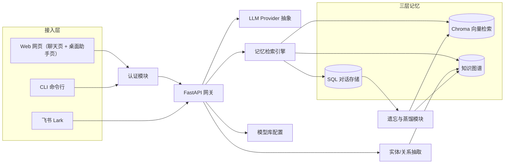
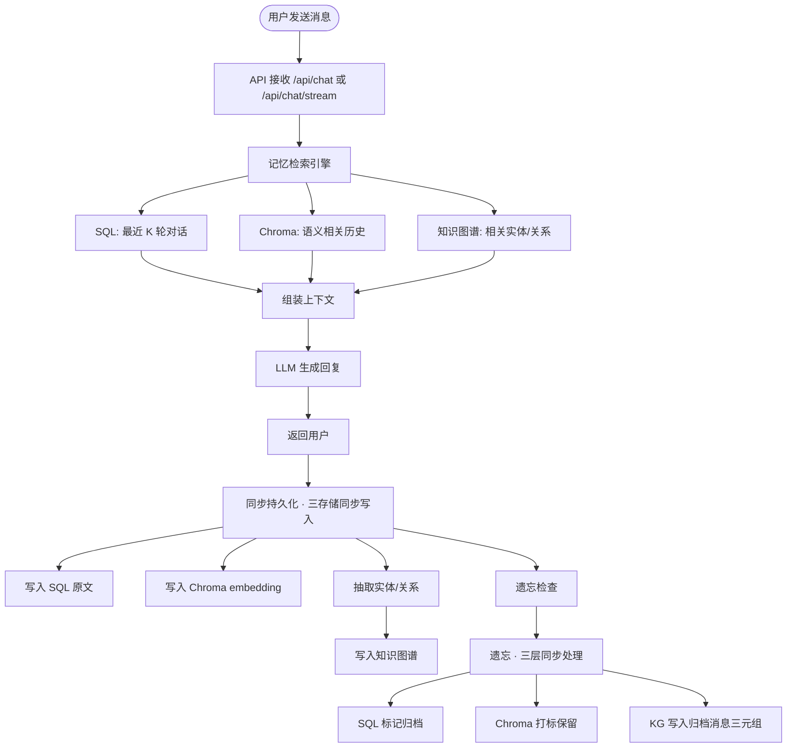
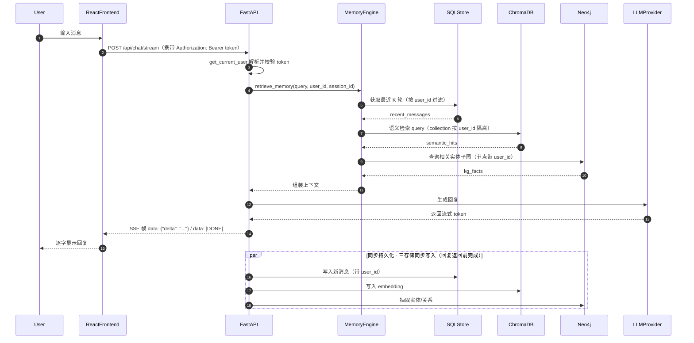
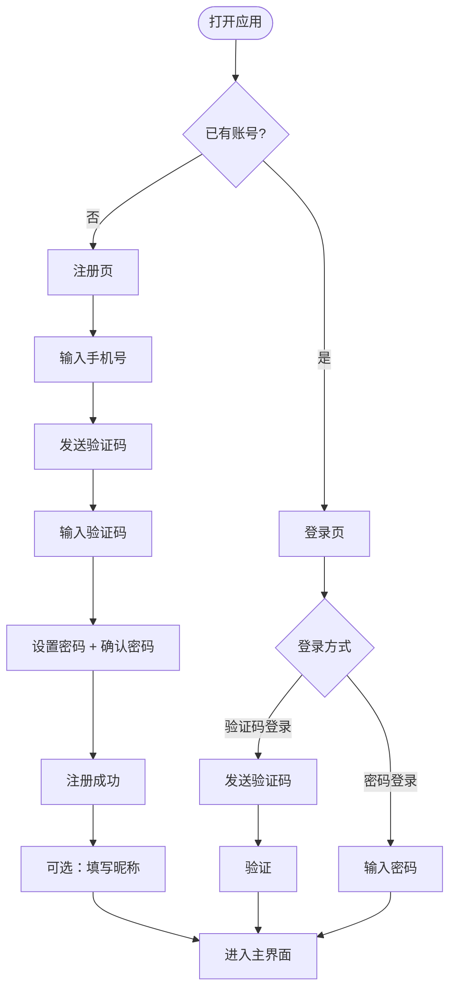
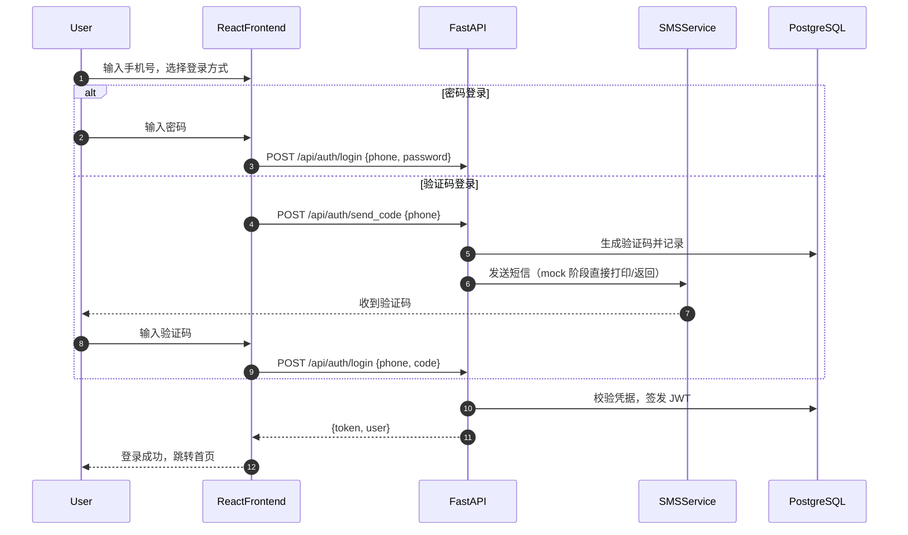

# 01_单Agent聊天助手项目初始计划详解

## 1. 目标

XIAONA 是一个**支持多用户的个人记忆型聊天机器人**。每个用户登录后都有自己的独立数据空间（对话、向量记忆、知识图谱全部按 `user_id` 隔离）。核心目标是：用户与它聊天时，机器人能够像人类朋友一样记住用户之前说过的话、认识的人、经历的事情，并在后续对话中自然调用这些记忆。

它不是一次性问答机器人，而是一个**有长期记忆、能遗忘、能蒸馏**的个人助手。

## 2. 核心功能

1. **用户认证**：手机号 + 验证码注册/登录，支持密码登录与验证码登录双模式。昵称选填，未填写则默认显示为 `用户{手机号}`。
2. **顶部导航栏**：登录后展示「聊天」「关系网」「桌面助手」「设置」四大入口（历史会话已并入聊天页左侧侧边栏，不再有独立 `/history` 页面）。
3. **三端接入**：支持 React 网页、飞书（Lark）、CLI 三种方式与机器人对话。网页端包含两个页面：**聊天页**（文字 + 语音转文字输入）与**桌面助手页**（实时语音对话）。
4. **三层记忆结构**：
   - SQL 存储原始对话记录（工作记忆）。
   - Chroma 向量数据库存储语义可检索的摘要（短期/长期语义记忆）。
   - 知识图谱存储结构化的人、事、关系、经历（长期图记忆）。
5. **可配置 LLM**：用户可在设置页维护「模型库」，为不同功能（聊天、记忆抽取、向量化）分别指定模型。
6. **记忆权重与遗忘**：常提的内容记得牢，不常提的内容逐渐淡化，并将原始记录的三元组结构化写入图谱（**特征蒸馏未接入**：原「蒸馏为高阶 Trait 特征」方案已废弃，见 03 §6 勘误）。
7. **语音输入**：支持语音转文字输入。
8. **桌面助手（网页端页面）**：网页内的实时语音对话页，打开即监听，关闭即停止，语音输入、语音回复。其实时语音通路复用后端 ASR/TTS/chat 接口，未来纯语音硬件可直接连通该通路接入（详见 `08_桌面助手详解.md`）。
9. **数据管理**：支持导出、备份、导入与隐私清理；删除数据需输入密码确认。

## 3. 系统架构



说明：接入端只有三端 —— **Web 网页、飞书、CLI**。「桌面助手」不是独立接入端，而是网页端内的一个页面（实时语音对话），通过后端语音接口走与聊天页相同的通路。

**三存储同步语义**：每条新消息持久化时，SQL（原文）、Chroma（embedding）、KG（抽取出的实体/关系）**同步写入**（在本次请求内完成，回复返回前三层均已落盘，保证后续检索能命中刚发的消息）；遗忘时三层**同步处理**——SQL 标记归档、Chroma 打标保留（供长期语义检索）、KG 写入归档消息抽取出的三元组（**不再蒸馏为 Trait 高阶特征**，该方案已废弃，见 03 §6 勘误）。`Extractor`（实体/关系抽取）只写入知识图谱（KG），Chroma 向量由持久化模块在写消息时写入，避免抽取器直接写两类存储造成职责混乱。`Web / CLI` 全部经认证模块鉴权，`Feishu` 走签名验证 + 服务端内部调用，无需用户 token。

## 4. 主要聊天流程



> 持久化在本次请求内**同步完成**（回复返回前三层已写入），保证下一次检索能命中刚发的消息。遗忘/蒸馏由后台定时任务触发，与持久化分开。

### 聊天时序图



接口约定：网页聊天页与桌面助手页均使用 `POST /api/chat/stream`（SSE 流式，帧格式见 §5.5），CLI 使用 `POST /api/chat`（非流式，返回 `{reply, session_id}`）；**飞书不走 HTTP**——在 `feishu.py` 内部直调 `agent_service.handle(...)`（先判任务意图/确认，未命中回落 `memory_engine.chat`，与 `/api/chat` 同一条链路，见 02 子项目群）。三者共用同一套记忆检索与持久化逻辑。

## 5. 统一约定总纲（数据模型 / API / 认证）

> 本总纲是全部文档（01~10）的一致性基准。各文档中的代码示例、接口路径、认证方式都以本节为准，实现时必须保持一致。

### 5.1 统一数据模型

XIAONA 是**多用户**系统，所有数据（会话、消息、向量、图谱、飞书映射）都带 `user_id` 隔离：

```python
# backend/app/db/sql_models.py（SQLAlchemy 统一模型，所有主键统一 String(36) uuid）
class User(Base):
    __tablename__ = "users"
    id = Column(String(36), primary_key=True)     # uuid
    phone = Column(String(128), unique=True, index=True)  # 手机号（2026-08-17 起不再创建 feishu_{open_id} 影子账号）
    password_hash = Column(String(256))
    nickname = Column(String(64), default="")             # 默认 f"用户{phone}"
    created_at = Column(DateTime, default=datetime.utcnow)
    last_active_at = Column(DateTime, default=datetime.utcnow, onupdate=datetime.utcnow)  # 最近活跃（飞书 webhook 每次消息刷新；2026-08-17 影子机制废弃后仅留作活跃统计）
    last_reminded_at = Column(DateTime, nullable=True)  # 原供影子账号绑定提醒限频（2026-08-17 影子机制废弃，列保留但不再写入）

class Session(Base):
    __tablename__ = "sessions"
    id = Column(String(36), primary_key=True)     # uuid
    user_id = Column(String(36), ForeignKey("users.id"), index=True)
    title = Column(String(128), default="新会话")
    source = Column(String(16), default="web")    # web / desktop / cli / feishu
    is_deleted = Column(Boolean, default=False)   # 软删除标记（2026-08-15 加，07 §9）
    created_at = Column(DateTime, default=datetime.utcnow)
    updated_at = Column(DateTime, default=datetime.utcnow, onupdate=datetime.utcnow)

class Message(Base):
    __tablename__ = "messages"
    id = Column(String(36), primary_key=True)     # uuid
    session_id = Column(String(36), ForeignKey("sessions.id"), index=True)
    user_id = Column(String(36), ForeignKey("users.id"), index=True)  # 便于跨会话过滤
    role = Column(String(16))                     # user / assistant
    content = Column(Text)
    source = Column(String(16), default="web")
    thinking = Column(Text, default="")           # 模型思考过程（DeepSeek reasoning_content，2026-08-15 加）
    attachments = Column(Text, default="")        # 附件元数据 JSON [{name,kind,size}]（12 §，2026-08-15 加）
    weight = Column(Float, default=0.5)
    importance = Column(Float, default=0.0)
    emotion_score = Column(Float, default=0.0)
    mention_count = Column(Integer, default=1)
    created_at = Column(DateTime, default=datetime.utcnow)
    last_mentioned_at = Column(DateTime, default=datetime.utcnow)
    is_archived = Column(Boolean, default=False)

class Model(Base):                               # 设置页模型库（2026-08-15 加，05 §11）
    __tablename__ = "models"
    id = Column(String(36), primary_key=True)    # uuid
    user_id = Column(String(36), ForeignKey("users.id"), index=True)
    name = Column(String(64))                    # 模型显示名
    provider = Column(String(16), default="openai")  # openai / ollama / claude ...
    base_url = Column(String(256), default="")
    api_key = Column(String(256), default="")
    model = Column(String(64), default="")       # 模型名
    temperature = Column(Float, default=0.7)
    max_tokens = Column(Integer, default=2048)
    capabilities = Column(String(128), default="chat")  # 逗号分隔：chat,extract,embedding（由 test_model 自动探测写回）
    created_at = Column(DateTime, default=datetime.utcnow)

class FunctionAssignment(Base):                  # 功能→模型分配（2026-08-15 加，05 §11）
    __tablename__ = "function_assignments"
    id = Column(String(36), primary_key=True)    # uuid
    user_id = Column(String(36), ForeignKey("users.id"), unique=True, index=True)
    chat_model_id = Column(String(36), default="")
    extract_model_id = Column(String(36), default="")
    embedding_model_id = Column(String(36), default="")
    executor_model_id = Column(String(36), default="")  # 多 Agent 执行者（02 子项目群，2026-08-17 加）
    reviewer_model_id = Column(String(36), default="")  # 多 Agent 审核者
    updated_at = Column(DateTime, default=datetime.utcnow, onupdate=datetime.utcnow)
```

- `02_长期记忆详解.md`、`07_会话历史记录详解.md` 的模型与本模型对齐。
- `09_数据管理详解.md` 的清理/导出/删除接口全部按 `user_id` 过滤。
- `10_飞书IM机器人接入详解.md` 通过 `feishu_user_map`（飞书 open_id ↔ user_id）关联到 `User`，并通过 `feishu_session_map`（feishu_user_id + chat_id + channel_type ↔ session_id）独立保存会话映射，避免群聊上下文串扰。

### 5.2 统一聊天 API 路径

| 接口 | 形态 | 用途 |
|------|------|------|
| `POST /api/chat/stream` | SSE 流式（multipart/form-data，files[] 上传附件） | 网页聊天页、桌面助手页 |
| `POST /api/chat` | 非流式 JSON，返回 `{reply, session_id}` | 仅 CLI 调用；飞书内部直调 `agent_service.handle`（不走 HTTP，见 §4） |

- 前端 `streamChat()`（`frontend/src/api/chat.js`）走 `POST /api/chat/stream`；`DesktopAssistant.jsx` 传 `source: 'desktop'`。
- 飞书消息处理在 `feishu.py` 内调用 `agent_service.handle(...)`（先判任务意图/确认，未命中回落 `memory_engine.chat`），与 `/api/chat` 非流式内部同一条链路。

`POST /api/chat` 与 `/api/chat/stream` 的请求体统一为：

```json
{
  "message": "你好，我叫小张",
  "session_id": "uuid",
  "source": "web"
}
```

- `source` 每个端显式传递：`web`（聊天页）、`desktop`（桌面助手页）、`cli`、`feishu`（飞书内部走 `agent_service.handle(..., source="feishu")` 回落 `memory_engine.chat`）。
- `user_id` 由 token 解析，客户端无需、也不允许自行指定。

### 5.3 统一聊天核心签名

所有端（网页、CLI、飞书）最终都调用同一聊天核心，签名统一为：

```python
# backend/app/core/memory_engine.py
async def chat(text: str, user_id: str, session_id: str, source: str,
               attachments: list[dict] | None = None) -> tuple[str, str]:
    """统一聊天入口：检索三层记忆 → LLM 生成 → 三存储同步持久化。

    - user_id: 记忆检索与持久化的隔离维度（必传）
    - session_id: 当前会话
    - source: web / desktop / cli / feishu
    - attachments: 附件解析结果（12 §），图片走多模态、文本类拼入 user 消息
    返回 (reply, 实际使用的 session_id)——ensure_session 可能新建会话（软删/无效时自愈）。
    """
```

- 非流式 `/api/chat` 先调 `agent_service.handle(...)`（命中 Agent 任务意图/确认时直接返回 reply，含 `task_started`），未命中才回落 `memory_engine.chat(...)` 并返回 `{reply, session_id}`（02 §5，2026-08-17 起）。
- 流式 `/api/chat/stream` 同样先过 `agent_service.handle(...)`，未命中回落 `memory_engine.chat_stream(...)`（同一套检索与持久化逻辑，仅回复以 SSE 帧输出）。

### 5.4 统一认证方式

- 前端 `api/client.js` 用 axios 拦截器统一附加 `Authorization: Bearer <token>`。
- 所有业务接口（聊天、会话、记忆、设置、语音、数据管理）都依赖 `get_current_user`，未登录返回 401。
- CLI 首次运行要求登录（验证码或密码，见 §5.4.1），token 存本地配置文件（如 `~/.xiaona/config.json`）。
- 飞书 webhook 不依赖用户 token（服务端内部走 `chat_core`），仅验证飞书签名。

#### 5.4.1 认证接口约定（Web / CLI 统一）

三端（Web、CLI、飞书服务端内部）使用同一套认证接口：

| 接口 | 方法 | 说明 |
|------|------|------|
| `/api/auth/send_code` | POST | 发送验证码，body `{phone}` |
| `/api/auth/login` | POST | 登录，body 二选一：`{phone, code}` 验证码登录 / `{phone, password}` 密码登录 → `{token, user}` |
| `/api/auth/register` | POST | 注册 `{phone, code, password, nickname?}` → `{token, user}`（密码必填） |
| `/api/auth/me` | GET | 校验 token，返回当前用户 |

约定：

- `login` 按 body 区分登录方式：带 `code` 走验证码、带 `password` 走密码，两者互斥。
- 未设置密码的用户只能用验证码登录；`register` 时密码必填。
- 注册成功后即登录态（返回 token）。

### 5.5 SSE 流式契约

`POST /api/chat/stream` 的响应体约定（前后端唯一契约，实现必须一致）：

```
HTTP/1.1 200 OK
Content-Type: text/event-stream
Cache-Control: no-cache
Connection: keep-alive

data: {"session_id": "uuid"}

data: {"delta": "你好", "thinking": "..."}

data: {"delta": "，我是"}

data: {"delta": "XIAONA"}

data: [DONE]

```

| 事件 | 帧格式 | 含义 |
|------|--------|------|
| 会话 | `data: {"session_id": "<id>"}\n\n` | 首帧回传实际 session_id（自愈新建/软删过滤后） |
| 增量 | `data: {"delta": "<片段>", "thinking": "<思考增量>"}\n\n` | 追加一个回复片段与思考过程片段，前端逐字显示 |
| 媒体回复 | `data: {"media_reply": "...", "code": "media_unsupported"}\n\n`（文件类型不支持，**无 thinking 键**）或 `data: {"media_reply": "...", "thinking": "...", "code": "media_not_supported"}\n\n`（模型不支持图片） | 以聊天式回复呈现 |
| 任务开始 | `data: {"task_started": {"task_id": "<id>", "session_id": "<id>"}}\n\n` | Agent 任务确认后多一帧（02 子项目群），前端 `onTaskStarted` 回调收到后每 2s 轮询 `GET /api/agent/tasks/{id}`，done/failed 停轮询并刷新消息 |
| 结束 | `data: [DONE]\n\n` | 流正常结束 |
| 错误 | `data: {"error": "<message>", "code": "<code>"}\n\n` | 流中途出错（如 `chat_model_not_configured`），前端停止并提示 |

约定：

- 请求头必须携带 `Accept: text/event-stream`；鉴权走 `Authorization: Bearer <token>`。
- `POST /api/chat/stream` 为 **multipart/form-data**（message/session_id/source 走 Form，files[] 走 File）。
- 媒体类帧 `data: {"media_reply": "...", "code": "media_unsupported|media_not_supported"}` 是聊天式回复（前端按正常气泡渲染，绝不上屏报错码）；`task_started` 帧仅在 Agent 任务确认后追加（`streamChat` 的 `onTaskStarted` 回调）。
- 错误帧后服务端应立即关闭连接。
- 前端用 `fetch` + `ReadableStream` 解析（`frontend/src/api/chat.js` 的 `streamChat`），切换会话/离开页面时用 `AbortController` 中止旧流。

### 5.6 健康探活端点

`06_一键启动详解.md` 的后端 Docker healthcheck 依赖 `GET /api/health`。该端点用于容器探活与运维检查，**无需认证**：

```python
# backend/app/api/health.py
from fastapi import APIRouter
from fastapi.responses import JSONResponse

router = APIRouter(tags=["health"])

@router.get("/api/health")
def health():
    """探活：只确认进程存活，不依赖外部存储（避免存储故障时容器被误判崩溃重启）。"""
    return JSONResponse({"status": "ok"})
```

> 说明：healthcheck 的目的是确认「容器还活着」，不应等待 DB/Chroma/Neo4j 全部就绪（那样容器会因存储抖动被反复重启）。数据库就绪性由 06 的 `depends_on: service_healthy` 保证。

## 6. 前端导航与认证流程

登录后，顶部导航栏包含四个入口：

| 入口 | 功能 |
|------|------|
| 聊天 | 与 LLM 进行文字/语音对话，可新建会话或继续历史会话（历史会话已并入页面左侧侧边栏，支持收起/删除） |
| 关系网 | 3D 力导向知识图谱，支持拖拽、旋转、缩放、点击看详情、删除节点 |
| 桌面助手 | 实时语音对话页，打开即监听，关闭即停止 |
| 设置 | 配置模型库、账号绑定（2026-08-17 起：展示已绑定的飞书身份列表，可解绑/改密，见 10 §5.1）、数据清空等 |

### 注册/登录流程



### 登录时序图



> 登录统一走单一 `POST /api/auth/login`，按 body 区分验证码（`code`）或密码（`password`），Web 与 CLI 共用（见 §5.4.1）。注册流程见上方「注册流程图」。CLI 侧登录流程见 `11_CLI客户端详解.md`。

## 7. 技术栈

| 层级 | 技术 |
|------|------|
| 后端 | Python 3.11 + FastAPI + Pydantic v2 + Uvicorn |
| 前端 | React 18 + Vite（纯 JavaScript） |
| 对话存储 | PostgreSQL（或 SQLite 快速启动） |
| 向量检索 | Chroma + 配置的 embedding 模型（`/v1/embeddings`，2026-08-23 起不再用 sentence-transformers） |
| 知识图谱 | Neo4j（推荐）或 KùzuDB（轻量单机） |
| LLM | 统一 Provider 抽象：OpenAI 兼容 / Ollama / Claude |
| 部署 | Docker Compose |

## 8. 项目目录结构

```
XIAONA/
├── backend/
│   ├── app/
│   │   ├── main.py                 # FastAPI 入口
│   │   ├── config.py               # 配置与设置模型
│   │   ├── dependencies.py         # 依赖注入（get_db 等）
│   │   ├── api/
│   │   │   ├── auth.py             # 手机号验证码 / 密码登录（get_current_user）
│   │   │   ├── chat.py             # 对话路由（/api/chat、/api/chat/stream）
│   │   │   ├── sessions.py         # 会话管理
│   │   │   ├── settings.py         # 模型库与系统设置
│   │   │   ├── memory.py           # 记忆/图谱查询
│   │   │   ├── voice.py            # ASR / TTS（需认证）
│   │   │   ├── data.py             # 导出 / 导入 / 清理（需密码确认）
│   │   │   ├── health.py           # 探活端点（§5.6，Docker healthcheck 依赖）
│   │   │   ├── agent.py            # 多 Agent 任务 API（02 子项目群：任务确认/状态/产物下载）
│   │   │   └── feishu.py           # 飞书回调（签名验证，内部调用 chat_core）
│   │   ├── core/
│   │   │   ├── llm_provider.py     # LLM 抽象
│   │   │   ├── memory_engine.py    # 记忆检索编排 + chat_core
│   │   │   ├── media_utils.py      # 多类型文件解析（detect_kind / parse_upload / unsupported_reply）
│   │   │   ├── audio_utils.py      # 音频转 16kHz WAV（convert_to_wav，ffmpeg 兜底）
│   │   │   ├── asr_provider.py     # 语音识别封装（OpenAI Whisper / faster-whisper）
│   │   │   ├── tts_provider.py     # 语音合成封装（edge-tts）
│   │   │   ├── forgetter.py        # 遗忘与蒸馏
│   │   │   ├── auth.py             # 认证核心（verify_password / verify_sms_code 等）
│   │   │   ├── feishu_client.py    # 飞书客户端（httpx + token 缓存）
│   │   │   ├── logger.py           # 日志
│   │   │   └── agent/              # 多 Agent 任务（02 子项目群）
│   │   │       ├── service.py      # 任务接入统一入口（handle）
│   │   │       ├── director.py     # 意图识别 / 确认判定
│   │   │       ├── workflow.py     # 任务状态机编排
│   │   │       ├── executor.py     # 执行者（工具调用循环）
│   │   │       ├── reviewer.py     # 审核者
│   │   │       └── tools/          # 工具白名单（registry / fetch_url / generate_excel）
│   │   ├── db/
│   │   │   ├── database.py         # SQLAlchemy engine/Base/SessionLocal
│   │   │   ├── sql_models.py       # SQLAlchemy 统一模型（User/Session/Message/FeishuUserMap/FeishuSessionMap/Model/FunctionAssignment/AgentTask/AgentRunLog）
│   │   │   ├── chroma_client.py    # Chroma 封装（collection 按 user_id 隔离）
│   │   │   ├── neo4j_client.py     # 图谱封装（节点/边带 user_id）
│   │   │   └── feishu_session_map.py # 飞书会话映射表
│   ├── scripts/
│   │   ├── backup.py               # 备份/导出脚本（详见 09_数据管理详解.md）
│   │   └── restore.py              # 全库恢复脚本（详见 09 数据管理详解 §7.1）
│   ├── docker-compose.yml
│   └── requirements.txt
├── cli/
│   ├── xiaona.py                   # CLI 入口（独立于 backend，token 存 ~/.xiaona/config.json）
│   └── requirements-cli.txt        # CLI 依赖（requests / sounddevice / soundfile / simpleaudio）
├── frontend/
│   ├── src/
│   │   ├── api/
│   │   │   ├── client.js           # axios 封装（token 拦截器）
│   │   │   ├── auth.js             # 认证 API
│   │   │   ├── chat.js             # 聊天 API（流式/非流式）
│   │   │   ├── sessions.js         # 会话 API
│   │   │   ├── memory.js           # 记忆/图谱 API
│   │   │   ├── settings.js         # 设置 API
│   │   │   ├── voice.js            # 语音 API
│   │   │   └── agent.js            # Agent 任务 API（列表/详情/产物下载/取消）
│   │   ├── pages/
│   │   │   ├── Login.jsx           # 登录页
│   │   │   ├── Register.jsx        # 注册页
│   │   │   ├── Chat.jsx            # 聊天页（含历史会话侧边栏）
│   │   │   ├── Graph.jsx           # 3D 关系网页
│   │   │   ├── DesktopAssistant.jsx # 实时语音对话页
│   │   │   └── Settings.jsx        # 设置页
│   │   ├── components/
│   │   │   ├── Navbar.jsx          # 顶部导航栏
│   │   │   ├── AuthRoute.jsx       # 登录保护路由
│   │   │   ├── Markdown.jsx        # Markdown 渲染（react-markdown）
│   │   │   ├── ThinkingBlock.jsx   # 思考过程折叠块
│   │   │   ├── ChatMessage.jsx     # 消息气泡
│   │   │   ├── ChatInput.jsx       # 输入框 + 语音按钮
│   │   │   ├── VoiceRecorder.jsx   # 语音输入
│   │   │   ├── Graph3D.jsx         # 3D 力导向图
│   │   │   ├── NodeDetail.jsx      # 节点详情弹窗
│   │   │   ├── ModelCard.jsx       # 模型库卡片
│   │   │   └── DeleteConfirm.jsx   # 删除密码确认弹窗
│   │   ├── hooks/
│   │   │   ├── useAuth.js          # 认证状态 hook
│   │   │   └── useModelStatus.js   # 模型配置状态 hook（chat_configured 等）
│   │   ├── contexts/
│   │   │   └── AuthContext.jsx     # 全局认证上下文
│   │   ├── utils/
│   │   │   ├── audio.js            # 音频转 16kHz WAV（blobToWav16k）
│   │   │   └── text.js             # 文本清洗（stripMarkdown / emoji 过滤）
│   │   └── App.jsx                # 路由入口
│   │   └── main.jsx               # React 挂载入口
│   ├── package.json
│   └── vite.config.js
└── 项目计划/
    └── 01_单Agent聊天助手/
        ├── 01_单Agent聊天助手项目初始计划详解.md
        ├── 02_长期记忆详解.md
        ├── 03_知识图谱详解.md
        └── ...
```

> 说明：「桌面助手」即网页端内的实时语音对话页（`DesktopAssistant.jsx`），不开发独立原生桌面程序。未来纯语音硬件可通过连通该页面的实时语音通路接入（复用后端 `voice.py` / `chat.py` 接口，详见 `08_桌面助手详解.md`）。

## 9. 如何查看文档中的 Mermaid 图表

本文档中的流程图、时序图、状态机使用 **Mermaid** 语法编写。Mermaid 代码在 Markdown 源码中显示为文本块，需要渲染后才能看到图形。

### 推荐方法：Cursor / VS Code 插件

1. 打开 Cursor 左侧扩展面板（Extensions）。
2. 搜索并安装插件：`Markdown Preview Mermaid Support`。
3. 打开任意 `.md` 文件，按 `Ctrl+Shift+V` 或点击右上角预览按钮。
4. 文档中的 Mermaid 图表会自动渲染为流程图、时序图等。

### 其他查看方式

- **在线渲染**：访问 https://mermaid.live/，把 ` ```mermaid ... ``` ` 中间那段代码复制进去，右侧实时显示图形。
- **GitHub**：把这些 `.md` 文件 push 到 GitHub 后，GitHub 会自动渲染 Mermaid 图。
- **本地 Markdown 工具**：Obsidian、Typora 等支持 Mermaid 的编辑器。

## 10. 与其他文档的关联

- **长期记忆机制**：详见 `02_长期记忆详解.md`
- **知识图谱设计**：详见 `03_知识图谱详解.md`
- **语音输入与识别**：详见 `04_语音输入与识别详解.md`
- **前端实现**：详见 `05_前端详解.md`
- **一键启动**：详见 `06_一键启动详解.md`
- **会话历史**：详见 `07_会话历史记录详解.md`
- **桌面助手**：详见 `08_桌面助手详解.md`
- **数据管理**：详见 `09_数据管理详解.md`
- **飞书机器人**：详见 `10_飞书IM机器人接入详解.md`
- **CLI 客户端**：详见 `11_CLI客户端详解.md`
