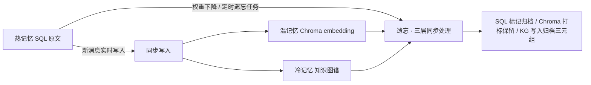
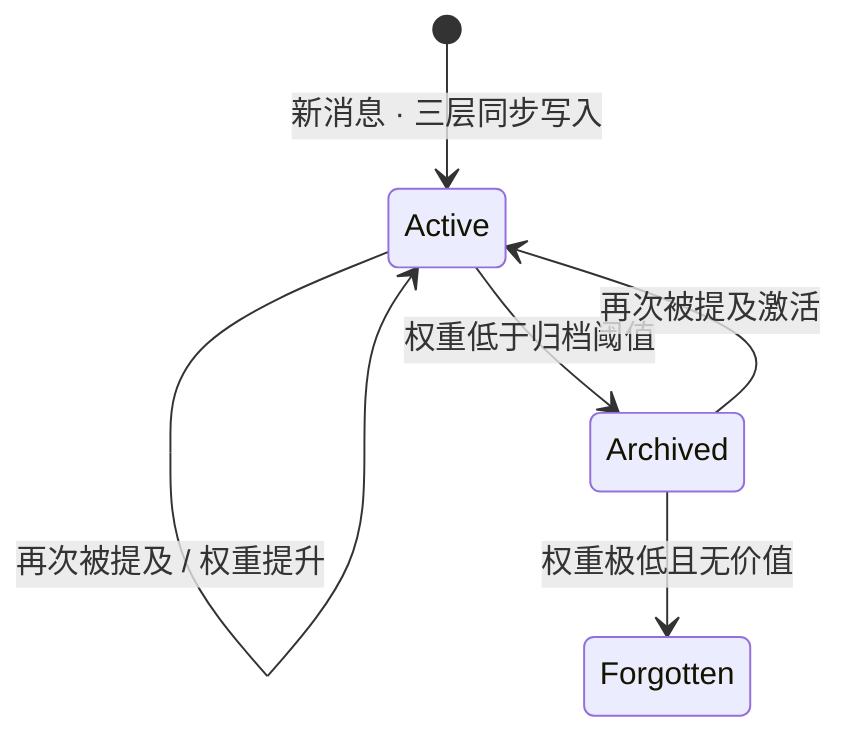
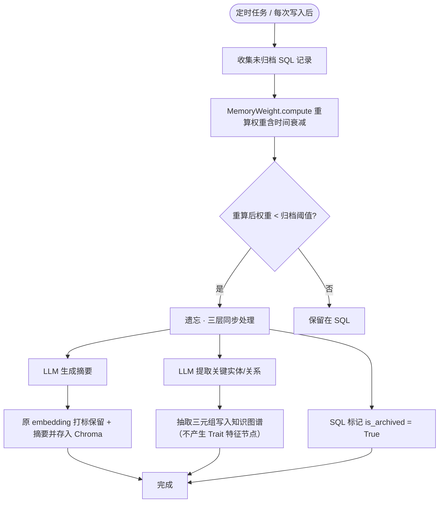
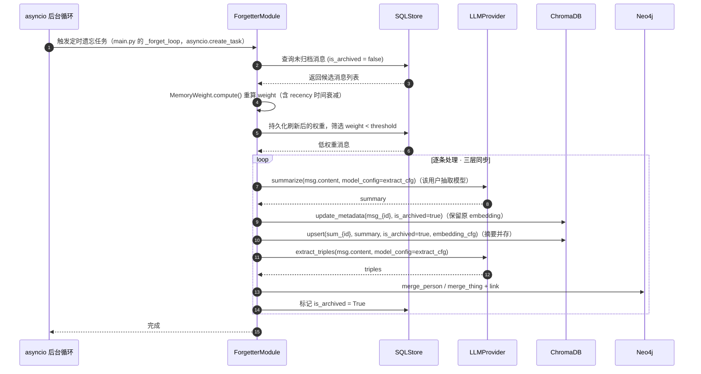
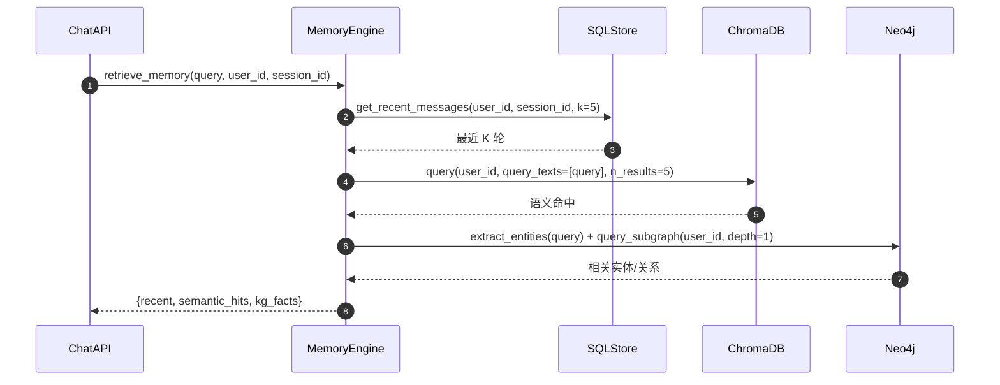

# 02_长期记忆详解

## 1. 目标

长期记忆系统的目标是：让机器人像人类一样记住用户说过的话，但**不是无限记忆**——重要的事情记得更牢，不重要或不常提及的事情逐渐淡化，最终归档并把抽取出的结构化三元组写入知识图谱。

本系统采用“三层记忆 + 遗忘归档”模型，三存储**同步写入、同步遗忘**：
- **热记忆层**：SQL 中保存每条原始对话（工作记忆）。
- **温记忆层**：Chroma 中保存同一消息的 embedding，支持语义模糊检索。
- **冷记忆层**：知识图谱中保存从对话抽取的结构化的人、事、关系（详见 `03_知识图谱详解.md`）。

新消息产生时三层同步写入；遗忘时三层同步处理：SQL 标记归档、Chroma 打标保留、KG 写入归档消息抽取出的三元组。

## 2. 记忆权重模型

每条记忆单元（一条消息或一个事件）都有一个权重分 `weight`，取值 `[0, 1]`。权重由四个维度共同决定：

```
weight = α * recency + β * frequency + γ * importance + δ * emotion
```

- **recency**：时间衰减，越近越高。按秒差折算天数计算：`e^(-λ * (now - last_mentioned_at).total_seconds() / 86400)`（实现见 §5，不再取整到天）。
- **frequency**：用户重复提及次数，每提一次加分。
- **importance**：消息重要度。实际实现为启发式（消息长度/是否含实体等），非 LLM 判断（2026-08-16 勘误：早期计划曾写"LLM 判断"，已按实现修正）。
- **emotion**：用户情绪强度（感叹号、强调词、明确表达喜怒哀乐等）。

参数 `α + β + γ + δ = 1`，可在 `config.py` 中配置。

## 3. 记忆生命周期



> **三存储同步语义**：每条新消息产生时，SQL（原文）、Chroma（embedding）、KG（抽取出的实体/关系）**同步写入**；遗忘时三层**同步处理**，而非「数据从 SQL 流向 Chroma 再流向 KG」。遗忘后：SQL 标记 `is_archived`、Chroma 原 embedding 打标保留 + 摘要并存（供长期语义检索）、KG 写入归档消息抽取出的三元组（**不产生 Trait 高阶特征节点**，该方案已废弃，见 `03_知识图谱详解.md` §6 勘误）。

### 记忆状态机



### 示例

用户说：
> "我和张先生去看了恐怖片。"

1. 初始：该消息产生时，SQL（原文）、Chroma（embedding）、KG（抽取出的“用户—KNOWS—张先生”“张先生—LIKES—恐怖片”等）**同步写入**。
2. 如果用户反复提到：权重维持高位，一直保留为活跃记忆。
3. 如果一个月没再提：权重下降，触发遗忘流程（三层同步处理）：
   - SQL 将原始对话标记 `is_archived = True`。
   - 生成摘要并存于 Chroma：原消息 embedding（`msg_{id}`）打标 `is_archived = True` 保留，新增摘要 embedding（`sum_{id}`，内容如 `用户曾和张先生一起观看恐怖片。`）同样标记为归档来源。
   - 同时把归档消息抽取出的三元组写入知识图谱：`张先生—LIKES—恐怖片` 等（详见 `03_知识图谱详解.md`，注意是三元组边写入、**非** Trait 特征节点）。
4. 后续用户提到“张先生”时，机器人可以从知识图谱中检索出 `张先生喜欢恐怖片`，也可从 Chroma 语义检索到原消息与归档摘要（合并结果见 §7）。

## 4. SQL 数据模型

本模型与 `01_单Agent聊天助手项目初始计划详解.md` 的「统一约定总纲」完全对齐：多用户、带 `user_id` 隔离。

```python
# backend/app/db/sql_models.py
from sqlalchemy import Column, String, DateTime, Float, Integer, ForeignKey, Text, Boolean
from sqlalchemy.orm import declarative_base, relationship
from datetime import datetime

Base = declarative_base()

class User(Base):
    __tablename__ = "users"
    id = Column(String(36), primary_key=True)  # uuid
    phone = Column(String(128), unique=True, index=True)  # 手机号（2026-08-17 起不再创建 feishu_{open_id} 影子账号）
    password_hash = Column(String(256))
    nickname = Column(String(64), default="")  # 默认 f"用户{phone}"
    created_at = Column(DateTime, default=datetime.utcnow)
    last_active_at = Column(DateTime, default=datetime.utcnow, onupdate=datetime.utcnow)  # 最近活跃（飞书 webhook 每次消息刷新；2026-08-17 影子机制废弃后仅留作活跃统计）
    last_reminded_at = Column(DateTime, nullable=True)  # 原供影子账号绑定提醒限频（2026-08-17 影子机制废弃，列保留但不再写入）

class Session(Base):
    __tablename__ = "sessions"
    id = Column(String(36), primary_key=True)  # uuid
    user_id = Column(String(36), ForeignKey("users.id"), index=True)
    title = Column(String(128), default="新会话")
    source = Column(String(16), default="web")  # web / desktop / cli / feishu
    is_deleted = Column(Boolean, default=False)  # 软删除标记（07 §9，2026-08-15 加）
    created_at = Column(DateTime, default=datetime.utcnow)
    updated_at = Column(DateTime, default=datetime.utcnow, onupdate=datetime.utcnow)
    messages = relationship("Message", back_populates="session",
                            order_by=lambda: (Message.created_at, Message.id))

class Message(Base):
    __tablename__ = "messages"
    id = Column(String(36), primary_key=True)  # uuid
    session_id = Column(String(36), ForeignKey("sessions.id"), index=True)
    user_id = Column(String(36), ForeignKey("users.id"), index=True)  # 便于跨会话过滤
    role = Column(String(16))            # user / assistant
    content = Column(Text)
    source = Column(String(16), default="web")
    thinking = Column(Text, default="")  # 模型思考过程（12 §，2026-08-15 加）
    attachments = Column(Text, default="")  # 附件元数据 JSON（12 §，2026-08-15 加）
    weight = Column(Float, default=0.5)  # 记忆权重
    importance = Column(Float, default=0.0)
    emotion_score = Column(Float, default=0.0)
    mention_count = Column(Integer, default=1)
    created_at = Column(DateTime, default=datetime.utcnow)
    last_mentioned_at = Column(DateTime, default=datetime.utcnow)
    is_archived = Column(Boolean, default=False)  # False=热记忆 True=已归档
    session = relationship("Session", back_populates="messages")
```

> 注意：`id` 统一使用 `String(36)`（uuid），避免不同模块间类型不一致。
> `Session.messages` 的 `order_by` 必须用 **lambda 返回列元组**（`lambda: (Message.created_at, Message.id)`）。SQLAlchemy 2.0 不接受字符串列表（`order_by=["Message.created_at", ...]`），否则首次 ORM 查询时 mapper configure 崩溃、login/register 全 500（见当天台账二十四）。

## 5. 权重计算函数

```python
# backend/app/core/forgetter.py
import math
from datetime import datetime
from app.config import MEMORY_LAMBDA, WEIGHT_ALPHA, WEIGHT_BETA, WEIGHT_GAMMA, WEIGHT_DELTA

class MemoryWeight:
    def __init__(self, lambda_decay=None, alpha=None, beta=None, gamma=None, delta=None):
        # 默认值从 config 读取（MEMORY_LAMBDA=0.05 / WEIGHT_ALPHA=0.3 / WEIGHT_BETA=0.3 /
        # WEIGHT_GAMMA=0.25 / WEIGHT_DELTA=0.15），传参可覆盖
        self.lambda_decay = lambda_decay if lambda_decay is not None else MEMORY_LAMBDA
        self.alpha = alpha if alpha is not None else WEIGHT_ALPHA
        self.beta = beta if beta is not None else WEIGHT_BETA
        self.gamma = gamma if gamma is not None else WEIGHT_GAMMA
        self.delta = delta if delta is not None else WEIGHT_DELTA

    def recency(self, last_mentioned_at: datetime) -> float:
        seconds = max(0.0, (datetime.utcnow() - last_mentioned_at).total_seconds())
        return math.exp(-self.lambda_decay * seconds / 86400.0)  # 以天为单位衰减

    def frequency(self, mention_count: int) -> float:
        # 封顶在 1.0
        return min(1.0, mention_count / 10.0)

    def compute(self, msg) -> float:
        r = self.recency(msg.last_mentioned_at)
        f = self.frequency(msg.mention_count)
        i = msg.importance or 0.0
        e = msg.emotion_score or 0.0
        return (
            self.alpha * r +
            self.beta * f +
            self.gamma * i +
            self.delta * e
        )
```

## 6. 遗忘与蒸馏流程



### 遗忘蒸馏时序图



### 关键代码片段

```python
# backend/app/core/forgetter.py
# 依赖：logger 来自 logging.getLogger(__name__)；
#       ARCHIVE_THRESHOLD 来自 app.config；Message 来自 app.db.sql_models
import asyncio
import logging

logger = logging.getLogger(__name__)


async def process_forgetting(db_session, chroma, kg_client, llm):
    threshold = ARCHIVE_THRESHOLD  # 例如 0.25

    # 先重算权重：weight 平时只由 mention_message 在被提及时 +0.15 加分，
    # 若不经 MemoryWeight.compute()（含 recency 时间衰减）刷新，消息权重永远不会
    # 随自然时间下降，遗忘/蒸馏流程对普通消息实际不触发。
    # 全库遍历 + commit 为同步阻塞 SQL，且 hourly 运行 → 整体下沉 asyncio.to_thread，
    # 线程内完成读写并返回纯 dict（id/user_id/content），避免跨线程访问 ORM 对象
    #（commit 后属性过期会触发 reload 同步查询，见当天台账二十七）。
    def _scan_and_weight():
        weight_calc = MemoryWeight()
        candidates = db_session.query(Message).filter(
            Message.is_archived.is_(False)
        ).all()
        low = []
        for msg in candidates:
            msg.weight = weight_calc.compute(msg)  # 用 last_mentioned_at 做指数衰减
            if msg.weight < threshold:
                low.append({"id": msg.id, "user_id": msg.user_id, "content": msg.content})
        db_session.commit()  # 先持久化刷新后的权重（即便本次无归档也会衰减生效）
        return low

    low_weight_msgs = await asyncio.to_thread(_scan_and_weight)

    # 每个用户用其配置的向量化模型生成摘要向量；摘要/三元组抽取用其「记忆抽取模型」
    #（未配置对应模型时 cfgs 为 None，upsert 跳过向量写入、summarize/extract 走 env 默认）
    from app.core.memory_engine import _model_configs
    embedding_cfgs: dict = {}
    extract_cfgs: dict = {}
    for uid in {m["user_id"] for m in low_weight_msgs}:
        cfgs = _model_configs(db_session, uid)
        embedding_cfgs[uid] = cfgs["embedding"]
        extract_cfgs[uid] = cfgs["extract"]

    # 三层同步处理：SQL 标记归档 + Chroma 并存归档（原 embedding 打标保留 + 摘要新增）+ KG 写入归档三元组。
    # 「并存」策略（C3 已确认）：
    #   - 原消息 embedding（id=msg_{id}）打标 is_archived=true 保留，不覆盖、不删除；
    #   - 新增摘要 embedding（id=sum_{id}），metadata 含 original_id / is_archived=true；
    #   - 两者共存，检索时按需合并（见 §7）。
    # 幂等性：
    #   - msg_{id} 打标是「覆盖同一 id 的 metadata」，重试安全；
    #   - sum_{id} 是固定 id 的 upsert，重试覆盖而非追加；
    #   - KG 的 merge_person / merge_thing / link 是「存在即返回，不存在才创建」的幂等操作。
    # 因此中途失败重试不会产生重复摘要/三元组。
    try:
        archived_ids = []
        for msg in low_weight_msgs:
            # 摘要与三元组抽取必须用该用户配置的「记忆抽取模型」（2026-08-24 起）：
            # extract_cfgs 来自 _model_configs(db, uid)["extract"]，未配置走 env 默认；
            # 本地 Ollama 用户（key 空）若漏传会退化成 text[:50] 截断/三元组恒空。
            extract_cfg = extract_cfgs.get(msg["user_id"])

            # 1. 生成摘要（LLM 调用本身是 async，无需 to_thread）
            summary = await llm.summarize(msg["content"], model_config=extract_cfg)

            # 1a. 原消息 embedding 打标 is_archived=true（保留原向量，供长期语义检索）
            #     chroma.upsert 是同步阻塞调用 → asyncio.to_thread 包裹避免卡事件循环。
            await asyncio.to_thread(
                chroma.update_metadata,
                ids=[f"msg_{msg['id']}"],
                metadatas=[{
                    "user_id": msg["user_id"],          # 向量按用户隔离
                    "source": "sql_archive",
                    "original_id": msg["id"],
                    "is_archived": True,                # 打标：保留但标记为归档来源
                }]
            )

            # 1b. 新增摘要 embedding（并存，id=sum_{id}）
            await asyncio.to_thread(
                chroma.upsert,
                ids=[f"sum_{msg['id']}"],
                documents=[summary],
                metadatas=[{
                    "user_id": msg["user_id"],
                    "source": "sql_archive_summary",
                    "original_id": msg["id"],
                    "is_archived": True,
                }],
                embedding_cfg=embedding_cfgs.get(msg["user_id"]),  # 向量由该用户配置的向量化模型生成
            )

            # 2. 蒸馏到知识图谱（带上 user_id；merge 幂等）。
            #    主语统一按 Person 处理（用户/人物），宾语按 Thing；KNOWS 时宾语也视为人物。
            #    merge_person / merge_thing / link 走 Neo4j 网络 I/O 是同步阻塞 → to_thread 包裹
            #    （实际实现见 neo4j_client.py，无 merge_triple 方法，2026-08-16 勘误）
            triples = await llm.extract_triples(msg["content"], model_config=extract_cfg)
            for sub, pred, obj in triples:
                sub_id = await asyncio.to_thread(kg_client.merge_person, sub, user_id=msg["user_id"])
                if pred == "KNOWS":
                    obj_id = await asyncio.to_thread(kg_client.merge_person, obj, user_id=msg["user_id"])
                else:
                    obj_id = await asyncio.to_thread(kg_client.merge_thing, obj, user_id=msg["user_id"])
                await asyncio.to_thread(kg_client.link, sub_id, pred, obj_id, user_id=msg["user_id"])

            # 3. 三层都成功后记录归档 id（不逐条 commit，最后统一批量标记）
            archived_ids.append(msg["id"])

        # 归档标记用批量 id.in_() update（synchronize_session=False），commit 同样下沉线程池
        def _mark_archived():
            db_session.query(Message).filter(Message.id.in_(archived_ids)).update(
                {Message.is_archived: True}, synchronize_session=False
            )
            db_session.commit()

        await asyncio.to_thread(_mark_archived)
    except Exception as e:
        db_session.rollback()
        # Chroma / KG 因幂等 upsert 不会重复；已归档的 SQL 记录重试时会被过滤掉。
        logger.error(f"forgetting failed, rollback: {e}")
        raise
```

### 再次被提及时的权重更新

当用户在后续对话中再次提到某条历史消息涉及的内容时，应当**提升其权重并刷新 `last_mentioned_at`**，避免被遗忘流程误归档。

> **调用时机**：`mention_message` 在「聊天持久化」阶段被调用——`chat()` 中先执行 `retrieve_memory`，对检索命中的历史消息（**Chroma 命中的原消息**，`_mention_hits` 仅遍历 `semantic_hits.metadatas`，SQL 最近消息不参与权重刷新）逐条调用 `mention_message` 刷新权重，再写入新消息。这样「再次被提及 → 权重上升 → 延缓遗忘」才能在正常对话中生效。

```python
# backend/app/core/memory_engine.py
def mention_message(db_session, msg, now=None):
    """再次被提及时刷新记忆。"""
    now = now or datetime.utcnow()
    msg.mention_count += 1
    msg.last_mentioned_at = now
    msg.weight = min(1.0, msg.weight + 0.15)  # 提升权重，延缓遗忘
    db_session.add(msg)
```

## 7. 记忆检索流程

当用户发送新消息时，记忆检索引擎会同时查询三层记忆：

```python
# backend/app/core/memory_engine.py
import asyncio


def _flatten_chroma(raw) -> list:
    """把 Chroma query() 返回的嵌套结构展平为一层 list，并过滤 None。

    Chroma 的 query(include=["documents","metadatas","distances"]) 返回的每个键都是
    「每 query_text 一个内层 list」的嵌套结构（query_texts=[query] 时仅 1 个内层 list），
    例如 metadatas = [[{...}, {...}]]。消费方若不展平，遍历会拿到内层 list，
    对其调 .get() 会抛 "'list' object has no attribute 'get'"（见当天台账七）。
    """
    if not raw:
        return []
    first = raw[0] if isinstance(raw, list) else raw
    if not isinstance(first, list):
        first = [first]
    return [x for x in first if x is not None]


async def retrieve_memory(query: str, user_id: str, session_id: str, top_k=5,
                          embedding_cfg: dict | None = None,
                          extract_enabled: bool = True,
                          extract_cfg: dict | None = None,
                          exclude_ids: set[str] | None = None):
    """按 user_id 隔离检索三层记忆。

    - embedding_cfg=None：跳过 Chroma 语义检索（未配置向量化模型，或服务故障降级）。
    - extract_enabled=False：跳过 KG 子图检索（未配置记忆抽取模型）。
    - extract_cfg：设置页分配的记忆抽取模型配置（配置后实体提取用该模型）。
    - exclude_ids：排除的消息 id（2026-08-24 起，当前消息先行落库后排除自身，
      避免 recent 与 Chroma 检索把「刚刚说的这句话」重复注入 LLM 上下文）。
    """
    # 1. SQL 最近 K 轮（限定当前用户 + 当前会话，排除当前消息）
    #    SQLAlchemy 同步查询同样是阻塞 I/O → to_thread 包裹，与下方 Chroma/KG 检索保持一致
    recent = await asyncio.to_thread(
        sql.get_recent_messages, user_id=user_id, session_id=session_id, k=5,
        exclude_ids=exclude_ids,
    )

    # 2. Chroma 语义检索（collection 按 user_id 隔离；2026-08-23 起按 embedding_cfg 门控）
    #    chroma.query 是同步阻塞调用（Chroma 客户端为同步 API）→ to_thread 包裹避免卡事件循环；
    #    未配置向量化或 Chroma/embedding 不可用时降级为无命中，不阻断聊天（2026-08-15 起）。
    #    向量由设置页分配的 embedding 模型生成（chroma._embeddings 调 {base_url}/v1/embeddings）。
    if embedding_cfg:
        try:
            vector_results = await asyncio.to_thread(
                chroma.query, user_id=user_id, query_texts=[query], n_results=top_k,
                embedding_cfg=embedding_cfg,
            )
        except Exception:
            logger.warning("chroma query failed, degraded to no semantic hits", exc_info=True)
            vector_results = {}
    else:
        vector_results = {}
    # Chroma query() 返回嵌套结构（每个 query_text 一个内层 list），消费前必须经
    # _flatten_chroma 展平（取内层 list + 过滤 None）——把外层当扁平 list 遍历会拿内层
    # list 调 .get() 抛 "'list' object has no attribute 'get'"，整条 chat_stream 中断。
    vector_results = {
        "documents": _flatten_chroma(vector_results.get("documents")),
        "metadatas": _flatten_chroma(vector_results.get("metadatas")),
        "distances": _flatten_chroma(vector_results.get("distances")),
    }
    for hit in vector_results["metadatas"]:
        hit["is_archived"] = hit.get("is_archived", False)
    # 排除当前消息自身的向量命中（用户消息先行落库会刚 upsert 自己，
    # 语义检索可能命中自己，把「刚刚说的这句话」当作相关记忆再次注入）
    if exclude_ids and vector_results["metadatas"]:
        kept = [
            (doc, meta, dist)
            for doc, meta, dist in zip(
                vector_results["documents"], vector_results["metadatas"],
                vector_results["distances"],
            )
            if meta.get("original_id") not in exclude_ids
        ]
        vector_results["documents"] = [k[0] for k in kept]
        vector_results["metadatas"] = [k[1] for k in kept]
        vector_results["distances"] = [k[2] for k in kept]
    for hit in vector_results["metadatas"]:
        hit["is_archived"] = hit.get("is_archived", False)

    # 3. 知识图谱子图（节点/边带 user_id；2026-08-15 起按 extract_enabled 门控）
    #    extract_entities_from_text / query_subgraph 均为同步阻塞调用 → 同样包 to_thread；
    #    KG 子图检索（kg.query_subgraph）异常降级日志告警，绝不阻断聊天主流程。
    if extract_enabled:
        try:
            entities = await llm.extract_entities_from_text(query, model_config=extract_cfg)
            kg_results = await asyncio.to_thread(
                kg.query_subgraph, user_id=user_id, entity_names=entities, depth=1,
            )
        except Exception:
            logger.warning("kg query failed, degraded to no kg facts", exc_info=True)
            kg_results = []
    else:
        kg_results = []

    return {
        "recent_messages": recent,
        "semantic_hits": vector_results,
        "kg_facts": kg_results
    }
```

### 记忆检索时序图



> 注：实际实现为**顺序 await**（SQL → Chroma → 实体抽取+KG），非并行查询（2026-08-19 核对）。

## 8. 三模型门控约定（2026-08-15 起）

**对话模型必须、提炼/向量化可选**（配合 `05 §11` 设置页分配）：

| 未配置项 | 检索阶段 | 持久化阶段 |
| --- | --- | --- |
| 对话模型（`chat_model_id`） | `chat` / `chat_stream` 开头抛 `ChatModelNotConfigured`，前端引导到设置页 | — |
| 记忆抽取模型（`extract_model_id`） | `retrieve_memory` 跳过 KG 子图检索 | `_persist_reply` 跳过三元组抽取与 KG 写入 |
| 向量化模型（`embedding_model_id`） | `retrieve_memory` 跳过 Chroma query | `save_chat_message(embedding_cfg=None)` 跳过 upsert |

- 配置提炼模型后，`llm.extract_triples` / `llm.extract_entities_from_text` 使用该模型（新增 `model_config` 参数）；未配置走 env 默认抽取模型。
- **向量由设置页分配的向量化模型生成（2026-08-23 起）**：`chroma_client._embeddings` 调 `{base_url}/v1/embeddings`（OpenAI 兼容，Ollama bge-m3 / 云端均可）；**不再硬编码 sentence-transformers**——此前 `SentenceTransformer(EMBEDDING_MODEL)` 初始化强制联网 huggingface.co 校验，网络不通反复 MaxRetryError 导致每次写消息/查记忆卡死（见当天台账）。配置的向量化模型真正用于向量生成，而非只当「开关」。
- **Chroma/embedding/KG 任何异常都降级日志告警，绝不阻断聊天主流程**（2026-08-15 曾因容器内 huggingface 拉 embedding 失败中断整个 chat_stream，见当天台账二十六）。
- 旧 collection 向量维度（384 维）与新模型（bge-m3 为 1024 维）不一致时，`chroma.upsert/query` 捕获维度异常后自动 `delete_collection` 重建，向量随后续对话重建，SQL 主数据不受影响。
- `_persist_user`（LLM 前执行）与 `_persist_reply`（流后 finally）拆分后，用户消息永不因 LLM 失败丢失。

## 9. 技术栈

- SQLAlchemy + PostgreSQL / SQLite
- Chroma 向量库；向量由设置页分配的 embedding 模型经 `/v1/embeddings` 生成（不再依赖 sentence-transformers，2026-08-23 起）
- 定时遗忘任务：`main.py` 的 asyncio 后台循环 `_forget_loop`（`FORGET_INTERVAL_MINUTES`，非 APScheduler/Celery，2026-08-16 勘误）
- LLM 用于摘要、实体抽取（importance 为启发式，非 LLM 判断）

## 10. 关联文档

- 总体架构：`01_单Agent聊天助手项目初始计划详解.md`
- 知识图谱蒸馏细节：`03_知识图谱详解.md`
- 数据导出与归档：`09_数据管理详解.md`
