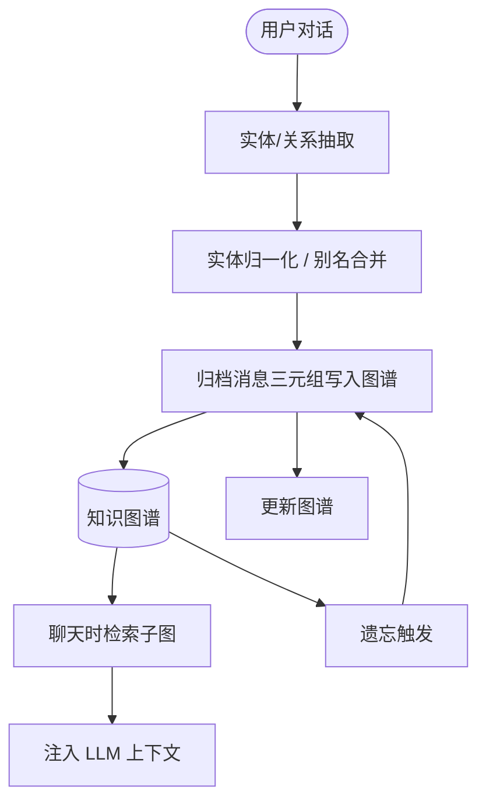
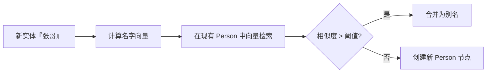
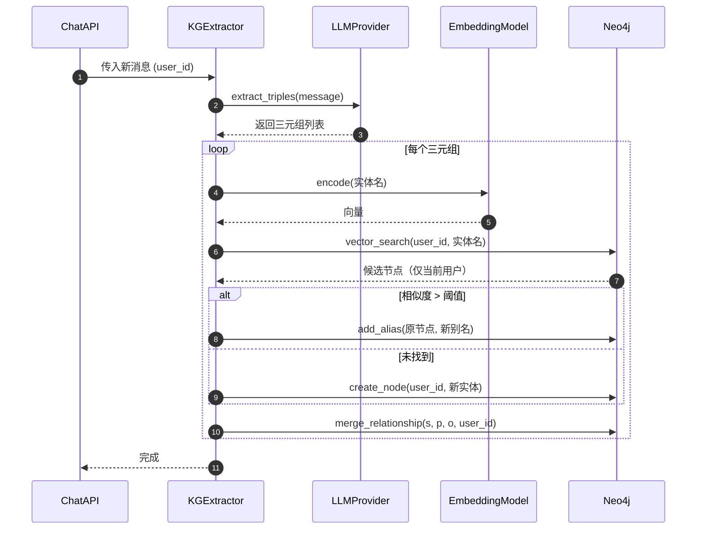
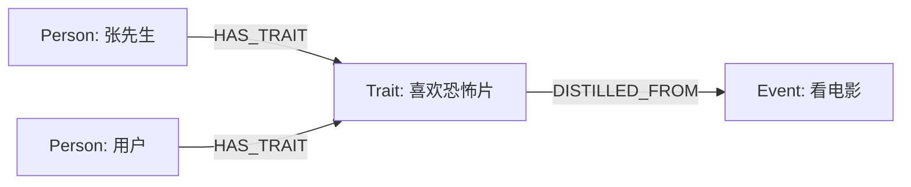
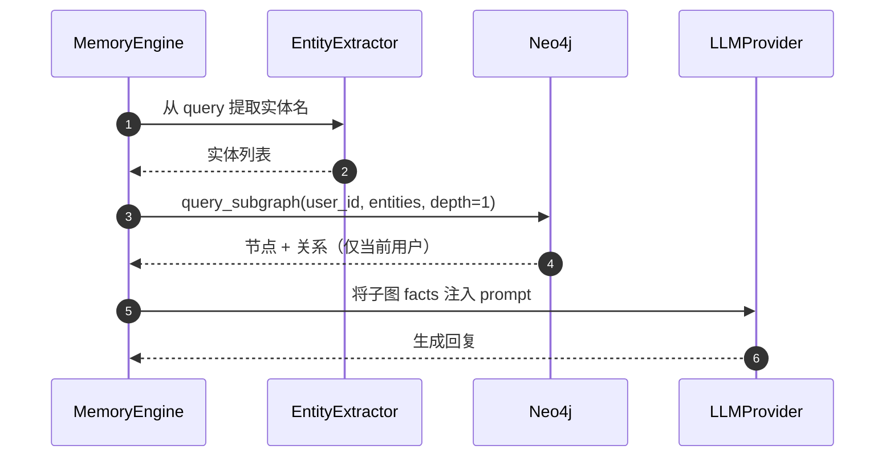

# 03_知识图谱详解

## 1. 目标

知识图谱负责把用户聊天中的**结构化信息**长期保存下来：认识的人、做过的事、去过的地点、兴趣爱好、人物特征等。

它不同于 Chroma 的“语义模糊记忆”，而是**精确的关系网络**。例如：
- 张先生 → `喜欢` → 恐怖片
- 用户 → `去过` → 青岛
- 用户 → `工作于` → 某公司

核心能力：
- 从非结构化对话中抽取实体与关系。
- 对实体去重与别名合并（如“张先生 / 老张 / 张哥”指同一人）。
- 对过期事件进行遗忘处理，把归档消息中抽取出的三元组写入图谱（2026-08-16 起：不再"蒸馏为人物长期特征"，不产生 Trait 特征节点）。
- 在聊天时根据当前问题检索相关子图，作为 LLM 上下文。

## 2. 图谱 Schema

> 所有节点与关系都带公共属性 `user_id`（多用户隔离）。下方表格中省略该属性，实现时必须保留。

### 节点类型（Node Labels）

| Label | 含义 | 示例属性 |
|-------|------|----------|
| Person | 人物 | name, aliases, summary, importance, **is_self** |
| Event | 事件 | title, date, description, weight |
| Place | 地点 | name, aliases |
| Thing | 物品/概念 | name, category |
| Trait | 特征/偏好 | name, value_type |
| Topic | 话题 | name |

> **自我节点（2026-08-15 起）**：每个用户注册时即创建一个 `Person` 节点并标记 `is_self: True`，作为用户在图谱中的身份锚点。名称 = 昵称（未设置昵称时为「用户+手机号」）。它保证新用户图谱至少有 1 个节点，且后续「用户 → 认识/喜欢/去过...」的关系都从该节点出发。

## 2.5 自我节点

### 幂等创建

`ensure_self_node` 按 `user_id + is_self=true` 幂等 MERGE，每个用户至多一个自我节点；昵称变更后下次调用自动更新 `name`（普通实体 Person 不受影响）：

```python
# backend/app/db/neo4j_client.py
# 2026-08-15：Neo4j 5 中 Cypher 取节点 id 必须用 elementId(p) 函数——
# 属性语法 p.element_id 返回 NULL（UnknownPropertyKeyWarning），会让 merge 拿不到 id、边建不出来。
def ensure_self_node(self, user_id: str, name: str) -> str:
    """用户自我节点：注册即建、按 user_id 幂等。"""
    q = (
        "MERGE (p:Person {user_id: $user_id, is_self: true}) "
        "ON CREATE SET p.name = $name, p.aliases = [$name] "
        "ON MATCH SET p.name = $name "
        "RETURN elementId(p) AS id"
    )
    return self.run(q, user_id=user_id, name=name)[0]["id"]
```

> **`get_or_create_self_node` 与 `ensure_self_node` 是两个函数（2026-08-28 补充说明）**：
> - `ensure_self_node(user_id, name)`：**建/更新节点名称**——`MERGE ... ON MATCH SET p.name`，注册/登录/图谱页兜底调用（昵称变更后下次调用自动更新 `name`）；
> - `get_or_create_self_node(user_id)`：**只取 id、无则建**——`resolve_self_ref` 处理「我/本人」等自称指代时调用它（无需改名语义，只要拿到自我节点 id）。两者均幂等，不会重复建节点。

### 触发时机

- `register`（`backend/app/api/auth.py`）：用户注册成功、`db.commit()` 后调用 `neo4j_client.ensure_self_node(user.id, user.nickname)`，用 `try/except` 容错——Neo4j 未就绪不阻断注册（记录日志）。
- `login`：登录时兜底再调用一次，保证注册时创建失败的自我节点最终会补上。
- `GET /api/memory/graph`：查询前兜底调用（昵称为空时用「用户+手机号」），兼容功能上线前注册的旧账号。

### 自我指代归并（2026-08-15 起）

**问题**：抽取模型常把「我 / 我的 / 本人」等自称抽成独立实体，图谱会出现「HHC」与「我」两个关于用户自己的重复节点，用户难以理解。

**归并规则**（`neo4j_client.merge_entity`）：合并实体时**先做自称归并**（`resolve_self_ref`）——实体名为自称词（`我 / 我自己 / 本人 / 自己 / 我的`）或与自我节点当前昵称相同时，直接返回自我节点 id，不再新建节点；**再处理机器人指代**（`resolve_bot_ref`）——「你/小娜/XIAONA」等指代归并到 `is_bot=true` 的机器人节点（`ensure_bot_node` 幂等创建）；两者都未命中才按 `kind` 走 `merge_person` / `merge_thing` 建普通节点：

```python
# backend/app/db/neo4j_client.py
_SELF_REFS = ("我", "我自己", "本人", "自己", "我的")

def resolve_self_ref(self, name: str, user_id: str) -> str | None:
    """自称/昵称指代 → 自我节点 id（无则先建）；非指代返回 None。"""
    if name in _SELF_REFS:
        return self.get_or_create_self_node(user_id)
    sid = self.get_self_node_id(user_id)
    if sid:
        rec = self.run("MATCH (p) WHERE elementId(p) = $id RETURN p.name AS name", id=sid)
        if rec and rec[0]["name"] == name:
            return sid
    return None

def merge_entity(self, name: str, kind: str, user_id: str) -> str:
    """合并实体到图谱：先自称归并（resolve_self_ref → 自我节点），
    再机器人指代归并（resolve_bot_ref → 「你/小娜/XIAONA」等归并到 is_bot 机器人节点），
    都未命中才按 Person/Thing 建节点。"""
    sid = self.resolve_self_ref(name, user_id)
    if sid:
        return sid
    bid = self.resolve_bot_ref(name, user_id)
    if bid:
        return bid
    if kind == "Person":
        return self.merge_person(name, user_id)
    return self.merge_thing(name, user_id)
```

**历史数据清理**（`neo4j_client.consolidate_self_refs`）：`GET /api/memory/graph` 查询前兜底执行——把已有「我/我的」等自称节点（及与昵称同名的节点）的全部关系转移到自我节点后删除该节点，幂等、单节点失败不阻断。聊天写入路径（`memory_engine._persist_reply`）改用 `merge_entity` 归并 + 用「提到」边把实体直连自我节点（见关系类型表），保证新数据不再产生重复节点、且全图与用户节点连通。

**机器人节点归并（2026-08-15 晚起）**：对话中「你/小娜/XIAONA」指的是聊天机器人本身，若被抽成独立「你」节点会显得突兀。`neo4j_client.ensure_bot_node` 按 `is_bot=true` 建机器人节点（名称=小娜），`merge_entity` 在自称归并后调用 `resolve_bot_ref` 把「你/小娜/XIAONA」及机器人节点同名实体归并过去；`GET /api/memory/graph` 查询前兜底 `consolidate_bot_refs` 转移并删除历史孤立「你」节点（与 `consolidate_self_refs` 同构）。

> **2026-08-15 修复**：早期版本 `neo4j_client` 的 Cypher 用 `p.element_id`（属性语法）取节点 id，在 Neo4j 5 下恒返回 `NULL`——`merge_person`/`merge_thing` 拿到的 id 全为 None，`link()` 的 `WHERE element_id = $id` 匹配不到节点，导致**边从未真正创建成功**（全库 rels=0，关系网只有节点没有线），`consolidate_self_refs` 也因此删不掉「我」节点。全部改为 `elementId(x)` 函数语法后，边创建/归并恢复正常；历史孤立节点另跑一次性补边脚本，用 `MERGE (self)-[:提到]->(n)` 全部连到自我节点（见当天台账五十六）。

### 前端展示

`get_full_graph` 的 `properties` 白名单保留 `is_self` 字段，前端 `Graph3D` 据此对自我节点做特殊渲染（渐变发光球、更大），见 `05_前端详解.md` 图谱章节。

**自我节点居中布局（2026-08-15 起）**：`Graph3D` 用 `graphData` 预处理——自我节点 `fx/fy/fz=0` 固定原点 + `val=40` 大质量当引力中心，其它节点初始分布在半径 60~100 随机球壳上；相机对准原点（`cameraPosition` + `onReady` `centerAt`/`lookAt`），`autoRotate` 绕自我节点自转。

**星空简洁风（2026-08-15 晚）**：节点小（`nodeRelSize=1.6`，自我节点发光球半径 2.4/1.7）、边为静态细线（`linkColor=rgba(99,102,241,0.55)`、`linkWidth=1.5`，**无箭头/流动粒子/曲率**）；`linkLabel` 悬停显示 `关系：${type}`、`linkHoverPrecision=10` 保证细线也易命中。

### 关系类型（Relationship Types）

| 关系 | 示例 |
|------|------|
| KNOWS | 用户 KNOWS 张先生 |
| ATTENDED | 用户 ATTENDED 聚会 |
| LIKES | 张先生 LIKES 恐怖片 |
| WORKS_AT | 用户 WORKS_AT 公司 |
| LOCATED_AT | 事件 LOCATED_AT 电影院 |
| RELATED_TO | 事件 RELATED_TO 话题 |
| 提到 | 用户（自我节点）提到 张先生/恐怖片 |

> **HAS_TRAIT / DISTILLED_FROM 未接入（2026-08-16 勘误）**：早期计划中的「特征蒸馏」关系（特征 HAS_TRAIT 人物、特征 DISTILLED_FROM 事件）依赖 `kg_extractor.py` 的 `distill_event_to_traits`，该模块全库零引用，已于 2026-08-16 删除——当前实现不产生 Trait 节点，表格不再列出。

> **「提到」边（2026-08-15 起）**：每次三元组写入时，同时把本消息涉及的实体用「提到」边直连到用户的自我节点（`MERGE` 幂等）。保证图谱中每个节点都经过 ≤1 跳连通到用户的自我节点（如 HHC），关系网不再出现与用户完全断开的孤立子图。

> **实体间关系边（2026-08-15 晚起）**：三元组写入还会建 sub→pred→obj 的实体间关系边（如 `南山区→位于→深圳`、`用户→请求介绍→AI助手`），使有关系的实体互相相连，而不是只呈放射状连到中心自我节点。历史数据（element_id bug 期间边缺失）用提炼模型重跑历史 user 消息补写（见当天台账五十七）。`link()` 对 `from_id==to_id` 自环直接跳过（三元组 sub/obj 归并到同一自我节点时不建无意义自环）。

> **机器人节点（2026-08-15 晚起）**：对话中「你/小娜/XIAONA」指代聊天机器人，`merge_entity` 经 `resolve_bot_ref` 归并到 `is_bot=true` 的「小娜」节点（`ensure_bot_node` 幂等创建），`consolidate_bot_refs` 在打开图谱页时兜底清理历史孤立「你」节点，图谱不再出现突兀的「你」节点（见当天台账五十七）。

## 3. 图谱数据流



## 4. 实体与关系抽取

使用 LLM 从对话中提取 JSON 格式三元组。

### Prompt 示例

```text
请从下面这段对话中提取实体和关系，返回 JSON 数组：
[
  {"subject": "实体A", "predicate": "关系", "object": "实体B", "subject_type": "Person", "object_type": "Thing"}
]

对话：
我和张先生去看了恐怖片。
```

### 返回示例

```json
[
  {"subject": "用户", "predicate": "KNOWS", "object": "张先生", "subject_type": "Person", "object_type": "Person"},
  {"subject": "用户", "predicate": "ATTENDED", "object": "看电影事件", "subject_type": "Person", "object_type": "Event"},
  {"subject": "张先生", "predicate": "LIKES", "object": "恐怖片", "subject_type": "Person", "object_type": "Thing"}
]
```

## 5. 实体去重与别名合并

> **2026-08-16 勘误：向量去重机制未接入**。下方流程图与代码块来自早期计划（`kg_extractor.py` 的余弦相似度去重），该模块全库零引用、已于 2026-08-16 删除。**当前实际实现**为 `neo4j_client.merge_person/merge_thing` 按 `user_id + name` 幂等归并（存在即返回、不存在才创建），别名写入 `aliases` 数组；实体抽取统一走 `memory_engine._persist_reply` → `llm.extract_triples` → `merge_entity`（含自称/机器人指代归并）。此节代码仅供参考历史方案，勿照抄。


> 上图（向量检索去重）为**历史方案，勿照抄**：当前实现不向量检索，`merge_person/merge_thing` 直接按 `user_id + name` 幂等归并。

```python
# backend/app/core/kg_extractor.py（已于 2026-08-16 删除，下方为历史方案，勿照抄）
import asyncio
import numpy as np


def cosine_similarity(a, b):
    """带防护的余弦相似度：零向量或维度不一致时返回 0。"""
    if a is None or b is None:
        return 0.0
    a, b = np.asarray(a, dtype=float), np.asarray(b, dtype=float)
    if a.shape != b.shape or a.size == 0:
        return 0.0
    na, nb = np.linalg.norm(a), np.linalg.norm(b)
    if na == 0 or nb == 0:
        return 0.0
    return float(np.dot(a, b) / (na * nb))


async def merge_person(kg_client, name: str, embedding_model, user_id: str):
    # search_persons 走 Neo4j 网络 I/O → to_thread 包裹（与 distill_event_to_traits 一致）
    candidates = await asyncio.to_thread(kg_client.search_persons, name, user_id=user_id)  # 限定当前用户
    # encode 是 CPU 密集的同步调用 → asyncio.to_thread 包裹，避免阻塞事件循环
    new_emb = await asyncio.to_thread(embedding_model.encode, name)

    best = None
    best_score = 0.0
    for p in candidates:
        # 直接用向量余弦相似度计算结果比较阈值（带零向量/维度防护）
        score = cosine_similarity(new_emb, p.embedding)
        if score > best_score:
            best, best_score = p, score

    if best and best_score > config.KG_MERGE_THRESHOLD:
        await asyncio.to_thread(kg_client.add_alias, best.id, name)
        return best.id
    return await asyncio.to_thread(kg_client.create_person, name, user_id=user_id)
```

### 实体抽取与合并时序图


> 上图（向量编码 + `add_alias`/`create_node`）为**历史方案，勿照抄**：当前实现是 `memory_engine._persist_reply` → `llm.extract_triples` → `merge_entity`（按 `user_id + name` 幂等归并 + 自称/机器人指代归并），无 `EmbeddingModel.encode`/`vector_search` 环节。

## 6. 事件蒸馏为特征

> **2026-08-16 勘误：事件蒸馏未接入**。本节描述的「遗忘时把事件蒸馏为特征」（`distill_event_to_traits`，产生 Trait 节点 + `HAS_TRAIT`/`DISTILLED_FROM` 边）依赖的 `kg_extractor.py` 全库零引用，已于 2026-08-16 删除。**当前实际行为**：遗忘归档做「SQL 标记归档 + Chroma 原 embedding 打标保留 + 摘要并存 + **归档消息抽取出的三元组经 `merge_person/merge_thing/link` 写入图谱**」（见 `02_长期记忆详解.md` §6），不产生 Trait 特征节点。以下内容为历史方案，勿照抄。

当“看电影事件”被遗忘时，不要直接删除，而是把它提炼成张先生或用户的长期特征。

### 蒸馏示例

原始事件：
> 用户和张先生在 2025-10-01 去万达影院看恐怖片。

蒸馏后：
- 张先生 `LIKES` 恐怖片
- 用户 `LIKES` 恐怖片（如果用户表现出喜欢）
- 关系：用户 `KNOWS` 张先生



> 方向约定：**特征蒸馏自事件**，即 `(:Trait)-[:DISTILLED_FROM]->(:Event)`。上图直接按该方向绘制（Trait 指向 Event），与代码 `link(trait_id, "DISTILLED_FROM", event_node.id)` 的语义一致。

### 蒸馏代码

```python
# backend/app/core/kg_extractor.py
# kg_client 的所有方法都走 Neo4j 网络 I/O 且为同步阻塞调用 → 统一 asyncio.to_thread 包裹，
# 与 02 的 process_forgetting / 04 的 convert_to_wav 处理约定一致，避免高并发阻塞事件循环
import asyncio

async def distill_event_to_traits(kg_client, event_node, llm):
    prompt = f"""
    从以下事件中提炼出长期特征或人物偏好，返回 JSON：
    {{"traits": [{{"person": "...", "trait": "...", "target": "..."}}]}}

    事件：{event_node.description}
    """
    result = await llm.json_complete(prompt)
    for t in result["traits"]:
        person_id = await asyncio.to_thread(
            kg_client.merge_person, t["person"], user_id=event_node.user_id
        )
        # target 非空时作为宾语实体（如“恐怖片”，Thing 节点），建立 (person)-[:LIKES]->(target)
        if t.get("target"):
            target_id = await asyncio.to_thread(
                kg_client.merge_thing, t["target"], user_id=event_node.user_id
            )
            await asyncio.to_thread(
                kg_client.link, person_id, "LIKES", target_id, user_id=event_node.user_id
            )
        # trait 描述性格特征时走 HAS_TRAIT（如“乐观”）
        trait_id = await asyncio.to_thread(
            kg_client.merge_trait, t["trait"], user_id=event_node.user_id
        )
        await asyncio.to_thread(
            kg_client.link, person_id, "HAS_TRAIT", trait_id, user_id=event_node.user_id
        )
        # 方向：Trait -DISTILLED_FROM-> Event（特征蒸馏自事件）
        await asyncio.to_thread(
            kg_client.link, trait_id, "DISTILLED_FROM", event_node.id, user_id=event_node.user_id
        )
    await asyncio.to_thread(
        kg_client.delete_or_archive, event_node.id, user_id=event_node.user_id
    )
```

> `merge_thing` / `merge_trait` / `merge_person` 是同族幂等方法：按 `user_id + name` 命中即返回现有节点 id，不存在才创建，重试安全。

## 7. Neo4j 数据模型示例

所有节点与关系都带 `user_id` 属性，实现多用户数据隔离：

```cypher
// 创建人物节点（均带 user_id；自我节点用 is_self=true，2026-08-15 起，替代早期 type:"self"）
CREATE (u:Person {user_id: $user_id, name: "用户", aliases: ["我"], is_self: true})
CREATE (z:Person {user_id: $user_id, name: "张先生", aliases: ["老张", "张哥"], type: "contact"})
CREATE (h:Thing {user_id: $user_id, name: "恐怖片", category: "movie_genre"})

// 创建关系（关系也可带 user_id）
CREATE (u)-[:KNOWS {user_id: $user_id, since: "2025-10-01"}]->(z)
CREATE (z)-[:LIKES {user_id: $user_id}]->(h)

// 查询某个用户张先生相关的人物/喜好（HAS_TRAIT 已废弃，见 §6 勘误，仅保留 LIKES 查询）
MATCH (p:Person {user_id: $user_id, name: "张先生"})-[:LIKES]->(t)
WHERE t.user_id = $user_id
RETURN p.name, t.name
```

## 8. 聊天时检索子图

```python
# backend/app/db/neo4j_client.py
def query_subgraph(self, user_id: str, entity_names, depth=1, directed=True):
    # 1) 默认有向：按实体所在关系方向 (n)-[*1..d]->(m) 扩展，减少稠密图无关路径；
    #    directed=False 时才用双向 (n)-[*1..d]-(m)（如实体在宾语位置需要命中时）。
    # 2) n.aliases 是列表，用 any() 判断“任意一个别名命中”；
    #    并加 COALESCE(n.aliases, []) 防止 aliases 为空/null 时抛错。
    # 3) 同时校验 m.user_id = $user_id，防止未来某条脏数据跨用户泄漏（严谨性兜底）。
    # 4) RETURN path LIMIT 50 防止深度 1 在稠密图上路径数指数爆炸、召回大量无关路径。
    direction = "->" if directed else "-"
    query = """
    MATCH path = (n)-[*1..%d]%s(m)
    WHERE n.user_id = $user_id
      AND m.user_id = $user_id
      AND (n.name IN $names OR any(alias IN COALESCE(n.aliases, []) WHERE alias IN $names))
    RETURN path
    LIMIT 50
    """ % (depth, direction)
    return self.run(query, user_id=user_id, names=entity_names)
```

### 聊天时子图检索时序图



## 9. 关系网 REST 接口

前端 `Graph.jsx`（关系网页）通过 `memoryApi` 调用以下接口。**本小节是前后端唯一契约**，实现时 `backend/app/api/memory.py` 必须与此一致：

| 接口 | 方法 | 说明 |
|------|------|------|
| `/api/memory/graph` | GET | 获取当前用户的完整关系网（需认证） |
| `/api/memory/graph/node/{node_id}` | DELETE | 删除节点并级联删除关联边（需认证 + 密码） |

### 获取关系网

```python
# backend/app/api/memory.py
# 依赖：router = APIRouter(prefix="/api/memory", tags=["memory"])；
#       User 来自 app.db.sql_models；get_current_user 来自 app.core.auth；
#       verify_password 来自 app.core.auth（与 07/09 统一命名）；
#       neo4j_client 为全局单例，见 app/db/neo4j_client.py
@router.get("/graph")
def get_graph(user: User = Depends(get_current_user)):
    """按 user_id 拉取全图（带数量上限，防止大图拖垮前端）。

    2026-08-15：查询前兜底确保自我节点存在（兼容自我节点功能上线前注册的账号，
    且登录兜底未执行过的情况），保证新账号/旧账号打开图谱页至少有 1 个节点；
    同时执行 consolidate_self_refs 清理「我/我的」等与自我节点重复的历史节点、
    consolidate_bot_refs 清理历史孤立「你」节点（归并到机器人节点）。
    """
    # 兜底确保自我节点存在 + 归并自称/机器人重复节点，失败不阻断查询（Neo4j 未就绪时前端展示空态）
    try:
        from app.core.logger import logger
        neo4j_client.ensure_self_node(user.id, user.nickname or f"用户{user.phone}")
        neo4j_client.consolidate_self_refs(user.id)
        neo4j_client.consolidate_bot_refs(user.id)
    except Exception:
        logger.warning(f"ensure self node failed for user {user.id}")
    return neo4j_client.get_full_graph(user_id=user.id, edge_limit=500)
```

响应结构（`react-force-graph-3d` 直接消费）：

```json
{
  "nodes": [
    {"id": "node_uuid", "name": "张先生", "label": "Person", "properties": {"since": "2025-10-01"}}
  ],
  "links": [
    {"source": "node_uuid_a", "target": "node_uuid_b", "type": "KNOWS"}
  ]
}
```

约定：`links.source/target` 是节点 `id`（字符串），不是对象。`get_full_graph` 内部把 Neo4j 关系两端解析成 `id`。

`neo4j_client.get_full_graph` 实现示意（关键：只取当前用户的子图，并把关系两端解析成 `id` 字符串）：

```python
# backend/app/db/neo4j_client.py
# LIMIT 作用于返回行（每条 = 一对节点 + 一条关系），实际限制的是「关系条数」，
# 故命名为 edge_limit 而非 node_limit。
# 2026-08-15：除关系节点对外，另查询所有孤立节点（含注册即建的自我节点），
# 保证新用户图谱至少有自我节点一个点。
def get_full_graph(self, user_id: str, edge_limit: int = 500):
    query = """
    MATCH (n {user_id: $user_id})-[r]->(m {user_id: $user_id})
    RETURN n, r, m
    LIMIT $edge_limit
    """
    orphan_query = """
    MATCH (n {user_id: $user_id})
    WHERE NOT (n)--()
    RETURN n
    """
    nodes, links = {}, []
    with self.driver.session() as s:
        for rec in s.run(query, user_id=user_id, edge_limit=edge_limit):
            n, m = rec["n"], rec["m"]
            for x in (n, m):
                nodes.setdefault(x.element_id, {
                    "id": x.element_id,
                    "name": x.get("name"),
                    "label": list(x.labels)[0] if x.labels else "Unknown",
                    # 白名单导出展示字段，排除 user_id 等内部隔离字段（避免冗余泄露给前端）
                    "properties": {k: v for k, v in x.items() if k not in ("user_id",)},
                })
            links.append({
                "source": n.element_id,
                "target": m.element_id,
                # rec["r"].type 才是 Neo4j 关系类型（KNOWS/LIKES）；
                # type(rec["r"]).__name__ 只会得到 Python 类名 "Relationship"，前端拿不到真实类型
                "type": rec["r"].type,
            })
        # 孤立节点（无任何关系，如刚注册的自我节点）
        for rec in s.run(orphan_query, user_id=user_id):
            x = rec["n"]
            nodes.setdefault(x.element_id, {
                "id": x.element_id,
                "name": x.get("name"),
                "label": list(x.labels)[0] if x.labels else "Unknown",
                "properties": {k: v for k, v in x.items() if k not in ("user_id",)},
            })
    return {"nodes": list(nodes.values()), "links": links}
```

### 删除节点

```python
# backend/app/api/memory.py
from pydantic import BaseModel

class DeleteNodeRequest(BaseModel):
    password: str

@router.delete("/graph/node/{node_id}")
def delete_node(
    node_id: str,
    req: DeleteNodeRequest,
    user: User = Depends(get_current_user),
):
    # 密码确认（统一命名，见 07/09 约定；来源 app/core/auth.py）
    if not verify_password(user, req.password):
        raise HTTPException(status_code=403, detail="密码错误")
    # 级联删除关联边（复用 delete_or_archive，仅限当前用户的数据）
    neo4j_client.delete_or_archive(node_id, user_id=user.id)
    return {"ok": True}
```

> 前端 `Graph.jsx` 删除后的本地过滤需兼容两种链接结构：`l.source?.id ?? l.source`（react-force-graph-3d 内部可能把 `source` 展开为节点对象）。

## 10. 技术栈

- 图数据库：Neo4j（实际采用；KùzuDB 为早期备选，未使用）
- 驱动：`neo4j` Python 官方驱动
- LLM：用于抽取三元组（实体去重走 name 幂等归并，非向量检索；事件蒸馏未接入，见 §5/§6 勘误）

## 11. 关联文档

- 总体架构与聊天流程：`01_单Agent聊天助手项目初始计划详解.md`
- 长期记忆与遗忘机制：`02_长期记忆详解.md`
- 数据导出与图谱备份：`09_数据管理详解.md`
- 前端图谱可视化：`05_前端详解.md`
