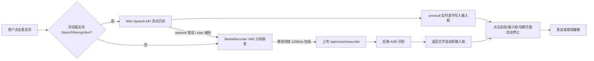
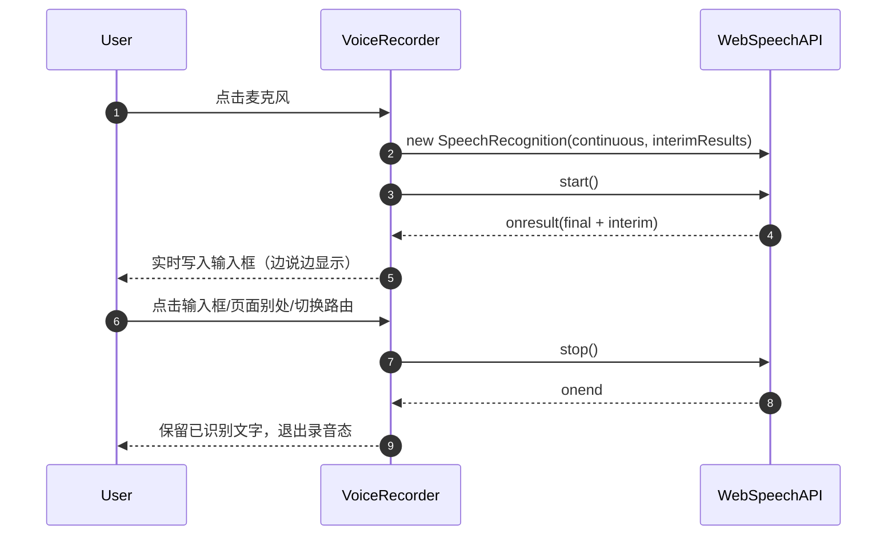
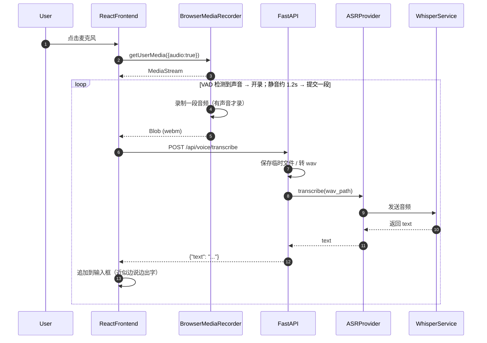
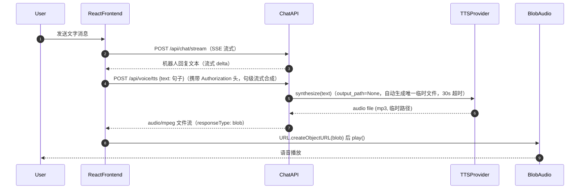
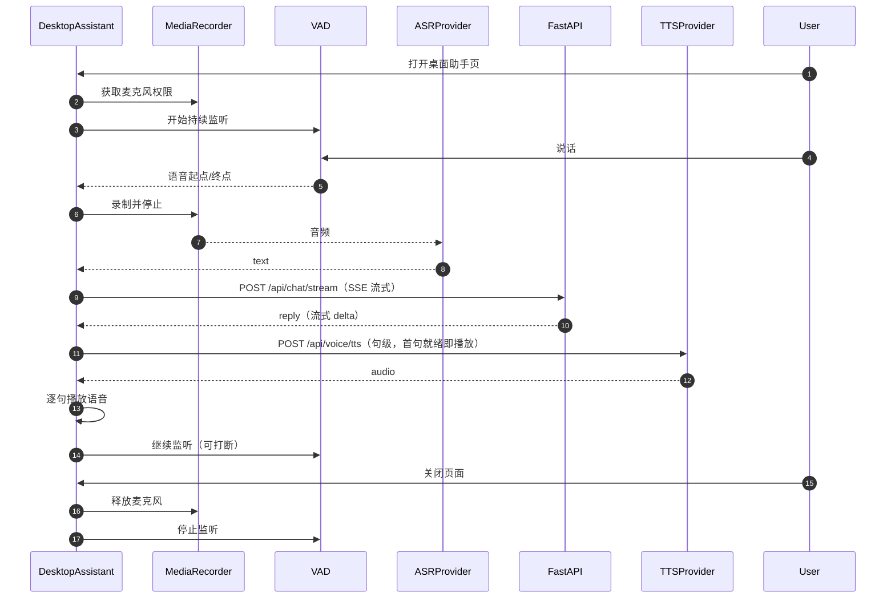

# 04_语音输入与识别详解

## 1. 目标

让用户可以通过语音与机器人对话，而不仅限于打字。XIAONA 中有两种语音使用场景：

### 模式一：聊天页语音转文字（Voice-to-Text）

在「聊天」页的输入框旁边有一个麦克风按钮。点击后录制一句话，ASR 识别成文字填入输入框，用户可编辑后再发送。这是**辅助输入**工具。

### 模式二：桌面助手实时语音对话（Voice-to-Voice）

在「桌面助手」页，页面打开即持续监听。用户说完一句话，系统自动 ASR → 聊天 → TTS → 播放语音回复，全程无需打字。这是**完整的语音对话**体验。

本模块统一提供 ASR 和 TTS 能力，两种模式共用同一套后端语音接口。

## 2. 三端语音能力矩阵

| 端 | 语音能力 | 流程 |
|----|----------|------|
| 网页（聊天页） | 语音转文字（辅助输入） | 录音 → `/api/voice/transcribe` → 文字填入输入框 → 发送 → 文字回复 |
| 网页（桌面助手页） | 实时语音对话（Voice-to-Voice） | 持续监听 → VAD 切分 → ASR → `/api/chat/stream` → TTS → 播放 |
| CLI | 语音转文字 + 语音回复 | 录音 → 后端 ASR → `/api/chat` → 回复文字 → 后端 TTS → 播放 |
| 飞书 | 语音消息转文字 | 接收 audio 消息 → 下载音频 → **后端内部直调 ASR 封装** → `chat_core.chat()` → 文字/语音回复 |

> 「桌面助手页」是**网页端内的一个页面**，与聊天页同属网页端（三端为：网页 / 飞书 / CLI）。桌面助手页的实时语音通路复用聊天页同一套后端语音接口，未来纯语音硬件可直接连通该通路接入。

所有语音接口（`/api/voice/transcribe`、`/api/voice/tts`）都依赖 `get_current_user` 认证；飞书与未来硬件（`08_桌面助手详解.md`）由服务端持有用户映射，飞书语音消息由后端内部完成 ASR 转写；CLI 使用用户自己的 JWT（`11_CLI客户端详解.md` 的 `auth_headers` 直接带 token），不依赖服务端映射。

## 3. 两种语音模式对比

> 两种模式都是**网页端**内的能力，分别位于聊天页与桌面助手页（同一个网站的两个页面）。

| 维度 | 聊天页麦克风 | 桌面助手页 |
|------|--------------|------------|
| 入口 | 聊天页输入框旁的麦克风按钮 | 顶部导航「桌面助手」 |
| 触发方式 | 用户按住/点击开始录音，再点击停止 | 页面打开自动监听，页面关闭自动停止 |
| 录音长度 | 一段，通常 ≤ 60 秒 | 多段循环，由 VAD 自动切分句子 |
| 交互流程 | 语音 → 文字 → 用户编辑 → 发送 → 文字回复 | 语音 → 文字 → 自动发送 → 文字回复 → 语音播放 |
| 使用场景 | 不想打字时快速输入 | 双手忙碌时全程语音交流 |
| 后端接口 | `/api/voice/transcribe` | `/api/voice/transcribe` + `/api/voice/tts` + `/api/chat/stream` |

## 4. 聊天页语音转文字流程

2026-08-15 起为**实时（流式）语音输入**：点击麦克风即开始，说话过程中文字**边说边显示**到输入框（主路径 Web Speech API）；Web Speech 不可用 / 服务网络异常 / start 被拒时自动降级为 MediaRecorder + 后端 Whisper，降级路径**按 VAD（音量检测）分段自动转写**——检测到声音开始录，静音约 1.2s 自动提交一段转写并上屏、继续录下一段（近似"边说边出字"，无需手动停止）。点击输入框 / 页面别处 / 切换路由自动停止。



### ASR 处理时序图（主路径：Web Speech API）



### ASR 处理时序图（降级路径：MediaRecorder + 后端 Whisper）



## 5. 技术选型

| 功能 | 推荐方案 | 说明 |
|------|----------|------|
| ASR | OpenAI Whisper API | 中文效果好，无需本地 GPU |
| 本地 ASR | `faster-whisper` | 隐私优先，需要显卡或 CPU 较慢 |
| 实时识别 | Web Speech API（`webkitSpeechRecognition`） | 2026-08-15 起主路径，`interimResults` 边说边出字，仅 Chrome/Edge 支持 |
| 录音 | 前端 MediaRecorder API | 浏览器原生支持（无 SpeechRecognition 时的降级路径） |
| 音频格式 | WebM / WAV | 2026-08-16 起浏览器录音先在前端解码为 16kHz 单声道 WAV 上传，后端 WAV 直通、ffmpeg 仅兜底其他格式（`audio_utils.convert_to_wav`） |
| ffmpeg | 系统级依赖 | 音频格式转换（需加入 requirements 说明 / Dockerfile） |
| TTS | Edge-TTS 或 GPT-SoVITS | 免费、中文自然（Edge-TTS 需联网） |

## 6. 前端录音实现

2026-08-15 起改用 **Web Speech API 实时识别**为主路径，`VoiceRecorder` 支持 `onInterim(全文)` 实时回调与 `onRecordingChange` 录音态回调；**Web Speech 不可用 / 服务网络异常 / start 被拒时自动降级**为 MediaRecorder + 后端 Whisper，降级路径 **VAD（音量检测）分段**：检测到声音自动开录，低于 offTh 静音约 1.2s 自动提交一段转写并上屏、继续录下一段（近似"边说边出字"，无需手动停止）。VAD 参数与桌面助手一致（时间域 RMS + EMA 噪声底 + onTh/offTh 迟滞，2026-08-16 晚修正停录判定）。

> **实现要点（2026-08-16 晚起，完整代码见 `frontend/src/components/VoiceRecorder.jsx`）**：
>
> - **组件形态**：`VoiceRecorder` 用 `forwardRef` + `useImperativeHandle` 暴露 `stopAndGetText(): Promise<string>`（一次点击「关麦并发送」时 await，见 §6.1），**不再是普通函数组件签名**；
> - **主路径 Web Speech**（`webkitSpeechRecognition`，`continuous + interimResults=true`）：`rec.onresult` 开头检查 `sentRef.current`（已发送则忽略迟到 final，2026-08-24 补），实时 `onInterim(全文)` 整串写入输入框；`rec.onend` 统一走 `flushTextAndResolve()`（发送按钮 await 时 resolve）；
> - **降级路径 MediaRecorder + VAD**：`start()` 在 `webSpeechFailedRef.current === true` 时直接走 `startMediaRecorder`（失败记忆，避免反复试 Google 服务）；`rec.onerror` 的 `network / service-not-allowed / audio-capture` 置 `webSpeechFailedRef` 并切降级；每段 `onstop` 先 `blobToWav16k(blob)` 再 `voiceApi.transcribe(wav)`，转写完成 `flushTextAndResolve()`；
> - **发送语义**：`sentRef` 标记已发送（`start()` 重置），`markTextSent()` 由 `ChatInput.handleSend` 发送成功后调用；`emitText` 开头拦截 `if (sentRef.current) return`；
> - **追加模式（2026-08-24 起）**：`ChatInput` 记录 `voiceBaseRef`，`onInterim={(t) => setText(voiceBaseRef.current + t)}`——语音转写是「输入框已有内容之外」的新文本，多轮录音无限累加；录音中发送完整内容 = `voiceBaseRef.current + voiceText`（见 §6.1）；
> - **竞态/卸载保护**：`startGenRef` 代际计数（防 `getUserMedia` 异步期间被 stop/卸载泄漏流）、`aliveRef` 卸载保护（onstop 转写回调不再刷新输入框）、`lastInterimRef` 末句保留、`stopInFlightRef` 防重复收尾。

> 完整实现见 `frontend/src/components/VoiceRecorder.jsx`（当前为带 `flushTextAndResolve()` 的版本，`stopAndGetText` 经 `recorder.onstop`→转写完成统一 resolve）。

聊天输入框 `ChatInput.jsx` 使用（`onError` 传入后，错误显示在输入框上方红字，3 秒自动消失；`voiceBaseRef` 追加模式 2026-08-24 起，完整实现见 `frontend/src/components/ChatInput.jsx`）：

```jsx
// frontend/src/components/ChatInput.jsx
const [micError, setMicError] = useState('');
const showMicError = (msg) => { setMicError(msg); clearTimeout(timer); timer = setTimeout(() => setMicError(''), 3000); };
const voiceBaseRef = useRef('');   // 录音开始时的输入框内容，语音转写在此基础上追加
const voiceRecorderRef = useRef(null);
const handleVoiceState = (on) => {
  setListening(on);
  if (on) voiceBaseRef.current = text;   // 录音开始：记录「输入框已有内容」为基准
};
// onInterim 追加而非覆盖：语音文本 = 基准 + 实时转写（多轮录音无限累加）
<VoiceRecorder ref={voiceRecorderRef} onInterim={(t) => setText(voiceBaseRef.current + t)}
               onRecordingChange={handleVoiceState} onError={showMicError} />
{micError && <div className="px-4 pt-2 text-xs text-red-500">{micError}</div>}
<input
  className={`... ${listening ? 'border-red-400' : 'border-slate-300'}`}
  value={text} onChange={(e) => setText(e.target.value)}
  placeholder={listening ? '正在聆听，说出你的问题…' : '输入消息，Enter 发送'}
/>
```

### 6.1 一次点击「关麦并发送」（2026-08-16 起）

录音中点击发送按钮 = **一次完成「关麦 + 发送」**（此前因 `pointerdown` 自动停止与 `click` 发送之间的文本确认异步时序，第一次点击只关麦、第二次才发送）：

- `VoiceRecorder` 改为 `forwardRef` + `useImperativeHandle`，暴露 `stopAndGetText(): Promise<string>`——停止录音并 resolve 最终语音文本：
  - `stopPromiseRef` 幂等复用同一 Promise（`pointerdown` 自动 `stop()` 已先行时，只注册等待者，文本确认后由 `onend` / `onstop`→转写统一 `flushTextAndResolve` resolve）；
  - `stopInFlightRef` 标记停止流程中，第二次 `stop()` 不重复收尾；
  - 8s 兜底超时：转写/onend 异常时不挂起发送；
  - `flushTextAndResolve()` = 清 `stopInFlightRef` + `emitText()` + resolve 外部等待者，接入 `stop()`（无进行中识别/录音时）、`rec.onend`（Web Speech）、`recorder.onstop`（MediaRecorder）三处。

```js
const stopAndGetText = () => {
  if (stopPromiseRef.current) return stopPromiseRef.current;
  stopPromiseRef.current = new Promise((resolve) => {
    pendingResolveRef.current = resolve;
    setTimeout(() => {   // 兜底超时
      if (pendingResolveRef.current) {
        pendingResolveRef.current(finalRef.current);
        pendingResolveRef.current = null;
        stopPromiseRef.current = null;
      }
    }, 8000);
  });
  if (!stopInFlightRef.current) stop();
  return stopPromiseRef.current;
};
```

- `ChatInput.handleSend` 录音中先 `await voiceRecorderRef.current?.stopAndGetText()`，以返回的语音文本为准再发送；**录音中发送的完整内容 = `voiceBaseRef.current + voiceText`**（基准 + 语音文本，勿用 `text` state——`await stopAndGetText` 期间 React setState 未提交、读到旧值）；`canSend` 录音中恒为 true（识别为空则不发送）；Enter 发送复用同一 `handleSend`；发送成功后调 `voiceRecorderRef.current?.markTextSent?.()` 并 `setText('')`（**只有点一次发送才全清输入框**，多轮语音追加的文本不会残留）。
- **发送瞬间 interim 末句保留（2026-08-16 晚起）**：`lastInterimRef` 记录最近一次完整文本（final 与 interim 都写），`currentText() = finalRef.current || lastInterimRef.current`——Web Speech 对最后一句话在 `onend` 前可能只有 interim 没有 final，若只 resolve `finalRef` 会丢末句；`flushTextAndResolve` / `stopAndGetText` 均用 `currentText()` 兜底。

## 7. 后端 ASR 接口

```python
# backend/app/api/voice.py
import asyncio
from fastapi import APIRouter, UploadFile, File, Depends
from fastapi.responses import JSONResponse, FileResponse
from pydantic import BaseModel
from app.core.auth import get_current_user
from app.db.sql_models import User
from app.core.audio_utils import convert_to_wav   # 共享工具，见 §8.2
from app.core.media_utils import MAX_FILE_SIZE    # 上传/转写大小上限 10MB
import tempfile
import os

router = APIRouter(prefix="/api/voice", tags=["voice"])

@router.post("/transcribe")
async def transcribe(
    file: UploadFile = File(...),
    user: User = Depends(get_current_user),   # 未登录返回 401
):
    # 转写大小预检：超过 MAX_FILE_SIZE（10MB）直接拒绝、不读内容（防超大音频读进内存/ffmpeg 挂起）
    if file.size is not None and file.size > MAX_FILE_SIZE:
        return JSONResponse({"detail": "音频文件过大（超过 10MB），无法转写"}, status_code=422)
    suffix = os.path.splitext(file.filename or "")[-1] or ".webm"  # filename 可能为 None
    wav_path = None  # 先初始化，避免 convert_to_wav 抛异常后 finally 引用未定义变量
    with tempfile.NamedTemporaryFile(delete=False, suffix=suffix) as tmp:
        content = await file.read()
        tmp.write(content)
        tmp_path = tmp.name

    try:
        # 统一转 wav：已是前端解码的 16kHz 单声道 WAV 时直接透传（不再走 ffmpeg，
        # 绕开 ffmpeg 7.x 解析 Chrome MediaRecorder webm 的 AVERROR_EOF(187)，见当天台账九）；
        # 其余格式（飞书/历史兼容）由 ffmpeg 兜底转换。convert_to_wav 内部
        # subprocess.run(ffmpeg) 是同步阻塞 → to_thread 包裹避免卡事件循环
        wav_path = await asyncio.to_thread(convert_to_wav, tmp_path)
        text = await asr.transcribe(wav_path)
        return JSONResponse({"text": text})
    except Exception as e:
        # 转写失败返回友好中文错误，前端据此展示具体原因，不再裸 500
        logger.warning("voice transcribe failed: %s", e, exc_info=True)
        return JSONResponse({"detail": "音频转写失败，请重试或稍后再试"}, status_code=422)
    finally:
        os.unlink(tmp_path)
        # 透传时 wav_path 即 tmp_path（已删除）；其余为新建 *_16k.wav 需单独清理
        if wav_path and wav_path != tmp_path and os.path.exists(wav_path):
            os.unlink(wav_path)
```

> **2026-08-16 补充（上传/转写大小预检）**：`parse_upload`（`backend/app/core/media_utils.py`）在 `len(data) > MAX_FILE_SIZE`（10MB）时**直接返回** `{kind:"unsupported", reason:"too_large"}`，不读取内容；`/api/voice/transcribe` 用 `UploadFile.size` 预检超限返回 422「音频文件过大…」；`chat._collect_attachments` 同样用 `UploadFile.size` 预检、超限走 `unsupported_reply(names, too_large=True)` 给出「超过 10MB 限制」聊天式回复。

## 8. ASR 封装（OpenAI / 本地）

```python
# backend/app/core/asr_provider.py
import asyncio
import logging
from openai import AsyncOpenAI   # 新版 openai SDK 使用 AsyncOpenAI 客户端
from faster_whisper import WhisperModel

logger = logging.getLogger("xiaona")

class ASRProvider:
    """空实现：ASR 不可用时兜底返回空文本，避免接口 500（日志在 _build_asr 打）。"""

    async def transcribe(self, audio_path: str) -> str:
        logger.warning("ASR unavailable, return empty transcription")
        return ""

class OpenAIWhisperASR(ASRProvider):
    def __init__(self, api_key: str, base_url: str | None = None):
        self.client = AsyncOpenAI(api_key=api_key, base_url=base_url)

    async def transcribe(self, audio_path: str) -> str:
        with open(audio_path, "rb") as f:
            result = await self.client.audio.transcriptions.create(
                model="whisper-1",
                file=f,
                language="zh",
                # prompt 上下文提示：引导中文口语常见字/专名（"小娜/XIAONA"等）解码，
                # 减少短句末尾字识别错误（与本地 faster-whisper 的 initial_prompt 对齐）
                prompt="小娜，XIAONA，你好，请问。这是一段中文口语对话。",
            )
        return result.text

class LocalWhisperASR(ASRProvider):
    def __init__(self, model_size="small"):
        self.model = WhisperModel(model_size, device="cpu", compute_type="int8")

    async def transcribe(self, audio_path: str) -> str:
        # faster-whisper 是 CPU 密集型同步调用，放到线程池避免阻塞事件循环
        segments, _ = await asyncio.to_thread(
            self.model.transcribe, audio_path,
            language="zh",
            beam_size=5,                       # beam_search 提高中文专名识别准确率
            vad_filter=True,                   # Silero VAD：只转写人声段，滤环境噪声
            vad_parameters=dict(min_silence_duration_ms=500),
            initial_prompt="小娜，XIAONA，你好，请问。",  # 专名热词（"小娜"不再被识别成"麦麦小妮"）
            condition_on_previous_text=False,  # 分段独立解码，避免上段文本污染后续段
        )
        return "".join([s.text for s in segments])

# .env 示例/模板常留占位符（如 your-key-here），若当真 key 传给 OpenAI 云转写会 401；
# 占位符一律视为未配置，自动走本地 faster-whisper（2026-08-19 台账：语音转写全线失败根因）
_PLACEHOLDER_KEYS = {"", "your-key-here", "your_openai_api_key", "your-api-key", "sk-your-key", "sk-xxx"}

def _build_asr() -> ASRProvider:
    key = (OPENAI_API_KEY or "").strip()
    if key and key.lower() not in _PLACEHOLDER_KEYS:
        return OpenAIWhisperASR(api_key=key)
    try:
        return LocalWhisperASR("small")
    except Exception as e:
        # 两者都不可用时返回空实现（接口仍可调用，但返回空文本）；
        # 打日志便于排查（典型：容器内未预下载 faster-whisper 模型且访问不了 huggingface.co）
        logger.warning("local faster-whisper init failed, ASR degraded to empty: %s", e, exc_info=True)
        return ASRProvider()
```

> **2026-08-15 补充（本地 ASR 必须构建时预下载）**：容器内运行 `faster-whisper` 首次初始化会从 huggingface.co 拉取模型，容器网络访问不了该域名时初始化失败、被 `_build_asr` 吞掉后转写永远返回空。必须在 `backend/Dockerfile` 构建阶段（走 Clash 代理）预下载。

> **2026-08-19 补充（占位符视为未配置 + 桌面助手不显示思考）**：`.env` 的 `OPENAI_API_KEY` 若为占位符（如 `your-key-here`）会被当真 key 传给 OpenAI 云转写 → 全链路 401「音频转写失败」。`_build_asr` 增加 `_PLACEHOLDER_KEYS` 校验，占位符/空一律走本地 faster-whisper；`.env` 已置空。另：桌面助手语音回复不再渲染深度思考块（`ChatMessage` 增加 `showThinking` prop，桌面助手传 `false`、不传 `onThinking`），仅聊天页文字输入显示。

> **2026-08-16 补充（识别不准 → 升级 small + 开启 VAD/热词）**：本地模型由 `base` 升级为 **`small`**（中文/专名识别显著变准，"在吗小娜 → 麦麦小妮"类错乱根治），`transcribe` 增加 `beam_size=5` + `vad_filter=True`（Silero VAD 只转写人声段）+ `initial_prompt` 专名热词 + `condition_on_previous_text=False`（见当天台账八）。Dockerfile 预下载同步改 small：

```dockerfile
RUN python -c "from faster_whisper import WhisperModel; WhisperModel('small', device='cpu', compute_type='int8')" \
    && rm -rf /root/.cache/pip
```

### 8.2 共享音频工具 `audio_utils.py`

`convert_to_wav` 被语音接口（`04`）与飞书语音消息（`10`）共用，抽为共享模块。依赖 `ffmpeg`（需加入 requirements / 系统依赖）：

```python
# backend/app/core/audio_utils.py
import logging
import os
import struct
import subprocess

logger = logging.getLogger("xiaona")


def _is_16k_mono_pcm_wav(path: str) -> bool:
    """探测是否为 16kHz 单声道 16-bit PCM WAV（前端 blobToWav16k 产物），是则无需转码。"""
    try:
        with open(path, "rb") as f:
            if f.read(4) != b"RIFF":
                return False
            f.read(8)  # size + "WAVE"
            while True:
                header = f.read(8)
                if len(header) < 8:
                    return False
                chunk_id, size = header[:4], struct.unpack("<I", header[4:8])[0]
                if chunk_id == b"fmt ":
                    data = f.read(min(size, 16))
                    if len(data) < 16:
                        return False
                    fmt, channels, rate, _, _, bits = struct.unpack("<HHIIHH", data[:16])
                    return fmt == 1 and channels == 1 and rate == 16000 and bits == 16
                if size % 2:
                    size += 1
                f.seek(size, os.SEEK_CUR)
    except OSError:
        return False
    return False


def convert_to_wav(src_path: str, dst_path: str | None = None) -> str:
    """把任意浏览器/飞书音频格式转成 16kHz 单声道 wav（faster-whisper 需要）。

    2026-08-16 起：输入已是 16kHz 单声道 16-bit PCM WAV（前端解码产物）时直接返回
    原路径、不调 ffmpeg（浏览器路径完全脱离 ffmpeg）；其余格式输出到独立路径
    *_16k.wav（输入已是 .wav 时 ffmpeg 会拒绝同路径覆写）；失败记录 stderr 后抛出。
    """
    if _is_16k_mono_pcm_wav(src_path):
        return src_path
    dst_path = dst_path or os.path.splitext(src_path)[0] + "_16k.wav"
    try:
        result = subprocess.run(
            ["ffmpeg", "-y", "-i", src_path, "-ar", "16000", "-ac", "1", dst_path],
            capture_output=True,
            timeout=60,   # 畸形/损坏音频可能让 ffmpeg 永久挂起，须限时
        )
    except subprocess.TimeoutExpired:
        # 超时先清理残留输出文件（ffmpeg 可能已写出半成品），再抛出
        logger.error("ffmpeg convert timed out: %s", src_path)
        if os.path.exists(dst_path):
            try:
                os.unlink(dst_path)
            except OSError:
                pass
        raise
    if result.returncode != 0:
        logger.error("ffmpeg convert failed: %s", result.stderr.decode(errors="replace"))
        raise subprocess.CalledProcessError(
            result.returncode, result.args, output=result.stdout, stderr=result.stderr
        )
    return dst_path
```

> `requirements.txt` 中注明：`ffmpeg` 为系统级依赖（Windows 安装时加入 PATH；Linux `apt install ffmpeg`）。

> **2026-08-16 补充（ffmpeg 7.x 解析 Chrome webm 回归）**：后端镜像重建后 ffmpeg 从 5.x 升到 7.x，matroskadec 对 Chrome MediaRecorder 产出的非 seekable webm（unknown-length Segment、无 Duration/Cues）更严格，转码报 `AVERROR_EOF`（exit 187）→ 转写全线 500。修复方案为**前端解码成 16kHz 单声道 WAV 上传**（`frontend/src/utils/audio.js` 的 `blobToWav16k`），后端对 16kHz mono WAV 直接透传；`capture_output` 吞掉的 ffmpeg 真实报错改为失败时 `logger.error` 记录。详见当天台账九。
>
> **2026-08-16 晚补充（`blobToWav16k` 复用 AudioContext 单例）**：`blobToWav16k` 内部改用模块级共享 `AudioContext` 单例（`getSharedCtx()` 懒建不 close）执行 `decodeAudioData`——桌面助手与聊天页降级路径每段录音都调它，每段新建 ctx 的初始化开销（几十~数百 ms）在转写链路上是纯延迟；解码不依赖主 ctx 状态（suspended 也能 decode），复用安全。

## 9. TTS 语音输出（可选）

如果希望机器人用语音回复，可在后端增加 TTS 接口。**契约**：`POST /api/voice/tts` 接收 JSON body `{text}`，返回**音频文件流**（`audio/mpeg`）；前端用 axios `responseType: 'blob'` 接收后用 `URL.createObjectURL` 播放（token 由请求头携带，不依赖 URL 查询参数）。前端实现见 `05_前端详解.md`。

```python
# backend/app/api/voice.py
import os
from pydantic import BaseModel
from fastapi.responses import JSONResponse, FileResponse
from starlette.background import BackgroundTask

class TTSRequest(BaseModel):
    text: str

@router.post("/tts")
async def tts(
    req: TTSRequest,
    user: User = Depends(get_current_user),   # 需登录，未认证 401
):
    # 去 markdown + emoji 后再合成（2026-08-15 起），避免语音念出 * # 等符号或表情描述：
    # 前端 stripMarkdown 之外的后端 regex + unicodedata 兜底（双保险，见 §9.1）
    cleaned = _strip_markdown(req.text)
    # 长度上限：清洗后超限直接拒绝，防超长文本长时间占用合成/连接（2026-08-16 晚起）
    if len(cleaned) > 5000:
        return JSONResponse({"detail": "文本过长（超过 5000 字符），无法合成语音"}, status_code=422)
    try:
        # voice.py 直接导入模块级 synthesize（from app.core.tts_provider import synthesize），
        # 作用域内没有 tts_provider 名字（2026-08-19 核对，勿写成 tts_provider.synthesize）
        audio_path = await synthesize(cleaned or "嗯")
    except Exception as e:
        # 合成失败（edge-tts 断网/超时等）返回友好中文错误，前端据此提示，不再裸 500
        logger.warning("tts synthesize failed: %s", e, exc_info=True)
        return JSONResponse({"detail": "语音合成失败，请稍后重试"}, status_code=422)
    # background 挂在响应上：文件流发送完成后删除临时 mp3，
    # 避免每次 TTS 调用都在系统临时目录堆积 tts_*.mp3
    return FileResponse(
        audio_path,
        media_type="audio/mpeg",
        background=BackgroundTask(os.unlink, audio_path),
    )
```

### 9.1 TTS 去 Markdown + 去 emoji（2026-08-15 起）

模型回复常含 Markdown（`**加粗**`、`# 标题`、`` `代码` ``、`[链接](url)`、列表等）与 emoji 表情，直接朗读会念出 `* #` 等符号或表情描述文字。两层清理：

1. **前端**（`frontend/src/utils/text.js` 的 `stripMarkdown`）：TTS 播放前清洗——去代码块/行内代码/标题/列表符号/引用/加粗斜体/删除线/链接与图片转纯文本/表格分隔行，折叠空白；并过滤 emoji（`\p{Extended_Pictographic}` + ZWJ/VS16 `\u200d\ufe0f`）。
2. **后端**（`backend/app/api/voice.py` 的 `_strip_markdown`）：`/api/voice/tts` 对入参 text 做同等 regex 清理 + `unicodedata` So 类别过滤兜底，双保险；清理后为空（纯 emoji 回复）时兜底合成"嗯"。

> 注意：清理只影响**朗读文本**；转录面板展示的回复仍用 `Markdown` 组件渲染，用户看到的还是美化后的富文本，emoji 照常显示。

推荐 `edge-tts`：

```python
# backend/app/core/tts_provider.py
import edge_tts
import asyncio
import tempfile
import uuid
import os

# edge-tts 整段合成超时：网络异常时避免请求无限挂起（2026-08-16 晚审查补）
TTS_TIMEOUT = 30


async def synthesize(text: str, output_path: str = None):
    temp_created = False
    # output_path 为空时用临时文件（按请求唯一命名），避免多用户并发互相覆盖同一 reply.mp3
    if not output_path:
        fd, output_path = tempfile.mkstemp(suffix=".mp3", prefix=f"tts_{uuid.uuid4().hex}_")
        os.close(fd)
        temp_created = True
    try:
        communicate = edge_tts.Communicate(text, voice="zh-CN-XiaoxiaoNeural")
        # asyncio.wait_for 30s 超时：断网/挂起时不再无限等待
        await asyncio.wait_for(communicate.save(output_path), timeout=TTS_TIMEOUT)
    except Exception:
        # 联网失败（超时/断网）时 save() 未写出文件：清理刚创建的临时文件，避免残留
        # （正常路径由 TTS 路由的 BackgroundTask(os.unlink) 在响应后清理）
        if temp_created:
            os.unlink(output_path)
        raise
    return output_path
```

> 注意：`edge-tts` 依赖**联网**（调用微软在线语音合成服务），不是离线 TTS 方案。若需完全离线，可换 `GPT-SoVITS` / `pyttsx3`（中文语音质量较差，仅作备选）。

### TTS 播放时序图



## 10. 桌面助手实时语音对话流程

桌面助手页的实时语音对话复用 `/api/voice/transcribe` 和 `/api/voice/tts`，但由前端控制持续监听和循环。页面打开时请求麦克风权限并开始 VAD 监听；检测到完整一句话后，自动走 ASR → Chat → TTS → 播放的闭环。

**VAD 实现要求**：自研**时间域 RMS + 自适应噪声底 EMA/clamp + 迟滞阈值**方案（`analyser.fftSize=1024`、`getFloatTimeDomainData` 填满整个数组算 RMS、`onTh/offTh` 迟滞开录停录），**未引入 `webrtcvad` / `@ricky0123/vad-react` 库**（详见 `08_桌面助手详解.md` §2.3.3）；结合**静音检测**（连续 1.2~1.6s 静音切段转写）与**语音起点检测**（说话前缓冲，避免吞字）；
- **播放回复时持续监听、用户开口即打断**（2026-08-16 起取代旧"播放时屏蔽 VAD"方案）：回复播放期间 VAD 不屏蔽，改为 TTS 突发能量判定——跟踪含回复回声的基础能量 `baseAvg`，用户声音相对基线是突发增量才打断（`baseAvg + max(0.02, baseAvg×0.5)`），配合浏览器 `echoCancellation` 消除回复回声，避免机器人把自己的回复再识别成输入（详情见 `08_桌面助手详解.md` 与当天台账）。

详细实现、流程图和代码见 `05_前端详解.md` 的「桌面助手页（实时语音对话）」章节。



## 11. 注意事项

- 录音权限：首次使用需请求浏览器麦克风权限。
- 文件大小限制：建议单次录音不超过 60 秒，可在 Nginx/Uvicorn 中限制上传大小。
- 隐私：如果走云端 Whisper，音频会上传；本地 ASR 则完全离线。
- 识别错误：前端应允许用户编辑识别后的文字再发送。

## 12. 关联文档

- 总体聊天流程：`01_单Agent聊天助手项目初始计划详解.md`
- React 前端组件集成：`05_前端详解.md`
- 一键部署 Docker 配置：`06_一键启动详解.md`
