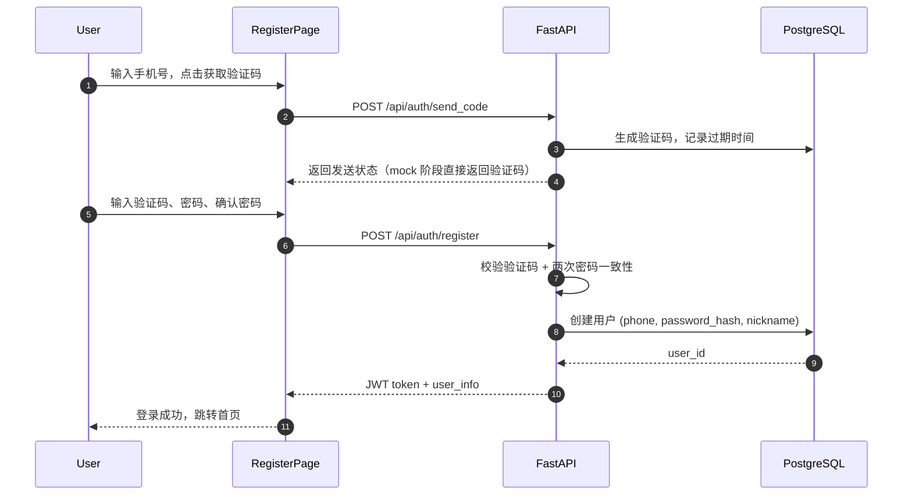
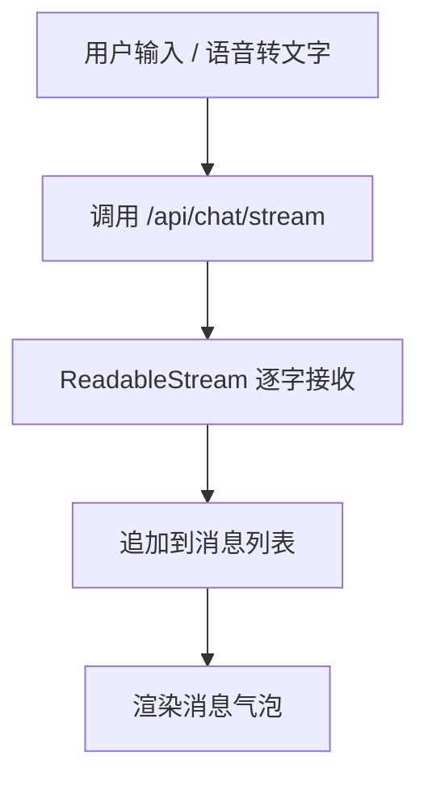
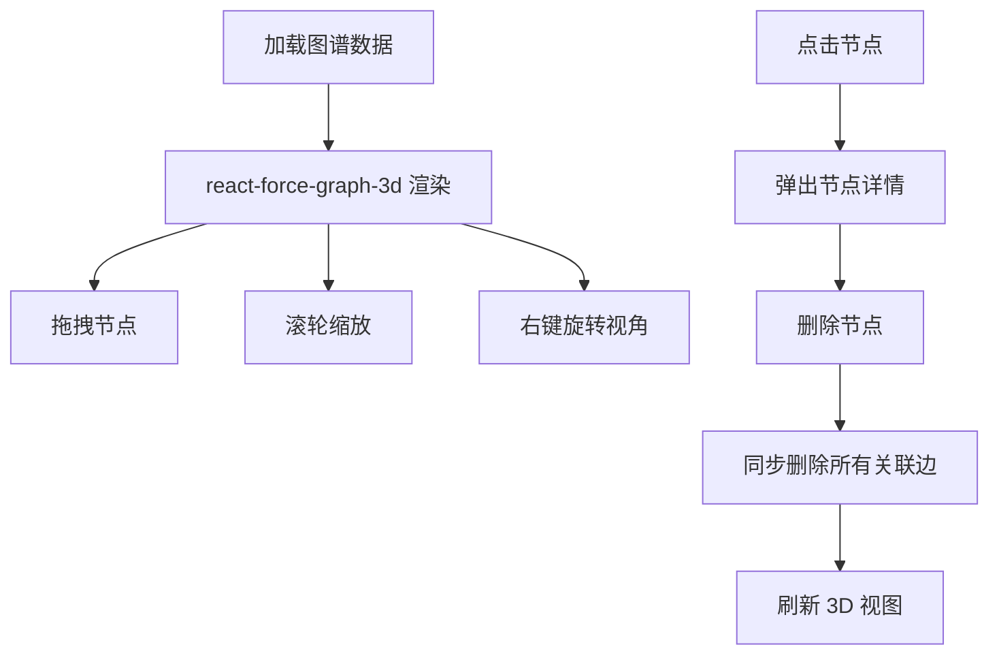
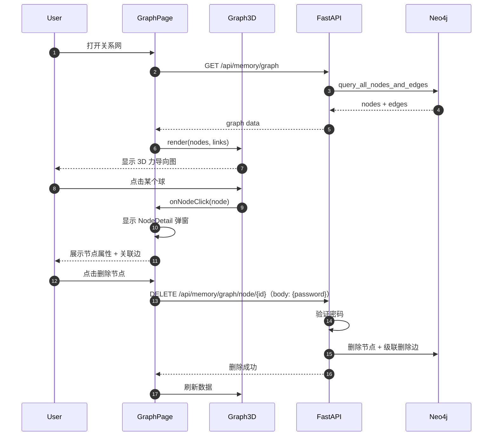
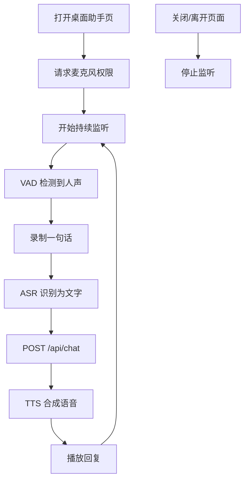
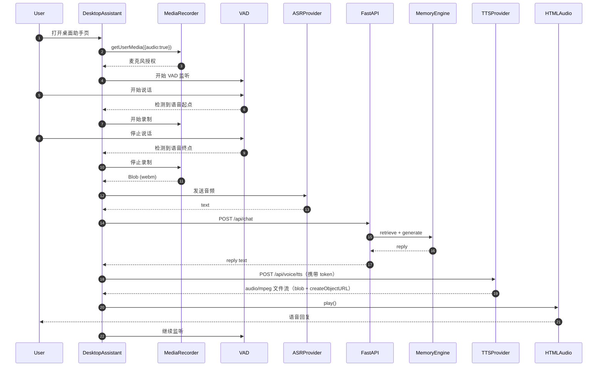
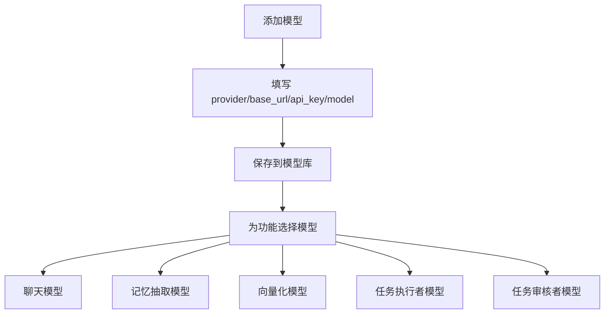

# 05_前端详解

## 1. 目标

XIAONA 的网页前端是一个单页 React 应用，提供完整的用户界面，包括：
- **认证**：手机号 + 验证码注册/登录，支持密码登录与验证码登录。
- **顶部导航栏**：登录后展示「聊天」「关系网」「桌面助手」「设置」四大入口。
- **聊天页**：与 LLM 对话，支持新建会话、继续历史会话、文字输入、语音输入、流式输出，左侧为可收起、可免密软删除的会话侧边栏。
- **关系网页**：3D 力导向知识图谱（白底 3d-force-graph 风格），支持拖拽、旋转、缩放、点击节点查看详情、删除节点；新用户注册即建自我节点。
- **桌面助手页**：实时语音对话页面，打开即监听，关闭即停止；问答归档到固定会话并写入三库。
- **设置页**：维护模型库（聊天模型、记忆抽取模型、向量化模型），支持模型测试连通性/修改/删除；以及数据清空、账号信息。

技术栈按用户要求：**React + 纯 JavaScript（不使用 TypeScript）**。

## 2. 技术栈

| 项目 | 技术 |
|------|------|
| 框架 | React 18 |
| 构建工具 | Vite 5 |
| 路由 | react-router-dom |
| 状态管理 | React Context + useState/useReducer |
| HTTP 请求 | axios |
| 样式 | Tailwind CSS（或原生 CSS） |
| 3D 图谱 | `react-force-graph-3d` |
| 2D 图谱（可选） | `react-force-graph-2d` / `cytoscape.js` |
| 语音 | Web Speech API 实时识别（主路径）+ MediaRecorder 降级 |
| 流式输出 | fetch + ReadableStream |
| Markdown 渲染 | `react-markdown@^10` + `remark-gfm@^4`（2026-08-15 起，用户确认的依赖例外） |
| 实时语音检测 | 自研时间域 RMS VAD（`getFloatTimeDomainData` + 噪声底 EMA + 迟滞阈值；**未引入** `webrtcvad` / `@ricky0123/vad-react` 依赖，见 08 §2.3） |

## 3. 项目目录

```
frontend/
├── src/
│   ├── api/
│   │   ├── client.js            # axios 封装（token 拦截器）
│   │   ├── auth.js              # 登录/注册/验证码 API
│   │   ├── chat.js              # 聊天 API（流式/非流式，streamChat）
│   │   ├── sessions.js          # 会话 API
│   │   ├── memory.js            # 记忆/图谱 API
│   │   ├── settings.js          # 设置 API
│   │   ├── voice.js             # ASR / TTS API
│   │   └── agent.js             # Agent 任务 API（列表/详情/产物下载/取消）
│   ├── components/
│   │   ├── Navbar.jsx           # 顶部导航栏
│   │   ├── AuthRoute.jsx        # 登录保护路由
│   │   ├── ChatMessage.jsx      # 单条消息气泡
│   │   ├── ChatInput.jsx        # 输入框 + 语音按钮
│   │   ├── VoiceRecorder.jsx    # 语音录音组件
│   │   ├── Graph3D.jsx          # 3D 力导向图组件
│   │   ├── NodeDetail.jsx       # 节点详情弹窗
│   │   ├── ModelCard.jsx        # 模型库单条模型卡片
│   │   ├── Markdown.jsx         # Markdown 渲染（react-markdown）
│   │   ├── ThinkingBlock.jsx    # 思考过程折叠块
│   │   └── DeleteConfirm.jsx    # 删除密码确认弹窗
│   ├── pages/
│   │   ├── Login.jsx            # 登录页
│   │   ├── Register.jsx         # 注册页
│   │   ├── Chat.jsx             # 聊天页（含可收起/可删除的会话侧边栏）
│   │   ├── Graph.jsx            # 关系网（3D 图谱）页
│   │   ├── DesktopAssistant.jsx # 桌面助手页（实时语音对话）
│   │   └── Settings.jsx         # 设置页
│   ├── hooks/
│   │   ├── useAuth.js           # 认证状态 hook
│   │   └── useModelStatus.js    # 模型配置状态 hook
│   ├── contexts/
│   │   └── AuthContext.jsx      # 全局认证上下文
│   ├── utils/
│   │   ├── audio.js             # 音频转 16kHz WAV（blobToWav16k）
│   │   └── text.js              # 文本清洗（stripMarkdown / emoji 过滤）
│   ├── App.jsx                  # 路由与布局入口
│   └── main.jsx
├── index.html
├── package.json
└── vite.config.js
```

## 4. 路由与认证保护

```jsx
// frontend/src/App.jsx
import { BrowserRouter, Routes, Route, Navigate } from 'react-router-dom';
import { AuthProvider } from './contexts/AuthContext';
import { AuthRoute } from './components/AuthRoute';
import Navbar from './components/Navbar';
import Login from './pages/Login';
import Register from './pages/Register';
import Chat from './pages/Chat';
import Graph from './pages/Graph';
import DesktopAssistant from './pages/DesktopAssistant';
import Settings from './pages/Settings';

function App() {
  return (
    <AuthProvider>
      <BrowserRouter>
        <AppLayout />
      </BrowserRouter>
    </AuthProvider>
  );
}

function AppLayout() {
  const { user } = useAuth();

  return (
    <div className="h-screen flex flex-col">
      {user && <Navbar />}
      <main className="flex-1 overflow-auto">
        <Routes>
          <Route path="/login" element={<Login />} />
          <Route path="/register" element={<Register />} />
          <Route path="/" element={<AuthRoute><Chat /></AuthRoute>} />
          <Route path="/graph" element={<AuthRoute><Graph /></AuthRoute>} />
          <Route path="/desktop" element={<AuthRoute><DesktopAssistant /></AuthRoute>} />
          <Route path="/settings" element={<AuthRoute><Settings /></AuthRoute>} />
        </Routes>
      </main>
    </div>
  );
}

export default App;
```

### 认证保护组件

```jsx
// frontend/src/components/AuthRoute.jsx
import { Navigate } from 'react-router-dom';
import { useAuth } from '../hooks/useAuth';

export function AuthRoute({ children }) {
  const { user, initializing } = useAuth();
  // 刷新页面时 token 尚未校验完成：显示 loading，避免登录页闪跳
  if (initializing) {
    return <div className="h-screen flex items-center justify-center">加载中...</div>;
  }
  return user ? children : <Navigate to="/login" replace />;
}
```

### 全局认证上下文

```jsx
// frontend/src/contexts/AuthContext.jsx
import { createContext, useState, useEffect } from 'react';

export const AuthContext = createContext(null);

export function AuthProvider({ children }) {
  const [user, setUser] = useState(null);
  const [initializing, setInitializing] = useState(true);

  useEffect(() => {
    // 启动时用本地 token 校验登录态（GET /api/auth/me）
    const token = localStorage.getItem('token');
    if (!token) return setInitializing(false);
    fetch('/api/auth/me', {
      headers: { Authorization: `Bearer ${token}` },
    })
      .then((res) => {
        if (res.status === 401) {
          // 仅 401（token 失效）清除本地 token：5xx/断网等错误不清登录态，
          // 避免后端临时故障把已登录用户弹回登录页（下次刷新自动重试）
          localStorage.removeItem('token');
          return null;
        }
        if (!res.ok) return undefined;   // 5xx 等错误：保留 token，不覆盖现有登录态
        return res.json();
      })
      .then((u) => { if (u !== undefined) setUser(u); })
      .catch(() => { /* 网络异常：保留 token 与登录态，下次刷新重试 */ })
      .finally(() => setInitializing(false));
  }, []);

  const logout = () => {
    localStorage.removeItem('token');
    setUser(null);
  };

  // 登录/注册成功后的统一入口：写入 token + 设置全局 user。
  // 若不更新 user，AuthRoute 会因 user 为 null 把刚登录的用户弹回 /login（曾导致跳转 bug）
  const login = (token, user) => {
    localStorage.setItem('token', token);
    setUser(user);
  };

  return (
    <AuthContext.Provider value={{ user, setUser, initializing, logout, login }}>
      {children}
    </AuthContext.Provider>
  );
}
```

### axios 客户端封装（统一附加 token）

所有 API 都通过 `api/client.js` 导出的 `api` 实例发起请求。登录后 token 存入 `localStorage`，拦截器自动附加 `Authorization: Bearer <token>`，未登录（401）时统一跳转登录页：

```js
// frontend/src/api/client.js
import axios from 'axios';

const TOKEN_KEY = 'token';

// baseURL 留空：所有接口用 /api/... 全路径，走同源代理
// （生产：nginx 代理 /api → backend；开发：vite server.proxy 代理 /api → localhost:8000）
export const api = axios.create({
  baseURL: '',
  timeout: 60000
});

// 请求拦截器：自动附加 token
api.interceptors.request.use((config) => {
  const token = localStorage.getItem(TOKEN_KEY);
  if (token) {
    config.headers.Authorization = `Bearer ${token}`;
  }
  return config;
});

// 响应拦截器：401 统一处理
api.interceptors.response.use(
  (res) => res,
  (err) => {
    if (err.response?.status === 401) {
      localStorage.removeItem(TOKEN_KEY);
      window.location.href = '/login';
    }
    return Promise.reject(err);
  }
);

// 封装后的 API 模块均从本文件导入 api 实例

// 供 fetch 流式请求（SSE）使用的 token 读取辅助函数
export function getToken() {
  return localStorage.getItem(TOKEN_KEY);
}

export function authHeaders() {
  const token = getToken();
  return token ? { Authorization: `Bearer ${token}` } : {};
}
```

### 认证 API 封装（统一单一登录接口）

```js
// frontend/src/api/auth.js
// 登录统一走 POST /api/auth/login，按 body 区分验证码/密码（与 CLI 共用同一接口）：
//   { phone, code }      → 验证码登录
//   { phone, password }  → 密码登录
import { api } from './client';

export const authApi = {
  // 发送验证码
  sendCode(phone) {
    return api.post('/api/auth/send_code', { phone });
  },

  // 统一登录接口，按 body 区分验证码/密码
  login(payload) {
    return api.post('/api/auth/login', payload).then((r) => r.data);
  },

  // 注册（密码必填，成功后返回 token 即登录态）
  register(payload) {
    return api.post('/api/auth/register', payload).then((r) => r.data);
  },

  // 当前用户
  me() {
    return api.get('/api/auth/me').then((r) => r.data);
  },
};
```

## 5. 注册/登录页

### 注册流程图

```mermaid
flowchart TD
    Start([打开注册页]) --> Phone[输入手机号]
    Phone --> SendCode[点击获取验证码]
    SendCode --> VerifyCode[输入验证码]
    VerifyCode --> Password[设置密码 + 确认密码]
    Password --> Submit[点击注册]
    Submit --> Optional{是否填写昵称?}
    Optional -->|是| Nickname[保存昵称]
    Optional -->|否| DefaultName[使用 用户{手机号}]
    Nickname --> Home[进入首页]
    DefaultName --> Home
```

### 注册时序图



### 注册页核心代码

```jsx
// frontend/src/pages/Register.jsx
import { useState } from 'react';
import { useNavigate } from 'react-router-dom';
import { authApi } from '../api/auth';
import { useAuth } from '../hooks/useAuth';

export default function Register() {
  const { login } = useAuth();
  const [phone, setPhone] = useState('');
  const [code, setCode] = useState('');
  const [password, setPassword] = useState('');
  const [confirmPassword, setConfirmPassword] = useState('');
  const [nickname, setNickname] = useState('');
  const [countdown, setCountdown] = useState(0);
  const navigate = useNavigate();

  const sendCode = async () => {
    await authApi.sendCode(phone);
    setCountdown(60);
    const timer = setInterval(() => {
      setCountdown(c => {
        if (c <= 1) clearInterval(timer);
        return c - 1;
      });
    }, 1000);
  };

  const handleSubmit = async () => {
    if (password !== confirmPassword) {
      alert('两次密码不一致');
      return;
    }
    const res = await authApi.register({ phone, code, password, nickname });
    login(res.token, res.user);   // 写入 token + 更新全局 user（否则 AuthRoute 弹回 /login）
    navigate('/');
  };

  return (
    <div className="p-6 max-w-md mx-auto">
      <h1 className="text-xl font-bold">注册</h1>
      <input value={phone} onChange={e => setPhone(e.target.value)} placeholder="手机号" />
      <button onClick={sendCode} disabled={countdown > 0}>
        {countdown > 0 ? `${countdown}s` : '获取验证码'}
      </button>
      <input value={code} onChange={e => setCode(e.target.value)} placeholder="验证码" />
      <input type="password" value={password} onChange={e => setPassword(e.target.value)} placeholder="设置密码" />
      <input type="password" value={confirmPassword} onChange={e => setConfirmPassword(e.target.value)} placeholder="确认密码" />
      <input value={nickname} onChange={e => setNickname(e.target.value)} placeholder="昵称（选填）" />
      <button onClick={handleSubmit}>注册</button>
    </div>
  );
}
```

### 登录页

```jsx
// frontend/src/pages/Login.jsx
import { useState } from 'react';
import { useNavigate, Link } from 'react-router-dom';
import { authApi } from '../api/auth';
import { useAuth } from '../hooks/useAuth';

export default function Login() {
  const [mode, setMode] = useState('password'); // 'password' | 'code'
  const [phone, setPhone] = useState('');
  const [password, setPassword] = useState('');
  const [code, setCode] = useState('');
  const navigate = useNavigate();
  const { login } = useAuth();

  const handleSubmit = async () => {
    const res = mode === 'password'
      ? await authApi.login({ phone, password })
      : await authApi.login({ phone, code });
    login(res.token, res.user);   // 写入 token + 更新全局 user（否则 AuthRoute 弹回 /login）
    navigate('/');
  };

  return (
    <div className="p-6 max-w-md mx-auto">
      <h1 className="text-xl font-bold">登录</h1>
      <div>
        <button onClick={() => setMode('password')}>密码登录</button>
        <button onClick={() => setMode('code')}>验证码登录</button>
      </div>
      <input value={phone} onChange={e => setPhone(e.target.value)} placeholder="手机号" />
      {mode === 'password' ? (
        <input type="password" value={password} onChange={e => setPassword(e.target.value)} placeholder="密码" />
      ) : (
        <>
          <button onClick={() => authApi.sendCode(phone)}>获取验证码</button>
          <input value={code} onChange={e => setCode(e.target.value)} placeholder="验证码" />
        </>
      )}
      <button onClick={handleSubmit}>登录</button>
      <Link to="/register">还没有账号？注册</Link>
    </div>
  );
}
```

## 6. 顶部导航栏

```jsx
// frontend/src/components/Navbar.jsx
// 顶部导航栏：历史会话已并入聊天侧边栏，导航只保留核心入口
import { Link, useNavigate } from 'react-router-dom';
import { useAuth } from '../hooks/useAuth';

const navItems = [
  { to: '/', label: '聊天' },
  { to: '/graph', label: '关系网' },
  { to: '/desktop', label: '桌面助手' },
  { to: '/settings', label: '设置' },
];

export default function Navbar() {
  const { user, logout } = useAuth();
  const navigate = useNavigate();

  return (
    <nav className="bg-white border-b border-slate-200 px-4 h-14 flex items-center justify-between shrink-0">
      <div className="flex items-center gap-6">
        <span className="text-lg font-bold bg-gradient-to-r from-indigo-600 to-violet-600 bg-clip-text text-transparent">
          XIAONA
        </span>
        <div className="flex items-center gap-1">
          {navItems.map((item) => (
            <Link
              key={item.to}
              to={item.to}
              className="px-3 py-1.5 rounded-lg text-sm text-slate-600 hover:text-indigo-600 hover:bg-indigo-50"
            >
              {item.label}
            </Link>
          ))}
        </div>
      </div>
      <div className="flex items-center gap-3">
        <span className="text-sm text-slate-500">{user?.nickname || `用户${user?.phone}`}</span>
        <button
          onClick={() => { logout(); navigate('/login'); }}
          className="px-3 py-1.5 rounded-lg text-sm text-slate-600 hover:bg-slate-100"
        >
          退出
        </button>
      </div>
    </nav>
  );
}
```

## 7. 聊天页



聊天页内嵌可收起、可删除的会话侧边栏（替代独立「历史会话」页，见 §8 变更说明）。

> **2026-08-16 勘误：下方代码块为中间版本，与当前 `Chat.jsx` 存在差异**。当前实现额外包含（均见 AGENTS.md 会话持久化/流式打字机约定）：
> - **URL 同步**：`useSearchParams` 的 `setSearchParams({ session_id })`（replace）同步当前会话，刷新/返回可恢复；删除当前会话时 `setSearchParams({}, {replace:true})` 清掉 URL 旧参数防"复活"。
> - **sessionStorage 跨页保持**：当前会话 id 另存 `sessionStorage['chat_active_session_{user.id}']`（按用户隔离），初始化「URL 优先，其次 sessionStorage」；删除当前会话同步移除。
> - **`sessionIdRef` 自愈同步**：`streamChat` 首帧 `onSession` 只更新 `sessionIdRef` + URL + sessionStorage，**不 setSessionId**（防触发会话 effect 的 abort 中断在途 SSE）。
> - **思考/回复双打字机**：`thinkingPendingRef` + `pendingRef` + `revealTimerRef`，优先揭晓思考、再揭晓回复；流结束/切换会话 `clearReveal()` 清双队列。
> - **自动滚动**：`messagesRef` + `messages/streamingId` effect `scrollTop = scrollHeight`。
> - **重试上一轮**（`retryLast`）、**懒创建会话守卫**（`pendingSendRef`/`noAbortRef`）、**消息拉取竞态防护**（`loadSeqRef`，切会话丢弃过期响应）。
> 以下代码块用于理解核心流程，细节以实际文件为准。

```jsx
// frontend/src/pages/Chat.jsx
import { useState, useEffect, useRef } from 'react';
import { useSearchParams } from 'react-router-dom';
import { ChatInput } from '../components/ChatInput';
import { ChatMessage } from '../components/ChatMessage';
import { DeleteConfirm } from '../components/DeleteConfirm';
import { sessionsApi } from '../api/sessions';
import { streamChat } from '../api/chat';
import { useModelStatus } from '../hooks/useModelStatus';

let tmpId = 0; // 临时消息 id（发送中尚未持久化）

export default function Chat() {
  const [searchParams] = useSearchParams();
  const [sessionId, setSessionId] = useState(searchParams.get('session_id'));
  const [messages, setMessages] = useState([]);
  const [sessions, setSessions] = useState([]);
  const [collapsed, setCollapsed] = useState(false);   // 侧边栏收起状态
  const [deleteTarget, setDeleteTarget] = useState(null); // 待删除的会话对象
  const abortRef = useRef(null); // 用于中止未完成的 SSE 流
  // 懒创建会话的守卫（2026-08-15 修复"新会话发消息丢失"）：
  // sendMessage 内 setSessionId 会触发两个依赖 sessionId 的 effect，必须放行本轮：
  // - pendingSendRef：reload effect 不拉取新会话的空消息覆盖乐观消息；
  // - noAbortRef：abort effect 不中止刚发起的流（否则 SSE 以 499 断开，消息全丢）。
  const pendingSendRef = useRef(false);
  const noAbortRef = useRef(false);

  useEffect(() => {
    // 懒创建会话触发的 reload 放行：仅跳过消息拉取（乐观消息不覆盖），会话列表照常刷新
    if (sessionId && !pendingSendRef.current) {
      sessionsApi.get(sessionId).then(s => setMessages(s.messages));
    }
    pendingSendRef.current = false;
    sessionsApi.list().then(r => setSessions(r.items));
  }, [sessionId]);

  useEffect(() => {
    // 切换会话/离开页面时中止旧流，避免继续写状态
    // 依赖 sessionId：切换会话时先中止上一会话的在途 SSE，防止内容混入新会话列表；
    // 但 sendMessage 懒创建会话（内部 setSessionId）触发的本次变化必须放行，
    // 否则刚发起的流会被立即 abort（SSE 499，消息丢失）。
    return () => {
      const skipAbort = noAbortRef.current;
      noAbortRef.current = false;   // 一次性消费
      if (!skipAbort) abortRef.current?.abort();
    };
  }, [sessionId]);

  const createNewSession = async () => {
    const s = await sessionsApi.create();
    setSessions(prev => [s, ...prev]);   // 新会话插入列表顶部，无需刷新
    setSessionId(s.id);
    setMessages([]);
  };

  const handleDeleteSession = async () => {
    const target = deleteTarget;
    await sessionsApi.remove(target.id);   // 免密软删除（2026-08-15 起）
    setSessions(prev => prev.filter(x => x.id !== target.id));
    // 若删除的是当前会话，清空当前会话状态
    if (sessionId === target.id) {
      setSessionId(null);
      setMessages([]);
    }
    setDeleteTarget(null);
  };

  const sendMessage = async (text, files) => {
    // 中止上一条未完成的流（如果存在），并清空打字机队列
    abortRef.current?.abort();

    // 无会话时先创建（拿到真实 id 再发送，避免后端自愈新建导致前端 sessionId 失联）
    let sid = sessionId;
    if (!sid) {
      const s = await sessionsApi.create();
      sid = s.id;
      // 守卫标记：本次 setSessionId 由发送流程内部触发，reload/abort effect 均需放行
      pendingSendRef.current = true;
      noAbortRef.current = true;
      setSessions(prev => [s, ...prev]);
      setSessionId(sid);
    }

    const userMsg = { id: `tmp_${++tmpId}`, role: 'user', content: text, attachments: files || [] };
    const assistantMsg = { id: `tmp_${++tmpId}`, role: 'assistant', content: '', thinking: '' };
    setMessages(prev => [...prev, userMsg, assistantMsg]);

    let assistantText = '';
    let thinkingText = '';
    let failed = null;

    const patchAssistant = (patch) => {
      setMessages(prev => {
        const last = prev[prev.length - 1];
        if (!last || last.role !== 'assistant') return prev;
        return [...prev.slice(0, -1), { ...last, ...patch }];
      });
    };
    // 打字机：onDelta 增量先入队，定时器每 30ms 揭晓 ~3 字符，防同一 tick 批处理合并
    const startReveal = () => {
      if (revealTimerRef.current) return;
      revealTimerRef.current = setInterval(() => {
        const pending = pendingRef.current;
        if (!pending) { clearReveal(); return; }
        const chunk = pending.slice(0, 3);
        pendingRef.current = pending.slice(3);
        assistantText += chunk;
        patchAssistant({ content: assistantText, thinking: thinkingText });
      }, 30);
    };
    const finish = () => {
      if (pendingRef.current) { assistantText += pendingRef.current; pendingRef.current = ''; }
      clearReveal();
      setStreamingId(null);
      abortRef.current = null;
      if (failed) patchAssistant({ content: assistantText, error: friendlyError(failed.msg, failed.code) });
      refreshSessions();   // 流结束刷新侧边栏（标题自动更新后同步）
    };

    // 共享流式工具（01 §5.5 SSE 契约；见下方"全通路改造"章节）
    abortRef.current = streamChat({
      message: text,
      files,
      sessionId: sid,
      onDelta: (d) => { pendingRef.current += d; startReveal(); },
      onThinking: (t) => { thinkingText += t; patchAssistant({ thinking: thinkingText, content: assistantText }); },
      onMediaReply: (text) => { assistantText = text; patchAssistant({ content: text, thinking: thinkingText }); },
      onError: (msg, code) => { failed = { msg, code }; finish(); },
      onDone: finish,
    });
  };

  return (
    <div className="flex h-full bg-slate-50">
      {/* 会话侧边栏：可收起，会话项 hover 显示删除按钮 */}
      {!collapsed ? (
        <aside className="w-64 bg-white border-r border-slate-200 flex flex-col shrink-0">
          <div className="p-3 flex items-center justify-between border-b border-slate-100">
            <button onClick={createNewSession} className="flex-1 mr-2 py-2 rounded-lg bg-gradient-to-r from-indigo-500 to-violet-500 text-white text-sm font-medium">
              + 新会话
            </button>
            <button onClick={() => setCollapsed(true)} title="收起侧边栏" className="px-2 py-2 rounded-lg text-slate-400 hover:text-slate-600">
              ‹
            </button>
          </div>
          <div className="flex-1 overflow-auto p-2">
            {sessions.map(s => {
              const active = s.id === sessionId;
              return (
                <div
                  key={s.id}
                  onClick={() => setSessionId(s.id)}
                  className={`group flex items-center justify-between px-3 py-2 rounded-lg cursor-pointer mb-0.5 ${
                    active ? 'bg-indigo-50 text-indigo-700' : 'text-slate-700 hover:bg-slate-100'
                  }`}
                >
                  <span className="truncate text-sm">{s.title}</span>
                  <button
                    onClick={e => { e.stopPropagation(); setDeleteTarget(s); }}
                    title="删除会话"
                    className="ml-2 shrink-0 text-slate-300 opacity-0 group-hover:opacity-100 hover:text-red-500"
                  >
                    ×
                  </button>
                </div>
              );
            })}
          </div>
        </aside>
      ) : (
        <button
          onClick={() => setCollapsed(false)}
          title="展开侧边栏"
          className="w-8 shrink-0 bg-white border-r border-slate-200 text-slate-400 hover:text-indigo-600"
        >
          ›
        </button>
      )}
      <div className="flex-1 flex flex-col min-w-0">
        <div className="flex-1 overflow-auto p-4">
          {/* key 用消息 id：临时消息用本地 uuid，持久化后用后端 id，流式更新不会错位 */}
          {messages.map(m => <ChatMessage key={m.id} message={m} onRetry={() => m.error && sendMessage(m.content)} />)}
        </div>
        <ChatInput onSend={sendMessage} />
      </div>
      <DeleteConfirm
        open={deleteTarget !== null}
        onClose={() => setDeleteTarget(null)}
        onConfirm={handleDeleteSession}
        title="删除会话"
        description="会话将从列表中移除，但聊天数据会保留在数据库中以供后续记忆检索（可在设置中彻底清空）。"
        confirmText="删除"
        requirePassword={false}   // 免密软删除
      />
    </div>
  );
}
```

### 聊天输入框（实时语音输入）

`frontend/src/components/ChatInput.jsx` 的输入框为 **`<textarea>` 多行控件**（2026-09-01 起，原单行 `<input>` 会把粘贴的多行文本剥掉所有换行，导致「粘贴 13000 字报价生成 Word 变成一坨文字」，见 2026-09-01 台账三）：

- **换行保真 + 自动增高**：`rows={1}` + `onInput` 按 `scrollHeight` 自动增高（`overflow-hidden` + `resize-none`，最多 ~6 行后内部滚动）——粘贴多行含表格的文本逐行保留，供后端 `_parse_markdown_blocks` 识别中文标题/纯文本表格；
- **Enter 发送、Shift+Enter 换行**：`onKeyDown` 判 `e.key === 'Enter' && !e.shiftKey && !e.nativeEvent.isComposing && e.keyCode !== 229` 才 `handleSend()`——IME 组合态（中文输入法选词）不误发，Shift+Enter 插入换行；
- **语音**：`VoiceRecorder` 主路径 Web Speech API 流式识别、失败自动降级 MediaRecorder VAD 分段转写（见 04 §6）；录音中点击发送 = 关麦 + 发送（`stopAndGetText`），语音追加模式 `voiceBaseRef`（见 AGENTS.md 约定）；
- **发送锁**：`sendingRef` 布尔锁防双击/连按重复提交；
- **文件上传**：拖拽/选择 + chips 删除 + 文字并存，前端预检 ≤5 个、每个 ≤10MB（见 12 §1/§2）。

```jsx
// 输入框核心片段（完整实现见 frontend/src/components/ChatInput.jsx）
<textarea
  ref={textareaRef}
  rows={1}
  className={`flex-1 border rounded-xl px-3 py-2 text-sm outline-none transition focus:ring-2 resize-none overflow-hidden leading-6 ${
    listening
      ? 'border-red-400 focus:ring-red-100 focus:border-red-400'
      : 'border-slate-300 focus:ring-indigo-200 focus:border-indigo-400'
  }`}
  value={text}
  onChange={(e) => setText(e.target.value)}
  onInput={autoGrow}
  onKeyDown={(e) => {
    if (e.key === 'Enter' && !e.shiftKey && !e.nativeEvent.isComposing && e.keyCode !== 229) {
      e.preventDefault();
      handleSend();
    }
  }}
  placeholder={listening ? '正在聆听，说出你的问题…' : '输入消息，Enter 发送，Shift+Enter 换行；可拖拽图片/文档到此处'}
/>
```

`VoiceRecorder` 完整实现见 `04_语音输入与识别详解.md` §6（Web Speech API 流式识别 + 网络失败自动降级 MediaRecorder **VAD 分段**转写 + 自动关闭）。

**2026-08-16 晚补充**：
- **IME 组合态不误发**：`onKeyDown` 改为 `e.key === 'Enter' && !e.nativeEvent.isComposing && e.keyCode !== 229` 才发送——中文输入法选词中按 Enter 是确认候选词，不应提交消息。
- **发送锁防重复提交**：`sendingRef` 布尔锁，`handleSend` 开头 `if (sendingRef.current) return;`，try/finally 复位——双击发送按钮 / 连按 Enter 只提交一次。
- **录音中点击发送 = 关麦 + 发送**：`handleSend` 在录音态先 `await voiceRecorderRef.current.stopAndGetText()` 拿最终语音文本再发送（见 AGENTS.md「一次点击关麦并发送」约定）。
- **文件预检**：前端同步校验 ≤5 个、每个 ≤10MB，超限红字提示并过滤（与后端大小预检双保险）。

### 单条消息气泡

```jsx
// frontend/src/components/ChatMessage.jsx
export function ChatMessage({ message, onRetry }) {
  const isUser = message.role === 'user';
  return (
    <div className={`flex ${isUser ? 'justify-end' : 'justify-start'} mb-3`}>
      <div className={`max-w-[70%] rounded-lg px-4 py-2 ${isUser ? 'bg-blue-500 text-white' : 'bg-gray-200'}`}>
        {message.content}
        {message.error && (
          <div className="mt-1 text-sm text-red-500">
            出错：{message.error}
            <button onClick={onRetry} className="ml-2 underline">重试</button>
          </div>
        )}
      </div>
    </div>
  );
}
```

### 会话 API

```js
// frontend/src/api/sessions.js
import { api } from './client';

export const sessionsApi = {
  list: (params) => api.get('/api/sessions', { params }).then(r => r.data),
  create: (source = 'web') => api.post('/api/sessions', { source }).then(r => r.data),
  get: (id) => api.get(`/api/sessions/${id}`).then(r => r.data),
  remove: (id) => api.delete(`/api/sessions/${id}`).then(r => r.data),   // 免密软删除
};
```

> 接口路径与返回结构与 `07_会话历史记录详解.md` 一致；`remove` 为免密软删除（2026-08-15 起），不再传密码。2026-08-16 晚清理死代码：`search / export / rename` 无调用方，已从 `sessionsApi` 删除。

### 2026-08-15 全通路改造（流式双通道 / URL 同步 / 缺失提示）

1. **共享流式工具 `frontend/src/api/chat.js` 的 `streamChat`**：POST `/api/chat/stream`，SSE 帧含 `{session_id}`（首帧）→ `{delta, thinking}` → `{media_reply, code}` / `{task_started}` → `[DONE]` / `{error, code}`。回调 `onSession / onDelta / onThinking / onMediaReply / onTaskStarted / onError(msg, code) / onDone`，返回 `AbortController`。聊天页与桌面助手共用，禁止再手写 fetch 解析。

```js
import { streamChat } from '../api/chat';
const controller = streamChat({
  message: text,
  sessionId: sid,
  onDelta: (d) => { assistantText += d; patchAssistant({ content: assistantText }); },
  onThinking: (t) => { thinkingText += t; patchAssistant({ thinking: thinkingText }); },
  onTaskStarted: ({ task_id }) => { startPollingTask(task_id); },   // Agent 任务确认后轮询
  onError: (msg, code) => { /* friendlyError 映射 */ },
  onDone: () => { /* 刷新会话列表 */ },
});
```

2. **会话 URL 同步**：`setSearchParams({ session_id: sessionId }, { replace: true })`，刷新/返回可恢复当前会话；`sessionId` 为空时先 `sessionsApi.create()` 拿到真实 id 再发送（2026-08-15 起：懒创建时的 `setSessionId` 用 `pendingSendRef / noAbortRef` 两个一次性守卫放行 reload 与 abort 两个 effect，修复"新会话首条消息丢失、需二次点击才保留"的 499 断流问题，见本节开头 `Chat.jsx` 代码）。
3. **思考块与 Markdown 渲染**：`components/ThinkingBlock.jsx`（"深度思考"折叠块，收起 `line-clamp-3`、点击展开；**流式中自动展开并滚底**——`streaming` 变化时 `setExpanded(true)`，让思考内容边生成边可见，而非思考完才整体显现）、`components/Markdown.jsx`（react-markdown + remark-gfm，标题/列表/代码块/表格 Tailwind 美化）；`ChatMessage.jsx` 有 thinking 先渲染思考块、回复用 Markdown、流式中显示"思考中…"动画。
4. **缺失对话模型提示**：`hooks/useModelStatus.js` 拉取 `GET /api/settings/function-models` 的 `chat_configured`，未配置时聊天页顶部显示 amber banner（链接到设置页）。
5. **流结束刷新会话列表**：`finish()` 后 `sessionsApi.list()` 重拉，自动标题更新后侧边栏立即可见。
6. **错误友好化**：`friendlyError(raw, code)`——`chat_model_not_configured` → 配置引导；`network_error` →「网络异常，请确认服务已启动（python start.py）」；其余显示后端文案。
7. **Agent 任务确认轮询（2026-08-17 起，2026-08-23 改为 2s，见 02 §5）**：任务意图命中且用户确认后，SSE 多一帧 `data: {"task_started": {task_id, session_id}}`——`streamChat` 的 `onTaskStarted` 回调收到后，`Chat.jsx` **每 2s 轮询 `GET /api/agent/tasks/{id}`** 查询进度；状态 `done` / `failed` 时停止轮询并刷新消息列表（侧边栏出现任务会话，产物以 `[下载 xxx](/api/agent/tasks/{id}/artifacts/{name})` Markdown 链接呈现）。

### 2026-08-16 晚 会话健壮性补充（删除清 URL / onSession 只同步 / 跨页面保持）

1. **删除当前会话清 URL**：`Chat.jsx` 的 URL 同步 effect 增加 `!sessionId` 分支——删除当前会话（`setSessionId(null)`）时 `setSearchParams({}, { replace: true })` 清掉 `session_id` 参数，防止刷新后被旧参数"复活"回已删会话（404 / 消息发送到已删会话）。
2. **`onSession` 只同步不中断**：`streamChat` 首帧可能回传后端自愈后的新 `session_id`（固定会话被软删后 `ensure_session` 新建）。`onSession` 回调只更新 `sessionIdRef.current` + URL + sessionStorage，**不 `setSessionId`**——否则触发会话 effect 的 `abort` 会中断在途 SSE 流（与"新会话 499 断流"同一类根因）。`sendMessage` 统一从 `sessionIdRef.current` 取真实 id；`sessionIdRef` 由 effect 在 `sessionId` 变化时写回。
3. **会话跨页面保持（07 §6 扩展）**：会话 id 另存 `sessionStorage`（key=`chat_active_session_{user.id}`，按用户隔离），`sessionId` 初始化「URL 参数优先 → sessionStorage」；删除当前会话时同步移除存储；只有浏览器完全关闭重新打开才回到新会话界面。
4. **消息列表自动滚动**：`messagesRef` 容器 + `messages/streamingId` 变化时 `scrollTop = scrollHeight` 跟随最新消息。
5. **打字机收尾补充**：`finish()` / 流中断 / 切换会话（`abortRef.abort()`）统一走 `clearReveal()`——清 `pendingRef` 与 `thinkingPendingRef` 两个队列并补全剩余内容（见下方"深度思考打字机"章节）。

### 2026-08-15 打字机流式（最终回复逐字浮现）

多次 `onDelta` 在同一 JS tick 同步触发会被 React 自动批处理合并成"一次性输出"。修复：`Chat.jsx` 本地实现 reveal 队列——

```js
const pendingRef = useRef('');       // 待显示的剩余 content
const revealTimerRef = useRef(null); // 30ms 定时器
const startReveal = () => {
  if (revealTimerRef.current) return;
  revealTimerRef.current = setInterval(() => {
    const pending = pendingRef.current;
    if (!pending) { clearReveal(); return; }
    const chunk = pending.slice(0, 3);
    pendingRef.current = pending.slice(3);
    assistantText += chunk;
    patchAssistant({ content: assistantText, thinking: thinkingText });
  }, 30);
};
```

- `onDelta` 只 `pendingRef.current += d; startReveal()`；定时器每 tick 揭晓 ~3 字符（独立宏任务 → 平滑）；
- `finish()` / 中断 / 切会话都走 `clearReveal()` 清队列并补全剩余内容，防写旧消息。

### 2026-08-16 深度思考打字机流式（思考也逐字浮现）

思考增量（`onThinking`）与回复一样面临 React 批处理合并问题——多帧 `reasoning_content`/`thinking` 到达时一次性整段出现。修复：思考也走打字机队列，且**优先揭晓思考、思考清空后再揭晓回复**（DeepSeek/Ollama 均先思考后回复），实现"先流式思考、再流式回复"：

```js
const thinkingPendingRef = useRef('');   // 待显示的剩余 thinking
const startReveal = () => {
  if (revealTimerRef.current) return;
  revealTimerRef.current = setInterval(() => {
    const tPending = thinkingPendingRef.current;
    if (tPending) {                       // 优先揭晓思考
      const chunk = tPending.slice(0, 3);
      thinkingPendingRef.current = tPending.slice(3);
      thinkingText += chunk;
      patchAssistant({ content: assistantText, thinking: thinkingText });
      return;
    }
    const pending = pendingRef.current;   // 思考清空后再揭晓回复
    if (!pending) { clearReveal(); return; }
    const chunk = pending.slice(0, 3);
    pendingRef.current = pending.slice(3);
    assistantText += chunk;
    patchAssistant({ content: assistantText, thinking: thinkingText });
  }, 30);
};
```

- `onThinking` 只 `thinkingPendingRef.current += t; startReveal()`；
- `clearReveal` / `flushPending` 同时处理 thinking 与 content 两个队列（流结束补全剩余思考与回复）；
- 桌面助手 `DesktopAssistant.jsx` 同构：`thinkingPendingRef` + `thinkingTimerRef` + `startThinkingReveal`/`flushThinking`；`interrupt()` 与 `stopListening()`（卸载）必须清定时器与队列，防打断/离开页面后定时器泄漏。

### 2026-08-15 多类型文件上传交互（详见 `12_多类型文件上传详解.md`）

- `ChatInput.jsx`：`onDragOver/onDrop` + 隐藏 `<input type="file" multiple hidden>` 选择；输入框上方渲染文件 chips（图标 + 文件名 + 大小 + × 删除）；`onSend(text, files)`，文字与文件并存、发送后清空；前端预检 ≤5 个、每个 ≤10MB，超限红字提示。
- `streamChat`：body 改 FormData（不手动设 Content-Type），新增 `onMediaReply(text, code)`——后端对 `media_unsupported` / `media_not_supported` 帧返回的是**聊天式自然语言回复**，`Chat.jsx` 把它当正常 assistant 气泡渲染（无"出错/重试"红色样式）。
- `ChatMessage.jsx`：user 消息显示附件名 chips（`Message.attachments` JSON 解析，兼容字符串与数组两种形态）。
- 发送时 `userMsg.attachments = files`（File 对象数组），Chroma 等记忆检索不落图片二进制。

## 8. 历史会话（已并入聊天侧边栏）

> **2026-08-15 变更**：独立「历史会话」页已移除。所有历史会话统一展示在聊天页左侧可收起/可删除的会话侧边栏中（见 §7），导航栏也不再提供「历史会话」入口。`frontend/src/pages/History.jsx`、`/history` 路由及 `App.jsx` 中对应引用均已删除。

## 9. 关系网页（3D 力导向图）



### 3D 图谱交互时序图



### 3D 图谱页核心代码

```jsx
// frontend/src/components/Graph3D.jsx
// 白底浅色主题，对标 3d-force-graph 官方风格（vasturiano/3d-force-graph）：
// - 节点按 label 自动着色、半透明球、hover 放大并显示标签
// - 节点大小按关联度（度数）决定（nodeVal）
// - 自我节点（is_self）用渐变发光球高亮（nodeThreeObject 自定义）
// - 自我节点居中布局（2026-08-15 起）：graphData 预处理，自我节点 fx/fy/fz=0 固定原点
//   + val=40 大质量引力中心，其它节点初始球壳分布；相机对准原点，autoRotate 绕它自转
// - 边（2026-08-15 起）：linkLabel 悬停显示关系类型（如「关系：提到」）、加深加粗 +
//   linkHoverPrecision 加大，让关系线清晰且易 hover 命中
// - 自转/拖拽/缩放；width/height 由父组件显式传入（Graph 页 ResizeObserver 量取），
//   保证画布填满可视区、无页面滚动条（图的大小用滚轮/3D 相机缩放控制）
import { useMemo, useRef } from 'react';
import ForceGraph3D from 'react-force-graph-3d';
import * as THREE from 'three';

export function Graph3D({ data, onNodeClick, width, height }) {
  const fgRef = useRef();
  const hoveredNodeRef = useRef(null);

  // 度数（关联度）统计：决定 nodeVal 与节点大小
  const degreeMap = useMemo(() => {
    const m = {};
    (data.links || []).forEach((l) => {
      const s = typeof l.source === 'object' ? l.source.id : l.source;
      const t = typeof l.target === 'object' ? l.target.id : l.target;
      m[s] = (m[s] || 0) + 1;
      m[t] = (m[t] || 0) + 1;
    });
    return m;
  }, [data]);

  const isSelf = (node) => node?.properties?.is_self === true;

  // 布局预处理：自我节点固定在原点（引力中心），其余节点分布在球壳上
  const graphData = useMemo(() => {
    const self = (data.nodes || []).find((n) => n.properties?.is_self === true);
    const nodes = (data.nodes || []).map((n) => {
      if (self && n.id === self.id) {
        return { ...n, fx: 0, fy: 0, fz: 0, val: 40 };
      }
      const theta = Math.random() * Math.PI * 2;
      const phi = Math.acos(2 * Math.random() - 1);
      const r = 60 + Math.random() * 40;
      return {
        ...n,
        x: r * Math.sin(phi) * Math.cos(theta),
        y: r * Math.sin(phi) * Math.sin(theta),
        z: r * Math.cos(phi),
      };
    });
    return { nodes, links: data.links || [] };
  }, [data]);

  // 普通节点：按度数定大小（关联度越高越大）；自我节点大质量作为引力中心
  const nodeVal = (node) => {
    if (isSelf(node)) return 40;
    return Math.max(1, Math.sqrt(degreeMap[node.id] || 0) + 0.5);
  };

  // hover 放大节点
  const handleNodeHover = (node) => {
    if (hoveredNodeRef.current && hoveredNodeRef.current.__threeObj) {
      hoveredNodeRef.current.__threeObj.scale.set(1, 1, 1);
    }
    if (node && node.__threeObj) {
      node.__threeObj.scale.set(1.6, 1.6, 1.6);
    }
    hoveredNodeRef.current = node;
  };

  // 自我节点：渐变发光球（半透明外层 + 高亮内核）
  const nodeThreeObject = (node) => {
    if (!isSelf(node)) return undefined;
    const group = new THREE.Group();
    const halo = new THREE.Mesh(
      new THREE.SphereGeometry(2.4, 32, 32),
      new THREE.MeshBasicMaterial({ color: 0x818cf8, transparent: true, opacity: 0.18 }),
    );
    const core = new THREE.Mesh(
      new THREE.SphereGeometry(1.7, 32, 32),
      new THREE.MeshPhongMaterial({
        color: 0x6366f1, emissive: 0x4f46e5, emissiveIntensity: 0.45,
        transparent: true, opacity: 0.95,
      }),
    );
    group.add(halo, core);
    return group;
  };

  const isEmpty = !data.nodes || data.nodes.length === 0;

  return (
    <div className="absolute inset-0">
      <ForceGraph3D
        ref={fgRef}
        graphData={graphData}
        width={width}
        height={height}
        backgroundColor="#ffffff"
        nodeAutoColorBy="label"
        nodeLabel="name"
        nodeVal={nodeVal}
        nodeRelSize={1.6}
        nodeOpacity={0.85}
        nodeResolution={24}
        nodeThreeObject={nodeThreeObject}
        // 边：简洁静态细线（无箭头/流动粒子/曲率，星空简洁风，2026-08-15 晚改）
        linkLabel={(l) => (l.type ? `关系：${l.type}` : '关系')}
        linkColor={() => 'rgba(99, 102, 241, 0.55)'}
        linkWidth={1.5}
        linkHoverPrecision={10}
        onNodeHover={handleNodeHover}
        onNodeClick={onNodeClick}
        // 相机对准原点：打开即从中心看自我节点，autoRotate 绕它自转
        cameraPosition={{ x: 0, y: 0, z: 150 }}
        onReady={() => {
          fgRef.current?.centerAt([0, 0, 0], 0);
          fgRef.current?.camera()?.lookAt(0, 0, 0);
        }}
        autoRotate
        autoRotateSpeed={0.6}
        warmupTicks={60}
      />
      {isEmpty && (
        <div className="absolute inset-0 flex items-center justify-center pointer-events-none">
          <p className="text-sm text-slate-400">图谱还没有节点，先和 XIAONA 聊几句吧</p>
        </div>
      )}
    </div>
  );
}
```

```jsx
// frontend/src/pages/Graph.jsx
// 布局要点：main 为 flex-1 relative overflow-auto；本页顶层用 absolute inset-0 占满 main 可视区，
// 不产生页面滚动条；用 ResizeObserver 量取容器尺寸显式传给 Graph3D，窗口变化时跟随。
import { useEffect, useState, useRef, useLayoutEffect } from 'react';
import { memoryApi } from '../api/memory';
import { NodeDetail } from '../components/NodeDetail';
import { Graph3D } from '../components/Graph3D';

export default function Graph() {
  const fgRef = useRef();
  const containerRef = useRef(null);
  const [size, setSize] = useState({ width: 0, height: 0 });
  const [data, setData] = useState({ nodes: [], links: [] });
  const [selectedNode, setSelectedNode] = useState(null);

  useEffect(() => {
    memoryApi.getGraph().then(r => setData(r));
  }, []);

  // 量取容器真实尺寸，显式传给 3D 画布（填满可视区、无滚动条；窗口变化时跟随）
  useLayoutEffect(() => {
    const el = containerRef.current;
    if (!el) return;
    const update = () => {
      const rect = el.getBoundingClientRect();
      setSize({ width: rect.width, height: rect.height });
    };
    update();
    const observer = new ResizeObserver(update);
    observer.observe(el);
    return () => observer.disconnect();
  }, []);

  const handleNodeClick = (node) => {
    setSelectedNode(node);
  };

  const handleDeleteNode = async (nodeId, password) => {
    await memoryApi.deleteNode(nodeId, password);
    // 兼容 source/target 为 id 字符串或节点对象两种形态
    const srcId = (l) => (typeof l.source === 'object' ? l.source?.id : l.source);
    const tgtId = (l) => (typeof l.target === 'object' ? l.target?.id : l.target);
    setData(prev => ({
      nodes: prev.nodes.filter(n => n.id !== nodeId),
      links: prev.links.filter(l => srcId(l) !== nodeId && tgtId(l) !== nodeId)
    }));
    setSelectedNode(null);
  };

  return (
    <div ref={containerRef} className="absolute inset-0 bg-white">
      <Graph3D ref={fgRef} data={data} onNodeClick={handleNodeClick} width={size.width} height={size.height} />
      {selectedNode && (
        <NodeDetail
          node={selectedNode}
          onClose={() => setSelectedNode(null)}
          onDelete={handleDeleteNode}
        />
      )}
    </div>
  );
}
```

### 节点详情弹窗

```jsx
// frontend/src/components/NodeDetail.jsx
import { useState } from 'react';

export function NodeDetail({ node, onClose, onDelete }) {
  const [password, setPassword] = useState('');

  return (
    <div className="absolute top-4 right-4 w-80 bg-white p-4 rounded shadow-lg">
      <h3 className="font-bold">{node.name}</h3>
      <p>类型：{node.label}</p>
      <p>别名：{node.aliases?.join(', ') || '无'}</p>
      <p>描述：{node.summary || '暂无'}</p>
      <div className="mt-4">
        <p className="text-sm">删除节点需要输入密码：</p>
        <input type="password" value={password} onChange={e => setPassword(e.target.value)} />
        <button onClick={() => onDelete(node.id, password)}>删除节点</button>
      </div>
      <button onClick={onClose}>关闭</button>
    </div>
  );
}
```

### 图谱 API

```js
// frontend/src/api/memory.js
import { api } from './client';

export const memoryApi = {
  getGraph: () => api.get('/api/memory/graph').then(r => r.data),
  // 删除节点：密码放 JSON body，不进 URL query（避免进访问日志）
  deleteNode: (nodeId, password) =>
    api.delete(`/api/memory/graph/node/${nodeId}`, { data: { password } }).then(r => r.data),
};
```

> 契约（见 `03_知识图谱详解.md §9`）：`links.source/target` 是节点 `id` 字符串。`Graph.jsx` 删除后的本地过滤用 `l.source?.id ?? l.source` 兼容 react-force-graph-3d 把 `source` 展开成对象的情况。

## 10. 桌面助手页（实时语音对话）

> 本页是**网页端内的一个页面**（三端接入：网页 / 飞书 / CLI，桌面助手页属于网页端）。打开本页面时，麦克风自动开启并持续监听；离开页面时，监听立即关闭。与聊天页麦克风（仅把语音转成文字填入输入框）不同，桌面助手页是**完整的语音对语音交互**：用户说话 → 助手语音识别 → 调用后端生成回复 → 语音合成 → 播放。

### 桌面助手 vs 聊天页麦克风区别

| 功能 | 聊天页麦克风 | 桌面助手页 |
|------|--------------|------------|
| 触发方式 | 点击麦克风按钮，录一段 | 页面打开即持续监听 |
| 结束方式 | 点击停止 | 页面关闭或点击暂停 |
| 交互 | 语音 → 文字，填入输入框 | 语音 → 语音，直接对话 |
| 使用场景 | 不方便打字时快速输入 | 双手忙碌时全程语音交流 |

### 实时语音对话流程



### 实时语音时序图



### 桌面助手页核心代码

> **2026-08-16 勘误：本节代码块为历史版本（非流式 `POST /api/chat` + 频域 VAD），已与实际实现严重脱节，照抄无法编译**。桌面助手当前实现要点：
> - 走 **`streamChat`（`POST /api/chat/stream` 流式 SSE）**，`source: 'desktop'`（后端按 source 分流思考深度 low）；不再使用非流式 `chatApi.send`。
> - VAD 用**时间域 RMS**（`getFloatTimeDomainData` 填满数组）+ 自适应噪声底 EMA/clamp + 迟滞阈值；**禁止** `getByteFrequencyData` 频域平均。
> - 转写统一 `blobToWav16k` 前端解码为 16kHz 单声道 WAV 后传 `/api/voice/transcribe`；TTS 句级流式播放 `playbackRate=1.25`。
> - **`startGenRef` 代际计数**：`startListening` 在 `await getUserMedia` 后校验 `gen === startGenRef.current && aliveRef.current`，否则立即释放流返回；`stopListening` 开头 `startGenRef.current++`（防异步 start 覆盖 stop、防卸载后泄漏麦克风）。
> - 完整权威实现见 `08_桌面助手详解.md`（当前实现唯一来源）。
>
> **固定会话归档（2026-08-15 起）**：桌面助手问答统一归档到**同一固定会话**（`localStorage` 存 `desktop_session_id`，无则创建 `source='desktop'` 会话并复用），数据经 `memory_engine._persist` 正常写入 SQL + Chroma + 知识图谱三层。后端流式首帧回传实际使用的 `session_id`（`ensure_session` 在固定会话被软删时会自愈新建），前端 `onSession` 据此同步 localStorage，避免会话碎片化。
>
> **切页即关麦、在途不丢话（2026-08-15 起）**：切到其他标签页/最小化/窗口失焦时（`visibilitychange` + `blur`）立即 `stopListening()` 关闭麦克风，回到页面自动恢复监听。`stopListening` 幂等：先 `cancelAnimationFrame`（VAD 循环 id 存 `rafIdRef`）防止 rAF 空转、再停 `streamRef` 的 tracks 第一时间关麦、若正在录音先 `recorder.stop()` 让最后一段走 `onstop → processVoice → POST /api/chat` 完成三层落库。组件卸载置 `aliveRef=false`，`processVoice` 的 TTS 播放前检查之：已卸载则不播声音但对话已落库。详见 `08_桌面助手详解.md` §2.3。
>
> **可打断的实时对话（2026-08-15 起，阈值 2026-08-16 更新）**：桌面助手不是"一句你一句它"的排队模式——**思考/回复期间持续监听**。VAD 用时间域 RMS + 自适应噪声底检测用户开口。思考时打断阈值 `min(0.08, max(0.03, noiseFloor×4))`；TTS 播放中改**增量式突发**：`baseAvg`（含回复回声，慢 EMA，仅非语音帧更新）→ `burstTh = baseAvg + max(0.02, baseAvg×0.5)`，用户声音叠在回声上相对基线的增量超过即判定说话（替代早期倍数 `×2.2`/`noiseFloor×6`——回声大时倍数阈值过高导致"打断不了"）。检测到说话即 `interrupt()`：`genRef+1` 令在途 `processVoice` 过期、`abortRef.abort()` 中断 SSE、`pause()` 停止回复、保留已生成思考/文字、立即开始录制新语音；`processVoice` 每个 `await` 后校验代际，被打断则丢弃旧回复不播放（已发后端的对话照常落库）。这样用户可随时打断模型说话或思考，基于新语音重新生成，无需等待整段回复播完。

```js
// frontend/src/api/chat.js
import { getToken } from './client';

// 流式对话：POST /api/chat/stream（multipart/form-data，files[] 支持多类型文件上传，12 §2）
// SSE 帧 {session_id} / {delta, thinking} / {media_reply, code} / {task_started} / {error, code} / [DONE]
// 返回 AbortController，供调用方中止（切换会话/打断/卸载）。
// source：web（聊天页）/ cli / feishu / desktop（桌面助手）——后端按 source 分流思考深度
//（desktop=low 浅度思考，其余=high 深度思考）并落库 Message.source（见 AGENTS.md 思考流约定）
export function streamChat({ message, sessionId, source = 'web', files, onSession, onDelta, onThinking, onMediaReply, onTaskStarted, onError, onDone }) {
  const controller = new AbortController();
  (async () => {
    let buffer = '';
    const decoder = new TextDecoder();
    try {
      const fd = new FormData();
      fd.append('message', message);
      if (sessionId) fd.append('session_id', sessionId);
      fd.append('source', source);
      if (files && files.length) {
        files.forEach((f, i) => fd.append('files', f, f.name || `file_${i}`));
      }
      const res = await fetch('/api/chat/stream', {
        method: 'POST',
        headers: {
          Accept: 'text/event-stream',   // SSE 契约，见 01 §5.5
          Authorization: `Bearer ${getToken()}`,
        },
        body: fd,
        signal: controller.signal,
      });
      if (!res.ok) throw new Error(`chat stream failed: ${res.status}`);
      const reader = res.body.getReader();
      while (true) {
        const { done, value } = await reader.read();
        if (done) break;
        buffer += decoder.decode(value, { stream: true });

        let newlineIdx;
        while ((newlineIdx = buffer.indexOf('\n')) !== -1) {
          const line = buffer.slice(0, newlineIdx).trim();
          buffer = buffer.slice(newlineIdx + 1);
          if (line.startsWith('data:')) {
            const payload = line.slice(5).trim();
            if (payload === '[DONE]') {
              buffer = '';
              onDone?.();
              return;
            }
            try {
              const parsed = JSON.parse(payload);
              if (parsed.error) {
                onError?.(parsed.error, parsed.code);
                try { await reader.cancel(); } catch { /* noop */ }
                return;
              }
              if (parsed.session_id) onSession?.(parsed.session_id);
              if (parsed.task_started) {
                // Agent 任务确认后回传（02 §5）：{task_id, session_id}，前端据此开始轮询进度
                onTaskStarted?.(parsed.task_started);
                continue;
              }
              if (parsed.media_reply) {
                onMediaReply?.(parsed.media_reply, parsed.code);
                continue;
              }
              if (parsed.delta) onDelta?.(parsed.delta);
              if (parsed.thinking) onThinking?.(parsed.thinking);
            } catch {
              /* 忽略无法解析的帧 */
            }
          }
        }
      }
      onDone?.();
    } catch (e) {
      if (e.name === 'AbortError') return;
      onError?.(e.message, 'network_error');
    }
  })();
  return controller;
}
```

> **聊天页 `Chat.jsx` 与桌面助手 `DesktopAssistant.jsx` 均走 `streamChat`**（流式 SSE）。早期文档写「桌面助手用 `chatApi.send` 非流式」已过时（2026-08-16 勘误）：桌面助手同样用 `streamChat` 传 `source: 'desktop'`，仅 `DesktopAssistant.jsx` 的 `sendTurn` 内使用；`frontend/src/api/chat.js` 也不再导出非流式 `chatApi.send`。

```js
// frontend/src/api/voice.js
import { api } from './client';

export const voiceApi = {
  // 上传音频转文字（ASR），需认证
  // 2026-08-16 起浏览器侧统一先解码为 16kHz 单声道 WAV 再上传（见 utils/audio.js），
  // 后端对 16kHz mono WAV 直接透传不再走 ffmpeg
  transcribe: (blob) => {
    const form = new FormData();
    form.append('file', blob, 'voice.wav');
    return api.post('/api/voice/transcribe', form).then(r => r.data.text);
  },
  // 文字合成语音（TTS）：接口返回音频文件流，这里以 blob 接收并生成可播放 URL
  tts: async (text) => {
    const res = await api.post('/api/voice/tts', { text }, { responseType: 'blob' });
    return URL.createObjectURL(res.data);   // 调用方播放后须 revokeObjectURL
  },
};
```

> **2026-08-16 起（勿回退 webm 直传）**：MediaRecorder 产出的 webm blob 上传前必须经 `frontend/src/utils/audio.js` 的 `blobToWav16k()`（`AudioContext.decodeAudioData` + `OfflineAudioContext` 重采样 16kHz 单声道 + 手写 44 字节头 WAV 编码）解码为 16kHz 单声道 WAV，再 `voiceApi.transcribe(wav)`——ffmpeg 7.x 解析 Chrome MediaRecorder 非 seekable webm 报 `AVERROR_EOF`(187) 曾致转写全线 500（见 AGENTS.md 后端 ASR 约定与当天台账九）。`blobToWav16k` 复用模块级共享 `AudioContext` 单例（`getSharedCtx()` 懒建不 close），避免每段录音新建 ctx 的初始化开销。

> 历史代码块（`chatApi.send` 非流式 + `getByteFrequencyData` 频域 VAD + `startGenRef` 未声明等，2026-08-16 已与实现严重脱节）已于 **2026-08-28 删除**，避免照抄误导。桌面助手当前实现要点见上方勘误块，完整权威实现见 `08_桌面助手详解.md`。

### 历史修复归档（2026-08-28 收敛）

> 本节点式记录了桌面助手演进过程中的历史修复，均已合入当前实现（当前实现唯一来源为 `08_桌面助手详解.md` 与 AGENTS.md「桌面助手约定」），不再逐日保留旧代码与旧根因堆叠。仅保留三条关键结论：
> - **setupVAD 必须先于 MediaRecorder 赋值**：`mediaRecorderRef.current = recorder` 之后再 `setupVAD(source)`，否则 VAD 首帧访问 `null.state` 抛 TypeError、整个监听启动崩溃（历史根因）。
> - **禁回频域稀释**：`getByteFrequencyData` 只填前 `frequencyBinCount` 一半数组、音量平均被稀释一倍 → 阈值 30 实际等效 60，人声很难触发；当前一律**时间域 RMS + EMA 噪声底 + 迟滞阈值**（历史根因，见当天台账四十八）。
> - **TTS 自打断**：回复起播约 0.3s 内回声被误判为用户说话触发 `interrupt()` → 无限循环；当前以 **300ms 预热期只做 `baseAvg` EMA、不累加打断量**（历史根因，见当天台账十四）。
>
> 其余历史修复（AudioContext 挂起 / 切句静音 / 语音重叠 / 「出错请重试」具体原因 / AEC / 时延优化等）均已体现在 AGENTS.md「桌面助手约定」与 `08_桌面助手详解.md`，逐日记录归档在台账 `2026年8月15日` / `2026年8月16日所遇问题及解决方案.md`。

## 11. 设置页

设置页包含两大块：模型库配置、数据管理。

### 模型库配置

用户先添加模型到模型库，再为不同功能（聊天、记忆抽取、向量化）选择模型库中的某个模型。



### 数据源 API（2026-08-19 起，2026-08-24 补 Pinterest）

设置页「数据源 API」区块（`Settings.jsx`）配置电商选品数据源的 API key。配置后可让「北美商品榜单/选品」类任务同时用多个数据源交叉验证；未配置的 key 只影响对应数据源（任务自动降级改用已配置的源，不阻断主榜）。

| 数据源 | 配置项 | 状态 |
|------|------|------|
| Amazon Best Sellers | 内置、无需 key | 主榜，保底可用 |
| Etsy | API key（Etsy 开发者后台注册） | 2026-08-19 起配置 UI |
| Pinterest Trends | Bearer token（Pinterest 开发者后台注册，scope `user_accounts:read`） | 2026-08-24 起配置 UI |

- **接口**：`GET /api/settings/datasources`（回显各源是否已配置 + `api_key_masked` 掩码）、`PUT /api/settings/datasources`（`{source, api_key}`，传空串即清除）；前端封装见 `frontend/src/api/settings.js` 的 `getDataSources` / `saveDataSource`；数据存 `data_source_configs` 表（per-user）。
- **key 解析回退链**（工具侧）：设置页数据库配置 → `.env`（`ETSY_API_KEY` / `PINTEREST_API_TOKEN`）；两处均未配置返回结构化降级错误（见 `02_北美电商数据网站爬取详解.md` §7.1）。
- **2026-08-28 随 Movers 卸载**：原「Amazon 24 小时涨幅榜」数据源配置条目已删除（含「无需配置」徽标），当前区块仅剩 Amazon（展示徽标）/ Etsy / Pinterest 三项。

### 设置页核心代码

```jsx
// frontend/src/pages/Settings.jsx
import { useEffect, useState, useRef } from 'react';
import { settingsApi } from '../api/settings';
import { authApi } from '../api/auth';
import { api } from '../api/client';
import { useAuth } from '../hooks/useAuth';
import { ModelCard } from '../components/ModelCard';
import { DeleteConfirm } from '../components/DeleteConfirm';

// 模型厂商下拉：市面上主流 AI 厂商（统一走 OpenAI 兼容协议），末尾 custom 自定义。
// 2026-08-15 简化：Base URL / 模型名 / API Key 全部由用户手填，不再自动填充或扫描。
const PROVIDERS = [
  { value: 'openai', label: 'OpenAI' },
  { value: 'anthropic', label: 'Claude / Anthropic' },
  { value: 'google', label: 'Google Gemini' },
  { value: 'ollama', label: 'Ollama（本地）' },
  { value: 'moonshot', label: 'Kimi / Moonshot' },
  { value: 'deepseek', label: 'DeepSeek' },
  { value: 'zhipu', label: '智谱 GLM' },
  { value: 'qwen', label: '通义千问 Qwen' },
  { value: 'baidu', label: '文心 ERNIE' },
  { value: 'doubao', label: '豆包' },
  { value: 'mistral', label: 'Mistral' },
  { value: 'groq', label: 'Groq' },
  { value: 'xai', label: 'Grok / xAI' },
  { value: 'openrouter', label: 'OpenRouter' },
  { value: 'together', label: 'Together AI' },
  { value: 'siliconflow', label: '硅基流动' },
  { value: 'huggingface', label: 'Hugging Face' },
  { value: 'azure', label: 'Azure OpenAI' },
  { value: 'localai', label: 'LocalAI' },
];
const CUSTOM_PROVIDER = 'custom';   // 下拉找不到时自定义厂商标识

export default function Settings() {
  const { setUser } = useAuth();   // 绑定手机号成功后刷新全局用户信息
  const [models, setModels] = useState([]);
  const [showForm, setShowForm] = useState(false);
  const [editingModel, setEditingModel] = useState(null);   // 正在编辑的模型对象（null=新增模式）
  const [deleteTarget, setDeleteTarget] = useState(null);  // null / 'sql' / 'chroma' / 'kg' / 'all'，由 DeleteConfirm 弹窗驱动
  const [newModel, setNewModel] = useState({
    name: '',
    provider: 'openai',        // 主流厂商下拉；选 custom 时用 customProvider
    base_url: '',              // Base URL 由用户手填（不自动填充）
    api_key: '',
    model: '',
    temperature: 0.7,
    max_tokens: 2048,
    capabilities: [],    // 2026-08-16 起添加不限类型：能力由后端 test 时自动探测写回
    customProvider: '',        // provider 选 custom 时自定义的厂商标识
  });
  const [functionModels, setFunctionModels] = useState({
    chat_model_id: '',
    extract_model_id: '',
    embedding_model_id: '',
    executor_model_id: '',
    reviewer_model_id: '',
    chat_configured: false,
    extract_configured: false,
    embedding_configured: false,
    executor_configured: false,
    reviewer_configured: false,
  });
  // 电商数据源 API key（02 爬取 §7.1，2026-08-19 起）：Amazon 内置无 key；Etsy/Pinterest 等按用户填写
  const [dataSources, setDataSources] = useState({});
  const [etsyKey, setEtsyKey] = useState('');
  const [etsySaving, setEtsySaving] = useState(false);
  const [pinterestKey, setPinterestKey] = useState('');
  const [pinterestSaving, setPinterestSaving] = useState(false);

  // 账号绑定 —— 2026-08-17 起改为「飞书账号绑定」新机制（2026-08-18 已实施，见 10 §5.1）：
  //   未绑定：展示手机号/验证码/密码三框（手机号确定账号、验证码证明手机归属、密码供飞书侧验证），
  //           真正的 open_id 关联在飞书对话框内三步完成（手机号→密码→验证码）。
  //   已绑定：展示绑定身份列表（open_id 后 8 位 + 绑定时间 + 最后活跃），每项可「解绑」「修改密码」。
  // 2026-08-18 已按新机制重构：bindPhone/bindCode/bindPassword 补录手机号+密码；
  // feishuBindStatus + confirmMode/unbindTarget/confirmPhone/confirmCode/newPassword 管理绑定列表与解绑/改密确认。
  const [bindPhone, setBindPhone] = useState('');
  const [bindCode, setBindCode] = useState('');
  const [bindPassword, setBindPassword] = useState('');
  const [bindCountdown, setBindCountdown] = useState(0);
  const [feishuBindStatus, setFeishuBindStatus] = useState({ phone_masked: '', bound: [] });
  const [confirmMode, setConfirmMode] = useState(null);    // 'unbind' | 'change_pwd'
  const [unbindTarget, setUnbindTarget] = useState(null);  // 正在解绑的 open_id_short
  const [confirmPhone, setConfirmPhone] = useState('');
  const [confirmCode, setConfirmCode] = useState('');
  const [confirmCountdown, setConfirmCountdown] = useState(0);
  const [newPassword, setNewPassword] = useState('');
  const confirmTimerRef = useRef(null);   // 解绑/改密确认面板的验证码倒计时定时器（2026-08-24 文档补齐）

  useEffect(() => {
    settingsApi.getModels().then(r => setModels(r.models));
    settingsApi.getFunctionModels().then(r => setFunctionModels(r));
  }, []);

  const emptyModel = () => ({
    name: '', provider: 'openai', base_url: '', api_key: '', model: '',
    temperature: 0.7, max_tokens: 2048, capabilities: [], customProvider: '',
  });

  // 打开编辑表单（预填当前模型字段；provider 不在已知列表时落到 custom 并回填）
  const openEdit = (model) => {
    setEditingModel(model);
    const known = PROVIDERS.some(p => p.value === model.provider);
    setNewModel({
      name: model.name,
      provider: known ? model.provider : CUSTOM_PROVIDER,
      base_url: model.base_url || '',
      api_key: model.api_key || '',
      model: model.model || '',
      temperature: model.temperature ?? 0.7,
      max_tokens: model.max_tokens ?? 2048,
      capabilities: model.capabilities || [],
      customProvider: known ? '' : (model.provider || ''),
    });
    setShowForm(true);
  };

  // 保存（新增或修改共用表单）
  // 保存（新增/修改共用）。2026-08-16 起保存后自动调测试接口探测能力写回（前端无需手动选类型）
  const saveModel = async () => {
    if (!newModel.name) return alert('请填写模型名称');
    if (!newModel.model) return alert('请填写模型名');
    // provider 选 custom 时用自定义厂商标识（未填则默认 custom）
    const { customProvider, ...rest } = newModel;
    const payload = {
      ...rest,
      provider:
        rest.provider === CUSTOM_PROVIDER ? (customProvider.trim() || CUSTOM_PROVIDER) : rest.provider,
    };
    let saved;
    if (editingModel) {
      saved = await settingsApi.updateModel(editingModel.id, payload);
    } else {
      saved = await settingsApi.addModel(payload);
    }
    // 保存后自动探测能力（后端 test_model 内部写回 capabilities 并返回），刷新模型列表
    try {
      const t = await settingsApi.testModel(saved.id);
      saved = { ...saved, capabilities: t.capabilities || saved.capabilities || [] };
    } catch (e) {
      // 探测失败不阻断保存（能力留空，功能分配时会再探测）
    }
    setModels(prev => {
      const exists = prev.some(m => m.id === saved.id);
      return exists ? prev.map(m => (m.id === saved.id ? saved : m)) : [...prev, saved];
    });
    setEditingModel(null);
    setNewModel(emptyModel());
    setShowForm(false);
  };

  // 删除模型（若被功能分配引用，后端会同步置空分配）
  const handleDeleteModel = async (model) => {
    await settingsApi.deleteModel(model.id);
    setModels(prev => prev.filter(m => m.id !== model.id));
    setFunctionModels(prev => ({
      chat_model_id: prev.chat_model_id === model.id ? '' : prev.chat_model_id,
      extract_model_id: prev.extract_model_id === model.id ? '' : prev.extract_model_id,
      embedding_model_id: prev.embedding_model_id === model.id ? '' : prev.embedding_model_id,
      executor_model_id: prev.executor_model_id === model.id ? '' : prev.executor_model_id,
      reviewer_model_id: prev.reviewer_model_id === model.id ? '' : prev.reviewer_model_id,
    }));
  };

  // 2026-08-16 起：分配乐观更新 + 失败回滚——选择/取消立即更新下拉与 configured 提示行（不等待后端能力探测）；
  // 后端校验拒绝（400 等）时回滚旧值并弹后端中文提示
  const assignModel = async (func, modelId) => {
    const prev = functionModels;
    // 前缀 key：func.replace('_model_id', '') 得 chat/extract/embedding/executor/reviewer
    //（chat_model_id → chat_configured）；勿用 replace('_id', '')（会拼成 chat_model_configured）
    const flag = `${func.replace('_model_id', '')}_configured`;
    setFunctionModels(p => ({ ...p, [func]: modelId, [flag]: !!modelId }));   // 乐观更新：提示立即消失/出现
    try {
      await settingsApi.assignFunctionModel(func, modelId);
    } catch (e) {
      setFunctionModels(prev);   // 后端拒绝 → 回滚
      alert(e.response?.data?.detail || '分配失败，请重试');
    }
  };

  // 2026-08-16 起：功能分配下拉按能力过滤——聊天/抽取/执行者/审核者只列对话模型，向量化只列向量化模型。
  // 能力未确认（添加后没测过）的模型允许选（分配时后端会再探测校验）；当前已选值始终保留。
  const filterByCapability = (list, cap, currentId) =>
    list.filter(m => !m.capabilities?.length || m.capabilities.includes(cap) || m.id === currentId);

  const clearData = async (type, password) => {
    await settingsApi.clearData(type, password);
    alert('已清空');
  };

  // 旧逻辑（待替换）：发送绑定验证码。新机制下仍可复用 sendCode（解绑/改密确认用）。
  const sendBindCode = async () => {
    if (!bindPhone) return alert('请填写手机号');
    const res = await authApi.sendCode(bindPhone);
    // mock 模式（SMS_MOCK=1）后端直接把验证码随响应返回：自动填入 + 提示，
    // 与 Login/Register 一致，否则 mock 下用户看不到验证码无法完成绑定（2026-08-17 修）
    if (res?.code) {
      setBindCode(res.code);
      alert(`演示模式，验证码已自动填入：${res.code}`);
    }
    setBindCountdown(60);
    const timer = setInterval(() => {
      setBindCountdown(c => {
        if (c <= 1) { clearInterval(timer); return 0; }
        return c - 1;
      });
    }, 1000);
  };

  // 旧逻辑（待替换）：绑定手机号 + 设置密码。新机制下真正的 open_id 关联在飞书对话框内完成，
  // 网页端「手机号+验证码」仅用于解绑/修改密码的身份确认（见 10 §5.1 设置页小节）。
  const bindAccount = async () => {
    if (!bindPhone || !bindCode || !bindPassword) return alert('请填写手机号、验证码和新密码');
    await settingsApi.bindPhone({ phone: bindPhone, code: bindCode, password: bindPassword });
    setUser(await authApi.me());   // 刷新全局用户（昵称/手机号），顶部导航同步更新
    alert('绑定成功，可用手机号+密码登录 Web/CLI');
    setBindPhone('');
    setBindCode('');
    setBindPassword('');
  };

  // 解绑/改密确认表单的验证码（手机号 + 验证码双重确认，防误操作）——2026-08-24 文档补齐实现代码
  const sendConfirmCode = async () => {
    if (!confirmPhone) return alert('请填写确认手机号');
    const res = await authApi.sendCode(confirmPhone);
    if (res?.code) {
      setConfirmCode(res.code);
      alert(`演示模式，验证码已自动填入：${res.code}`);
    }
    setConfirmCountdown(60);
    clearInterval(confirmTimerRef.current);   // 防连续点击叠加多个倒计时定时器
    confirmTimerRef.current = setInterval(() => {
      setConfirmCountdown(c => {
        if (c <= 1) { clearInterval(confirmTimerRef.current); return 0; }
        return c - 1;
      });
    }, 1000);
  };

  const confirmAction = async () => {
    if (!confirmPhone || !confirmCode) return alert('请填写手机号和验证码');
    try {
      if (confirmMode === 'unbind') {
        if (!unbindTarget) return;
        await settingsApi.unbindFeishu({ openId: unbindTarget, phone: confirmPhone, code: confirmCode });
        alert('已解绑该飞书身份');
      } else {
        if (!newPassword || newPassword.length < 6) return alert('新密码至少 6 位');
        await settingsApi.changePassword({ phone: confirmPhone, code: confirmCode, newPassword });
        alert('密码修改成功');
      }
      setConfirmMode(null);
      setUnbindTarget(null);
      setNewPassword('');
      setConfirmPhone('');
      setConfirmCode('');
      const r = await settingsApi.getFeishuBindStatus();
      setFeishuBindStatus(r);
    } catch (e) {
      alert(e.response?.data?.detail || '操作失败，请重试');
    }
  };

  // 数据源 API key 保存（02 爬取 §7.1，2026-08-19 起）：按当前用户存 data_source_configs 表，
  // 传空串即清除；Pinterest 为 2026-08-24 起新增（ETSY_API_KEY / PINTEREST_API_TOKEN）
  const saveEtsyKey = async () => {
    if (!etsyKey.trim()) return alert('请填写 Etsy API key');
    setEtsySaving(true);
    try {
      const r = await settingsApi.saveDataSource({ source: 'etsy', apiKey: etsyKey.trim() });
      setDataSources((prev) => ({ ...prev, etsy: r }));
      setEtsyKey('');
      alert(r.configured ? '已保存 Etsy API key' : '已清除 Etsy API key');
    } catch (e) {
      alert(e.response?.data?.detail || '保存失败，请重试');
    } finally {
      setEtsySaving(false);
    }
  };

  const savePinterestKey = async () => {
    if (!pinterestKey.trim()) return alert('请填写 Pinterest API token');
    setPinterestSaving(true);
    try {
      const r = await settingsApi.saveDataSource({ source: 'pinterest', apiKey: pinterestKey.trim() });
      setDataSources((prev) => ({ ...prev, pinterest: r }));
      setPinterestKey('');
      alert(r.configured ? '已保存 Pinterest API token' : '已清除 Pinterest API token');
    } catch (e) {
      alert(e.response?.data?.detail || '保存失败，请重试');
    } finally {
      setPinterestSaving(false);
    }
  };

  // 导出全部数据（09 §4.1）：下载 xiaona_backup.zip
  const exportAll = async () => {
    const res = await fetch('/api/data/export', {
      headers: { Authorization: `Bearer ${localStorage.getItem('token')}` },
    });
    if (!res.ok) return alert('导出失败');
    const blob = await res.blob();
    const url = URL.createObjectURL(blob);
    const a = document.createElement('a');
    a.href = url;
    a.download = 'xiaona_backup.zip';
    a.click();
    URL.revokeObjectURL(url);
  };

  // 导入备份（09 §5）：需当前用户本人备份
  const importBackup = async (file) => {
    const form = new FormData();
    form.append('file', file);
    try {
      await api.post('/api/data/import', form);
      alert('导入成功');
    } catch (e) {
      alert(e.response?.data?.detail || '导入失败');
    }
  };

  return (
    <div className="p-6 max-w-3xl mx-auto">
      <h1 className="text-2xl font-bold mb-4">设置</h1>

      {/* 模型库：卡片含测试/修改/删除 */}
      <section className="bg-white border border-slate-200 rounded-xl p-6 mb-6 shadow-card">
        <h2 className="font-bold mb-3">模型库</h2>
        {models.map(m => (
          <ModelCard
            key={m.id}
            model={m}
            onEdit={openEdit}
            onDelete={(model) => {
              if (window.confirm(`确定删除模型「${model.name}」吗？删除后其功能分配将被清空。`)) {
                handleDeleteModel(model);
              }
            }}
          />
        ))}
        {!showForm && (
          <button onClick={() => setShowForm(true)} className="btn-secondary">
            + 添加模型
          </button>
        )}
        {showForm && (
          <div className="border p-4 mt-2 space-y-2">
            {/* 2026-08-15 起：不再提供「能力」多选，添加/修改模型统一按 chat 能力入库；
                Base URL / 模型名 / API Key 全部手填（不自动填充、不扫描） */}
            <div className="font-semibold text-sm mb-1">{editingModel ? `修改模型：${editingModel.name}` : '添加模型'}</div>
            <input className="input-base" placeholder="模型名称" value={newModel.name}
                   onChange={e => setNewModel({ ...newModel, name: e.target.value })} />
            <select className="input-base" value={newModel.provider}
                    onChange={e => {
                      const provider = e.target.value;
                      setNewModel({
                        ...newModel,
                        provider,
                        customProvider: provider === CUSTOM_PROVIDER ? newModel.customProvider : '',
                      });
                    }}>
              {PROVIDERS.map(p => <option key={p.value} value={p.value}>{p.label}</option>)}
              <option value={CUSTOM_PROVIDER}>自定义（下拉未列出）</option>
            </select>
            {newModel.provider === CUSTOM_PROVIDER && (
              <input className="input-base" placeholder="自定义厂商标识（英文，如 ollama-free）"
                     value={newModel.customProvider}
                     onChange={e => setNewModel({ ...newModel, customProvider: e.target.value })} />
            )}
            <input className="input-base" placeholder="Base URL（如 https://api.deepseek.com/v1）" value={newModel.base_url}
                   onChange={e => setNewModel({ ...newModel, base_url: e.target.value })} />
            <input className="input-base" placeholder="模型名（如 deepseek-chat / qwen2.5）" value={newModel.model}
                   onChange={e => setNewModel({ ...newModel, model: e.target.value })} />
            <input className="input-base" placeholder="API Key（可选，本地 Ollama 可留空）" type="password" value={newModel.api_key}
                   onChange={e => setNewModel({ ...newModel, api_key: e.target.value })} />
            <button onClick={saveModel} className="btn-primary px-4">保存</button>
            <button onClick={() => { setShowForm(false); setEditingModel(null); }} className="btn-secondary ml-2">取消</button>
          </div>
        )}
      </section>

      <section className="bg-white border border-slate-200 rounded-xl p-6 mb-6 shadow-card">
        <h2 className="font-bold mb-3">功能模型分配</h2>
        <div className="space-y-2">
          {/* 2026-08-16 起：分配下拉按能力过滤——聊天/抽取只列对话模型，向量化只列向量化模型；
              能力未确认（添加后没测过）的模型仍可选（后端分配时会再探测校验） */}
          <div>
            <label className="block text-sm">聊天模型</label>
            <select className="input-base" value={functionModels.chat_model_id} onChange={e => assignModel('chat_model_id', e.target.value)}>
              <option value="">请选择</option>
              {filterByCapability(models, 'chat', functionModels.chat_model_id).map(m => <option key={m.id} value={m.id}>{m.name}</option>)}
            </select>
            {!functionModels.chat_configured && (
              <p className="mt-1 text-xs text-amber-600">未配置对话模型：聊天、知识图谱、桌面助手将无法对话，请先配置。</p>
            )}
          </div>
          <div>
            <label className="block text-sm">记忆抽取模型</label>
            <select className="input-base" value={functionModels.extract_model_id} onChange={e => assignModel('extract_model_id', e.target.value)}>
              <option value="">请选择</option>
              {filterByCapability(models, 'chat', functionModels.extract_model_id).map(m => <option key={m.id} value={m.id}>{m.name}</option>)}
            </select>
            {!functionModels.extract_configured && (
              <p className="mt-1 text-xs text-amber-600">未配置记忆抽取模型：对话内容将不提炼到知识图谱，长期记忆减弱。</p>
            )}
          </div>
          <div>
            <label className="block text-sm">向量化模型</label>
            <select className="input-base" value={functionModels.embedding_model_id} onChange={e => assignModel('embedding_model_id', e.target.value)}>
              <option value="">请选择</option>
              {filterByCapability(models, 'embedding', functionModels.embedding_model_id).map(m => <option key={m.id} value={m.id}>{m.name}</option>)}
            </select>
            {!functionModels.embedding_configured && (
              <p className="mt-1 text-xs text-amber-600">未配置向量化模型：对话内容将不做向量化存储，语义检索减弱。</p>
            )}
          </div>
          <div className="pt-2 border-t border-slate-100">
            <label className="block text-sm">执行者模型（多 Agent 任务）</label>
            <select className="input-base" value={functionModels.executor_model_id} onChange={e => assignModel('executor_model_id', e.target.value)}>
              <option value="">请选择</option>
              {filterByCapability(models, 'chat', functionModels.executor_model_id).map(m => <option key={m.id} value={m.id}>{m.name}</option>)}
            </select>
            {!functionModels.executor_configured && (
              <p className="mt-1 text-xs text-amber-600">未配置执行者模型：执行任务时将回退使用聊天模型。</p>
            )}
          </div>
          <div>
            <label className="block text-sm">审核者模型（多 Agent 任务）</label>
            <select className="input-base" value={functionModels.reviewer_model_id} onChange={e => assignModel('reviewer_model_id', e.target.value)}>
              <option value="">请选择</option>
              {filterByCapability(models, 'chat', functionModels.reviewer_model_id).map(m => <option key={m.id} value={m.id}>{m.name}</option>)}
            </select>
            {!functionModels.reviewer_configured && (
              <p className="mt-1 text-xs text-amber-600">未配置审核者模型：验收产物时将回退使用执行者模型（建议分配不同模型，独立把关）。</p>
            )}
          </div>
        </div>
        <p className="mt-2 text-xs text-slate-400">
          <span className="font-medium text-slate-500">2026-08-15 起</span>：对话模型为必需（未配置时聊天/关系网/桌面助手页显示引导 banner）；记忆抽取/向量化模型可选，未配置时对应能力自动跳过，提示会随配置而消失。
          <span className="font-medium text-slate-500">2026-08-17 起功能分配为五个键</span>：`chat_model_id / extract_model_id / embedding_model_id / executor_model_id / reviewer_model_id`。`GET /api/settings/function-models` 返回这五个键及对应 `chat_configured / extract_configured / embedding_configured / executor_configured / reviewer_configured` 布尔（configured = 已分配且模型条目仍存在）供前端判断。下拉按能力过滤：聊天/抽取/执行者/审核者只列对话能力模型，向量化只列 embedding 能力模型。执行者回退链 `executor_cfg = executor || chat`、审核者回退链 `reviewer_cfg = reviewer || executor || chat`（未分配执行者/审核者时回退聊天模型，02 §3）。
        </p>
      </section>

      {/* 数据源 API（02 爬取 §7.1，2026-08-19 起；Pinterest 2026-08-24 起）：
          Amazon 内置免 key；Etsy/Pinterest 按用户填写，存 data_source_configs 表（per-user）。
          2026-08-28 随 Movers 卸载：原「Amazon 24 小时涨幅榜」条目已删除，区块仅剩三项。 */}
      <section className="bg-white border border-slate-200 rounded-xl p-6 mb-6 shadow-card">
        <h2 className="font-bold mb-3">数据源 API</h2>
        <p className="text-sm text-gray-500 mb-4">
          配置电商选品数据源的 API key。配置后可让「北美商品榜单/选品」类任务同时用多个数据源交叉验证；
          未配置的 key 只会影响对应数据源（任务自动改用已配置的数据源）。
        </p>
        <div className="space-y-4">
          <div className="flex items-center justify-between border border-slate-200 rounded-lg px-3 py-2">
            <div>
              <div className="text-sm font-medium">Amazon 北美榜单</div>
              <div className="text-xs text-gray-400">内置数据源，无需 API key，保底可用</div>
            </div>
            <span className="text-xs bg-emerald-50 text-emerald-600 border border-emerald-200 rounded-full px-2.5 py-1">无需配置</span>
          </div>

          <div className="border border-slate-200 rounded-lg px-3 py-2">
            <div className="flex items-center justify-between mb-2">
              <div>
                <div className="text-sm font-medium">Pinterest 趋势</div>
                <div className="text-xs text-gray-400">收藏种草/前瞻趋势词。官方 API v5 免费，用于判断品类在 Pinterest 的趋势</div>
              </div>
              {dataSources.pinterest?.configured ? (
                <span className="text-xs bg-emerald-50 text-emerald-600 border border-emerald-200 rounded-full px-2.5 py-1">
                  已配置（{dataSources.pinterest.api_key_masked}）
                </span>
              ) : (
                <span className="text-xs bg-gray-100 text-gray-500 rounded-full px-2.5 py-1">未配置</span>
              )}
            </div>
            <div className="flex gap-2">
              <input type="password" className="input-base" placeholder="Pinterest API token（到 Pinterest 开发者后台创建应用获取）"
                     value={pinterestKey} onChange={(e) => setPinterestKey(e.target.value)} />
              <button onClick={savePinterestKey} disabled={pinterestSaving} className="btn-primary px-4 shrink-0 disabled:opacity-50">
                {pinterestSaving ? '保存中…' : '保存'}
              </button>
              {dataSources.pinterest?.configured && (
                <button onClick={async () => {
                  await settingsApi.saveDataSource({ source: 'pinterest', apiKey: '' });
                  setDataSources((prev) => ({ ...prev, pinterest: { configured: false, api_key_masked: '' } }));
                  alert('已清除 Pinterest API token');
                }} className="btn-secondary shrink-0">清除</button>
              )}
            </div>
            <p className="mt-2 text-xs text-gray-400">
              获取指引：访问 <a className="text-indigo-600" href="https://developers.pinterest.com/" target="_blank" rel="noreferrer">Pinterest 开发者后台</a>
              → 创建应用 → OAuth 授权 scope user_accounts:read → 复制 Bearer token。token 仅保存在当前账号，不会明文回显。
            </p>
          </div>

          <div className="border border-slate-200 rounded-lg px-3 py-2">
            <div className="flex items-center justify-between mb-2">
              <div>
                <div className="text-sm font-medium">Etsy 官方 API</div>
                <div className="text-xs text-gray-400">手作/饰品趋势数据。免费额度 10000 请求/天，用于与 Amazon 榜交叉验证</div>
              </div>
              {dataSources.etsy?.configured ? (
                <span className="text-xs bg-emerald-50 text-emerald-600 border border-emerald-200 rounded-full px-2.5 py-1">
                  已配置（{dataSources.etsy.api_key_masked}）
                </span>
              ) : (
                <span className="text-xs bg-gray-100 text-gray-500 rounded-full px-2.5 py-1">未配置</span>
              )}
            </div>
            <div className="flex gap-2">
              <input type="password" className="input-base" placeholder="Etsy API key（到 Etsy 开发者后台注册 Open API v3）"
                     value={etsyKey} onChange={(e) => setEtsyKey(e.target.value)} />
              <button onClick={saveEtsyKey} disabled={etsySaving} className="btn-primary px-4 shrink-0 disabled:opacity-50">
                {etsySaving ? '保存中…' : '保存'}
              </button>
              {dataSources.etsy?.configured && (
                <button onClick={async () => {
                  await settingsApi.saveDataSource({ source: 'etsy', apiKey: '' });
                  setDataSources((prev) => ({ ...prev, etsy: { configured: false, api_key_masked: '' } }));
                  alert('已清除 Etsy API key');
                }} className="btn-secondary shrink-0">清除</button>
              )}
            </div>
            <p className="mt-2 text-xs text-gray-400">
              获取指引：访问 <a className="text-indigo-600" href="https://www.etsy.com/developers/" target="_blank" rel="noreferrer">Etsy 开发者后台</a>
              → 创建应用（OAuth 方式选 Key-only）→ 复制 API Key。key 仅保存在当前账号，不会明文回显。
            </p>
          </div>
        </div>
      </section>

      <section className="bg-white border border-slate-200 rounded-xl p-6 mb-6 shadow-card">
        <h2 className="font-bold mb-3">账号绑定</h2>
        {/* 2026-08-17 起新机制（2026-08-18 已实施，见 10 §5.1）：未绑定 → 三个输入框（手机号/验证码/密码）+ 各自作用说明；
            已绑定 → 绑定身份列表（open_id 后 8 位 + 绑定时间 + 最后活跃），每项「解绑」「修改密码」。
            真正的 open_id 关联在飞书对话框内三步完成（手机号→密码→验证码）。
            下方为 2026-08-18 实际实现的 UI。 */}
        {feishuBindStatus.bound.length > 0 ? (
          <>
            <p className="text-sm text-gray-500 mb-3">已连接手机号 <span className="font-semibold text-indigo-600">{feishuBindStatus.phone_masked}</span>，一个账号可绑定多个飞书身份（共享三层记忆）。</p>
            {feishuBindStatus.bound.map((b) => (
              <div key={b.open_id_short} className="flex items-center justify-between border border-slate-200 rounded-lg px-3 py-2">
                <div>
                  <div className="text-sm font-medium">飞书身份 …{b.open_id_short}</div>
                  <div className="text-xs text-gray-400">绑定于 {b.bound_at ? new Date(b.bound_at).toLocaleString() : '-'}{b.last_active_at ? ` · 最近活跃 ${new Date(b.last_active_at).toLocaleString()}` : ''}</div>
                </div>
                <div className="flex gap-2">
                  <button onClick={() => { setConfirmMode('unbind'); setUnbindTarget(b.open_id_short); }} className="text-xs border border-slate-300 rounded-lg px-2.5 py-1 text-slate-600 hover:bg-slate-50">解绑</button>
                  <button onClick={() => { setConfirmMode('change_pwd'); }} className="text-xs border border-slate-300 rounded-lg px-2.5 py-1 text-slate-600 hover:bg-slate-50">修改密码</button>
                </div>
              </div>
            ))}
            {/* confirmMode 为 'unbind' | 'change_pwd' 时展示确认面板（2026-08-24 文档补齐实现代码）：
                确认手机号 + 验证码（+ 新密码），sendConfirmCode 发验证码、confirmAction 调
                unbindFeishu / changePassword 后刷新绑定状态 */}
            {confirmMode && (
              <div className="border border-amber-200 bg-amber-50 rounded-lg p-3 mb-2">
                <p className="text-xs text-amber-700 mb-2">
                  {confirmMode === 'unbind'
                    ? `确认解绑飞书身份 …${unbindTarget}？解绑后该飞书账号将无法与小娜对话（三层记忆保留，重新绑定即可恢复）。`
                    : '修改密码将同步影响飞书绑定侧的密码校验，请用当前绑定手机号验证。'}
                </p>
                <div className="flex gap-2 mb-2">
                  <input value={confirmPhone} onChange={e => setConfirmPhone(e.target.value)} placeholder="确认手机号" className="input-base max-w-[160px]" />
                  <input value={confirmCode} onChange={e => setConfirmCode(e.target.value)} placeholder="验证码" className="input-base w-28" />
                  <button onClick={sendConfirmCode} disabled={confirmCountdown > 0} className="shrink-0 px-3 py-2 rounded-lg border border-slate-300 text-sm text-slate-600 hover:bg-slate-50 disabled:opacity-50">
                    {confirmCountdown > 0 ? `${confirmCountdown}s` : '获取验证码'}
                  </button>
                </div>
                {confirmMode === 'change_pwd' && (
                  <input type="password" value={newPassword} onChange={e => setNewPassword(e.target.value)} placeholder="新密码（至少 6 位）" className="input-base max-w-[200px] mb-2" />
                )}
                <div className="flex gap-2">
                  <button onClick={confirmAction} className="btn-primary px-4 text-sm">确认{confirmMode === 'unbind' ? '解绑' : '修改'}</button>
                  <button onClick={() => { setConfirmMode(null); setUnbindTarget(null); setNewPassword(''); }} className="btn-secondary px-3 text-sm">取消</button>
                </div>
              </div>
            )}
          </>
        ) : (
          <>
            <p className="text-sm text-gray-500 mb-2">当前未绑定飞书身份。真正的飞书绑定在 <b>飞书对话框内</b> 完成：回复「绑定」→ 依次输入 手机号 → 密码 → 短信验证码。</p>
            <p className="text-sm text-gray-500 mb-2">下方三个输入框用于为当前账号补录真实手机号与密码（注册账号的初始账号没有真实手机号/密码，补录后才能作为飞书绑定的目标账号）。</p>
            <div className="flex gap-2 mb-2">
              <input value={bindPhone} onChange={e => setBindPhone(e.target.value)} placeholder="手机号" className="input-base max-w-[200px]" />
              <input value={bindCode} onChange={e => setBindCode(e.target.value)} placeholder="验证码" className="input-base w-28" />
              <button onClick={sendBindCode} disabled={bindCountdown > 0} className="shrink-0 px-3 py-2 rounded-lg border border-slate-300 text-sm text-slate-600 hover:bg-slate-50 disabled:opacity-50">
                {bindCountdown > 0 ? `${bindCountdown}s` : '获取验证码'}
              </button>
            </div>
            <div className="flex gap-2">
              <input type="password" value={bindPassword} onChange={e => setBindPassword(e.target.value)} placeholder="新密码" className="input-base max-w-[200px]" />
              <button onClick={bindAccount} className="btn-primary px-4">绑定</button>
            </div>
          </>
        )}
      </section>

      <section className="bg-white border border-slate-200 rounded-xl p-6 mb-6 shadow-card">
        <h2 className="font-bold mb-3">数据管理</h2>
        <div className="flex gap-2 mb-4">
          <button onClick={exportAll} className="btn-secondary">导出全部数据</button>
          <label className="btn-secondary cursor-pointer">导入备份
            <input type="file" accept=".zip" className="hidden" onChange={e => { const f = e.target.files?.[0]; if (f) importBackup(f); e.target.value = ''; }} />
          </label>
        </div>
        <button onClick={() => setDeleteTarget('sql')} className="bg-red-50 text-red-600 border border-red-200 rounded-lg px-3 py-1.5 mr-2 hover:bg-red-100">清空 SQL 对话</button>
        <button onClick={() => setDeleteTarget('chroma')} className="bg-red-50 text-red-600 border border-red-200 rounded-lg px-3 py-1.5 mr-2 hover:bg-red-100">清空 Chroma 向量</button>
        <button onClick={() => setDeleteTarget('kg')} className="bg-red-50 text-red-600 border border-red-200 rounded-lg px-3 py-1.5 mr-2 hover:bg-red-100">清空知识图谱</button>
        <button onClick={() => setDeleteTarget('all')} className="bg-red-500 text-white rounded-lg px-3 py-1.5 hover:bg-red-600">清空全部数据</button>

        {/* 密码确认弹窗（设置页数据清空仍需密码） */}
        <DeleteConfirm
          open={deleteTarget !== null}
          onClose={() => setDeleteTarget(null)}
          onConfirm={async (password) => {
            await clearData(deleteTarget, password);
            setDeleteTarget(null);
          }}
        />
      </section>
    </div>
  );
}
```

### 删除确认弹窗组件

```jsx
// frontend/src/components/DeleteConfirm.jsx
// 确认弹窗：open 控制显隐，onConfirm(password) 在确认时回调（免密模式回调不传参），
// onClose 在取消/遮罩点击/失败后关闭时回调。
// props: { open, onConfirm, onClose, title, description, confirmText, requirePassword }
// requirePassword 默认为 true（显示密码输入框）；传 false 时免密（聊天会话软删除用）。
import { useEffect, useRef, useState } from 'react';

export function DeleteConfirm({ open, onConfirm, onClose, title, description, confirmText, requirePassword = true }) {
  const [password, setPassword] = useState('');
  const [loading, setLoading] = useState(false);
  const [error, setError] = useState('');
  const inputRef = useRef(null);

  useEffect(() => {
    if (open) {
      setPassword('');
      setError('');
      if (requirePassword) inputRef.current?.focus();   // 打开即聚焦密码输入
    }
  }, [open, requirePassword]);

  if (!open) return null;

  const handleConfirm = async () => {
    if (requirePassword && !password) return setError('请输入密码');
    setLoading(true);
    setError('');
    try {
      if (requirePassword) {
        await onConfirm(password);   // 设置页数据清空：内部调用 settingsApi.clearData
        setPassword('');
      } else {
        await onConfirm();           // 聊天会话软删除：免密
      }
    } catch (e) {
      setError(e.response?.data?.detail || '操作失败，请重试');   // 密码错误等后端 403
    } finally {
      setLoading(false);
    }
  };

  return (
    <div className="fixed inset-0 bg-black/50 flex items-center justify-center z-50" onClick={onClose}>
      <div className="bg-white rounded-xl p-6 w-80 shadow-xl border border-slate-200" onClick={e => e.stopPropagation()}>
        <h3 className="font-bold text-slate-800 mb-2">{title || '确认清空数据'}</h3>
        <p className="text-sm text-slate-500 mb-4">{description || '该操作不可恢复，请输入密码确认。'}</p>
        {requirePassword && (
          <input
            ref={inputRef}
            type="password"
            value={password}
            onChange={e => setPassword(e.target.value)}
            onKeyDown={e => e.key === 'Enter' && handleConfirm()}
            placeholder="请输入密码"
            className="w-full border border-slate-300 rounded-lg px-3 py-2 mb-3 focus:ring-2 focus:ring-indigo-200 focus:border-indigo-400 outline-none"
          />
        )}
        {error && <p className="text-red-500 text-sm mb-3">{error}</p>}
        <div className="flex justify-end gap-2">
          <button onClick={onClose} disabled={loading} className="px-4 py-1.5 rounded-lg text-slate-600 hover:bg-slate-100 disabled:opacity-50">取消</button>
          <button onClick={handleConfirm} disabled={loading} className="px-4 py-1.5 rounded-lg bg-gradient-to-r from-indigo-500 to-violet-500 text-white hover:from-indigo-600 hover:to-violet-600 disabled:opacity-50">
            {loading ? '处理中…' : (confirmText || '确认清空')}
          </button>
        </div>
      </div>
    </div>
  );
}
```

### 模型卡片（含测试/修改/删除）

```jsx
// frontend/src/components/ModelCard.jsx
// 模型卡片：显示模型信息 + 能力标签 + 测试连通性（绿勾✓/红叉✗）+ 修改/删除
import { useEffect, useState } from 'react';
import { settingsApi } from '../api/settings';

export function ModelCard({ model, onEdit, onDelete }) {
  const [testing, setTesting] = useState(false);
  const [testState, setTestState] = useState(null); // { ok, detail }
  const [caps, setCaps] = useState(model.capabilities || []);

  // 编辑保存后 model 变化时同步能力标签
  useEffect(() => { setCaps(model.capabilities || []); }, [model]);

  // 2026-08-16 起：能力标签（对话 / 嵌入 / 未确认），由后端 test 探测写回
  const capsLabel = caps.length === 0
    ? '未确认'
    : [caps.includes('chat') ? '对话' : null, caps.includes('embedding') ? '嵌入' : null]
        .filter(Boolean).join(' + ');

  const handleTest = async () => {
    setTesting(true);
    setTestState(null);
    try {
      const res = await settingsApi.testModel(model.id);
      setTestState({ ok: res.ok, detail: res.detail });
      if (Array.isArray(res.capabilities)) setCaps(res.capabilities);   // 探测能力同步标签
    } catch (e) {
      setTestState({ ok: false, detail: e.response?.data?.detail || '测试请求失败' });
    } finally {
      setTesting(false);
    }
  };

  return (
    <div className="border border-slate-200 rounded-xl p-4 mb-2 shadow-card hover:shadow-lift transition">
      <div className="flex items-center justify-between">
        <span className="font-semibold text-slate-800">{model.name}</span>
        <span className="flex items-center gap-2">
          <span className={`text-xs px-2 py-0.5 rounded-full border ${caps.length ? 'bg-indigo-50 text-indigo-600 border-indigo-200' : 'bg-slate-50 text-slate-400 border-slate-200'}`}>
            {capsLabel}
          </span>
          <span className="text-sm text-slate-500">{model.provider}</span>
        </span>
      </div>
      <p className="text-sm text-slate-500">{model.model}</p>
      <div className="flex items-center gap-2 mt-3">
        <button onClick={handleTest} disabled={testing} className="btn-secondary !py-1 text-xs">
          {testing ? '测试中…' : '测试'}
        </button>
        <button onClick={() => onEdit(model)} className="btn-secondary !py-1 text-xs">修改</button>
        <button onClick={() => onDelete(model)} className="bg-red-50 text-red-600 border border-red-200 rounded-lg px-3 py-1 text-xs hover:bg-red-100">删除</button>
      </div>
      {/* 2026-08-16 起：测试结果放按钮下方独立行（后端 ollama 诊断提示较长，break-words 完整展示） */}
      {testState && (
        <p className={`text-sm mt-2 flex items-start gap-1 ${testState.ok ? 'text-green-600' : 'text-red-500'}`}>
          <span>{testState.ok ? '✓' : '✗'}</span>
          <span className="leading-snug break-words">{testState.detail}</span>
        </p>
      )}
    </div>
  );
}
```

### 设置 API

```js
// frontend/src/api/settings.js
import { api } from './client';

export const settingsApi = {
  getModels: () => api.get('/api/settings/models').then(r => r.data),
  addModel: (model) => api.post('/api/settings/models', model).then(r => r.data),
  // 测试连通性 / 修改 / 删除（接口见 05 §11 后端）
  testModel: (id) => api.post(`/api/settings/models/${id}/test`).then(r => r.data),
  updateModel: (id, model) => api.put(`/api/settings/models/${id}`, model).then(r => r.data),
  deleteModel: (id) => api.delete(`/api/settings/models/${id}`).then(r => r.data),
  getFunctionModels: () => api.get('/api/settings/function-models').then(r => r.data),
  assignFunctionModel: (func, modelId) =>
    api.put('/api/settings/function-models', { func, model_id: modelId }).then(r => r.data),
  // 数据源 API key（02 爬取 §7.1，2026-08-19 起；Pinterest 2026-08-24 起）
  getDataSources: () => api.get('/api/settings/datasources').then(r => r.data),
  saveDataSource: ({ source, apiKey }) =>
    api.put('/api/settings/datasources', { source, api_key: apiKey }).then(r => r.data),
  // 清空数据：密码放 JSON body（接口见 09_数据管理详解.md）
  clearData: (type, password) =>
    api.post('/api/data/clear', { type, password }).then(r => r.data),
  // 飞书账号绑定（10 §5.1，2026-08-18 起）
  getFeishuBindStatus: () => api.get('/api/settings/feishu-bind-status').then(r => r.data),
  unbindFeishu: ({ openId, phone, code }) =>
    api.post('/api/settings/feishu-unbind', { open_id: openId, phone, code }).then(r => r.data),
  changePassword: ({ phone, code, newPassword }) =>
    api.post('/api/settings/change-password', { phone, code, new_password: newPassword }).then(r => r.data),
  // 旧接口（保留）：bindPhone 更新 phone/password_hash（手机号+验证码+新密码）
  bindPhone: ({ phone, code, password }) =>
    api.post('/api/settings/bind-phone', { phone, code, password }).then(r => r.data),
};
```

> 注：后端 `/api/settings/models/scan` 仅供连通性诊断内部使用，前端**没有** `scanModels` 调用（厂商/Base URL/模型名/API Key 全部手填，无扫描下拉，见 AGENTS.md 模型管理约定）。

### 模型库数据结构

```javascript
// 前端/后端通用模型对象
{
  id: "uuid",
  name: "OpenAI GPT-4o",
  provider: "openai",        // 主流厂商标识（前端下拉 + 自定义），统一兼容 OpenAI 协议
  base_url: "https://api.openai.com/v1",
  api_key: "sk-...",
  model: "gpt-4o",
  temperature: 0.7,
  max_tokens: 2048,
  // 能力标签：2026-08-16 起添加模型不限类型，能力由后端 test 时自动探测写回
  // （对话能力=chat，向量化能力=embedding；未测过显示「未确认」；删除模型时若被功能分配引用，后端同步置空分配）
  capabilities: ["chat", "embedding"]
}

// 功能分配配置（2026-08-17 起五个键；执行者未分配回退聊天模型、审核者未分配回退执行者→聊天模型）
{
  chat_model_id: "uuid-1",
  extract_model_id: "uuid-2",
  embedding_model_id: "uuid-3",
  executor_model_id: "uuid-4",
  reviewer_model_id: "uuid-5"
}
```

## 12. 关联文档

- 总体架构与认证流程：`01_单Agent聊天助手项目初始计划详解.md`
- 长期记忆与模型抽取：`02_长期记忆详解.md`
- 知识图谱数据与删除逻辑：`03_知识图谱详解.md`
- 语音输入组件：`04_语音输入与识别详解.md`
- 一键启动与部署：`06_一键启动详解.md`
- 会话历史 API：`07_会话历史记录详解.md`
- 桌面助手实现：`08_桌面助手详解.md`
- 数据清空与密码确认：`09_数据管理详解.md`
- 多类型文件上传：`12_多类型文件上传详解.md`
