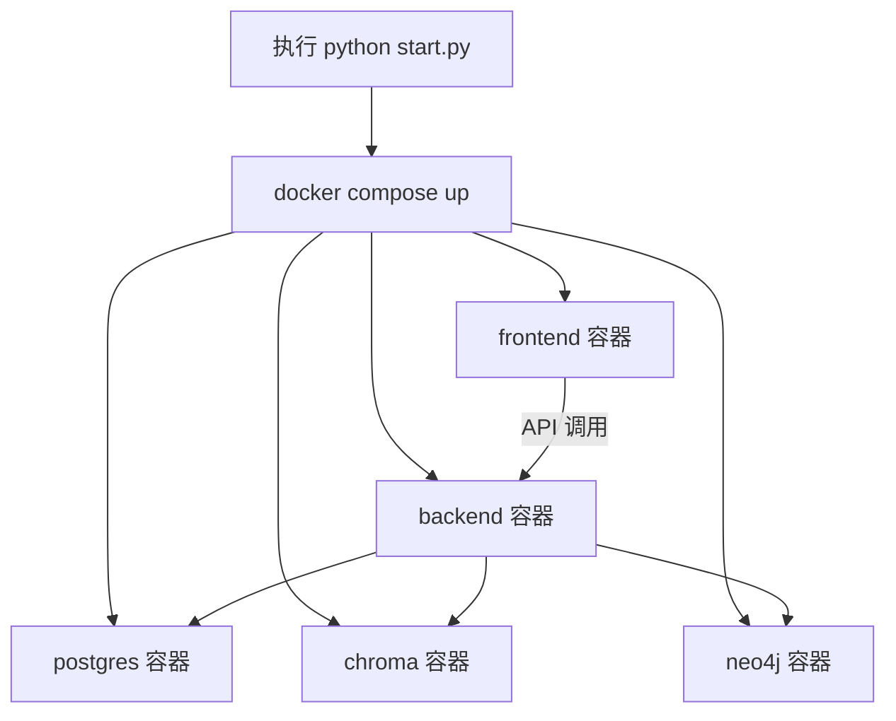
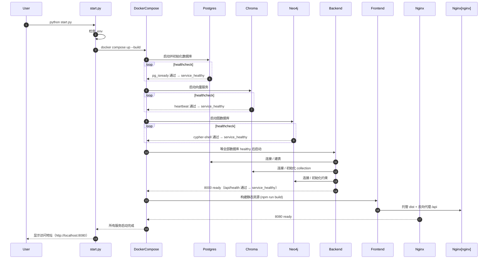

# 06_一键启动详解

## 1. 目标

让任何人在新机器上只需要一条命令就能把整个 XIAONA 系统跑起来，包括：后端、前端、数据库、向量数据库、知识图谱数据库。

实现方式：使用 **Docker Compose** 编排所有服务，并配合 `.env` 环境文件和启动脚本。

## 2. 一键启动架构



### 一键启动时序图



## 3. Docker Compose 配置

```yaml
# backend/docker-compose.yml
# 注意：Compose v2 不再需要 version 字段（写 version: "3.8" 会告警且已过时），
#       condition: service_healthy 由 v2 直接支持。

services:
  postgres:
    image: postgres:15-alpine
    container_name: xiaona_postgres
    environment:
      POSTGRES_USER: xiaona
      POSTGRES_PASSWORD: ${DB_PASSWORD:-xiaona_pass}
      POSTGRES_DB: xiaona
    volumes:
      - pg_data:/var/lib/postgresql/data
    ports:
      - "5432:5432"
    healthcheck:
      test: ["CMD-SHELL", "pg_isready -U xiaona -d xiaona"]
      interval: 5s
      timeout: 5s
      retries: 10

  chroma:
    # 版本锁死 1.0.0：与 backend 客户端 chromadb==1.0.0 对齐（防止 latest 漂移导致客户端/服务端不匹配）
    image: chromadb/chroma:1.0.0
    container_name: xiaona_chroma
    volumes:
      - chroma_data:/chroma/chroma
    ports:
      - "8001:8000"
    # 新版 chroma 镜像无 python/curl/wget，且已废弃 v1 API（返回 410），
    # 故用 bash /dev/tcp 探测 v2 心跳接口（实测 HTTP 200）。
    # 注意：CMD-SHELL 默认走 /bin/sh（dash），不支持 /dev/tcp，须显式 bash -c
    healthcheck:
      test: ["CMD-SHELL", "bash -c 'exec 3<>/dev/tcp/127.0.0.1/8000 && printf \"GET /api/v2/heartbeat HTTP/1.0\\r\\n\\r\\n\" >&3 && head -1 <&3 | grep -q \"200 OK\"'"]
      interval: 5s
      timeout: 5s
      retries: 10

  neo4j:
    image: neo4j:5-community
    container_name: xiaona_neo4j
    environment:
      NEO4J_AUTH: ${NEO4J_USER:-neo4j}/${NEO4J_PASSWORD:-xiaona_pass}
      NEO4J_PLUGINS: "[\"apoc\"]"
    volumes:
      - neo4j_data:/data
      - neo4j_logs:/logs
    ports:
      - "7474:7474"
      - "7687:7687"
    healthcheck:
      test: ["CMD-SHELL", "cypher-shell -u ${NEO4J_USER:-neo4j} -p ${NEO4J_PASSWORD:-xiaona_pass} 'RETURN 1'"]
      interval: 10s
      timeout: 10s
      retries: 10

  backend:
    build:
      context: ../backend
      dockerfile: Dockerfile
      # BuildKit 构建代理：让容器内 pip install 走宿主机 Clash（host.docker.internal
      # 是 Docker Desktop 的宿主机别名；Dockerfile 内已默认清华 pip 源作兜底，见 §4）
      args:
        HTTP_PROXY: http://host.docker.internal:7890
        HTTPS_PROXY: http://host.docker.internal:7890
        NO_PROXY: localhost,127.0.0.1
    container_name: xiaona_backend
    # healthcheck 依赖 GET /api/health（无需认证，见 01_单Agent聊天助手项目初始计划详解.md §5.6）
    environment:
      DATABASE_URL: postgresql://xiaona:${DB_PASSWORD:-xiaona_pass}@postgres:5432/xiaona
      CHROMA_HOST: chroma
      CHROMA_PORT: 8000
      NEO4J_URI: bolt://neo4j:7687
      NEO4J_USER: ${NEO4J_USER:-neo4j}
      NEO4J_PASSWORD: ${NEO4J_PASSWORD:-xiaona_pass}
      OPENAI_API_KEY: ${OPENAI_API_KEY:-}
      JWT_SECRET: ${JWT_SECRET:-dev-secret-change-me}
      FEISHU_APP_ID: ${FEISHU_APP_ID:-}
      FEISHU_APP_SECRET: ${FEISHU_APP_SECRET:-}
      FEISHU_VERIFY_TOKEN: ${FEISHU_VERIFY_TOKEN:-}
      FEISHU_ENCRYPT_KEY: ${FEISHU_ENCRYPT_KEY:-}
      FEISHU_BOT_OPEN_ID: ${FEISHU_BOT_OPEN_ID:-}
      FEISHU_BOT_NAME: ${FEISHU_BOT_NAME:-XIAONA}
      # 标记运行在容器内：llm_provider 据此把用户填的 localhost 自动解析为宿主机
      #（Ollama 等本地模型 base_url 可直接填 http://localhost:11434）
      XIAONA_IN_DOCKER: "1"
    # 让 host.docker.internal 在 Linux 主机也解析到宿主机（Docker Desktop 内置该别名，
    # 此处 host-gateway 对其同样生效），供本地模型连通性测试与扫描使用
    extra_hosts:
      - "host.docker.internal:host-gateway"
    ports:
      - "8000:8000"
    healthcheck:
      test: ["CMD-SHELL", "python -c \"import urllib.request; urllib.request.urlopen('http://localhost:8000/api/health')\""]
      interval: 10s
      timeout: 5s
      retries: 5
    depends_on:
      postgres:
        condition: service_healthy
      chroma:
        condition: service_healthy
      neo4j:
        condition: service_healthy
    # 生产不使用 bind mount（镜像内 COPY . . 提供完整代码）；
    # 开发如需热重载，可临时加 - ../backend:/app 并配合 --reload
    command: uvicorn app.main:app --host 0.0.0.0 --port 8000

  frontend:
    build:
      context: ../frontend
      dockerfile: Dockerfile
      # BuildKit 构建代理：让容器内 npm install 走宿主机 Clash（Dockerfile 内已默认 npmmirror 作兜底，见 §5）
      args:
        HTTP_PROXY: http://host.docker.internal:7890
        HTTPS_PROXY: http://host.docker.internal:7890
        NO_PROXY: localhost,127.0.0.1
    container_name: xiaona_frontend
    ports:
      - "8080:80"          # 映射到 8080，避免 80 在 Windows/macOS 需要管理员权限
    depends_on:
      backend:
        condition: service_healthy

volumes:
  # 显式指定卷名（name:），与 09 备份脚本 -v xiaona_*_data 的挂载名保持一致；
  # 否则 Compose 会生成项目名前缀卷（如 backend_neo4j_data），备份脚本会挂载到空卷。
  pg_data:
    name: xiaona_pg_data
  chroma_data:
    name: xiaona_chroma_data
  neo4j_data:
    name: xiaona_neo4j_data
  neo4j_logs:
    name: xiaona_neo4j_logs
  neo4j_dumps:    # 供 09 备份脚本的 Neo4j dump 中转（临时容器挂载）
    name: xiaona_neo4j_dumps
```

> 说明：`depends_on` 只能保证容器“已启动”，不能保证数据库“已就绪”。这里为每个服务（含 backend）配置了 `healthcheck`，并用 `condition: service_healthy` 串起启动顺序。生产模式下 frontend 构建静态文件后由 nginx 托管（见下文 Dockerfile）。前端接口走同源 `/api/...` 相对路径，由 nginx 代理到 backend，因此不需要 `VITE_API_BASE_URL`。

## 4. 后端 Dockerfile

```dockerfile
# backend/Dockerfile
FROM python:3.11-slim

WORKDIR /app

# 国内网络从官方 PyPI 拉包常超时，默认走清华镜像源；
# 海外用户构建时可用 --build-arg PIP_INDEX_URL=... 覆盖
ARG PIP_INDEX_URL=https://pypi.tuna.tsinghua.edu.cn/simple
ENV PIP_INDEX_URL=$PIP_INDEX_URL

# ffmpeg 为系统级依赖（04_语音输入与识别详解.md §5）：
# convert_to_wav 内部用 subprocess.run(["ffmpeg", ...])，缺装时网页/CLI/飞书
# 语音转写都会抛 FileNotFoundError
RUN apt-get update && apt-get install -y --no-install-recommends ffmpeg \
    && rm -rf /var/lib/apt/lists/*

COPY requirements.txt .
RUN pip install --no-cache-dir -r requirements.txt

# 构建时预下载 whisper 模型进镜像（走宿主机 Clash 代理）：
# 运行时容器访问不到 huggingface.co（Network unreachable），faster_whisper small
# 不预下则 ASR 初始化失败被吞，转写恒空/500（见当天台账四十六）；
# sentence-transformers 已随「chroma 改用配置的 embedding 模型」移除（2026-08-23），
# 向量改由设置页分配的模型经 /v1/embeddings 生成
ARG HTTP_PROXY=
ARG HTTPS_PROXY=
ARG NO_PROXY=localhost,127.0.0.1
ENV HTTP_PROXY=$HTTP_PROXY HTTPS_PROXY=$HTTPS_PROXY NO_PROXY=$NO_PROXY
RUN python -c "from faster_whisper import WhisperModel; WhisperModel('small', device='cpu', compute_type='int8')" \
    && rm -rf /root/.cache/pip
ENV HTTP_PROXY= HTTPS_PROXY= NO_PROXY=

COPY . .

CMD ["uvicorn", "app.main:app", "--host", "0.0.0.0", "--port", "8000"]
```

## 5. 前端 Dockerfile（生产多阶段构建）

```dockerfile
# frontend/Dockerfile
# ---- 构建阶段：Node 打包静态资源 ----
FROM node:20-alpine AS builder

WORKDIR /app
# 国内网络从官方 npm registry 拉包常超时，默认走 npmmirror；
# 海外用户构建时可用 --build-arg NPM_REGISTRY=... 覆盖
ARG NPM_REGISTRY=https://registry.npmmirror.com
# 目录树只声明 package.json（未提交 package-lock.json），用 package*.json + npm install，
# 避免 COPY package-lock.json 在无 lock 文件时直接失败
COPY package*.json ./
RUN npm install --registry=$NPM_REGISTRY

COPY . .
# 接口走同源 /api 相对路径，由 nginx 反向代理到 backend，无需注入 API 地址
RUN npm run build

# ---- 运行阶段：nginx 托管静态文件 + 反向代理 API ----
FROM nginx:1.25-alpine
COPY --from=builder /app/dist /usr/share/nginx/html
COPY nginx.conf /etc/nginx/conf.d/default.conf
EXPOSE 80
```

配套 `nginx.conf`（放在 `frontend/nginx.conf`）：

```nginx
server {
    listen 80;
    server_name _;
    root /usr/share/nginx/html;
    index index.html;

    # 上传大小限制：略高于后端 import 接口 50MB 上限，提前拒绝超大请求
    # （后端 /api/data/import 另有 Content-Length 头校验兜底，见 09_数据管理详解.md）
    client_max_body_size 60m;

    # 前端路由（history 模式）回退到 index.html
    location / {
        try_files $uri $uri/ /index.html;
    }

    # 反向代理后端 API
    location /api/ {
        proxy_pass http://backend:8000;
        proxy_http_version 1.1;
        proxy_set_header Host $host;
        proxy_set_header X-Real-IP $remote_addr;
        proxy_set_header X-Forwarded-For $proxy_add_x_forwarded_for;
        # SSE 流式接口需要关闭缓冲
        proxy_buffering off;
        proxy_cache off;
        # SSE 长连接超过默认 60s 会被断开，调大到 1 小时
        proxy_read_timeout 3600s;
    }
}
```

这样生产环境无需暴露后端端口给浏览器，浏览器统一访问 `/api/*`。

## 6. 环境变量文件

```bash
# .env.example
# 复制为 .env 后修改
DB_PASSWORD=xiaona_pass
NEO4J_USER=neo4j
NEO4J_PASSWORD=xiaona_pass
OPENAI_API_KEY=your-key-here

# 可选：生产环境请务必修改 JWT 密钥
# JWT_SECRET=change-me-to-a-random-string

# 可选：飞书机器人（10 §3 / §8，公网 Webhook 接入）
FEISHU_APP_ID=cli_xxx
FEISHU_APP_SECRET=xxx
# 事件订阅「加密策略」里取：Verification Token 用于签名验证（必填）
# FEISHU_VERIFY_TOKEN=xxx
# 事件订阅「加密策略」里取：Encrypt Key 用于事件加密模式解密（开启事件加密才需要）
# FEISHU_ENCRYPT_KEY=xxx
# 群聊 @ 判断用（机器人自身 open_id；后台不展示，需调 GET /open-apis/bot/v3/info 获取，见 10 §3）
# FEISHU_BOT_OPEN_ID=ou_xxx

# 可选：飞书账号绑定（10 §5.1）——绑定状态机在内存 5 分钟超时，无独立环境变量

# 可选：Etsy 官方 Open API v3 key（02 爬取 §7.1）——到 Etsy 开发者后台注册后填入，
# 供 fetch_etsy_trending 工具使用；未配置时该工具返回降级错误、可改用 Amazon BSR
# ETSY_API_KEY=

# 可选：Pinterest API v5 Bearer token（02 爬取 §7.1，2026-08-24 起）——到
# https://developers.pinterest.com/ 注册 app，OAuth 授权 scope user_accounts:read 后获取，
# 供 fetch_pinterest_trends 工具使用；未配置时该工具返回降级错误、跳过 Pinterest 维度
# PINTEREST_API_TOKEN=

# 可选：Agent 任务产物清理 TTL（天，默认 30，2026-08-24 起）——backend/artifacts 下
# 过期产物每日自动清理；不填默认 30 天
# ARTIFACTS_TTL_DAYS=30
```

> 注：`SMS_MOCK` 无独立环境变量，`backend/app/config.py` 默认 `"1"`（mock 阶段不发真实短信、验证码回显在响应/日志），真实接入短信服务商时需在 `config.py` 中关闭。

## 7. 启动脚本

> 统一使用现代 `docker compose`（Compose v2 随 Docker Desktop / docker 包内置，无需单独安装 `docker-compose`）。

> 跨平台统一使用 `start.py`（替代原 `start.bat` / `start.sh`，各平台用法一致：`python start.py`）。实现用 Python 标准库（`subprocess` / `shutil` / `pathlib`），**不依赖第三方包**。

```python
# start.py（项目根目录）
#!/usr/bin/env python3
"""XIAONA 一键启动（见 06_一键启动详解.md §7）。

用法：python start.py
跨平台统一入口（替代原 start.bat / start.sh）。
"""
import shutil
import subprocess
import sys
from pathlib import Path

ROOT = Path(__file__).resolve().parent


def main() -> int:
    if not (ROOT / ".env").exists():
        print("未找到 .env，请先执行：cp .env.example .env 并填写密钥")
        return 1
    if not shutil.which("docker"):
        print("未检测到 docker，请先安装 Docker 并确保 docker 在 PATH 中")
        return 1
    print("Starting XIAONA...")
    try:
        # --env-file 显式指定根目录 .env：Compose 默认从 compose 文件所在目录（backend/）
        # 查找 .env，会把根目录的 DB/Neo4j/OpenAI/飞书凭据全部丢掉（DB_PASSWORD 等恰与默认值
        # 相同才未暴露，FEISHU_APP_ID 等非默认值必须显式传入，见 §7 说明）
        return subprocess.call(
            ["docker", "compose", "--env-file", str(ROOT / ".env"),
             "-f", str(ROOT / "backend" / "docker-compose.yml"),
             "up", "--build"],
            cwd=str(ROOT),
        )
    except KeyboardInterrupt:
        print("\n已停止 XIAONA")
        return 0


if __name__ == "__main__":
    sys.exit(main())
```

启动前会依次校验：

1. `.env` 是否存在（缺失则提示 `cp .env.example .env` 并退出码 1）；
2. `docker` 是否在 PATH 中（缺失则明确提示并退出码 1）。

随后前台执行 `docker compose --env-file .env -f backend/docker-compose.yml up --build`，继承 Docker 输出与退出码；Ctrl+C 可优雅停止（捕获 `KeyboardInterrupt`）。

> **为什么必须 `--env-file`（2026-08-17 修）**：Compose 默认从 **compose 文件所在目录**（`backend/`）查找 `.env`，而项目 `.env` 在根目录——`DB_PASSWORD`/`NEO4J_PASSWORD` 恰好与 `docker-compose.yml` 里的默认值相同才一直没暴露，新增的 `FEISHU_APP_ID`/`FEISHU_APP_SECRET`/`FEISHU_VERIFY_TOKEN`（非默认值）会直接为空、飞书 webhook 签名校验与事件处理不可用。`start.py` 用 `--env-file <根目录>/.env` 显式指定，手工执行 compose 时也必须带同参数。

## 8. 常见问题排查

`python start.py` 构建 / 拉镜像阶段最容易遇到两类网络问题（国内网络环境），按症状对号入座：

### 8.1 症状与原因

| 报错 | 阶段 | 原因 |
|------|------|------|
| `failed to fetch anonymous token` / `connectex` | 拉基础镜像 | Docker Hub 被墙，daemon 层没走代理/镜像源 |
| `Read timed out`（`files.pythonhosted.org` / `pypi.tuna.tsinghua.edu.cn`） | 构建 pip 阶段 | 构建容器内没走代理，且国内源偶发超时 |
| `ERR_SOCKET_TIMEOUT` / `npm` 超时 | 构建 npm 阶段 | 同上（npm registry 访问慢） |
| `Container xiaona_chroma is unhealthy` | 服务启动 | 新版 chroma 镜像已废弃 v1 API 且无 `python`（healthcheck 配置见 §3） |

### 8.2 方案 A：国内镜像源（无 VPN 兜底）

- **拉镜像**：`C:\Users\38384\.docker\daemon.json` 配置 `registry-mirrors`（2026 年可用源示例：`docker.1ms.run`、`docker.xuanyuan.me`、`docker.m.daocloud.io`），然后重启 Docker Desktop：

```json
{
  "registry-mirrors": [
    "https://docker.1ms.run",
    "https://docker.xuanyuan.me",
    "https://docker.m.daocloud.io"
  ]
}
```

- **pip**：`backend/Dockerfile` 默认 `PIP_INDEX_URL=https://pypi.tuna.tsinghua.edu.cn/simple`（`ARG`/`ENV`，见 §4），构建时可用 `--build-arg PIP_INDEX_URL=...` 覆盖。
- **npm**：`frontend/Dockerfile` 默认 `NPM_REGISTRY=https://registry.npmmirror.com`（`ARG`，见 §5），构建时可用 `--build-arg NPM_REGISTRY=...` 覆盖。

### 8.3 方案 B：Clash / VPN 代理（网络可达时首选）

有 Clash（或任意本地 HTTP 代理）时，配置**双层代理**：daemon 层拉镜像 + BuildKit 层构建依赖。

1. **daemon 层**（拉镜像）：`daemon.json` 新增 `proxies` 段指向本机代理端口（与 `registry-mirrors` 可并存）：

```json
{
  "proxies": {
    "http-proxy": "http://127.0.0.1:7890",
    "https-proxy": "http://127.0.0.1:7890",
    "no-proxy": "localhost,127.0.0.1"
  }
}
```

2. **BuildKit 层**（构建 pip/npm）：`backend/docker-compose.yml` 已在 `backend`/`frontend` 的 `build.args` 注入：

```yaml
args:
  HTTP_PROXY: http://host.docker.internal:7890
  HTTPS_PROXY: http://host.docker.internal:7890
  NO_PROXY: localhost,127.0.0.1
```

`HTTP_PROXY`/`HTTPS_PROXY`/`NO_PROXY` 是 BuildKit 预定义构建参数，Compose 显式传入后自动注入构建 `RUN` 步骤环境变量（pip/npm 自动读取）。

> **平台差异**：`host.docker.internal` 在 Windows / macOS（Docker Desktop）开箱即用；Linux 需要在 compose 加 `extra_hosts: ["host.docker.internal:host-gateway"]`（backend 服务已配，见 §3 示例）。
>
> **本地模型（Ollama）连通（2026-08-15 起）**：后端容器内 `localhost` 指向容器自身，用户若在设置页填 `http://localhost:11434` 将连不上宿主机 Ollama。backend 服务通过 `XIAONA_IN_DOCKER=1` 标记容器环境，`llm_provider._resolve_host` 会把 `localhost / 127.0.0.1 / 0.0.0.0` 自动翻译为 `host.docker.internal` 再请求——**用户无需改填 Docker 路径，直接填 `localhost:端口` 即可**；容器外运行（开发模式）时不做翻译。连通性测试失败的提示语也会提示「请确认本机 Ollama 已启动」。
>
> **代理端口**：Clash 默认混合端口 `7890`，若自定义请在 `daemon.json` 与 `build.args` 中同步修改（注意 `docker info` 可能显示 Docker Desktop 内置的 `http.docker.internal:3128`，这是 Docker Desktop 的新版转发机制，实际流量仍会落到配置的代理上）。

### 8.4 验证与结论

- 验证命令：`docker info` 应同时显示 `Registry Mirrors` 与 `HTTP Proxy/HTTPS Proxy`；`docker compose config --quiet` 校验 compose 语法。
- **两方案可并存**：Clash 开启时走代理，关闭时拉镜像走加速器、pip/npm 走国内源，互相兜底。

## 9. 开发模式（不使用 Docker）

如果只想本地开发：

```bash
# 1. 启动数据库（使用 Docker 单独跑）
docker run -d --name xiaona_postgres -e POSTGRES_USER=xiaona -e POSTGRES_PASSWORD=xiaona_pass -e POSTGRES_DB=xiaona -p 5432:5432 postgres:15-alpine
docker run -d --name xiaona_chroma -p 8001:8000 chromadb/chroma:1.0.0
docker run -d --name xiaona_neo4j -e NEO4J_AUTH=neo4j/xiaona_pass -p 7474:7474 -p 7687:7687 neo4j:5-community

# 2. 启动后端
cd backend
python -m venv venv
venv\Scripts\activate  # Windows: venv\Scripts\activate
pip install -r requirements.txt
uvicorn app.main:app --reload

# 3. 启动前端
cd frontend
npm install
npm run dev
```

> **CHROMA_PORT 语义**：compose 内（`docker-compose.yml`）后端配置 `CHROMA_PORT=8000`，指的是容器网络里直连 Chroma 服务端口；**本地直连**（上面的开发模式）则必须用宿主机映射端口，即 `CHROMA_PORT=8001`（`-p 8001:8000` 的含义：容器内 8000，宿主机 8001）。可用环境变量或 `.env` 覆盖：
>
> ```bash
> # Windows (PowerShell)
> $env:CHROMA_PORT=8001
> # Linux / macOS
> export CHROMA_PORT=8001
> ```
>
> 同理本地直连 PostgreSQL 用 `5432`、Neo4j 用 `7687`，与 compose 内服务名直连的语义不同。

前端开发服务器在 `5173` 端口。所有接口走同源相对路径 `/api/...`，因此必须配置 **Vite 代理**把 `/api` 转发到后端 `8000`（否则浏览器会把 `/api` 打到 Vite dev server）：

```js
// frontend/vite.config.js
import { defineConfig } from 'vite';
import react from '@vitejs/plugin-react';

export default defineConfig({
  plugins: [react()],
  server: {
    port: 5173,
    proxy: {
      // SSE 流式接口同样走代理（ws/stream 支持见 http-proxy 默认配置）
      '/api': {
        target: 'http://localhost:8000',
        changeOrigin: true,
      },
    },
  },
});
```

## 10. 启动后访问入口

| 服务 | 地址 |
|------|------|
| 前端（nginx，生产构建） | http://localhost:8080 |
| 后端 API | http://localhost:8000 |
| 后端文档 | http://localhost:8000/docs |
| Neo4j Browser | http://localhost:7474 |

> 生产模式下浏览器只访问前端 `http://localhost:8080`，API 请求经 nginx 代理 `/api/*` → backend:8000；后端端口可不对外暴露。开发模式下访问 `http://localhost:5173`，`/api` 由 Vite 代理转发。

## 11. 关联文档

- 后端模块：`01_单Agent聊天助手项目初始计划详解.md`
- 长期记忆数据库：`02_长期记忆详解.md`
- 知识图谱数据库：`03_知识图谱详解.md`
- 前端构建：`05_前端详解.md`
- 飞书回调地址：`10_飞书IM机器人接入详解.md`
