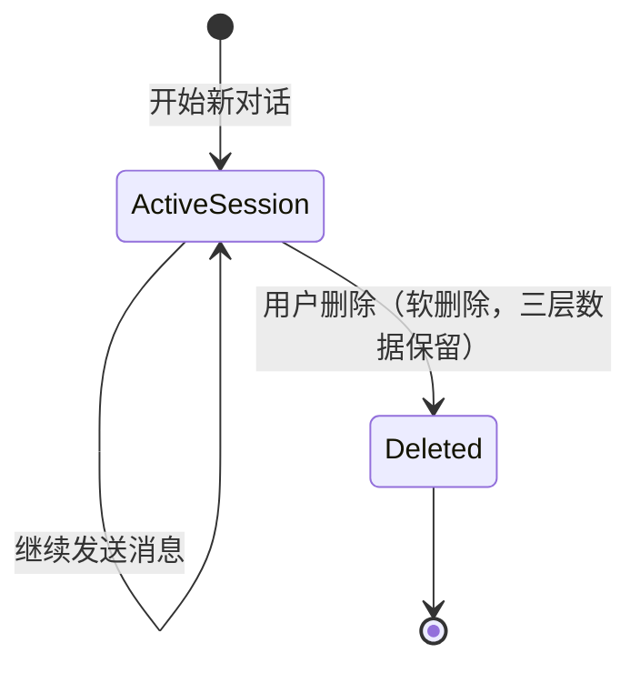
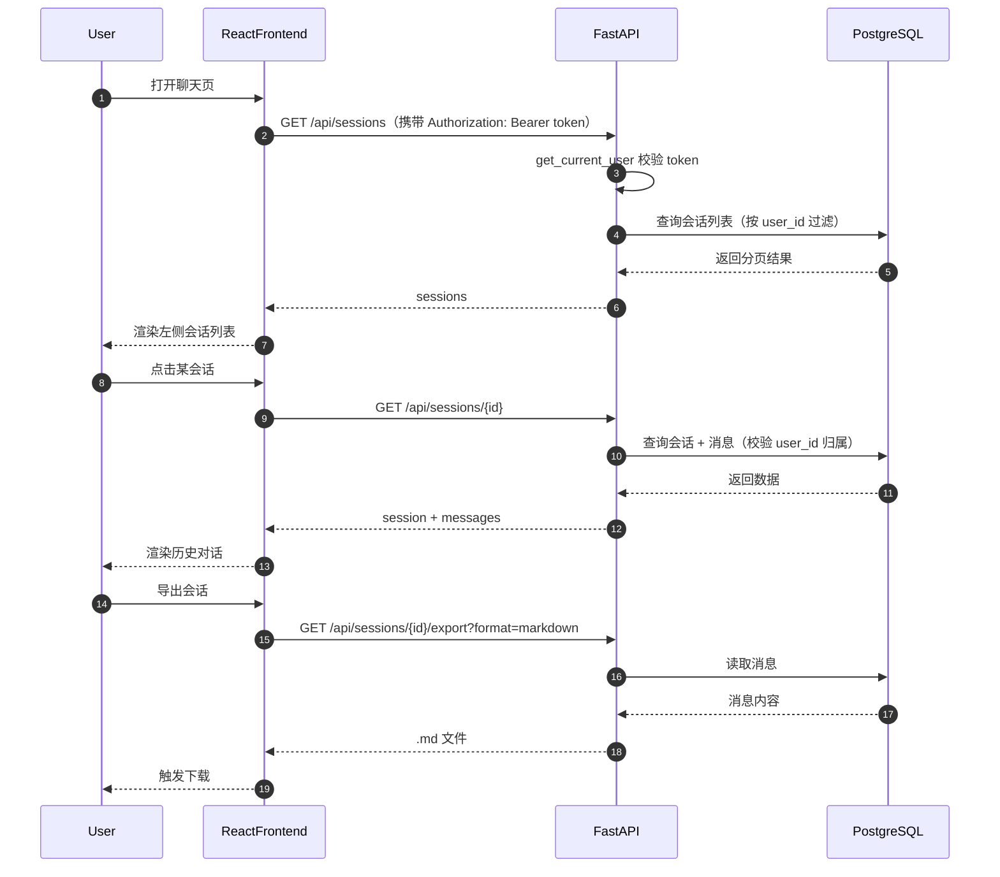

# 07_会话历史记录详解

## 1. 目标

会话历史记录模块负责把所有对话按“会话（Session）”维度组织起来，提供新建、查看、搜索、分页、导出、删除等能力。它是机器人“工作记忆”的可视化入口，也是用户回溯过往聊天的主要界面。

每一条原始消息首先进入 SQL 的 `messages` 表（详见 `02_长期记忆详解.md`），然后通过会话维度对外暴露。

## 2. 核心概念

- **Session（会话）**：一次连续的聊天上下文，类似微信里的一次对话窗口。会话有标题、创建时间、最后更新时间。
- **Message（消息）**：会话中的单条用户或助手消息。
- **接入源标识**：记录消息来自 CLI、Web 还是飞书，方便后续排查和统计。

## 3. 会话生命周期



> **注（2026-08-24 修）**：原生命周期图含 `Archived`（归档）状态——该功能当前**未实现**（代码里只有会话软删除 `is_deleted`，无用户可操作的归档态），图中已移除，避免误导（历史消息的"归档"发生在记忆层 `Message.is_archived`，与会话生命周期无关，见 `02_长期记忆详解.md`）。

### 会话管理时序图



## 4. 数据模型

数据模型与 `01_单Agent聊天助手项目初始计划详解.md` 的「统一约定总纲」完全一致：多用户、带 `user_id` 隔离，并包含 `02_长期记忆详解.md` 的记忆字段。

```python
# backend/app/db/sql_models.py
class User(Base):
    __tablename__ = "users"
    id = Column(String(36), primary_key=True)  # uuid
    phone = Column(String(128), unique=True, index=True)  # 手机号（2026-08-17 起不再创建 feishu_{open_id} 影子账号）
    password_hash = Column(String(256))
    nickname = Column(String(64), default="")
    created_at = Column(DateTime, default=datetime.utcnow)
    # 最近活跃（飞书 webhook 每次消息刷新；2026-08-17 影子账号机制废弃后仅留作活跃统计）
    last_active_at = Column(DateTime, default=datetime.utcnow, onupdate=datetime.utcnow)
    # 原供影子账号绑定提醒限频（2026-08-17 影子机制废弃，列保留但不再写入）
    last_reminded_at = Column(DateTime, nullable=True)

class Session(Base):
    __tablename__ = "sessions"
    id = Column(String(36), primary_key=True)  # uuid
    user_id = Column(String(36), ForeignKey("users.id"), index=True)
    title = Column(String(128), default="新会话")
    source = Column(String(16), default="web")  # web / cli / feishu / desktop
    # 软删除标记（2026-08-15 起：聊天删除免密软删，数据保留在三库供记忆检索；
    # 设置页「清空数据」仍为硬删除）
    is_deleted = Column(Boolean, default=False)
    created_at = Column(DateTime, default=datetime.utcnow)
    updated_at = Column(DateTime, default=datetime.utcnow, onupdate=datetime.utcnow)
    messages = relationship("Message", back_populates="session",
                            order_by=lambda: (Message.created_at, Message.id))

class Message(Base):
    __tablename__ = "messages"
    id = Column(String(36), primary_key=True)  # uuid
    session_id = Column(String(36), ForeignKey("sessions.id"), index=True)
    user_id = Column(String(36), ForeignKey("users.id"), index=True)
    role = Column(String(16))             # user / assistant
    content = Column(Text)
    # 模型思考过程（2026-08-15 起）：DeepSeek reasoning_content / Ollama thinking，
    # 随 assistant 消息一起入库；修改 Message 序列化时注意带上
    thinking = Column(Text, default="")
    # 附件元数据（2026-08-15 起，12 §）：JSON 字符串 [{name,kind,size}]，
    # 图片仅存元数据不存二进制；飞书媒体额外带 file_key/message_id 供按需下载
    attachments = Column(Text, default="")
    source = Column(String(16), default="web")
    weight = Column(Float, default=0.5)          # 记忆权重
    importance = Column(Float, default=0.0)
    emotion_score = Column(Float, default=0.0)
    mention_count = Column(Integer, default=1)
    created_at = Column(DateTime, default=datetime.utcnow)
    last_mentioned_at = Column(DateTime, default=datetime.utcnow)
    is_archived = Column(Boolean, default=False)
    session = relationship("Session", back_populates="messages")
```

## 5. API 设计

| 接口 | 方法 | 说明 |
|------|------|------|
| `/api/sessions` | GET | 分页获取会话列表 |
| `/api/sessions` | POST | 创建新会话 |
| `/api/sessions/search` | GET | 按关键词搜索会话（**后端保留、前端未接入**，前端 `sessionsApi` 已删 search，2026-08-16 清理；必须注册在 `/{session_id}` 之前） |
| `/api/sessions/{id}` | GET | 获取单个会话详情（含消息） |
| `/api/sessions/{id}` | DELETE | 软删除会话（**免密**，仅 `is_deleted=True` 从界面隐藏，SQL/Chroma/KG 数据全部保留供记忆检索） |
| `/api/sessions/{id}/title` | PUT | 修改会话标题（**后端保留、前端未接入**，前端 `sessionsApi` 已删 rename，2026-08-16 清理） |
| `/api/sessions/{id}/messages` | GET | 分页获取会话内消息 |
| `/api/sessions/{id}/export` | GET | 导出会话为 Markdown / JSON（与 09 统一，见 §9） |

> **路由顺序**：FastAPI 按注册顺序匹配路由。`/api/sessions/search` 必须定义在 `/api/sessions/{session_id}` 之前，否则 `session_id="search"` 会先被 `/{session_id}` 捕获导致 404。本文档代码块按「列表 → 搜索 → 详情 → 删除 → 导出」顺序展示，编码时保持该顺序。

## 6. 会话列表与分页

```python
# backend/app/api/sessions.py
from fastapi import APIRouter, Query, Depends, HTTPException
from sqlalchemy.orm import Session as DbSession
from app.db.sql_models import Session as SessionModel, Message, User
from app.core.auth import get_current_user
from app.dependencies import get_db

router = APIRouter(prefix="/api/sessions", tags=["sessions"])

@router.get("")
def list_sessions(
    page: int = Query(1, ge=1),
    page_size: int = Query(20, ge=1, le=100),
    db: DbSession = Depends(get_db),
    user: User = Depends(get_current_user),   # 需登录
):
    offset = (page - 1) * page_size
    total = db.query(SessionModel).filter_by(user_id=user.id, is_deleted=False).count()
    items = (
        db.query(SessionModel)
        .filter_by(user_id=user.id, is_deleted=False)
        .order_by(SessionModel.updated_at.desc())
        .offset(offset).limit(page_size).all()
    )
    return {
        "total": total,
        "page": page,
        "page_size": page_size,
        "items": [{"id": s.id, "title": s.title, "updated_at": s.updated_at} for s in items]
    }
```

## 7. 搜索会话

> **后端保留、前端未接入（2026-08-16 清理）**：前端 `sessionsApi` 已删除 `search` 方法，聊天页/侧边栏不提供搜索入口；接口仍保留供 CLI/未来接入。路由上仍需放在 §8 的 `/{session_id}` 之前注册（顺序要求见 §5）。

```python
@router.get("/search")
def search_sessions(
    q: str,
    db: DbSession = Depends(get_db),
    user: User = Depends(get_current_user),
):
    # 仅搜索当前用户的会话标题或消息内容
    session_ids = db.query(Message.session_id).filter(
        Message.user_id == user.id,
        Message.content.ilike(f"%{q}%")
    ).distinct().all()
    sessions = db.query(SessionModel).filter(
        SessionModel.user_id == user.id,
        SessionModel.is_deleted.is_(False),
        SessionModel.id.in_([s[0] for s in session_ids]) |
        SessionModel.title.ilike(f"%{q}%")
    ).all()
    return [{"id": s.id, "title": s.title} for s in sessions]
```

## 8. 会话详情与消息分页

```python
@router.get("/{session_id}")
def get_session(
    session_id: str,
    db: DbSession = Depends(get_db),
    user: User = Depends(get_current_user),
):
    session = db.query(SessionModel).filter_by(id=session_id, user_id=user.id, is_deleted=False).first()
    if not session:
        raise HTTPException(status_code=404, detail="Session not found")
    # 消息含 id（前端用作列表 key）与记忆字段，供聊天页渲染与再次提及时加权；
    # thinking/attachments 一并返回（AGENTS.md：get_session/messages/导出均返回，2026-08-16 勘误）
    return {
        "id": session.id,
        "title": session.title,
        "messages": [
            {
                "id": m.id, "role": m.role, "content": m.content, "created_at": m.created_at,
                "thinking": m.thinking or "", "attachments": m.attachments or "",
            }
            for m in session.messages
        ]
    }
```

会话内消息分页（消息多时避免一次性拉全）：

```python
@router.get("/{session_id}/messages")
def get_session_messages(
    session_id: str,
    page: int = Query(1, ge=1),
    page_size: int = Query(50, ge=1, le=200),
    db: DbSession = Depends(get_db),
    user: User = Depends(get_current_user),
):
    session = db.query(SessionModel).filter_by(id=session_id, user_id=user.id, is_deleted=False).first()
    if not session:
        raise HTTPException(status_code=404, detail="Session not found")

    base = (
        db.query(Message)
        .filter(Message.session_id == session_id, Message.user_id == user.id)
        # 稳定排序：时间相同（如同批写入）时按 id 保证顺序一致，避免翻页重复/遗漏
        .order_by(Message.created_at, Message.id)
    )
    total = base.count()
    messages = base.offset((page - 1) * page_size).limit(page_size).all()
    return {
        "total": total,
        "page": page,
        "page_size": page_size,
        "items": [
            {
                "id": m.id, "role": m.role, "content": m.content, "created_at": m.created_at,
                "thinking": m.thinking or "", "attachments": m.attachments or "",
            }
            for m in messages
        ],
    }
```

### 修改会话标题

> **后端保留、前端未接入（2026-08-16 清理）**：前端 `sessionsApi` 已删除 `rename` 方法，当前界面未提供「重命名」入口；接口仍保留供 CLI/未来接入。调用方式：`api.put('/api/sessions/{id}/title', { title })`。

```python
from fastapi import Body
from pydantic import BaseModel, Field

class SessionTitleRequest(BaseModel):
    title: str = Field(..., min_length=1, max_length=128)   # 与模型 String(128) 对齐

@router.put("/{session_id}/title")
def rename_session(
    session_id: str,
    req: SessionTitleRequest,
    db: DbSession = Depends(get_db),
    user: User = Depends(get_current_user),
):
    session = db.query(SessionModel).filter_by(id=session_id, user_id=user.id, is_deleted=False).first()
    if not session:
        raise HTTPException(status_code=404, detail="Session not found")
    session.title = req.title.strip()
    db.commit()
    return {"id": session.id, "title": session.title}
```

> 校验 `user_id` 防止跨用户改名；`max_length=128` 与 §4 统一模型 `Session.title = String(128)` 一致。前端当前未接入该接口（`sessionsApi` 已删 rename，2026-08-16 清理）。

## 9. 删除会话（2026-08-15 起：免密软删除）

> **变更说明**：聊天界面删除会话**不再需要密码**，且改为**软删除**——仅把 `sessions.is_deleted` 置为 `True`，SQL 消息、Chroma 向量、知识图谱数据**全部保留**，供后续记忆检索与模型思考继续调用。设置页「清空数据」（`POST /api/data/clear`，`09_数据管理详解.md §6`）仍是**需密码的硬删除**，会连软删会话一起清掉。

```python
@router.delete("/{session_id}")
def delete_session(
    session_id: str,
    db: DbSession = Depends(get_db),
    user: User = Depends(get_current_user),
):
    session = db.query(SessionModel).filter_by(
        id=session_id, user_id=user.id, is_deleted=False
    ).first()
    if not session:
        raise HTTPException(status_code=404, detail="Session not found")

    # 软删除：仅隐藏界面入口，三层数据保留（记忆检索仍可命中）
    session.is_deleted = True
    db.commit()
    return {"ok": True, "soft_deleted": True}
```

> 各查询接口（`list_sessions` / `search_sessions` / `get_session` / `get_session_messages` / `export_session` / `rename_session`）均需过滤 `is_deleted == False`；`memory_engine.ensure_session` 同样过滤，避免软删会话被继续写入“复活”。
>
> **迁移**：`create_all` 不会给已存在的 `sessions` 表补新列，`init_db()`（`app/db/database.py`）内置轻量迁移——`inspect` 检查缺列时执行 `ALTER TABLE sessions ADD COLUMN is_deleted BOOLEAN DEFAULT FALSE`（兼容 SQLite/PostgreSQL）。

## 10. 导出会话

```python
from fastapi.responses import Response, JSONResponse

@router.get("/{session_id}/export")
def export_session(
    session_id: str,
    format: str = "markdown",
    db: DbSession = Depends(get_db),
    user: User = Depends(get_current_user),
):
    session = db.query(SessionModel).filter_by(id=session_id, user_id=user.id, is_deleted=False).first()
    if not session:
        raise HTTPException(status_code=404)

    if format not in ("markdown", "json"):
        raise HTTPException(status_code=400, detail=f"不支持的导出格式：{format}")

    if format == "markdown":
        lines = [f"# {session.title}\n"]
        for m in session.messages:
            lines.append(f"**{m.role}**: {m.content}\n")
            # 导出带思考过程（AGENTS.md：get_session/messages/导出均返回 thinking）
            if m.role == "assistant" and (m.thinking or "").strip():
                lines.append(f"> 深度思考：{m.thinking}\n")
        return Response("\n".join(lines), media_type="text/markdown")

    if format == "json":
        data = {
            "id": session.id,
            "title": session.title,
            "source": session.source,
            # 消息级 source（2026-08-24 起）：与 import_session 的 m.get("source") 对应，
            # 导出→导入单会话往返不丢渠道字段（web/desktop/feishu/cli）
            "messages": [
                {"role": m.role, "content": m.content,
                 "thinking": m.thinking or "", "attachments": m.attachments or "",
                 "source": m.source or ""}
                for m in session.messages
            ]
        }
        return JSONResponse(data)
```

> 导出单会话统一走本接口；`09_数据管理详解.md` 不再提供重复的会话导出接口（见其 §8 的去重复约定）。**2026-08-16 晚补齐**：markdown 导出对 assistant 消息附 `> 深度思考：` 块，json 导出补 `thinking` 字段（此前导出不含思考过程，与 AGENTS.md「导出均返回 thinking」约定不符）。**2026-08-16 补**：json 导出补 `attachments` 字段，与 `import_session`（`memory_engine`）导入重建对齐，保证导出→清空→导入往返不丢附件元数据。**2026-08-24 补**：json 导出补 `source` 字段（会话级 + 消息级），导入侧原样重建，往返不丢渠道字段。

## 11. 前端会话列表

> **2026-08-15 变更**：独立「历史会话」页已移除，会话列表统一为聊天页左侧可收起、可删除的侧边栏（见 `05_前端详解.md §7`）。侧边栏会话项 hover 显示删除按钮，删除**免密**（`DeleteConfirm` 的 `requirePassword={false}`，走 §9 软删除接口），删除当前会话时同时清空聊天区状态。

```jsx
// frontend/src/pages/Chat.jsx 侧边栏核心片段
const [collapsed, setCollapsed] = useState(false);
const [deleteTarget, setDeleteTarget] = useState(null);

const handleDeleteSession = async () => {        // 免密软删除
  const target = deleteTarget;
  await sessionsApi.remove(target.id);           // 不再传密码
  setSessions(prev => prev.filter(x => x.id !== target.id));
  if (sessionId === target.id) { setSessionId(null); setMessages([]); }
  setDeleteTarget(null);
};

{/* 删除确认：免密模式 */}
<DeleteConfirm
  open={deleteTarget !== null}
  onClose={() => setDeleteTarget(null)}
  onConfirm={handleDeleteSession}
  title="删除会话"
  description="会话将从列表中移除，但聊天数据会保留在数据库中以供后续记忆检索（可在设置中彻底清空）。"
  confirmText="删除"
  requirePassword={false}
/>

{sessions.map(s => {
  const active = s.id === sessionId;
  return (
    <div key={s.id} onClick={() => setSessionId(s.id)}
      className={`group flex items-center justify-between px-3 py-2 rounded-lg cursor-pointer ${
        active ? 'bg-indigo-50 text-indigo-700' : 'text-slate-700 hover:bg-slate-100'
      }`}>
      <span className="truncate text-sm">{s.title}</span>
      <button onClick={e => { e.stopPropagation(); setDeleteTarget(s); }}
        className="ml-2 shrink-0 text-slate-300 opacity-0 group-hover:opacity-100 hover:text-red-500">×</button>
    </div>
  );
})}
```

## 12. 2026-08-15 全通路改造：持久化时机 / thinking 列 / 自动标题 / URL 同步

### 12.1 持久化时机（用户消息先行落库）

`memory_engine` 将原 `_persist` 拆为两步，保证 LLM 失败/中断也不丢用户记录：

- `_persist_user(user_id, session_id, user_text, source, embedding_enabled)`：**LLM 调用前**执行，用户消息写 SQL + Chroma。
- `_persist_reply(...)`：**流结束后 finally 执行**，回复写 SQL + Chroma + KG 三元组（`thinking` 一并入库）。

`chat` 非流式同理：先 `_persist_user` 再调 LLM，最后 `_persist_reply`。

### 12.2 thinking 列

- `Message.thinking`（Text，默认 `""`）存模型思考过程；`messages` 表迁移在 `database._apply_light_migrations()`（`ALTER TABLE messages ADD COLUMN thinking TEXT DEFAULT ''`）。
- `GET /api/sessions/{id}`、`GET /api/sessions/{id}/messages`、导出均返回 `thinking` 字段。

### 12.3 自动会话标题

- 新增 `_maybe_auto_title`：会话标题仍为「新会话」时，用聊天模型以「≤12 字中文标题」prompt 概括用户首条消息；失败/超长/空白回退首条消息前 15 字。
- 幂等：生成成功后标题不再为「新会话」，后续轮次不再触发。
- 前端流结束 `sessionsApi.list()` 刷新侧边栏，新标题立即可见。

### 12.4 URL 同步与流式 session_id 回传

- 聊天页 `setSearchParams({ session_id })`（replace），刷新/返回可恢复当前会话。
- **sessionStorage 跨页面保持（2026-08-16 起）**：`Chat.jsx` 把当前会话 id 另存 `sessionStorage`（key=`chat_active_session_{user.id}`，**按用户隔离**）。`sessionId` 初始化「URL 参数优先，其次 sessionStorage」——切页（关系网/桌面助手/设置）导致组件卸载重挂时自动恢复刚才打开的会话；删除当前会话（`setSessionId(null)`）同步移除存储；**只有浏览器完全关闭重新打开**（sessionStorage 清空）才回到新会话界面。
- `POST /api/chat/stream` **首帧回传实际 `session_id`**（`ensure_session` 确定值），前端 `streamChat` 的 `onSession` 回调据此同步（桌面助手固定会话软删自愈后防碎片化）。

### 12.5 attachments 附件持久化（2026-08-15 起，详见 12）

- `Message.attachments`（Text，JSON `[{name,kind,size}]`）随 user 消息落库；文本类附件落库 `content` **只记 `[附件：文件名]` 占位**（`_compose_user_text`），图片记 `[附件：文件名（图片）]` 说明，**二进制不落库**；提取全文只进当次 LLM 上下文（`_compose_llm_text`）。
- 迁移：`database._apply_light_migrations()` 已补 `ALTER TABLE messages ADD COLUMN attachments TEXT DEFAULT ''`。
- `GET /api/sessions/{id}`、`/messages`、导出均返回 `attachments` 字段。
- 飞书媒体元数据（含 `file_key`/`message_id`）也存于此，供按需下载（见 `10_飞书IM机器人接入详解.md` 与 `12` §6）。

### 12.6 新会话发消息丢失修复（前端懒创建守卫）

**现象**：新会话（`sessionId` 为空）直接发消息时，屏幕先闪一下、侧边栏新建会话，但刚发送的内容全部消失，需要二次点击进新会话重发才保留。

**根因**：无会话时 `sendMessage` 内部先 `sessionsApi.create()` 再 `setSessionId(sid)`，后者触发两个依赖 `sessionId` 的 effect：① reload effect 用 `GET /api/sessions/{id}` 拉新会话的空消息列表，覆盖了刚 append 的乐观消息；② 卸载 effect 直接 `abortRef.current?.abort()`，把刚发起的 SSE 流立刻中断（后端日志表现为 `POST /api/chat/stream 499`）。

**修复**（`Chat.jsx`）：引入两个一次性守卫 ref——`pendingSendRef`（reload effect 跳过消息拉取，仅刷新会话列表）与 `noAbortRef`（卸载 effect 跳过本次 abort，一次性消费后复位）。其余路径（点侧边栏切会话、点「+ 新会话」）不受影响，仍走原 reload/abort 逻辑。详见 `05` §7。

## 13. 关联文档

- 总体架构：`01_单Agent聊天助手项目初始计划详解.md`
- 消息权重与遗忘：`02_长期记忆详解.md`
- 数据导出与备份：`09_数据管理详解.md`
- 前端聊天页集成：`05_前端详解.md`

> 本文件代码片段依赖以下 import（实现时统一补齐）：`fastapi` 的 `APIRouter, Query, Depends, HTTPException, Body`、`fastapi.responses` 的 `Response, JSONResponse`、`sqlalchemy.orm` 的 `Session as DbSession`、模型 `Session, Message, User`、`get_current_user`、`get_db`。
