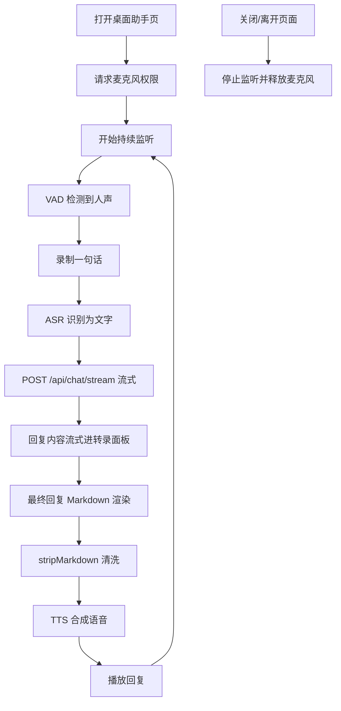
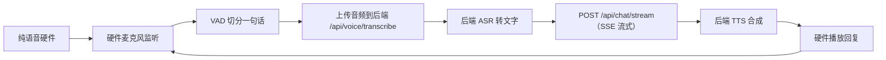

# 08_桌面助手详解

## 1. 目标

「桌面助手」不是独立接入端，而是 **网页端内的一个页面**（三端接入：网页 / 飞书 / CLI）。它提供**实时语音对话**体验：打开页面即持续监听，用户说完一句话，自动 ASR → 聊天 → TTS → 播放语音回复，全程无需打字。

其背后的「实时语音通路」（VAD → ASR → `/api/chat/stream`（SSE 流式，首帧 `session_id` → `delta/thinking` 增量 → `[DONE]`）→ TTS）复用网页聊天页同一套后端语音接口。**未来纯语音硬件接入时，直接连通这条通路即可**，无需开发独立桌面程序。

## 2. 网页端桌面助手页（当前实现）

### 2.1 定位

- 网页端包含两个页面：**聊天页**（文字 + 语音转文字输入）与**桌面助手页**（实时语音对话）。
- 桌面助手页在顶部导航栏「桌面助手」入口进入，打开即监听，关闭/离开页面即停止。

### 2.2 实时语音对话流程

### 2.3 实现要点

#### 2.3.1 启动与监听

- **纯自动监听（2026-08-15 起）**：桌面助手**没有「开始/停止监听」按钮**——打开页面（组件 mount）即自动 `startListening()`，切换路由/关闭页面（组件 unmount）自动 `stopListening()` 释放麦克风。麦克风权限被拒时分类提示并渲染「重新启动监听」按钮。
- **start/stop 竞态防护（2026-08-15 起）**：`startListening` 用 `startGenRef` 代际计数——开头 `const gen = ++startGenRef.current`，`await getUserMedia` 之后校验 `gen === startGenRef.current && aliveRef.current`，否则立即 `stream.getTracks().forEach(t => t.stop())` 并 return（防止异步 start 覆盖 stop 状态、卸载后泄漏麦克风）；`stopListening` 开头 `startGenRef.current++` 令所有在途 start 失效。
- **权限错误分类（2026-08-15 起）**：`describeMicError(e)`——`NotAllowedError/SecurityError`→「点地址栏锁图标允许麦克风」；`NotFoundError`→「未检测到麦克风设备」；`NotReadableError`→「被其他应用占用」；其余显示具体 message；`new AudioContext()` 包 try/catch（失败归类为启动失败并释放流）。启动失败时圆形图标旁出现**「重新启动监听」按钮**（点击重新 `startListening`）。
- **切页/失焦即关麦（2026-08-15 起）**：页面切到其他浏览器标签页、最小化或窗口失焦（`document` 的 `visibilitychange`、`window` 的 `blur`）会立即调用 `stopListening()` 释放麦克风；回到页面且组件仍挂载时自动 `startListening()` 恢复监听（start/stop 幂等，防重复启动）。根因修复：
  - VAD 的 `requestAnimationFrame` 循环 id 存入 `rafIdRef`，`stopListening()` 先 `cancelAnimationFrame`，避免组件卸载后 rAF 空转导致麦克风指示灯残留；
  - `getUserMedia` 的 stream 单独存入 `streamRef`，停止时**第一时间停其 tracks**（真正关麦），再兜底 `recorder.stream` tracks；
  - 若正在录音先 `recorder.stop()`，让最后一段音频走 `onstop → processVoice（转写）→ sendTurn（POST /api/chat/stream）→ _persist()` 完成落库，**在途对话不因切页中断**；
  - 组件卸载 cleanup 置 `aliveRef.current = false`，`processVoice` 在 TTS 播放前检查之：已卸载则不播放声音（对话已落库），`revokeObjectURL` 后直接返回。
- **AudioContext 挂起修复（2026-08-15 起）**：浏览器自动播放策略下无用户手势时 `new AudioContext()` 为 `suspended` 状态，`AnalyserNode.getByteFrequencyData` 恒返回 0 → VAD 永远判定"无音量"→ 录音不开始、状态一直停在「已停止监听」。修复：`startListening` 创建后立即 `if (state === 'suspended') await resume()`（由点击手势驱动的启动可正常解除挂起）；VAD 的 `checkVolume` 每帧开头再兜底 `resume()`（防某些浏览器手势丢失后再次挂起）。**用户激活兜底（2026-08-15 补充）**：首次授权时 `getUserMedia` 权限弹窗可能耗尽浏览器"用户激活"窗口（约 5s），`resume()` 静默失败（context 仍 suspended）；此时注册一次性 `document` `pointerdown/keydown` 监听器，用户下次点击页面时 `resume()` 并自移除（`stopListening`/卸载时移除），避免麦克风指示灯亮但永远听不到声。
- **VAD 启动顺序与空指针防护（2026-08-15 补充，修复"打开一直已停止监听"）**：`startListening` 中**必须先赋值 `mediaRecorderRef.current = recorder` 再调用 `setupVAD(source)`**——`setupVAD` 首帧会同步执行一次 `checkVolume`，若 recorder 尚未就绪则 `mediaRecorderRef.current.state` 访问 `null` 抛 `TypeError`，异常中断整个 `startListening`，`setIsListening(true)` 永不执行、VAD rAF 循环永不调度，表现就是"打开页面永远已停止、不监听不对话不输出"。同时把「建 AudioContext → 建 recorder → setupVAD」整段包进 try/catch（失败时停流释放 + 提示 + 重试按钮），`checkVolume` 顶部对 `mediaRecorderRef.current` 为 null 直接重排 rAF 返回（竞态防护）。

#### 2.3.2 可打断的实时对话

- **可打断的实时对话（2026-08-15 起）**：桌面助手不是"一句你一句它"的排队模式，**思考/回复期间持续监听**。VAD 检测到用户开口即 `interrupt()`：`genRef.current += 1` 令在途 `processVoice`/`sendTurn` 过期、`audioRef.pause()` 立即停止播放中的回复、`busyRef/suppressRef` 复位、清空句级 TTS 队列并**固定被中断一轮的最终状态**（把剩余未揭晓的思考并入累积、保留已生成的思考+文字到面板并标「（已打断）」，仅删除完全空白占位气泡——2026-08-16 深夜起：此前会把未揭晓思考清空、空白占位 turn 整条删除，用户思考中补话时"第一句回答就没了"，见当天台账二十三）、若未在录音则立即 `recorder.start()` 录制新语音；`processVoice`（转写）与句级 TTS 播放链每个 `await` 后校验 `gen === genRef.current` 与 `aliveRef.current`，被打断则丢弃旧回复不播放（已发后端的对话照常落库）。用户可随时打断模型说话或思考，基于新语音重新生成。
- **打断"确认即开录" + 累积判定（2026-08-16 起）**：检测到音量超打断阈值**第一帧就 `recorder.start()`**（用户开口不被丢，修"一句话没说完就中断"）；打断判定用 `interruptAccumRef` **累积+半速衰减**——超阈值帧 `+= 实际帧长`、低于阈值帧 `-= 帧长/2`（不清零；帧长取 rAF 时间戳差值，120Hz/144Hz 屏不再把每帧当 16ms 累加，2026-08-16 晚修正防误打断），累积到 `INTERRUPT_CONFIRM_MS=200` 才 `interrupt()`。自然说话的字间隙（50~300ms）只衰减不清零，说话声总量能稳定触发；鼠标点击（短促尖峰）衰减后到不了阈值，不再误打断（"一点杂音就中断"根因，见当天台账八/十/十一）。瞬态段丢弃条件收紧：`belowSinceRef`（低于阈值持续）>400ms 且累积已清零才 `stop+drop`（`dropNextRef` 清 chunks 不转写）。

#### 2.3.3 VAD 参数与切段合并

- **VAD（2026-08-16 起：自研时间域 RMS + 噪声底 EMA/clamp + 迟滞阈值）**：实际实现为**自研 VAD**（`AnalyserNode` 时间域方案，**未引入 `webrtcvad` / `@ricky0123/vad-react` 库**）：`analyser.fftSize = 1024`、`getFloatTimeDomainData` 填满整个数组算 **RMS 能量** + **自适应噪声底 EMA/clamp** + **迟滞阈值**，防止机器人把自己的回复再识别成用户输入：
  - **噪声底 EMA + clamp**：仅在非语音帧校准 `noiseFloor = clamp(noiseFloor*0.95 + level*0.05)`（clamp 0.005~0.03，初始 0.01），环境变化能跟上、不被噪声/回声一次性锁高（修"一句话被拆几句"）；
  - **迟滞阈值**：开录 `onTh = min(0.06, max(0.02, noiseFloor×3))`、停录 `offTh = onTh×0.7`，中间区段保持录音状态，消除阈值附近抖动导致的碎片段；
  - **思考期间**打断阈值 `min(0.08, max(0.03, noiseFloor×4))`（无 TTS 回声，可更低更灵敏），判定走累积逻辑；
  - **TTS 播放期间"增量式突发"打断**：`baseAvg`（含回复回声的基础能量，慢 EMA，仅非语音帧更新）→ `burstTh = baseAvg + max(0.02, baseAvg×0.5)`——用户声音叠在回复回声上，相对基线的**增量**超过即判定说话，替代旧版 `max(0.03, baseAvg×2.2)` 倍数阈值（回声大时倍数阈值过高导致"打断不了"，见当天台账十一）；**预热期 300ms**（`suppressStartRef`）：TTS 前 300ms **每帧都做 `baseAvg` EMA、不累加打断量、不开录、不判定打断**（2026-08-16 晚落实：此前实现在预热期照常累加打断量，回复起播约 0.3s 累积满 200 就触发 `interrupt()`——小娜每播一句话就打断自己、回声段又被当成用户说话转写 → 无限循环/胡言乱语，见当天台账十四），防回复开头回声自打断。
  - **静音定时器防堆叠 + offTh 停录（2026-08-16 晚起，修"说话中被切段"）**：低于阈值帧不再每帧 new `setTimeout`——设新定时器前先 `clearTimeout` 并置 null（rAF ~60fps，一次停顿会堆出几十个"幽灵定时器"，早期堆叠的定时器在 1.2s 后把正在说话的录音掐断）；定时器回调内再校验 `recordingRef && state === 'recording'`（防 onTh 帧已 clear 但旧回调已入队的竞态）；停录条件改用 `level < offTh`（此前停录只看 `<= onTh`，音量介于 offTh~onTh 的说话人会被 1200ms 静音切断，见当天台账十三）。
  - **多句合并统一回复（2026-08-16 起，深夜简化）**：段级静音 `SILENCE_MS=1600`（2026-08-16 晚由 1.2s 提到 1.6s，给中文口语换气/想词停顿留余量）切段并转写，结果**追加进 `pendingTextRef` 合并缓冲**并挂 `MERGE_WINDOW_MS=2500` 合并窗口——静默 2.5s 到点 `flushPendingTurn` 把累积的所有句子作为**一轮**统一发送（`sendTurn`）。修"一句话被拆成多个回复"（「你好小娜 + 我想聊TikTok + 电商」不再分别回复，见当天台账十一/二十三）。2026-08-16 深夜删掉「短确认窗立即 flush」分支：转写完成**一律挂满 2.5s 窗口**，与用户"停顿 2.5 秒自动发送"的心智模型对齐（此前「未在录音且距段结束 ≥ 800ms 立即 flush」在换气停顿处仍可能拆句）。**录音中/有声音帧一律取消合并窗口**（含 offTh~onTh 轻声区，2026-08-16 晚审查修复），防轻声说话被截断。`interrupt()` 若合并缓冲还有未发送内容会重新挂窗口（防打断后句子永久滞留）。**用户说话实时上屏（2026-08-16 补充）**：段转写完成即通过 `activeUserTurnIdRef` 创建/追加转录面板的用户消息（边说边上屏，不等合并窗口结束），`flushPendingTurn` 不再封口、改由 `sendTurn` 统一封口（文字输入路径也在 sendTurn 创建 user turn，2026-08-16 晚）。缓冲 >500 字立即 flush；切页不丢已听内容（stopListening 保留 pendingTextRef，startListening 回来重新挂窗口）。
  - **一句话完整说完（2026-08-15 起）**：最小有效语音时长 `MIN_VOICE_MS=300`（短噪声段 300ms 即丢、长句开头不会因未录满被误丢）。
  - **TTS 播放前必须停旧音频（2026-08-15 起，防语音重叠）**：`sendTurn`（收到用户新话）与 `kickSpeech`（播下一句前）都要 `if (audioRef.current) { audioRef.current.pause(); audioRef.current = null; }`——否则旧回复仍在播时新回复 `play()`，两个语音同时出声（见当天台账五十）。
  - **历史根因（勿回退到频域平均）**：旧实现 `new Uint8Array(analyser.fftSize)` + `getByteFrequencyData` 只填前 `frequencyBinCount=fftSize/2` 个元素、后一半恒 0，音量平均被稀释一半，阈值 30 实际等效 60，人声很难触发 → "显示监听中但说话 9/10 不响应"（见当天台账四十八）。
  - 离开页面时 `stopListening` 会 `audio.pause()` 中断正在播放的回复。详见 `04_语音输入与识别详解.md`。

#### 2.3.4 会话 / 流式 / 转录面板（含 ASR、TTS 基础与静音/历史）

- **ASR / TTS**：统一走后端 `/api/voice/transcribe` 与 `/api/voice/tts`（需认证），具体实现见 `04_语音输入与识别详解.md`。
- **转写先转 WAV（2026-08-16 起）**：`recorder.onstop` 先把 webm blob 用 `blobToWav16k`（`frontend/src/utils/audio.js`）解码重采样为 16kHz 单声道 WAV 再 `processVoice(wav)`——绕开 ffmpeg 7.x 解析 Chrome MediaRecorder webm 报 `AVERROR_EOF`(187) 的 500（后端镜像重建后的回归，见当天台账九）；`blobToWav16k` 复用模块级共享 `AudioContext` 单例（`getSharedCtx()` 懒建不 close，2026-08-16 晚起），不再每段新建 ctx 省初始化开销；`processVoice` 的 `catch` 改为优先展示后端 `detail`，仅真实网络错误才显示「网络异常」，不再把转写 500 误报成网络异常。
- **对话（2026-08-15 起流式）**：`streamChat`（`frontend/src/api/chat.js`）POST `/api/chat/stream`（SSE），产出 `(session_id 首帧, delta+thinking 帧)`。最终回复用 `Markdown` 渲染；中断时 `interrupt()` 先 `abortRef.abort()` 中断 SSE 再停 TTS。
- **桌面助手不渲染思考（2026-08-19 起，修正描述）**：桌面助手**不采集 thinking**（`streamChat` 不传 `onThinking`，`ChatMessage` 传 `showThinking={false}`）——语音回复只显示回复内容，**思考块/思考打字机只在聊天页文字输入使用**（2026-08-19 删除了桌面助手的思考块渲染，见 AGENTS.md 思考流约定）。代码保留 `thinkingPendingRef`/`thinkingTimerRef` 与 `flushThinking` 仅作 interrupt/卸载清理的兼容兜底（队列恒空、无副作用）。转录面板每轮渲染「用户话 → Markdown 回复」。
- **错误处理（2026-08-15 起展示具体原因）**：SSE 错误帧/网络层失败经 `onError(msg, code)` 带回，`friendlyError(raw, code)` 映射 `chat_model_not_configured`→配置引导、`network_error`→「网络异常，请确认后端服务已启动」，其余直接用后端中文友好句（如「模型响应超时，请稍后重试」「无法连接到模型服务」）；`processVoice` 的 `catch`（转写/建流失败）同样展示中文提示。**不再笼统显示「出错请重试」**（见当天台账五十三）。后端侧：`memory_engine` 的 KG 子图检索与 `_mention_hits` 均 try/except 降级，KG/Neo4j 故障不再中断聊天主流程。
- **转录面板**：`turns` 状态每轮「用户话 → Markdown 回复」，麦克风下方用 `ChatMessage` 渲染。容器 `ref={transcriptRef}`，`turns/streamingId` 变化时 `scrollTop = scrollHeight` 自动滚动跟随最新消息，无需手动翻。
- **TTS 去 Markdown + 去 emoji**：播放前 `stripMarkdown(reply)`（`frontend/src/utils/text.js`）清洗 Markdown 符号并过滤 emoji（`\p{Extended_Pictographic}` + ZWJ/VS16），后端 `/api/voice/tts` 另有 `_strip_markdown` 正则 + `unicodedata` So 类别兜底（双保险），语音不会念出 `* #` 等符号或表情描述文字；清理后空文本兜底合成"嗯"。
- **AEC（2026-08-16 晚起）**：`getUserMedia` 请求 `{echoCancellation:true, noiseSuppression:true, autoGainControl:true}`，让浏览器消除自己扬声器回传的回声（个别设备不支持对象约束时降级重试 `audio:true`），与"增量式突发打断 + 预热期"共同根治"TTS 回声被当成用户说话"。
- **静音开关 / 重播上一条 / 加载历史（2026-08-16 晚起）**：页面提供 🔊/🔇 语音回复开关——静音时 TTS 跳过合成播放、文字照常渲染落库；「重播上一条」按钮用 `lastReplyRef` + 公共 `playReply(text, gen)`（重播不落库）；打开页面时 `sessionsApi.get` 把固定会话最近 40 条消息加载进转录面板（`hist_` 前缀 id，不与本地 turnSeq 冲突），切走再切回能看到历史对话。切段状态用「识别中...」而非常用「思考中...」，`你说：` 超过 50 字截断。

#### 2.3.5 TTS 语音输出与其它体验（句级流式、思考分流、输入/音量条、后端加固）

- **句级流式 TTS（2026-08-16 晚提速，深夜回调 1.25x）**：回复不再等整段文字流完才合成播放——`onDelta` 按句切分（`lastSentenceBoundary`：。！？!?…换行），完整句子入 `speechQueueRef`，`kickSpeech(gen)` 串行逐句合成播放（首句就绪即出声，回复语音不再滞后文字 2~3s），`finish()` 把尾句入队后由播放链收尾（队列空 + 本轮流结束 → 复位 `busyRef/suppressRef`）。打断/静音/失焦会清队列或跳过播放；重播上一条仍走原 `playReply` 整段合成。**播放一律 `audio.playbackRate = 1.25`**（`kickSpeech` 句级播放与 `playReply` 重播两处，2026-08-16 深夜由 1.5x 回调——1.5x 太快，1.25x 既提速又听清）。`interrupt()`/`stopListening()`/`replayLast` 都要复位 `speechQueueRef`+`speechPlayingRef`（audioRef 已 pause 时 onended 不触发，须手动复位防播放链卡死）。
- **思考深度按来源分流（2026-08-16 深夜起）**：桌面助手语音（`source=desktop`）用 DeepSeek **low** 浅度思考快速回话——`memory_engine.chat_stream` 调 `llm.chat_stream(..., thinking="low" if source == "desktop" else "high")`，`llm_provider._complete` 仅当 `base_url` 含 `deepseek.com` 时注入 `body["reasoning_effort"] = cfg.get("reasoning_effort", thinking or "high")`。文字聊天/CLI/飞书（web/cli/feishu）保持 **high** 深度思考；Ollama 本次不做分流（其 `think` 只有 true/false 开关）。非流式 `chat()` 同样按 source 分流，保证两路径一致。
- **失焦不出声（2026-08-16 晚审查修复）**：`pageFocusedRef` 在 `blur`/`visibilitychange(hidden)` 置 false、`focus` 置 true；`playReply` 与 `kickSpeech` 开头检查，未聚焦只落库渲染不播声音——修复"切到别的标签页时尾段录音仍触发对话、扬声器突然冒出回复声"。
- **文字输入兜底（2026-08-16 晚起）**：转录面板下方提供文字输入框（发送走同一 `sendTurn` 链路，`activeUserTurnIdRef` 为空时在 sendTurn 内创建 user turn），麦克风/识别故障或不想说话时仍可对话；与语音并行，均可打断回复。
- **实时音量条（2026-08-16 晚起）**：VAD `level` 节流（每 150ms 一次 `setVolume`）渲染麦克风下方音量条，说话时可见视觉反馈（静默接近 0）。
- **后端 TTS 加固（2026-08-16 晚起）**：`tts_provider.synthesize` 加 `asyncio.wait_for` 30s 超时（防 edge-tts 断网挂起）；`/api/voice/tts` 清洗后文本超 5000 字符返回 422「文本过长」，合成失败返回 422「语音合成失败，请稍后重试」（不再裸 500）；`tts_provider = __import__(__name__)` 别名 hack 移除，`voice.py` 直接 `from app.core.tts_provider import synthesize`。

#### 2.3.6 会话归档与相关文档

- **固定会话归档（2026-08-15 起）**：桌面助手问答统一归档到**同一固定会话**——前端 `localStorage` 存 `desktop_session_id`，无则 `sessionsApi.create('desktop')` 创建 `source='desktop'` 会话并复用。`streamChat` **首帧回传实际 `session_id`**（SSE `data: {"session_id": "..."}`），前端 `onSession` 回调写回 localStorage（固定会话被软删时 `ensure_session` 自愈新建，同步最新 id 避免碎片化）。`memory_engine` 会把每条问答写入 **SQL + Chroma 向量 + 知识图谱三层数据库**，供模型后期检索与思考。
- **前端代码**：完整页面实现见 `05_前端详解.md` 的「桌面助手页（实时语音对话）」章节。

## 3. 未来硬件接入（通路）

未来如果接入**纯语音硬件**（如桌面语音盒子），无需开发独立桌面程序，只需让硬件连通网页桌面助手的「实时语音通路」：

要点：

- 硬件端只负责**采集音频、播放音频**与基础的 VAD 切分；ASR、聊天、TTS 全部由后端完成，与网页桌面助手页完全相同。
- **主方案：服务端内部通道**。与飞书接入一致，由服务端持有「硬件 → 用户」的映射（如给硬件分配一个固定 `device_id`，后端维护其绑定的 `user_id`），硬件调用后端时由服务端注入用户身份，**不需要在硬件里保存用户 token**，泄露风险低。
- **备选：用户 token 直接配置进硬件**。硬件以该用户身份调用 `/api/voice/transcribe` + `/api/chat/stream`（SSE 流式）+ `/api/voice/tts`。注意：token 保存在硬件上，一旦设备失窃/泄露即可冒用用户身份，应配合短有效期 token 或吊销机制使用。
- 通路的接口规范固定为：`/api/voice/transcribe` + `/api/chat/stream` + `/api/voice/tts`，未来硬件接入时直接复用，网页端无需任何改动。

## 4. 关联文档

- 总体架构与三端接入：`01_单Agent聊天助手项目初始计划详解.md`
- 语音输入与识别（ASR/TTS/VAD）：`04_语音输入与识别详解.md`
- 网页端桌面助手页完整实现：`05_前端详解.md`
- 后端 API：`01_单Agent聊天助手项目初始计划详解.md`
