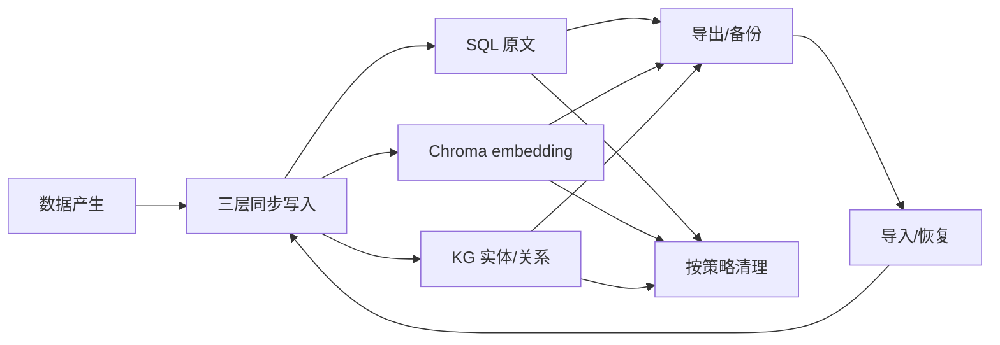
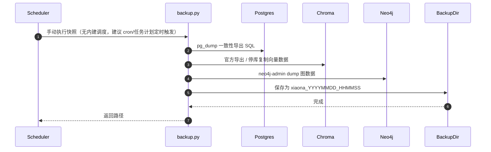
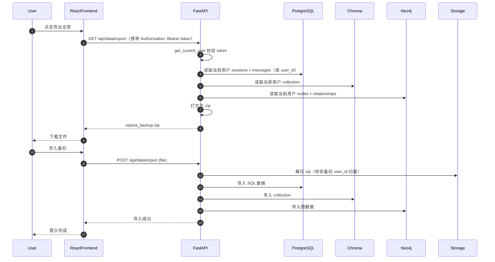
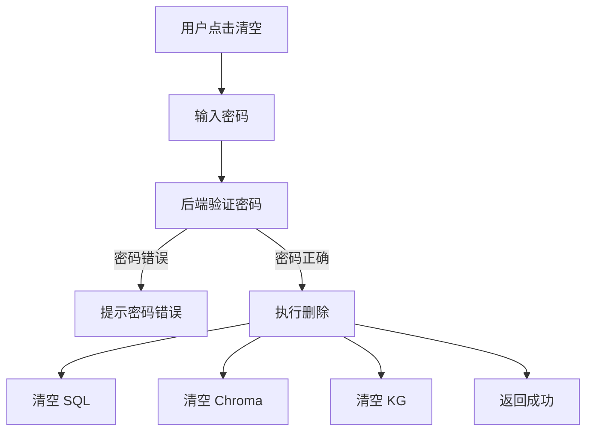
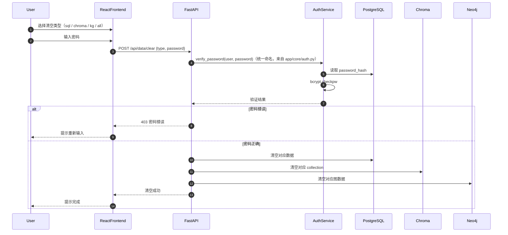

# 09_数据管理详解

## 1. 目标

数据管理模块负责 XIAONA 全量数据的备份、导出、导入、清理与迁移。由于机器人保存了用户的个人记忆、对话、知识图谱，数据管理必须可靠、安全、可控。

管理范围包括：
- SQL 中的会话与消息记录
- Chroma 中的向量记忆
- Neo4j 中的知识图谱
- 用户设置与环境配置

## 2. 数据生命周期



### 数据备份/恢复时序图





## 3. 备份策略

推荐三种备份方式：

| 方式 | 频率 | 内容 | 适用场景 |
|------|------|------|----------|
| 手动快照（建议每日） | 手动执行 | 全量 SQL + Chroma + KG 卷 | 防止误删或损坏 |
| 手动导出 | 按需 | 会话 JSON / Markdown | 用户迁移或分享 |
| 增量归档 | 每周 | 低权重已归档数据 | 长期冷存储 |

### 两套备份/恢复体系（重要区分）

本项目存在**两套互不互通**的数据保全体系，适用场景与执行方式完全不同：

| 维度 | 全库快照（backup.py / restore.py，§7） | 单用户导出/导入（/api/data/export、/api/data/import，§4/§5） |
|------|----------------------------------------|--------------------------------------------------------------|
| 粒度 | 全库（所有用户 + 所有存储层） | 单用户（按 user_id 打包 zip） |
| 产物 | `postgres.dump`（pg_dump 全库）+ `neo4j.dump` + Chroma 数据卷副本 | `xiaona_backup.zip`（内含 `xiaona_export.json`，含 sessions/vectors/graph） |
| 执行方式 | 运维命令行（Docker 卷级，见 §7） | Web 设置页 / API（带认证 + 密码校验） |
| 恢复方式 | `restore.py`：pg_restore + neo4j-admin database load + 卷复制（见 §7.1） | `/api/data/import`（校验 user_id 归属后幂等导入） |
| 适用场景 | 整机/服务器迁移、灾难恢复、多用户部署 | 单用户自助备份/换设备、导出分享 |

> 两套体系**产物不兼容**：`postgres.dump`/`neo4j.dump`/Chroma 卷副本无法通过 `/api/data/import` 恢复，`xiaona_backup.zip` 也非全库级产物。按场景选用，不要混用。

## 4. 导出 API

### 4.1 导出全部数据

```python
# backend/app/api/data.py
import json
import zipfile
import io
from fastapi import APIRouter, Depends, UploadFile, File, HTTPException
from fastapi.responses import StreamingResponse
from app.core.auth import get_current_user
from app.core.memory_engine import sql
from app.db.chroma_client import chroma
from app.db.neo4j_client import neo4j_client
from app.db.sql_models import User
from app.core.logger import logger

router = APIRouter(prefix="/api/data", tags=["data"])

# 外部存储（Chroma/Neo4j）暂不可用时降级：不阻断导出，收集 warnings 随响应返回
def _try_call(desc: str, fn, warnings: list[str], fallback):
    try:
        return fn()
    except Exception as e:
        logger.warning(f"data op partial failure: {desc}: {e}")
        warnings.append(f"{desc} 暂不可用（{e}），已跳过")
        return fallback


@router.get("/export")
def export_all(user: User = Depends(get_current_user)):
    # 只导出当前用户的数据
    warnings: list[str] = []
    sessions = sql.get_all_sessions_with_messages(user.id)
    # 收集 Chroma 数据（当前用户 collection；失败降级为空）
    vector_data = _try_call("Chroma 向量", lambda: chroma.get_all(user.id), warnings, [])
    # 收集图谱数据（当前用户的节点/边；失败降级为空）
    graph_data = _try_call("知识图谱", lambda: neo4j_client.export_all(user.id), warnings, {"nodes": [], "edges": []})

    export_payload = {
        "version": "1.0",
        "user_id": user.id,
        "sessions": sessions,   # 每条消息带 thinking / attachments 字段（JSON 导出，见 07 §6）
        "vectors": vector_data,
        "graph": graph_data,
        "warnings": warnings,
    }

    zip_buffer = io.BytesIO()
    with zipfile.ZipFile(zip_buffer, "w") as zf:
        zf.writestr("xiaona_export.json", json.dumps(export_payload, ensure_ascii=False, indent=2))
    zip_buffer.seek(0)

    return StreamingResponse(
        zip_buffer,
        media_type="application/zip",
        headers={"Content-Disposition": "attachment; filename=xiaona_backup.zip"},
    )
```

> **导出字段要点**：JSON 导出（`xiaona_export.json`）的 session 消息带 `thinking`（思考过程）与 `attachments`（附件元数据 `[{name,kind,size}]`）字段；单会话导出 `GET /api/sessions/{id}/export` 的 markdown 格式在 assistant 消息附 `> 深度思考：` 块、json 格式补 `thinking` 字段（详见 `07_会话历史记录详解.md`）。

### 4.2 按会话导出

单会话导出统一使用 `07_会话历史记录详解.md` 的 `GET /api/sessions/{id}/export`（支持 markdown / json），本文件**不再提供**重复的 `/api/data/sessions/{id}/export`，避免接口二义。

## 5. 导入与恢复

```python
import json
import zipfile
import io
from fastapi import APIRouter, Depends, UploadFile, File, HTTPException, Request

from app.config import MAX_IMPORT_SIZE  # 50MB 上限
from app.core.memory_engine import sql
from app.db.chroma_client import chroma
from app.db.neo4j_client import neo4j_client
from app.core.logger import logger

def _try_call(desc: str, fn, warnings: list[str], fallback):
    """外部存储（Chroma/Neo4j）暂不可用时降级：不阻断导入，收集 warnings。"""
    try:
        return fn()
    except Exception as e:
        logger.warning(f"data op partial failure: {desc}: {e}")
        warnings.append(f"{desc} 暂不可用（{e}），已跳过")
        return fallback

class _LimitedReader(io.RawIOBase):
    """限制读取总字节数：zip 炸弹防护——压缩包可能很小（Content-Length 校验通过）但解压后巨大。"""

    def __init__(self, raw, limit):
        self.raw = raw
        self.limit = limit
        self.read_total = 0

    def read(self, size=-1):
        chunk = self.raw.read(size if size and size >= 0 else 64 * 1024)
        if not chunk:
            return b""
        self.read_total += len(chunk)
        if self.read_total > self.limit:
            raise HTTPException(status_code=413, detail="备份解压后过大，请检查备份文件")
        return chunk

    def readable(self):
        return True

@router.post("/import")
def import_all(file: UploadFile = File(...), user: User = Depends(get_current_user),
               request: Request):
    # 大小限制：防超大备份拖垮服务。
    # 用 Content-Length 请求头校验（UploadFile.size 依赖较新 Starlette，旧版本恒为 None
    # 时检查会被静默跳过）；nginx 反代层另有 client_max_body_size 兜底（见 06_一键启动详解.md）
    content_length = int(request.headers.get("content-length") or 0)
    if content_length > MAX_IMPORT_SIZE:
        raise HTTPException(status_code=413, detail="备份文件过大（上限 50MB）")

    try:
        with zipfile.ZipFile(file.file) as zf:
            with zf.open("xiaona_export.json") as f:
                # 解压限流（zip 炸弹防护）：解压后字节数上限为导入体积上限的 5 倍
                data = json.load(_LimitedReader(f, MAX_IMPORT_SIZE * 5))
    except zipfile.BadZipFile:
        raise HTTPException(status_code=400, detail="不是合法的 zip 备份文件")
    except KeyError:
        raise HTTPException(status_code=400, detail="备份文件缺少 xiaona_export.json")
    except (json.JSONDecodeError, UnicodeDecodeError, ValueError):
        raise HTTPException(status_code=400, detail="备份文件内容损坏，无法解析")

    # 版本校验：未来 schema 变更可做迁移（json 内容非对象同样拒绝，2026-08-17 起）
    if not isinstance(data, dict) or data.get("version") != "1.0":
        raise HTTPException(status_code=400, detail="不支持的备份版本")

    # 校验备份归属：只能导入到原用户的数据空间
    if data.get("user_id") and data["user_id"] != user.id:
        raise HTTPException(status_code=403, detail="备份不属于当前用户")

    # 导入 SQL：合并策略——已存在的 id 跳过（幂等），新数据插入
    imported = 0
    warnings: list[str] = []
    for session in data.get("sessions", []):
        if sql.import_session(session, user.id, skip_existing=True):  # 原样重建 thinking / attachments / source
            imported += 1

    # 导入 Chroma：按 id 幂等 upsert（已存在 id 覆盖为一致；失败降级不阻断）
    _try_call("Chroma 向量", lambda: chroma.import_collection(data.get("vectors", []), user.id), warnings, None)

    # 导入 Neo4j：先 clear_graph(user_id) 再整体重建（备份恢复语义，天然幂等，失败降级不阻断）
    _try_call("知识图谱", lambda: neo4j_client.import_graph(data.get("graph", {}), user.id), warnings, None)

    result = {"status": "ok", "sessions": imported}
    if warnings:
        result["warnings"] = warnings
    return result
```

> **导入字段要点**：`import_session` 导入时原样重建消息的 `thinking` / `attachments` / `source`（`source` 缺失时回退会话级），保证「导出 → 清空 → 导入」往返不丢字段（见 `07_会话历史记录详解.md`）。

## 6. 数据清理与隐私

所有**清空数据**和**删除节点**操作都需要用户输入密码进行二次确认，防止误删。

### 数据清理流程



### 数据清理时序图



### 清理 API

```python
from pydantic import BaseModel
from app.core.auth import verify_password
from app.core.memory_engine import sql
from app.db.chroma_client import chroma
from app.db.neo4j_client import neo4j_client
from app.core.logger import logger

class ClearRequest(BaseModel):
    type: str = "all"     # 'sql' | 'chroma' | 'kg' | 'all'
    password: str         # 用户登录密码（JSON body 传入）

# 外部存储失败降级：收集 warnings，不阻断清空主流程
def _try_call(desc: str, fn, warnings: list[str], fallback):
    try:
        return fn()
    except Exception as e:
        logger.warning(f"data op partial failure: {desc}: {e}")
        warnings.append(f"{desc} 暂不可用（{e}），已跳过")
        return fallback


@router.post("/clear")
def clear_data(clear_request: ClearRequest, user: User = Depends(get_current_user)):
    """
    type: 'sql' | 'chroma' | 'kg' | 'all'
    password: 用户登录密码（JSON body 传入）
    """
    if not verify_password(user, clear_request.password):
        raise HTTPException(status_code=403, detail="密码错误")

    warnings: list[str] = []
    if clear_request.type in ('sql', 'all'):
        sql.clear_messages_and_sessions(user.id)
    if clear_request.type in ('chroma', 'all'):
        _try_call("Chroma 清理", lambda: chroma.clear_collection(user.id), warnings, None)
    if clear_request.type in ('kg', 'all'):
        _try_call("知识图谱清理", lambda: neo4j_client.clear_graph(user.id), warnings, None)

    result = {"status": "cleared"}
    if warnings:
        result["warnings"] = warnings
    return result
```

> **删除单个会话**统一走 `07_会话历史记录详解.md` 的 `DELETE /api/sessions/{id}`。**2026-08-15 起聊天界面删除会话为免密软删除**（`DeleteConfirm` 传 `requirePassword={false}`，DELETE 无 body），仅置 `sessions.is_deleted=True`，SQL/Chroma/KG 三层数据全部保留供记忆检索；设置页「清空数据」（本文件 §6 的 `POST /api/data/clear`）才是**需密码的硬删除**，会连软删会话一起清掉。本文件不再提供重复的 `/api/data/sessions/{id}` 删除接口。

## 7. 快照脚本（手动运维）

> **重要**：运行中的 PostgreSQL / Neo4j 数据目录不能直接 `shutil.copytree`，会得到不一致或损坏的备份。必须使用各数据库官方导出工具。

```python
# backend/scripts/backup.py
import subprocess
from datetime import datetime
from pathlib import Path

# 用脚本自身位置定位仓库根，不依赖「从仓库根目录运行」的前提：
# backend/scripts/backup.py -> parents[0]=scripts, parents[1]=backend, parents[2]=仓库根
REPO_ROOT = Path(__file__).resolve().parents[2]
BACKUP_DIR = REPO_ROOT / "backups"
COMPOSE_FILE = str(REPO_ROOT / "backend" / "docker-compose.yml")

def run(cmd: list[str], **kwargs):
    subprocess.run(cmd, check=True, **kwargs)

def snapshot():
    ts = datetime.now().strftime("%Y%m%d_%H%M%S")
    dest = BACKUP_DIR / f"xiaona_{ts}"
    dest.mkdir(parents=True, exist_ok=True)

    # 1) PostgreSQL：pg_dump 一致性导出
    #    docker compose exec 用 compose 服务名 postgres（与 restore.py 保持一致；
    #    xiaona_postgres 是容器名，仅 docker cp 需要）
    run([
        "docker", "compose", "-f", COMPOSE_FILE, "exec", "-T", "postgres",
        "pg_dump", "-U", "xiaona", "-d", "xiaona", "-F", "c", "-f", "/tmp/xiaona.dump"
    ])
    run(["docker", "cp", "xiaona_postgres:/tmp/xiaona.dump", dest / "postgres.dump"])

    # 2) Neo4j：neo4j-admin database dump
    #    community 版要求数据库离线才能 dump（在线执行会报错/产生不一致快照），
    #    因此与 Chroma 相同的编排：先 stop → 用临时容器跑 dump → 恢复 start。
    run(["docker", "compose", "-f", COMPOSE_FILE, "stop", "neo4j"])
    try:
        # 用同版本 neo4j 镜像的临时容器执行 dump（数据卷只读挂载给 /data）
        run([
            "docker", "run", "--rm",
            "-v", "xiaona_neo4j_data:/data",
            "-v", "xiaona_neo4j_dumps:/backups",
            "neo4j:5-community",
            "neo4j-admin", "database", "dump", "neo4j", "--to-path=/backups", "--verbose"
        ])
        # 从 dumps 卷拷出
        run([
            "docker", "run", "--rm",
            "-v", "xiaona_neo4j_dumps:/src:ro",
            "-v", f"{dest.absolute()}:/dst",
            "alpine", "cp", "-a", "/src/.", "/dst/neo4j"
        ])
    finally:
        # 无论 dump 是否成功，都恢复服务
        run(["docker", "compose", "-f", COMPOSE_FILE, "start", "neo4j"])

    # 3) Chroma：维护窗口停库后复制数据卷（保证一致性）
    #    这样才能让「每日全量 SQL+Chroma+KG」名副其实
    run(["docker", "compose", "-f", COMPOSE_FILE, "stop", "chroma"])
    try:
        run(["docker", "run", "--rm",
             "-v", "xiaona_chroma_data:/src:ro",
             "-v", f"{dest.absolute()}:/dst",
             "alpine", "cp", "-a", "/src/.", "/dst/chroma"])
    finally:
        # 无论复制是否成功，都恢复服务
        run(["docker", "compose", "-f", COMPOSE_FILE, "start", "chroma"])

    print(f"Backup saved to {dest}")

if __name__ == "__main__":
    snapshot()
```

说明：

- **PostgreSQL**：`pg_dump` 在数据库运行时可安全导出一致性快照，是首选。
- **Neo4j**：`neo4j-admin database dump` 是官方推荐的备份方式，但 **community 版要求数据库离线**（在线执行会报错/得到不一致快照）。脚本因此采用「`docker compose stop neo4j` → 临时容器执行 dump → `start neo4j`」的编排（与 Chroma 同模式），会在快照期间短暂停服（建议凌晨执行）。
- **Chroma**：无统一命令行备份，采用**维护窗口停库后复制数据卷**（保证一致性）。因此「每日全量 SQL+Chroma+KG」的快照会在 Chroma/Neo4j 复制期间短暂停服（可在每日凌晨执行）。
- **无内建调度**：`backup.py` 仅提供 `snapshot()`（`__main__` 直接调用），**不会自动定时执行**——需运维用 cron（Linux）或任务计划程序（Windows）定时调用，例如每天凌晨 `python backend/scripts/backup.py`。

### 7.1 全库恢复（restore.py）

全库快照的恢复脚本，与 `backup.py` 的产物一一对应，编排与备份对称（stop → 操作 → start）：

```python
# backend/scripts/restore.py —— 从全库快照恢复（与 backup.py 对称，运维执行）
import subprocess
import sys
from pathlib import Path

REPO_ROOT = Path(__file__).resolve().parents[2]
BACKUP_DIR = REPO_ROOT / "backups"
COMPOSE_FILE = str(REPO_ROOT / "backend" / "docker-compose.yml")

def run(cmd: list[str], **kwargs):
    subprocess.run(cmd, check=True, **kwargs)

def restore(backup_name: str):
    src = BACKUP_DIR / backup_name
    assert src.exists(), f"备份目录不存在：{src}"

    # 1) PostgreSQL：pg_restore 恢复全库（目标库需已创建）
    #    先 drop + recreate 数据库，保证从干净状态恢复
    #    注意：docker compose exec 用 compose 服务名 postgres（xiaona_postgres 是容器名，
    #    只适用于 docker cp / docker exec 单容器命令）
    run(["docker", "compose", "-f", COMPOSE_FILE, "exec", "-T", "postgres",
         "dropdb", "--if-exists", "-U", "xiaona", "xiaona"])
    run(["docker", "compose", "-f", COMPOSE_FILE, "exec", "-T", "postgres",
         "createdb", "-U", "xiaona", "xiaona"])
    run(["docker", "cp", src / "postgres.dump", "xiaona_postgres:/tmp/restore.dump"])
    run(["docker", "compose", "-f", COMPOSE_FILE, "exec", "-T", "postgres",
         "pg_restore", "-U", "xiaona", "-d", "xiaona", "--clean", "--if-exists", "/tmp/restore.dump"])

    # 2) Neo4j：community 版要求离线恢复，编排与 backup 对称
    run(["docker", "compose", "-f", COMPOSE_FILE, "stop", "neo4j"])
    try:
        # 只拷 neo4j/ 子目录（含 neo4j.dump）到卷根，--from-path=/backups 才能命中；
        # 若把整个备份目录拷进去，dump 会在 /backups/neo4j/neo4j.dump，load 找不到
        run(["docker", "run", "--rm", "-v", "xiaona_neo4j_dumps:/backups",
             "-v", f"{src.absolute()}:/src:ro", "alpine", "cp", "-a", "/src/neo4j/.", "/backups/"])
        run(["docker", "run", "--rm",
             "-v", "xiaona_neo4j_data:/data",
             "-v", "xiaona_neo4j_dumps:/backups",
             "neo4j:5-community",
             "neo4j-admin", "database", "load", "neo4j", "--from-path=/backups", "--overwrite-destination"])
    finally:
        run(["docker", "compose", "-f", COMPOSE_FILE, "start", "neo4j"])

    # 3) Chroma：停库后把备份卷内容复制回 chroma_data 卷再启动
    #    先清空目标卷再复制（cp -a 只覆盖同名文件，不清空会与快照时间点之后的旧数据合并，
    #    Chroma 内部 SQLite 索引也可能新旧混合损坏）；与 PostgreSQL drop+create、
    #    Neo4j --overwrite-destination 保持一致语义
    run(["docker", "compose", "-f", COMPOSE_FILE, "stop", "chroma"])
    try:
        run(["docker", "run", "--rm",
             "-v", "xiaona_chroma_data:/dst",
             "alpine", "sh", "-c", "rm -rf /dst/* /dst/.[!.]* 2>/dev/null || true"])
        run(["docker", "run", "--rm",
             "-v", "xiaona_chroma_data:/dst",
             "-v", f"{src.absolute()}:/src:ro",
             "alpine", "cp", "-a", "/src/chroma/.", "/dst/"])
    finally:
        run(["docker", "compose", "-f", COMPOSE_FILE, "start", "chroma"])

    print(f"Restored {backup_name}")

if __name__ == "__main__":
    # 必须带参数：BACKUP_DIR 下快照目录名（无自动取最新快照逻辑，缺参会 assert 失败）
    restore(sys.argv[1])
```

> 使用：`python backend/scripts/restore.py xiaona_20260814_030000`——**必须带参数**，参数为 `BACKUP_DIR` 下的快照目录名（`backup.py` 按 `xiaona_YYYYMMDD_HHMMSS` 命名，不生成 `xiaona_latest`，restore 也无自动取最新逻辑）。恢复前建议先停掉 backend（避免恢复过程中有请求写入），恢复完成后 `docker compose up -d` 全量重启。Chroma 卷恢复目录说明：backup 的 Chroma 部分是 `dest/chroma/`（见 §7 备份脚本），故 `restore.py` 从 `/src/chroma/` 复制回卷。

## 8. 存储目录映射

所有持久化数据使用 **named volumes**（与 `06_一键启动详解.md` 的 compose 一致），备份脚本走 `docker compose exec` + `docker cp`（见 §7），不依赖宿主机目录路径：

```yaml
# compose 键（06 §3 已显式指定 name:，与容器名 xiaona_* 前缀匹配）
volumes:
  pg_data:        # name: xiaona_pg_data    PostgreSQL 数据（/var/lib/postgresql/data）
  chroma_data:    # name: xiaona_chroma_data  Chroma 数据（/chroma/chroma）
  neo4j_data:     # name: xiaona_neo4j_data   Neo4j 数据（/data）
  neo4j_logs:     # name: xiaona_neo4j_logs   Neo4j 日志（/logs）
  neo4j_dumps:    # name: xiaona_neo4j_dumps  Neo4j 备份中转（§7 临时容器 dump 输出）
```

> **卷名约定**：06 的 compose 为每个卷显式声明 `name: xiaona_*`，因此 §7 备份脚本用 `-v xiaona_neo4j_data` / `-v xiaona_chroma_data` / `-v xiaona_neo4j_dumps` 即可命中真实卷。若不加 `name:`，Compose 会按 `{项目名}_{键}` 生成（compose 文件在 `backend/` 目录 → `backend_chroma_data` 等），备份脚本会挂载到新建的空卷，导致备份出空数据。

> 直接对运行中数据库的数据目录做 `shutil.copytree` / bind mount 复制是不安全的，务必走 §7 的官方工具与卷复制方式。

## 9. 隐私建议

- 默认数据只保存在本地（Docker 卷或本地目录）。
- 云端 API Key 仅用于调用 LLM，不传输本地记忆数据。
- 提供「一键清空」按钮，用于用户主动销毁数据；**清空前必须输入密码确认**。
- 删除知识图谱节点、清空全部数据仍需密码验证；删除会话为免密软删除（`DELETE /api/sessions/{id}` 无 body，仅置 `is_deleted=True`，SQL/Chroma/KG 三层数据保留）。
- 若启用本地 LLM（Ollama），对话可完全离线。

## 10. 关联文档

- 长期记忆与遗忘机制：`02_长期记忆详解.md`
- 知识图谱数据：`03_知识图谱详解.md`
- 会话历史导出（含 thinking/attachments）：`07_会话历史记录详解.md`
- 一键启动与存储配置：`06_一键启动详解.md`
- 多类型文件上传：`12_多类型文件上传详解.md`
