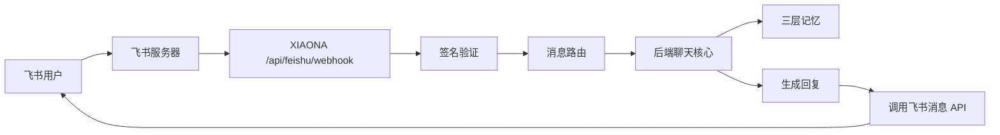
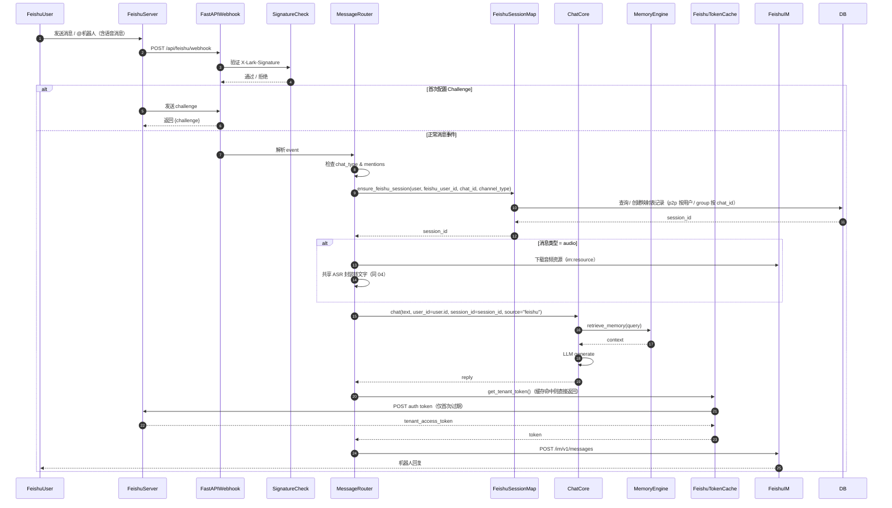

# 10_飞书IM机器人接入详解

## 1. 目标

让 XIAONA 能够以飞书（Lark）机器人身份与用户对话。用户在公司或个人飞书里 @机器人或私聊时，机器人调用同一套后端记忆系统回复，并保存对话记录。

实现要点：
- 接收飞书事件回调（challenge 验证 + 消息事件）。
- 验证飞书请求签名，确保安全性。
- 将飞书用户 ID 映射到 XIAONA 的会话 ID。
- 调用后端聊天核心生成回复，并发送回飞书。

## 2. 接入流程



### 飞书消息处理时序图



> **2026-08-17 更新**：上方时序图为早期简化版。实际 `process_feishu_event` 在 `Router` 之后、进入聊天前先做**绑定校验**：未绑定 open_id → 0 token 引导 / 绑定状态机（见 §5.1），已绑定才继续会话映射与聊天。该绑定分流已于 2026-08-18 随「飞书绑定改造」正式实施。

## 3. 飞书应用配置

1. 登录飞书开发者平台：https://open.feishu.cn/
2. 创建企业自建应用，开启“机器人”能力。
3. 获取：`App ID` 和 `App Secret`（应用详情页「凭证与基础信息」）。
4. 配置事件订阅（**公网 Webhook，见 §8**）：
   - 订阅方式：选「**将事件发送至开发者服务器**」（Webhook），填请求地址 `https://你的公网地址/api/feishu/webhook`（本地调试用 ngrok 暴露，见 §8）；
   - 配置「加密策略」：Verification Token（`FEISHU_VERIFY_TOKEN`，签名验证用）与 Encrypt Key（`FEISHU_ENCRYPT_KEY`，事件加密模式解密用）都取自这里；
   - 订阅事件：`im.message.receive_v1`（接收消息事件）。
5. 开启权限：
   - `im:chat:readonly`
   - `im:message:send`
   - `im:message.group_msg`
   - `im:message:readonly` / `im:resource`（下载语音/图片等消息资源）
6. **获取机器人 open_id（`FEISHU_BOT_OPEN_ID`）**：后台 UI **不展示**，官方唯一方式调接口（无需额外权限，有 App ID/Secret 即可）：

```bash
GET https://open.feishu.cn/open-apis/bot/v3/info
Authorization: Bearer <tenant_access_token>
# 响应 code=0 时，bot.open_id 即机器人 open_id（形如 ou_xxx）
```

   本机已验证：`BOT_OPEN_ID=ou_49f2ec743c93f7b1e1f951b1260714c9`（应用状态 activate_status=2）。群聊 @ 判断用精确匹配；不填则回退按 `FEISHU_BOT_NAME`（默认 XIAONA）匹配，单聊不需要它。

## 4. 后端 Webhook 接口

> **2026-08-17 勘误**：下方代码为**早期示例**，签名算法与顺序已更新，实际实现以 `backend/app/api/feishu.py` 为准：
> - 签名 key 由「Verification Token」改为「事件加密模式下用 Encrypt Key，否则 Verification Token」；
> - 签名算法由「HMAC-SHA256 + `\n` 拼接」改为「**纯 SHA-256 直接拼接 `timestamp + nonce + key + body`**」（与飞书官方算法一致）；
> - 事件加密模式下 body 为 `{"encrypt":"..."}`，需先 AES-256-CBC 解密（key=sha256(Encrypt Key)、IV=密文前 16 字节）再处理；
> - 处理顺序：**先解密 → challenge 直接返回（不带签名头）→ 正式事件才验签**；
> - 2026-08-17 已接入：`_decrypt_feishu_body`、`FEISHU_ENCRYPT_KEY`、`process_feishu_event` 统一入口（消息分流见 §5.1）。

```python
# backend/app/api/feishu.py（早期示例，签名算法已过时，仅供参考结构）
from fastapi import APIRouter, Request, HTTPException
from fastapi.responses import JSONResponse
import hmac
import hashlib
import json
import time
from app.core.memory_engine import chat_core
from app.core.feishu_client import FeishuClient

router = APIRouter(prefix="/api/feishu", tags=["feishu"])

# 签名验证 key = 飞书开发者后台的 Verification Token（事件订阅配置里的「Verification Token」）。
# 注意：飞书后台请「关闭事件加密」，仅开启「签名验证」——本方案只做请求头签名验证，
#       不处理 AES 内容解密，因此不需要 FEISHU_ENCRYPT_KEY / encrypt key。
FEISHU_VERIFY_TOKEN = config.FEISHU_VERIFY_TOKEN
BOT_OPEN_ID = config.FEISHU_BOT_OPEN_ID  # 机器人自身 open_id（用于群聊 @ 判断）
feishu_client = FeishuClient(config.FEISHU_APP_ID, config.FEISHU_APP_SECRET)

# 已处理事件去重：飞书可能重试同一 event，避免重复回复
# 注意：这是模块级内存字典，单 worker 下有效；多 worker（uvicorn --workers N）下各进程
# 独立，不共享去重状态。生产建议用「单 worker 运行 webhook」或改用 Redis/DB 存最近 event_id。
# 关键：采用「后置标记」——处理成功才记 seen，失败不记，飞书重试同 event 仍会重新处理。
_seen_events: dict[str, float] = {}   # event_id -> 处理时间戳（秒）
_EVENT_TTL = 3600                     # 1 小时 TTL


def is_duplicate_event(event_id: str) -> bool:
    """只读判断是否已处理（不写入）。"""
    now = time.time()
    # 清理过期条目，防止内存无限增长
    for eid in list(_seen_events):
        if now - _seen_events[eid] > _EVENT_TTL:
            _seen_events.pop(eid, None)
    return event_id in _seen_events


def mark_event_done(event_id: str) -> None:
    """处理成功后标记为已完成（供重试判定）。"""
    _seen_events[event_id] = time.time()


@router.post("/webhook")
async def webhook(request: Request):
    body = await request.body()
    payload = json.loads(body)

    # 1. 签名验证（飞书请求头 X-Lark-Signature）
    #    challenge 请求同样携带签名，先验签再响应，保证任何入口都过签名校验
    token = (
        request.headers.get("X-Lark-Request-Timestamp", "") + "\n"
        + request.headers.get("X-Lark-Request-Nonce", "") + "\n"
        + body.decode()
    )
    expected = hmac.new(FEISHU_VERIFY_TOKEN.encode(), token.encode(), hashlib.sha256).hexdigest()
    if request.headers.get("X-Lark-Signature", "") != expected:
        raise HTTPException(status_code=403, detail="Invalid signature")

    # 2. Challenge 验证（首次配置回调时）
    if "challenge" in payload:
        return JSONResponse({"challenge": payload["challenge"]})

    # 3. 处理消息事件
    event = payload.get("event", {})
    event_id = payload.get("event_id") or event.get("event_id")
    # 只读去重检查：不在此处标记，等处理成功后才 mark_event_done，
    # 否则 chat_core/send_message 抛异常时飞书重试会被当成已处理而吞掉。
    if event_id and is_duplicate_event(event_id):
        return JSONResponse({"code": 0})   # 已处理成功过，直接返回成功

    try:
        message = event.get("message", {})
        # 2026-08-16 勘误：下方简化示例只画 text/audio 主路径。实际实现（backend/app/api/feishu.py）
        # 还处理 image / file / media 消息：
        #   - image/file：群聊未 @ 只记元数据（_record_media_meta，Message.attachments 存
        #     file_key/message_id）；@ 或单聊按需下载 → parse_upload → 多模态送入聊天核心；
        #   - media（视频）：只记元数据、不拉取、不回复（飞书媒体按需监听约定，见 12 §6）；
        #   - 群聊 @ 文字含"图/文件/文档"等关键词时自动带最近媒体（_latest_media）。
        # 图片模型不支持时经 VisionNotSupportedError 转聊天式回复。
        if message.get("message_type") in ("text", "audio"):
            feishu_user_id = event["sender"]["sender_id"]["open_id"]
            chat_id = message["chat_id"]
            channel_type = message.get("chat_type", "p2p")  # p2p / group

            # 群聊 @ 机器人过滤
            if channel_type == "group" and not is_bot_mentioned(event):
                return JSONResponse({"code": 0})

            # 提取文字内容；audio 消息先转写
            text = extract_text(event)
            if message.get("message_type") == "audio":
                audio_key = json.loads(message["content"]).get("file_key", "")
                audio_bytes = await feishu_client.download_audio(message["message_id"], audio_key)
                text = await feishu_client.transcribe_audio(audio_bytes)  # 内部调共享 ASR 封装

            # 映射到 XIAONA 会话：先查 open_id 绑定（get_feishu_bind_user），
            # 未绑定 → 回 0 token 固定引导文案（不建账号、不调 LLM，见 §5.1）；
            # 已绑定 → ensure_feishu_session(user, feishu_user_id, chat_id, channel_type) 确保会话并刷新 last_active_at
            user = feishu_session_map.get_feishu_bind_user(feishu_user_id)
            if user is None:
                reply = _UNBOUND_GUIDE  # 0 token 引导文案
            else:
                session_id = ensure_feishu_session(user, feishu_user_id, chat_id, channel_type)
                reply = await chat_core.chat(text, user_id=user.id, session_id=session_id, source="feishu")

            # 发送回复（内部带失败重试）
            await feishu_client.send_message(chat_id, reply)

        # 全部处理成功后才标记已完成
        if event_id:
            mark_event_done(event_id)
        return JSONResponse({"code": 0})
    except Exception:
        # 不标记 seen → 飞书重试同一 event_id 仍会重新处理，不会静默丢回复
        raise
```

## 5. 飞书会话映射

**问题**：仅按 `title` 和 `source` 查找会话，会导致同一个用户在不同群聊复用同一会话（上下文串扰），私聊与群聊也无法区分。

**方案**：新增独立映射表 `feishu_session_map`，保存 `feishu_user_id + chat_id + channel_type`，并按通道类型绑定会话：
- **私聊（p2p）**：每个飞书用户绑定一个稳定会话（该用户所有私聊复用）。
- **群聊（group）**：按 `chat_id` 绑定，同一群聊共享一个会话；不同群聊互不串扰。

```python
# backend/app/db/sql_models.py（新增映射表，2026-08-18 已实施）
class FeishuUserMap(Base):
    __tablename__ = "feishu_user_map"
    id = Column(String(36), primary_key=True)  # uuid
    feishu_user_id = Column(String(128), index=True)  # 飞书 open_id（2026-08-18 起去 unique，一个账号可绑多个 open_id）
    user_id = Column(String(36), ForeignKey("users.id"))
    bound_at = Column(DateTime, default=datetime.utcnow)  # 绑定时间（设置页展示）
    last_active_at = Column(DateTime, nullable=True)  # 最后活跃（2026-08-24 加，按 open_id 记录；设置页各自显示，不再一律用 User.last_active_at）
    created_at = Column(DateTime, default=datetime.utcnow)

class FeishuSessionMap(Base):
    __tablename__ = "feishu_session_map"
    id = Column(String(36), primary_key=True)  # uuid
    feishu_user_id = Column(String(128), index=True)  # 飞书 open_id
    chat_id = Column(String(128), index=True)         # 飞书 chat_id
    channel_type = Column(String(10))                 # p2p / group
    session_id = Column(String(36), ForeignKey("sessions.id"))
    created_at = Column(DateTime, default=datetime.utcnow)
```

> **数据模型变化（2026-08-18 已实施）**：
> - `feishu_user_map.feishu_user_id` 去掉 `unique=True`（一个账号绑多个 open_id），`_apply_light_migrations()` 执行 `DROP CONSTRAINT IF EXISTS feishu_user_map_feishu_user_id_key`（SQLite 无该约束时忽略）；
> - 新增 `FeishuUserMap.bound_at`（DateTime，默认当前时间）用于设置页展示绑定时间（`_apply_light_migrations()` 补列，`TIMESTAMP` 类型）；
> - 2026-08-24 补 `FeishuUserMap.last_active_at`（DateTime，可空，按 open_id 记录，`TIMESTAMP` 类型）——设置页绑定身份列表的「最后活跃」按 open_id 展示，接口回退 `User.last_active_at`。

### 5.1 账号绑定机制（2026-08-18 起已实施，取代「影子账号生命周期」）

> **2026-08-18 已实施**：本节描述的新机制（0 token 引导 + 飞书内三步绑定）已随「飞书绑定改造」全部落地，与 `backend/app/api/feishu.py` / `feishu_session_map.py` / `settings.py` / `Settings.jsx` 一致。原影子账号机制已废弃（见下「废弃原因」），相关代码全部删除。

#### 核心原则

**小娜是「贴身秘书」，只服务绑定了账号的人（主人）。未绑定的 open_id 发消息，后端不调 LLM、不回实质内容，只回一条 0 token 的固定引导文案。** 任何陌生人无法消耗主人的大模型 token。

- **绑定门槛 = 手机号 + 密码 + 短信验证码**，分步引导、一步一问，全程在飞书对话框完成；
- **验证码在最后一步**（手机号存在且密码正确之后），确保「手机此刻在用户身边」，三重验证才放行；
- **一个小娜账号（一个手机号）可绑定多个飞书 open_id**（`feishu_user_map.feishu_user_id` 去唯一约束），同手机号注册的多个飞书账号共享同一账号的三层记忆；
- **绑定中间状态与密码/验证码不落库、不进日志**（内存态，重启即清零；密码明文只存在于飞书消息到校验的内存链路）。

#### 飞书侧交互（绑定状态机）

未绑定 open_id 发普通消息 → 回固定引导文案（纯文本拼接，0 token，代码 `_UNBOUND_GUIDE`）：

```
「你好，我是小娜。你还没有连接到小娜账号，暂时无法与我对话。
  1. 还没有账号：请先到 XIAONA 网页注册。
  2. 已有账号：回复「绑定」，或直接回复你的注册手机号，按提示完成绑定即可正常使用。」
```

绑定流程（状态机 `_BIND_STATE`，存内存，按 open_id 索引，5 分钟无输入超时清零；触发方式为回复「绑定」或直接报手机号）：

```
用户输入手机号 15935154248
  → 清洗首尾空格 → 查账号表
  ├─ 不存在 → 「该手机号未注册，请先到官方网页注册或绑定手机号」
  └─ 存在  → 状态【等密码】「请输入密码」

用户输入密码
  → 校验
  ├─ 错误 → 「密码错误，请到前端界面修改密码」（可重新输密码，不退回手机号）
  └─ 正确 → 状态【等验证码】「已向该手机发送验证码，请输入 6 位验证码」

用户输入验证码
  → 校验
  ├─ 错误 → 「验证码错误，请重试」
  └─ 正确 → 绑定成功：
       「绑定成功！你已关联手机号 159****4248，现在可以使用小娜了。」
       写入 feishu_user_map（当前 open_id → 该账号），标记完成
```

> **为什么分步问**（2026-08-17 用户确认）：一次输「手机号+密码+验证码」整串容易因格式/顺序/空格出错；分步一问一答，每步只回一个短输入，清洗首尾空格后即可，几乎不会错。

#### 设置页（网页端）

- **未绑定状态**：显示手机号、验证码、密码三个输入框及各自作用说明（手机号确定账号、验证码证明手机归属、密码供飞书侧验证）。真正把飞书 open_id 关联上，是在飞书里按引导一步步完成。
- **已绑定状态**：输入框消失，显示**绑定身份列表**——每个绑定身份一条，含标识（open_id 后 8 位）、绑定时间、最后活跃时间，可独立操作：
  - **解绑**：需输入「手机号 + 短信验证码」确认（防他人误操作），确认后删除该 open_id 的映射，**三层记忆全部保留**；该 open_id 再发消息回到未绑定引导。
  - **修改密码**：需输入「手机号 + 短信验证码 + 新密码」，更新账号密码，该账号下所有已绑定飞书身份下次绑定用新密码。
- **区分多个绑定身份**：个人应用拿不到飞书通讯录权限（无昵称/头像），首期用「绑定时间 + 最后活跃时间 + open_id 后 8 位」区分；绑定备注名作为二期可选增强。

#### 废弃原因（原影子账号生命周期）

原机制（2026-08-16 起）为未绑定 open_id 自动创建 `feishu_{open_id}` 影子账号并允许其聊天、限时保存记忆、定期提醒绑定。2026-08-17 用户明确废弃，原因：

1. **陌生人白耗 token**：任何人在飞书发消息都会创建一个影子账号并尝试调 LLM，成本全由主人承担，1 万人可薅空大模型额度；
2. **影子账号无模型配置**：chat 必然抛 `ChatModelNotConfigured` → 500，小娜无法回复，体验是「怎么发都没反应」；
3. **绑定机制缺失**：没有「open_id ↔ 正式账号」关联能力，用户无法从飞书通道进入正式账号。

新机制下未绑定 open_id 的消息**不创建账号、不调 LLM**，0 token 引导文案即可。原 `is_shadow_account` / `_shadow_reminder` / `_task_shadow_notice` / `shadow_cleaner` 定时任务 / `get_or_create_user_by_feishu` 自动建号逻辑全部删除；存量 `feishu_` 影子账号用一次性脚本清理（SQL 消息/会话 + Chroma collection + Neo4j 图谱）。

#### 绑定消息的安全处理（硬性要求）

- 绑定指令（含密码）在进入聊天流程前被**拦截识别**，不落库、不进记忆检索、不进日志；
- 校验走 `verify_password`（与网页登录同源）与 `verify_sms_code`（与注册/登录同源）；
- 绑定中间状态（等密码/等验证码）存模块级内存 dict，按 open_id 索引，5 分钟 TTL。

#### 设置页后端 API 设计（2026-08-18 已实施）

- `GET /api/settings/feishu-bind-status`：返回当前用户已绑定飞书身份列表 `bound: [{open_id_short（后 8 位）, bound_at, last_active_at}]` + `phone_masked`（如 `159****4248`）；未绑定返回空列表；
- `POST /api/settings/feishu-unbind`：body `{open_id, phone, code}`，校验手机号归属 + 短信验证码后删除该 open_id 的 `FeishuUserMap` 行（**只删映射，三层记忆全部保留**）；
- `POST /api/settings/change-password`：body `{phone, code, new_password}`，校验后更新当前账号 `password_hash`（供飞书侧绑定校验使用）；
- `POST /api/settings/bind-phone`（保留）：更新当前账号 `phone`/`password_hash`（手机号 + 验证码 + 密码），改为「为账号补录真实手机号与密码」入口（注册初始账号无真实手机号，补录后才能作为飞书绑定目标），不再承担「补建 open_id 关联」职责。

#### 已实施改造清单（2026-08-18 完成）

| 模块 | 改动 |
|------|------|
| `sql_models.py` | `FeishuUserMap.feishu_user_id` 去 unique；新增 `bound_at`；`User.phone` 注释更新 |
| `database.py` | `_apply_light_migrations()`：DROP 唯一约束 + 补 `bound_at` 列（`TIMESTAMP`） |
| `feishu_session_map.py` | 改为「只查不建」：`get_feishu_bind_user` / `bind_feishu_user` / `ensure_feishu_session`；删除 `get_or_create_user_by_feishu` 自动建号 |
| `feishu.py` | `process_feishu_event` 开头绑定校验分流：未绑定 → 绑定状态机（`_BIND_STATE`）/ 0 token 引导；删除 `is_shadow_account` / `_shadow_reminder` / `_task_shadow_notice` |
| `main.py` | 删除 `shadow_cleaner` 后台清理循环 |
| `shadow_cleaner.py` | 整个文件已删除 |
| `settings.py` | 新增 feishu-bind-status / feishu-unbind / change-password；bind-phone 语境更新 |
| `Settings.jsx` / `settings.js` | 绑定区块重构（未绑定三框 + 已绑定身份列表/解绑/改密） |
| 一次性脚本 | `backend/scripts/cleanup_shadow_accounts.py`：清理存量 `feishu_` 影子账号（SQL 消息/会话 + Chroma + Neo4j）——**2026-08-18 dry-run 验证 + 正式执行成功（1 个存量账号）后已删除** |
| `config.py` / `.env.example` | 删除 `SHADOW_TTL_DAYS` / `SHADOW_REMIND_INTERVAL_HOURS` / `SHADOW_CLEANUP_INTERVAL_HOURS` |

```python
# backend/app/db/feishu_session_map.py —— 新实现（2026-08-18 起）
def get_feishu_bind_user(feishu_user_id: str) -> User | None:
    """只查映射，返回绑定的 XIAONA 用户；未绑定返回 None（不创建账号）。"""

def bind_feishu_user(feishu_user_id: str, user_id: str) -> bool:
    """把 open_id 绑定到指定账号（幂等；一账号可绑多个 open_id，写 feishu_user_map）。"""

def ensure_feishu_session(user: User, feishu_user_id: str, chat_id: str, channel_type: str) -> str:
    """确保飞书会话映射存在并返回 session_id（调用方保证已绑定）。
    私聊按用户绑定；群聊按 chat_id 绑定；每次调用刷新 user.last_active_at（活跃统计）。"""
```

绑定状态机在 `feishu.py` 内实现：`_BIND_STATE`（open_id → `{step, phone, expire}`，5 分钟 TTL）、`_handle_bind_turn` 统一入口、`_bind_step_phone` / `_bind_step_password` / `_bind_step_code` 三步处理。密码校验用 `auth.verify_password`，验证码用 `auth.send_sms_code` / `verify_sms_code`（与注册/登录同源），密码/验证码只存在于内存链路、不落库不进日志。

### 飞书账号与 Web/CLI 账号打通

> **2026-08-18 起：已按新机制实现**。原「影子账号补手机号」方式已废弃（不再有 `feishu_` 影子账号）。新机制下账号体系统一为：**先有 XIAONA 账号（网页注册/补录手机号+密码），再在飞书对话框内三步绑定 open_id**，Web/CLI 与飞书共享同一账号的三层记忆。

设置页 `bind-phone`（`backend/app/api/settings.py`）现仅用于**为账号补录真实手机号与密码**（注册账号的初始账号 `phone` 为占位、`password_hash` 为空）：校验验证码 → 校验手机号未被占用 → 更新 `phone` + `password_hash`。此后该账号可经 Web/CLI 用「手机号 + 密码」登录，也能作为飞书侧绑定的目标账号。飞书侧的 open_id 关联**只在飞书对话框内**完成（见 §5.1 绑定状态机）。

```python
# backend/app/api/settings.py —— 设置页「绑定手机号」接口（2026-08-18 起：补录手机号/密码）
@router.post("/bind-phone")
def bind_phone(
    req: BindPhoneRequest,          # {phone, code, password}
    db: DbSession = Depends(get_db),
    user: User = Depends(get_current_user),
):
    # 1) 校验验证码（与 /api/auth/login 的 code 校验同源）
    verify_sms_code(req.phone, req.code)
    # 2) 校验 phone 未被其他账号占用（phone 唯一索引）
    if db.query(User).filter(User.phone == req.phone, User.id != user.id).first():
        raise HTTPException(status_code=409, detail="该手机号已被绑定")
    # 3) 更新 phone 与 password_hash（此后可用手机号+密码登录 Web/CLI）
    user.phone = req.phone
    user.password_hash = hash_password(req.password)
    db.commit()
    return {"ok": True}
```

> **前端入口**：绑定功能在 Web 设置页「账号绑定」区块（见 `05_前端详解.md`），对应 `settings.js` 的 `bindPhone` / `getFeishuBindStatus` / `unbindFeishu` / `changePassword` 与上方 `/api/settings/*` 接口；发送验证码复用 `/api/auth/send_code`。

### 5.2 影子账号生命周期（2026-08-16 起，2026-08-17 起废弃，2026-08-18 代码已删除）

> **已废弃（2026-08-17 用户确认，2026-08-18 代码全部删除）**：原「未绑定自动建影子账号 + 限时保存记忆 + 定期提醒绑定」机制整体废除，原因见上方新 §5.1「废弃原因」。`is_shadow_account` / `_shadow_reminder` / `_task_shadow_notice` / `shadow_cleaner.py` / `get_or_create_user_by_feishu` 自动建号逻辑及 `SHADOW_*` 配置项**已从代码中删除**。本节保留历史设计仅供追溯。

原设计：未绑定正式账号的飞书账号（`phone="feishu_{open_id}"`、`password_hash=""`）称为**影子账号**。其记忆与正式账号一样完整写入三层存储，但**限时保存**，防止长期不注册的用户持续占用存储：

- **判定**：`is_shadow_account(user)` = `(user.phone or "").startswith("feishu_") and not user.password_hash`；设置页绑定手机号后 `phone` 变真手机号、`password_hash` 非空，自然脱离影子状态，记忆永久保存（user_id 不变，记忆不丢）。
- **活跃刷新**：`ensure_feishu_session` 每次调用都刷新 `user.last_active_at`（任何飞书消息进来视为活跃）。
- **私聊限频提醒**：`_shadow_reminder(user, channel_type)` 仅私聊 + 影子账号 + 距上次提醒超过 `SHADOW_REMIND_INTERVAL_HOURS`（默认 24h）时，在回复末尾追加一条绑定引导（超期记忆将被清理），并写 `user.last_reminded_at`；群聊不提醒、未 @ 的媒体不打扰。
- **超期清理**：后台定时任务 `shadow_cleaner.cleanup_expired_shadow_accounts()`（`main.py` 启动，间隔 `SHADOW_CLEANUP_INTERVAL_HOURS`，默认 24h）清理 `last_active_at` 超过 `SHADOW_TTL_DAYS`（默认 30 天）未活跃的影子账号：先删飞书映射与关联行（FeishuSessionMap/FeishuUserMap/FunctionAssignment/Model），再清三层记忆（SQL 消息/会话 + Chroma collection + Neo4j 图谱），最后删 User 行；Chroma/Neo4j 异常降级日志不阻断。`last_active_at` 为 NULL 的老账号保守跳过（防误删）。
- **配置项**：`SHADOW_TTL_DAYS` / `SHADOW_REMIND_INTERVAL_HOURS` / `SHADOW_CLEANUP_INTERVAL_HOURS`（默认 30 / 24 / 24，见 `.env.example`）。

> **注**：原 `SHADOW_*` 配置已随影子账号机制删除（2026-08-18），`config.py` / `.env.example` 不再包含这些项；上文默认值仅作历史追溯。

## 6. 飞书客户端（异步 + token 缓存）

```python
# backend/app/core/feishu_client.py
import os
import time
import json
import tempfile
import logging
import httpx

logger = logging.getLogger(__name__)

class FeishuClient:
    def __init__(self, app_id: str, app_secret: str):
        self.app_id = app_id
        self.app_secret = app_secret
        self.client = httpx.AsyncClient(timeout=30)
        self._token: str | None = None
        self._token_expire_at: float = 0.0

    async def _request(self, method: str, url: str, *, headers=None, json=None, params=None):
        """统一请求 + 重试：非 2xx 响应与 httpx.RequestError（超时/断连）都重试 2 次并记日志。
        最后一次仍失败时抛错（webhook 层可据此返回 500 触发飞书重试）。"""
        # 注意：不引用 resp（两次尝试均为网络异常时 resp 未定义会抛 NameError），
        # 循环内 except 后自然进入下一轮，两次都失败则统一抛 RuntimeError
        for attempt in (1, 2):
            try:
                resp = await self.client.request(method, url, headers=headers, json=json, params=params)
                if resp.status_code < 300:
                    return resp
                logger.warning(f"feishu {method} {url} failed (attempt {attempt}): {resp.status_code} {resp.text[:200]}")
            except httpx.RequestError as e:
                logger.warning(f"feishu {method} {url} network error (attempt {attempt}): {e}")
        raise RuntimeError(f"feishu {method} {url} failed after retries")

    async def get_tenant_token(self) -> str:
        """tenant_access_token 内存缓存，过期前复用，避免每次请求都获取。"""
        now = time.time()
        if self._token and now < self._token_expire_at - 60:  # 提前 60s 刷新
            return self._token
        resp = await self._request(
            "POST",
            "https://open.feishu.cn/open-apis/auth/v3/tenant_access_token/internal",
            json={"app_id": self.app_id, "app_secret": self.app_secret},
        )
        data = resp.json()
        self._token = data["tenant_access_token"]
        self._token_expire_at = now + data.get("expire", 7200)
        return self._token

    async def send_message(self, chat_id: str, text: str):
        # chat_id 为空时直接失败，避免无效请求触发两次无意义网络重试
        if not chat_id:
            raise ValueError("chat_id 不能为空")
        # 飞书文本消息有长度上限（约 1500 字符），超长时截断并加省略号提示；
        # 若需保留全文可拆成多条消息分批发送（此处以截断为主）。
        MAX_TEXT_LEN = 1500
        if len(text) > MAX_TEXT_LEN:
            text = text[: MAX_TEXT_LEN - 20] + "\n……（内容过长已截断）"
        token = await self.get_tenant_token()
        url = "https://open.feishu.cn/open-apis/im/v1/messages"
        headers = {"Authorization": f"Bearer {token}", "Content-Type": "application/json"}
        body = {
            "receive_id": chat_id,
            "msg_type": "text",
            "content": json.dumps({"text": text}, ensure_ascii=False),
        }
        # 统一走 _request（含非 2xx + 网络异常重试）
        await self._request(
            "POST", url, headers=headers, params={"receive_id_type": "chat_id"}, json=body
        )

    async def download_resource(self, message_id: str, file_key: str,
                                resource_type: str = "file") -> bytes:
        """下载消息资源（图片/文件/音频共用）：GET /messages/{id}/resources/{file_key}。
        resource_type 区分资源类型——图片必须传 "image"（飞书 type=image），文件/音频传 "file"
        （固定 type=file 会导致图片下载全部失败，2026-08-24 修）。
        下载后校验大小上限（MAX_FILE_SIZE 10MB），超限直接抛错，防恶意超大资源整包进内存
        （webhook 层 catch 记录，2026-08-17 修）。"""
        from app.core.media_utils import MAX_FILE_SIZE
        token = await self.get_tenant_token()
        url = f"https://open.feishu.cn/open-apis/im/v1/messages/{message_id}/resources/{file_key}"
        resp = await self._request(
            "GET", url, headers={"Authorization": f"Bearer {token}"}, params={"type": resource_type}
        )
        if len(resp.content) > MAX_FILE_SIZE:
            raise ValueError(f"resource too large: {len(resp.content)} > {MAX_FILE_SIZE}")
        return resp.content

    async def download_audio(self, message_id: str, file_key: str) -> bytes:
        """音频下载复用 download_resource（10 §6）。"""
        return await self.download_resource(message_id, file_key)

    async def transcribe_audio(self, audio_bytes: bytes) -> str:
        """内部调用共享 ASR 封装完成转写（与 04_语音输入与识别详解.md 一致）。"""
        import asyncio
        from app.core.asr_provider import asr
        from app.core.audio_utils import convert_to_wav   # 共享工具，含 ffmpeg 依赖
        # 将音频字节写入临时文件后交给统一 ASR 封装
        with tempfile.NamedTemporaryFile(suffix=".opus", delete=False) as tmp:
            tmp.write(audio_bytes)
            tmp_path = tmp.name
        wav_path = None
        try:
            # convert_to_wav 内部 subprocess.run(ffmpeg) 是同步阻塞 → to_thread 包裹
            wav_path = await asyncio.to_thread(convert_to_wav, tmp_path)
            return await asr.transcribe(wav_path)
        finally:
            os.unlink(tmp_path)
            if wav_path and os.path.exists(wav_path):
                os.unlink(wav_path)
```

## 7. 支持的消息类型

| 类型 | 处理 |
|------|------|
| text | 直接送入聊天核心；群聊 @ 文字含"图/文件/文档"等关键词时，自动按需拉取会话内最近的媒体（12 §6；`_MEDIA_KEYWORDS` = 图/图片/照片/截图/文件/文档/PDF/Word/Excel/表格，不含"分析"） |
| audio | 下载飞书音频 → 共享 ASR 封装转文字 → 送入聊天核心 |
| image | 群聊未 @ → **只记元数据**；@ 或单聊 → 按需下载 → `parse_upload` → 多模态送入聊天核心；模型不支持图片时收到聊天式反馈 |
| file | 同上（按扩展名判定 pdf/word/excel/text；无法识别时聊天式"无法识别"反馈） |
| media（视频） | 只记元数据、不拉取、不回复（转写成本高，12 §6 降级策略） |
| sticker 等 | 完全忽略 |
| 群聊 @机器人 | 未 @ 的媒体消息只记元数据、不调 LLM、不回复（12 §6 按需监听策略） |

### 7.1 媒体元数据解析与按需拉取（2026-08-15 起，详见 `12_多类型文件上传详解.md` §6）

```python
# backend/app/api/feishu.py（要点）
def _parse_media_meta(message) -> dict | None:
    """image → kind=image；file → 按 file_name 扩展名判定 kind；media → kind=video。
    返回 {name, kind, size, file_key, message_id}。"""

async def _record_media_meta(user_id, session_id, event) -> None:
    """群聊未 @ 的媒体：落库「[用户发送了图片：xxx]」元数据 user 消息（SQL+Chroma，
    含 file_key/message_id 于 Message.attachments），不下载、不调 LLM、不回复。
    async：内部 save_chat_message 走 asyncio.to_thread（Chroma embedding 为 CPU 密集，
    同步执行会阻塞事件循环），webhook 中 await 调用。"""

def _latest_media(user_id, session_id) -> dict | None:
    """取会话内最近一条带 file_key 的媒体附件元数据（按需拉取用）。"""

def _wants_media(text) -> bool:
    """群聊 @ 文字是否要求看图/分析文件（关键词：图/图片/照片/截图/文件/文档/PDF/Word/Excel/表格）。"""
```

下载复用 `feishu_client.download_resource(message_id, file_key, resource_type)`——**图片传 `resource_type="image"`，文件/音频传 `"file"`**（飞书下载接口 `type` 参数区分资源类型，固定 `type=file` 会导致图片下载全部失败，2026-08-24 修）。无法识别的类型以 `unsupported_reply` 聊天式回复，模型不支持图片以 `VisionNotSupportedError → chat_media_reply` 聊天式回复，均作为正常 assistant 消息落库、正常发送。

群聊 @ 处理：

```python
import re

# 飞书群聊 @ 占位符形如 @_user_1（纯文本消息，key 字段）或 <at user_id="ou_xxx"></at>（富文本），
# 送入 LLM 前都需去除
_MENTION_RE = re.compile(r"@_user_[\w-]+|<at[^>]*user_id=\"[^\"]*\"[^>]*>|</at>")


def extract_text(event) -> str:
    """从消息事件中提取文字内容；audio 消息无文本（返回空，由 ASR 转写）。"""
    message = event["message"]
    msg_type = message.get("message_type")
    if msg_type == "text":
        raw = json.loads(message["content"]).get("text", "")
        # 群聊中 @ 机器人后文本形如 "@_user_1 你好"，去掉占位符避免原样送入 LLM
        return _MENTION_RE.sub("", raw).strip()
    return ""


def is_bot_mentioned(event) -> bool:
    message = event["message"]
    if message.get("chat_type") != "group":
        return True
    mentions = message.get("mentions", [])
    for m in mentions:
        # 以机器人 open_id 精确匹配为主（BOT_OPEN_ID 从 config 读取，不受名字大小写/全角空格影响）
        if m.get("id", {}).get("open_id") == BOT_OPEN_ID:
            return True
        # name 可能含全角空格/大小写差异，统一小写后比较，作为兜底
        if (m.get("name") or "").strip().lower() == BOT_NAME.lower():
            return True
    return False
```

其中 `BOT_NAME = config.FEISHU_BOT_NAME`（机器人显示名，如 "XIAONA"），`BOT_OPEN_ID = config.FEISHU_BOT_OPEN_ID`（机器人自身 open_id）。

## 8. 本地调试（Webhook 模式）

飞书回调需要公网地址，本地开发可用 **ngrok** 暴露端口：

```bash
ngrok http 8000
```

然后将 `https://xxx.ngrok-free.app/api/feishu/webhook` 填入飞书事件订阅地址。

## 9. 技术栈

- `httpx`（AsyncClient）：调用飞书 API，不阻塞事件循环
- `hashlib` + `hmac.compare_digest`：签名验证（webhook 模式）——飞书官方算法 **sha256(timestamp + nonce + key + body) 直接拼接**（非 HMAC），`compare_digest` 仅做常量时间比较防时序侧信道
- `pycryptodome`：事件加密模式下 AES-256-CBC 解密（见 §4）
- FastAPI：接收回调（webhook）
- `tenant_access_token` 内存缓存：过期前复用，减少请求

## 10. 关联文档

- 总体聊天流程：`01_单Agent聊天助手项目初始计划详解.md`
- 后端 API 设计：`01_单Agent聊天助手项目初始计划详解.md`
- 会话历史记录：`07_会话历史记录详解.md`
- 一键启动与公网部署：`06_一键启动详解.md`
- 媒体按需监听/文件上传：`12_多类型文件上传详解.md`
