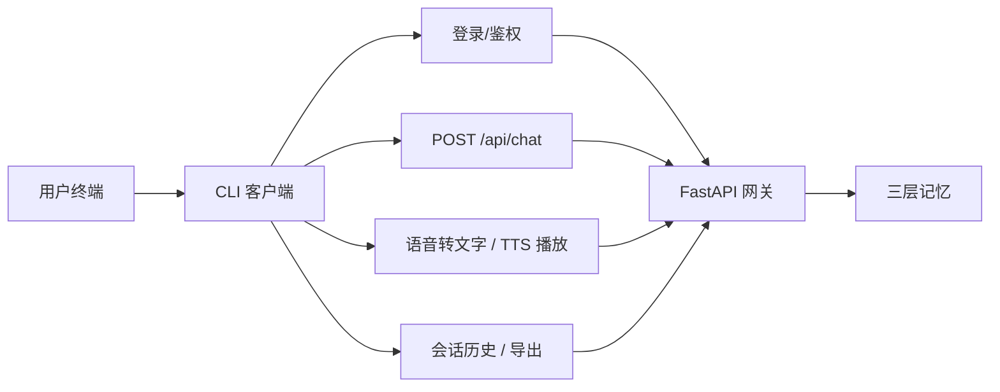
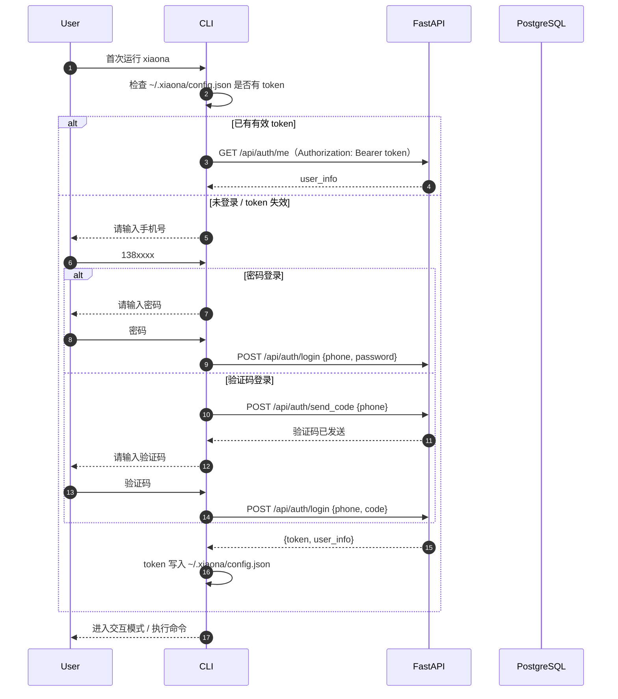
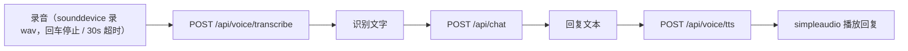

# 11_CLI客户端详解

## 1. 目标

CLI 是 XIAONA 的第三接入端（三端：**Web 网页 / 飞书 / CLI**）。它面向熟悉终端、希望快速对话或用脚本化方式使用 XIAONA 的用户，功能与网页聊天页对齐：登录后创建/继续会话、发消息、看历史、导出会话，并支持**语音对话**（录音转文字 → 对话 → 语音回复）。

CLI 走**非流式** `POST /api/chat`（返回 `{reply, session_id}`），与飞书一致；记忆检索与持久化共用同一套后端逻辑。

## 2. 接入流程



### CLI 登录时序图



## 3. 安装与配置

```bash
# 后端服务（含 /api）已按 06_一键启动详解.md 部署，假设地址为 http://localhost:8000
# CLI 是独立目录（XIAONA/cli/），依赖与 backend 镜像分离，单独安装：
cd cli
pip install -r requirements-cli.txt
```

`cli/requirements-cli.txt` 内容：

```text
requests
sounddevice
soundfile
simpleaudio
numpy
```

> 语音播放需 `ffmpeg`（mp3 → wav 转码，可选安装；无 ffmpeg 时语音回复环节会跳过播放并提示）。`playsound` 跨平台兼容性差（Linux 常缺系统库），故统一用 `simpleaudio`。

CLI 配置文件 `~/.xiaona/config.json`：

```json
{
  "server_url": "http://localhost:8000",
  "token": "eyJhbGciOi...（JWT）",
  "user_id": "uuid",
  "current_session_id": "uuid"
}
```

> 权限：`chmod 600 ~/.xiaona/config.json`（仅当前用户可读写，token 属敏感信息）。

## 4. 命令总览

| 命令 | 作用 |
|------|------|
| `xiaona register` | 注册新账号（手机号 + 验证码 + 密码，密码必填） |
| `xiaona login` | 手机号 + 验证码或密码登录，token 存入配置 |
| `xiaona logout` | 退出登录，清空 token |
| `xiaona new` | 新建会话 |
| `xiaona start` | 进入交互对话模式（自动继续 `current_session_id` 或新建） |
| `xiaona continue <session_id>` | 继续指定会话 |
| `xiaona history [--page 1 --page_size 20]` | 列出历史会话 |
| `xiaona export <session_id> [--format markdown]` | 导出会话为 Markdown / JSON |
| `xiaona voice` | 语音对话模式（录音 → ASR → 对话 → TTS 播放） |
| `xiaona whoami` | 显示当前登录用户 |

`new` / `start` / `continue` / `history` / `export` / `voice` 每个需要登录的命令都在开头调用 `require_login(cfg)`——未登录输出「未登录，请先运行 xiaona login」并以 `SystemExit(1)` 退出（`register` / `login` 本身用于登录，无需该校验；`logout` / `whoami` 各自处理 token 状态）。

## 5. 登录与配置管理

```python
# cli/xiaona.py
import json
import os
from pathlib import Path
import requests

CONFIG_DIR = Path.home() / ".xiaona"
CONFIG_PATH = CONFIG_DIR / "config.json"
API = "http://localhost:8000"   # 可被 --server 覆盖

def load_config():
    if CONFIG_PATH.exists():
        return json.loads(CONFIG_PATH.read_text(encoding="utf-8"))
    return {"server_url": API, "token": None, "user_id": None, "current_session_id": None}

def save_config(cfg):
    CONFIG_DIR.mkdir(parents=True, exist_ok=True)
    CONFIG_PATH.write_text(json.dumps(cfg, ensure_ascii=False, indent=2), encoding="utf-8")
    try:
        os.chmod(CONFIG_PATH, 0o600)  # Windows 无 os.chmod 权限位语义，忽略
    except OSError:
        pass

def auth_headers(cfg):
    return {"Authorization": f"Bearer {cfg['token']}"} if cfg.get("token") else {}

def cmd_login():
    cfg = load_config()
    phone = input("手机号: ").strip()
    # 统一走单一 /api/auth/login，按 body 区分验证码 / 密码（与 Web 端一致，见 01 §5.4.1）
    method = input("登录方式 [1]验证码 [2]密码（默认 1）: ").strip() or "1"
    if method == "2":
        password = input("密码: ").strip()
        payload = {"phone": phone, "password": password}
    else:
        resp = requests.post(f"{cfg['server_url']}/api/auth/send_code", json={"phone": phone})
        resp.raise_for_status()   # 验证码发送失败立即中止，避免用无效验证码继续
        code = input("验证码: ").strip()
        payload = {"phone": phone, "code": code}
    resp = requests.post(f"{cfg['server_url']}/api/auth/login", json=payload)
    resp.raise_for_status()
    data = resp.json()
    cfg.update({"token": data["token"], "user_id": data["user"]["id"]})
    save_config(cfg)
    print(f"登录成功：{data['user']['nickname']}")

def cmd_register():
    cfg = load_config()
    phone = input("手机号: ").strip()
    resp = requests.post(f"{cfg['server_url']}/api/auth/send_code", json={"phone": phone})
    resp.raise_for_status()   # 验证码发送失败立即中止
    code = input("验证码: ").strip()
    password = input("设置密码（必填，与 Web 注册约束一致）: ").strip()
    nickname = input("昵称（选填）: ").strip() or None
    resp = requests.post(f"{cfg['server_url']}/api/auth/register",
                         json={"phone": phone, "code": code, "password": password,
                               "nickname": nickname})
    resp.raise_for_status()
    data = resp.json()
    cfg.update({"token": data["token"], "user_id": data["user"]["id"]})
    save_config(cfg)
    print(f"注册成功：{data['user']['nickname']}")

def cmd_logout():
    cfg = load_config()
    cfg.update({"token": None, "user_id": None})
    save_config(cfg)
    print("已退出登录")

def cmd_whoami():
    """显示当前登录用户（GET /api/auth/me）。"""
    cfg = load_config()
    if not cfg.get("token"):
        print("未登录，请先运行 xiaona login")
        return
    resp = requests.get(f"{cfg['server_url']}/api/auth/me", headers=auth_headers(cfg))
    resp.raise_for_status()
    user = resp.json()
    print(f"昵称：{user.get('nickname')}  手机号：{user.get('phone')}  user_id：{user.get('id')}")

def main():
    """命令行入口：解析 --server 与子命令并分派（让上方 API 常量的「可被 --server 覆盖」落地）。"""
    import argparse
    parser = argparse.ArgumentParser(prog="xiaona", description="XIAONA CLI 客户端")
    parser.add_argument("--server", help="后端服务地址，覆盖 config 中的 server_url（默认 http://localhost:8000）")
    sub = parser.add_subparsers(dest="command")

    p_register = sub.add_parser("register", help="注册新账号")
    p_login = sub.add_parser("login", help="登录")
    p_logout = sub.add_parser("logout", help="退出登录")
    p_new = sub.add_parser("new", help="新建会话")
    p_start = sub.add_parser("start", help="进入交互对话模式")
    p_continue = sub.add_parser("continue", help="继续指定会话")
    p_continue.add_argument("session_id")
    p_history = sub.add_parser("history", help="列出历史会话")
    p_history.add_argument("--page", type=int, default=1)
    p_history.add_argument("--page_size", type=int, default=20)
    p_export = sub.add_parser("export", help="导出会话")
    p_export.add_argument("session_id")
    p_export.add_argument("--format", default="markdown", choices=["markdown", "json"])
    p_voice = sub.add_parser("voice", help="语音对话模式")
    p_whoami = sub.add_parser("whoami", help="显示当前登录用户")

    # 子命令也接受 --server（与顶层同名，argparse 合并到 args.server）：
    # 兼容 `xiaona --server X register` 与 `xiaona register --server X` 两种写法
    for p in (p_register, p_login, p_logout, p_new, p_start, p_continue,
              p_history, p_export, p_voice, p_whoami):
        p.add_argument("--server", help=argparse.SUPPRESS)

    args = parser.parse_args()
    if args.server:
        cfg = load_config()
        cfg["server_url"] = args.server   # --server 覆盖 config 中的 server_url，持久化
        save_config(cfg)

    fn = {
        "register": cmd_register,
        "login": cmd_login,
        "logout": cmd_logout,
        "new": cmd_new,
        "start": cmd_start,
        "continue": lambda: cmd_continue(args.session_id),
        "history": lambda: cmd_history(page=args.page, page_size=args.page_size),
        "export": lambda: cmd_export(args.session_id, args.format),
        "voice": cmd_voice,
        "whoami": cmd_whoami,
    }.get(args.command)
    if fn:
        fn()
    else:
        parser.print_help()

if __name__ == "__main__":
    main()
```

## 6. 会话管理

```python
def cmd_new():
    cfg = load_config()
    require_login(cfg)   # 未登录先引导登录（2026-08-18 起，防止裸 HTTP 401）
    resp = requests.post(f"{cfg['server_url']}/api/sessions",
                         headers=auth_headers(cfg),
                         json={"source": "cli"})
    resp.raise_for_status()
    s = resp.json()
    cfg["current_session_id"] = s["id"]
    save_config(cfg)
    print(f"新会话：{s['id']}")

def cmd_continue(session_id):
    """继续指定会话：写入 current_session_id 后进入交互对话模式。"""
    cfg = load_config()
    require_login(cfg)
    cfg["current_session_id"] = session_id
    save_config(cfg)
    print(f"继续会话：{session_id}")
    cmd_start()

def cmd_history(page=1, page_size=20):
    cfg = load_config()
    require_login(cfg)
    resp = requests.get(f"{cfg['server_url']}/api/sessions",
                        headers=auth_headers(cfg),
                        params={"page": page, "page_size": page_size})
    resp.raise_for_status()
    for s in resp.json()["items"]:
        print(f"{s['id']}  {s['title']}  {s['updated_at']}")
```

> 会话接口路径与 `07_会话历史记录详解.md` 一致（`GET/POST /api/sessions`），均需携带 token。

## 7. 对话（非流式）

`start` 进入交互模式：每轮读取用户输入，调 `POST /api/chat`（非流式，返回 `{reply}`），消息与回复都会由后端同步写入三层记忆。

```python
def cmd_start():
    cfg = load_config()
    require_login(cfg)   # 未登录先引导登录
    if not cfg.get("current_session_id"):
        cmd_new()
        cfg = load_config()   # cmd_new 只写磁盘，重新加载才能拿到新会话 id（与 cmd_voice 一致）
    while True:
        text = input("你> ").strip()
        if text.lower() in ("exit", "quit", "q"):
            break
        if text.lower() in ("new", "n"):       # 输入 new 开启新会话
            cmd_new()
            cfg = load_config()                # 同上：刷新进程内配置，否则后续消息仍发往旧会话
            continue
        resp = requests.post(
            f"{cfg['server_url']}/api/chat",
            headers=auth_headers(cfg),
            json={"message": text, "session_id": cfg["current_session_id"], "source": "cli"},
        )
        resp.raise_for_status()
        print(f"XIAONA> {resp.json()['reply']}")
```

请求体约定（与 01 §5.2 / 05 一致）：

```json
{
  "message": "你好，我叫小张",
  "session_id": "uuid",          // 当前会话；服务端用于记忆检索与持久化
  "source": "cli"                // web / cli / feishu
}
```

返回：

```json
{ "reply": "你好，小张！" }
```

后端内部先过 `agent_service.handle(text, user_id, session_id, source)`（命中 Agent 任务意图/确认时直接返回 reply），未命中回落 `memory_engine.chat(text, user_id, session_id, source)`（见 01 §5.3 / 02 §5）：`user_id` 由 token 解析，会话归属校验由后端完成，CLI 无需自己传 `user_id`。

## 8. 导出会话

```python
def cmd_export(session_id, fmt="markdown"):
    cfg = load_config()
    require_login(cfg)
    resp = requests.get(
        f"{cfg['server_url']}/api/sessions/{session_id}/export",
        headers=auth_headers(cfg),
        params={"format": fmt},
    )
    resp.raise_for_status()
    out = Path(f"{session_id}.{fmt}")
    out.write_bytes(resp.content)
    print(f"已导出到 {out}")
```

## 9. 语音对话

CLI 语音流程复用后端语音接口（`04_语音输入与识别详解.md`）：



```python
import io
import shutil
import subprocess
import threading
import time

# 语音依赖守卫：sounddevice/soundfile/simpleaudio/numpy 任一缺失则 _HAS_AUDIO=False，
# cmd_voice 开头据此提示「pip install -r requirements-cli.txt」后返回（与 cli/xiaona.py 一致）
# 注意：语音依赖必须在 try 守卫内 import，不能放模块顶部裸 import——否则缺依赖时
# 脚本在 import 阶段直接崩溃、守卫形同虚设（cli/xiaona.py 同样只在守卫内 import）
_HAS_AUDIO = False
try:
    import numpy as np
    import sounddevice as sd
    import soundfile as sf
    import simpleaudio as sa
    _HAS_AUDIO = True
except ImportError:
    pass

SAMPLE_RATE = 16000
MAX_RECORD_SECONDS = 30.0   # 最长录音超时

def record_audio() -> bytes:
    """录制直到用户按回车停止，或达到 30s 超时，返回 wav 字节。"""
    frames = []
    stop_flag = {"stop": False}

    def wait_enter():
        input()                     # 阻塞直到回车
        stop_flag["stop"] = True

    threading.Thread(target=wait_enter, daemon=True).start()

    print("开始录音，说完按回车结束（最长 30 秒）...")
    with sd.InputStream(samplerate=SAMPLE_RATE, channels=1, dtype="int16") as stream:
        start = time.time()
        while not stop_flag["stop"] and time.time() - start < MAX_RECORD_SECONDS:
            data, _ = stream.read(int(SAMPLE_RATE * 0.5))   # 500ms 一块
            frames.append(data)

    audio = np.concatenate(frames) if frames else np.zeros(0, dtype="int16")
    buf = io.BytesIO()
    sf.write(buf, audio, SAMPLE_RATE, format="WAV")
    return buf.getvalue()

def cmd_voice():
    cfg = load_config()
    require_login(cfg)   # 未登录先引导登录（2026-08-18 起）
    # 会话兜底：登录后直接 xiaona voice 时 current_session_id 可能为 None（与 cmd_start 一致）
    if not cfg.get("current_session_id"):
        cmd_new()
        cfg = load_config()   # cmd_new 已写入新会话 id 到磁盘，重新加载才能拿到
    if not _HAS_AUDIO:   # 语音依赖守卫（sounddevice/soundfile/simpleaudio）
        print("缺少语音依赖，请执行：pip install -r requirements-cli.txt")
        return
    wav_bytes = record_audio()

    # 1) ASR：上传 wav → 文字
    resp = requests.post(
        f"{cfg['server_url']}/api/voice/transcribe",
        headers=auth_headers(cfg),
        files={"file": ("voice.wav", wav_bytes, "audio/wav")},
    )
    resp.raise_for_status()
    text = resp.json()["text"]
    print(f"识别：{text}")
    if not text.strip():
        # 用户直接回车（无语音）或转写为空时中止，避免发空消息（与桌面助手页 if (!text) 一致）
        print("未识别到语音，请重试")
        return

    # 2) 对话（非流式）
    resp = requests.post(
        f"{cfg['server_url']}/api/chat",
        headers=auth_headers(cfg),
        json={"message": text, "session_id": cfg["current_session_id"], "source": "cli"},
    )
    resp.raise_for_status()
    reply = resp.json()["reply"]
    print(f"XIAONA> {reply}")

    # 3) TTS：返回音频文件流，保存为 mp3 后转 wav 播放（simpleaudio 只支持 wav，需先转码）
    resp = requests.post(
        f"{cfg['server_url']}/api/voice/tts",
        headers=auth_headers(cfg),
        json={"text": reply},
    )
    resp.raise_for_status()
    mp3_path = CONFIG_DIR / "reply.mp3"
    mp3_path.write_bytes(resp.content)
    # ffmpeg 可选：缺失时优雅跳过播放并提示，而不是抛异常（与 §3 说明一致）
    if not shutil.which("ffmpeg"):
        print("提示：未安装 ffmpeg，跳过语音播放（回复文字已在上方显示）。")
        return
    wav_path = CONFIG_DIR / "reply.wav"
    subprocess.run(["ffmpeg", "-y", "-i", str(mp3_path), str(wav_path)], check=True)
    play_obj = sa.WaveObject.from_wave_file(str(wav_path))
    play_obj.play().wait_done()
```

> TTS 契约（C1）：`POST /api/voice/tts` 返回音频文件流（`audio/mpeg`），CLI 直接落盘后播放；token 由请求头携带。

## 10. 认证接口约定

| 接口 | 方法 | 说明 |
|------|------|------|
| `/api/auth/send_code` | POST | 发送验证码 `{phone}` |
| `/api/auth/login` | POST | 登录，body 二选一：`{phone, code}` 验证码 / `{phone, password}` 密码 → `{token, user}` |
| `/api/auth/register` | POST | 注册 `{phone, code, password}`（密码必填）→ `{token, user}` |
| `/api/auth/me` | GET | 校验 token，返回当前用户 |

> 与 Web 端共用单一 `POST /api/auth/login`（见 01 §5.4.1 / 05 `auth.js`）。**密码约束**：未设置密码的用户只能用验证码登录（`cmd_login` 选验证码即可）；`register` 与 Web 注册一致，密码**必填**，因此 CLI 新用户请先 `xiaona register`。

## 11. 关联文档

- 总体架构与三端接入：`01_单Agent聊天助手项目初始计划详解.md`
- 统一认证方式：`01_单Agent聊天助手项目初始计划详解.md §5.4`
- 会话历史接口：`07_会话历史记录详解.md`
- 语音接口（ASR/TTS）：`04_语音输入与识别详解.md`
- 一键部署：`06_一键启动详解.md`
