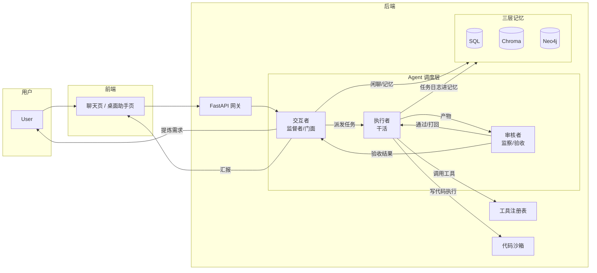
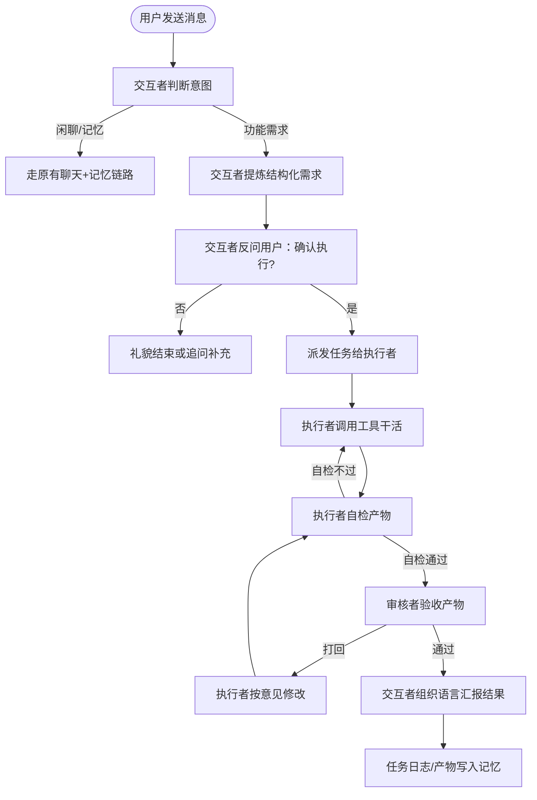
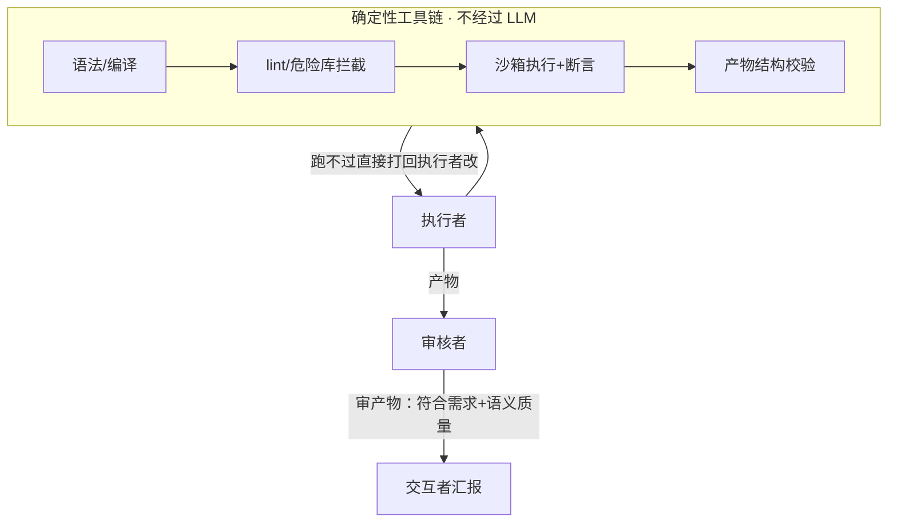

# 01_多Agents执行功能项目初始计划详解

> **2026-08-17 实现状态**：本文档描述的「三模型分工 + 任务确认 + 异步执行 + 会话留痕」核心闭环已落地实现（见 `03_任务确认与执行详解.md`）。Phase 1 范围为：预写工具 `fetch_url` + `generate_excel`（零新依赖）、确认交互为文本问答、后台 `asyncio.create_task` 异步执行、聊天页轮询刷新。以下 §5.1 工具表中 **已实现** 的工具即实际可用项；**2026-08-24 起 PDF/Word 文档生成已实现**（`generate_pdf`/`generate_docx`，见 04/05 详解）；代码沙箱（`run_python`，§9）与 PPT/图表生成工具（需新依赖）留待 Phase 2。
>
> **2026-08-19 追加**：电商数据源工具 `fetch_amazon_bestsellers`（Amazon 北美榜单，无 key 保底）与 `fetch_etsy_trending`（Etsy 官方 API，per-user key）已实现，详见 `02_北美电商数据网站爬取详解.md §7.1` 与 §5.1 工具表。

## 1. 目标

XIAONA 目前是「有长期记忆的个人聊天助手」，但只能「说」，不能「做」。本项目的目标是：在不改变现有聊天/记忆链路的前提下，为 XIAONA 增加**多 Agent 任务执行能力**——用户提出功能需求时，AI 不只是回复文字，而是真正动手完成任务，例如：

- **扒取数据**：抓取指定网页/链接的内容并整理成结构化数据。
- **生成 PDF**：根据内容/模板生成 PDF 文档。
- **生成 PPT**：根据大纲/数据生成 PPT 演示文稿。
- **生成 Excel**：根据数据生成表格、报表、图表。

核心设计思想是**三模型分工协作**：一个交互者（门面/监督者）负责理解用户、派发任务、汇报结果；一个执行者负责真正干活；一个审核者负责验收执行者的成果，不合格打回重做，形成「执行 → 审核 → 回退」的闭环。

> 本文档是 02 子项目群的**总纲与初始计划**，后续各详解文档（工具体系、执行器、审核器、前端交互、异步任务等）以本文档为一致性基准，编号 `02_xx`、`03_xx`…（参照 01 子项目群 01~12 的编号方式）。

## 2. 背景与定位

### 2.1 与现有系统关系

| 维度 | 现有（01 子项目群） | 新增（02 子项目群） |
|------|------|------|
| 定位 | 记忆型聊天助手 | 任务执行型 Agent |
| 模型 | 对话模型（chat）/ 抽取模型（extract）/ 向量模型（embedding） | 交互者 = 复用 chat 模型；新增执行者 / 审核者两个模型角色 |
| 数据 | SQL + Chroma + Neo4j 三层记忆 | 复用三层记忆；新增任务/产物存储 |
| 交互 | 聊天下发即回复 | 需求确认 → 异步执行 → 进度汇报 → 结果交付 |

### 2.2 为什么需要三个角色

- **交互者（门面/监督者）**：与用户打交道，判断意图。闲聊/记忆类内容走原有链路；功能需求则提炼成结构化任务，先向用户确认「是否执行」，确认后派发给执行者，最后把结果组织成自然语言汇报。
- **执行者（干活的模型）**：接收明确任务，通过工具真正完成任务（爬网页、生成文件等）。
- **审核者（监察者）**：对执行者的产物进行验收——文件是否生成成功、内容是否符合原始需求、数据是否准确。不合格则给出结构化修改意见让执行者重做。

## 3. 三模型分工架构



分工原则：

- **交互者 = 门面**：它只说给用户听的话，不直接操作工具；任务的确认、派发、汇报都由它统一对外。
- **执行者 = 干活的**：只面对任务描述与工具，不直接面向用户；它决定用什么工具、怎么组合。
- **审核者 = 监察**：只面对执行者的产物与原始需求，独立验收；它与执行者必须是**不同模型**，否则自己审自己容易蒙混过关。
- 三者均复用现有 `llm_provider` 抽象与模型库配置，只是「角色 prompt + 可用工具」不同。

## 4. 任务流转主流程

### 4.1 总体流程



### 4.2 意图判断（交互者第一层职责）

交互者收到消息后先判断：

- **闲聊/记忆型**（问候、回忆、续聊、提问）：走现有 `chat` 链路，不派发任务。
- **功能需求型**（包含"帮我扒/抓取、生成一份 PDF/PPT/Excel、做个表格/图表"等指令动词 + 明确对象）：提炼成结构化任务。

提炼出的结构化任务建议包含：

```json
{
  "task_type": "generate_pdf | generate_ppt | generate_excel | scrape_web | run_code",
  "goal": "用户目标的自然语言描述",
  "inputs": {
    "url": "https://...",          // 扒取场景
    "topic": "2026年AI行业报告",    // 生成场景
    "data": "..."                  // 已有数据（内联或引用文件）
  },
  "requirements": ["要求1", "要求2"]
}
```

### 4.3 用户确认（防误执行）

执行任务有副作用（占资源、访问外网、写文件），因此**必须二次确认**：

- 交互者把提炼后的任务用一句话概括给用户：「您是想让我抓取 X 页面的数据并生成一份 Excel 报表，对吗？」
- 用户明确确认后才派发；用户补充/修改则重新提炼。

## 5. 工具体系（执行者怎么干活）

### 5.1 结论：三条路线，主力自写 + 沙箱兜底

> 网上确实存在"工具市场"（MCP Registry、Composio、Apify 等），但对本项目的定位（自托管、隐私优先、本地模型）不划算，暂不引入。工具的正确来源是下面两条路线。

**路线 A：预写工具（Function Calling）—— 主力，必须做**

工具 = 后端 Python 函数 + 一份 JSON 描述（名称/参数/说明）。执行者模型读描述决定「调哪个、传什么」，真正执行的是后端容器里的代码。

> **2026-08-17 已落地（Phase 1）**：`fetch_url`（httpx 抓网页正文）与 `generate_excel`（openpyxl 生成 xlsx）已实现并通过验证，见 `03_任务确认与执行详解.md §5`。**2026-08-24 追加**：`generate_pdf` / `generate_docx` / `fetch_session_messages` 已实现（见 04/05 详解）。以下其余工具（scrape_page / generate_ppt / make_chart / read_file / write_file）需引入新依赖，留待 Phase 2，按项目依赖例外流程确认后添加。
>
> **2026-08-19 追加落地（电商数据源）**：`fetch_amazon_bestsellers`（Amazon 北美榜单，搜索页人气排序 + cookie 强制美元，见 `02_北美电商数据网站爬取详解.md §7.1`）与 `fetch_etsy_trending`（Etsy 官方 API，per-user key，设置页「数据源 API」配置）已实现并注册进 `registry.py`，执行者系统提示含完整交叉验证工作流（按源分榜 + 确认度标签 + 共同趋势总结）。

| 能力 | 依赖库 | 封装工具 | 状态 |
|------|------|------|------|
| 抓取网页（静态） | `httpx`（现有依赖） | `fetch_url` | ✅ 已实现 |
| 抓取网页（动态 JS） | `playwright` | `scrape_page` | ⏳ 待添加 |
| 生成 PDF | `reportlab`（现有依赖） | `generate_pdf` | ✅ 已实现（2026-08-24） |
| 生成 Word | `python-docx`（现有依赖） | `generate_docx` | ✅ 已实现（2026-08-24） |
| 生成 PPT | `python-pptx` | `generate_ppt` | ⏳ 待添加 |
| 生成 Excel | `openpyxl`（现有依赖） | `generate_excel` | ✅ 已实现 |
| 图表 | `matplotlib` | `make_chart` | ⏳ 待添加 |
| 读本地文件 | 内置 | `read_file` / `write_file` | ⏳ 待添加 |
| 读取会话消息 | 内置 | `fetch_session_messages` | ✅ 已实现（2026-08-24） |
| Amazon 北美榜单 | `httpx`（现有依赖） | `fetch_amazon_bestsellers` | ✅ 已实现（2026-08-19） |
| Etsy 官方 API | `httpx`（现有依赖） | `fetch_etsy_trending` | ✅ 已实现（2026-08-19，需设置页配 key） |
| Pinterest 趋势词 | `httpx`（现有依赖） | `fetch_pinterest_trends` | ✅ 已实现（2026-08-24，需设置页配 token） |
| Google Trends | `httpx`（零新依赖直连，未用 pytrends） | `fetch_google_trends` | ❌ 已移除（2026-08-28 卸载：当前网络环境不可用、无平替） |
| 博查/秘塔搜索 | 接入 API | `search_web` | ⏳ 待添加 |

**路线 B：代码沙箱 `run_python` —— 兜底，等于"无限工具"**

给执行者一个 `run_python` 沙箱工具：它自己写 Python 代码，沙箱执行，可 `pip install` 任意库。这样它能用整个 Python 生态，任何冷门能力都能现写现用。代价是必须做隔离（独立容器、限网络/文件/超时、禁危险库），详见 §9 安全。

**路线 C：第三方工具市场 —— 本期不做，留作未来扩展**

MCP Registry / Composio（1000+ toolkit）/ Apify（云爬虫 Actor）在 2026 已成熟，但引入意味着数据与任务发给第三方，与自托管定位冲突。等真有接入外部 SaaS（GitHub/Notion/飞书文档等）需求时，优先通过 MCP 协议对接，再单独写详解文档。

### 5.2 工具注册表

```python
# backend/app/core/agent/tools/registry.py（示意）
TOOL_SPECS = [
    {
        "name": "generate_excel",
        "description": "根据数据生成 Excel 表格",
        "parameters": {
            "type": "object",
            "properties": {
                "rows": {"type": "array", "description": "数据行列表"},
                "columns": {"type": "array", "description": "列名列表"},
                "sheet_name": {"type": "string", "default": "Sheet1"}
            },
            "required": ["columns", "rows"]
        }
    },
    # ... generate_pdf / generate_ppt / fetch_url / run_python ...
]
```

- 执行者 prompt 中注入工具描述（JSON Schema），它通过 function calling 发起调用。
- **注入格式必须用 OpenAI 标准 `{"type":"function","function":{...}}` 包装（2026-08-19 起）**：DeepSeek 官方端点严格反序列化校验，直接传 `{name,description,parameters}` 会 400 `tools[0]: missing field `type``，导致执行者整轮失败、任务回「❌ None」（见当天台账）。`registry.py` 实际实现：`TOOLS = [{"type":"function","function":spec} for spec in _SPECS]`。
- 所有工具统一签名：`(tool_name, params, task_ctx) -> result`，异常统一捕获为结构化错误返回给执行者（让模型知道"刚才这步失败了"）。

## 6. 审核与回退机制

### 6.1 轮数上限：最多 3 轮

**1 次初执行 + 最多 2 次回退重做**，到顶即上交，不让执行者死磕。理由：

- 收益递减：第 3 轮后能修好的问题很少，更多是重复错误或改坏已对的部分。
- 成本线性涨：每轮重跑都带完整上下文，token 与时间翻倍。
- 防震荡：模型修改可能来回振荡，必须有硬上限切断。

### 6.2 审核意见必须结构化

审核者输出的结论是 JSON，不能是"写得不太好"这种模糊话：

```json
{
  "passed": false,
  "issues": [
    "第2页标题与用户要求的主题不符，请改为《XX行业报告》",
    "Excel 价格列存在 3 个空值，请补充或标注缺失原因"
  ],
  "comment": "标题不符 + 价格列有空值，重做"
}
```

> **2026-08-17 落地（以 `03_任务确认与执行详解.md` §6.2 为准）**：`reviewer.review` 实际返回 `{"passed": bool, "issues": list[str], "comment": str}`，`issues` 为**纯字符串数组**（上例），不是对象数组；`workflow` 把 `issues` 写入 `refined["review_issues"]` 回传执行者逐条修订。

执行者拿到清单"照着改"，而不是靠猜。

### 6.3 每轮回退必须带完整上下文

原始任务 + 之前所有尝试 + 审核者的全部问题清单，**每次全部带上**，不能只传"上次不合格，再改改"，否则它只能靠记忆猜、重复犯错。

### 6.4 审核者要"真检查产物"，不是听汇报

> **2026-08-17 落地状态：Phase 2 待实施**。当前 `reviewer.review` 为**听汇报模式**：无工具调用，仅基于任务目标 + 执行者的执行日志与总结（含产物清单）判定 `passed` 并输出 `issues`（见 `03_任务确认与执行详解.md` §6）。检查工具链尚未接入。

审核者必须配一套**检查工具**（`inspect_file` / `validate_excel` / `check_pdf_pages` 等）：

- Excel → 打开检查列名、行数、关键字段空值；
- PPT → 检查页数、每页内容、标题匹配；
- 扒取数据 → 检查字段齐全、数量合理、无整列全空。

它审的是**产物本身**，不是执行者的自我描述。

### 6.5 超限处理：上交监督者，如实汇报

3 轮后无论过没过，一律上交交互者。交互者向用户**如实汇报**：成功了给结果；失败了说清楚「试了 3 次，卡在哪个问题上，已做到什么程度」，并询问用户「换个思路重来 / 放弃 / 保存当前进度」。

### 6.6 省钱技巧：执行者先自检

执行者干完先自己跑一遍自查工具（检查产物 + 对照需求），确认没问题再交审核，可显著减少回退轮数。前提是执行者与审核者是不同模型（本架构天然满足）。

### 6.7 审核范围：审产物，不逐行审代码

**审核者主审「结果（产物）」，不逐行审「代码」**。代码质量由确定性工具链负责，两者分工不同：

- 用户关心的是产物：用户要「一份 AI 行业报告 PPT」，拿到成品满意即可，不关心执行者代码怎么写。
- 模型审代码审不出真问题：LLM 是"读"代码不是"跑"代码，语法对、逻辑看着没问题，跑起来照样崩（空指针、编码、依赖版本），只有执行了才知道。
- 浪费 token 且盲区重叠：几百行代码全读一遍，LLM 审 LLM 写的代码，犯的错误同类，审不出真问题。
- 方向反了：代码是手段，产物是目的。逐行审手段，不如验收目的。

**代码质量靠确定性工具链（不经过 LLM）**，由沙箱执行器负责，分四层：

| 层 | 检查内容 | 手段 |
|----|------|------|
| 1 | 能不能跑 | 语法/编译检查（`python -m py_compile`） |
| 2 | 规不规范 | lint（ruff / flake8）+ 危险库调用拦截 |
| 3 | 跑得对不对 | 沙箱内执行 + 代码内断言（assert） |
| 4 | 产物行不行 | 产物结构校验（openpyxl 读回 xlsx 检查列/行/空值） |

四层全部是确定性代码，不花 token、速度毫秒级、比任何审核模型可靠。**唯一例外**：结果挂了需定位出错环节时，审核者可看执行日志（工具调用记录、报错堆栈、失败步骤）给执行者指明方向——这是"看日志定位"，不是"逐行审代码"。

分层验证模型：



## 7. 异步长任务与前端交互

### 7.1 必须异步

执行任务（尤其爬网页、生成大文件）是**长任务**，不能堵在聊天请求里。约定：

1. 交互者先回用户一句「已开始执行任务，完成后我汇报您」。
2. 后台跑流水线，任务状态推进：`pending → confirmed → executing → reviewing → revising(N) → done / failed / cancelled`。
3. 完成或失败后，通过前端轮询或 SSE 推送结果，交互者组织最终汇报。

> **2026-08-17 已落地**：确认后 `service._confirm` 用 `asyncio.create_task(start_task_async(...))` 后台执行，SSE 多一帧 `data: {"task_started": {task_id, session_id}}`，聊天页前端收到后每 2s 轮询 `GET /api/agent/tasks/{id}`，`done/failed` 时停止轮询并刷新消息（详见 `03_任务确认与执行详解.md §7.1`（SSE 帧扩展）/§8.2（前端轮询））。

### 7.2 前端交互建议

- 聊天页出现「任务执行中…」指示条（顶部，脉冲点动画）；完成后自动刷新当前会话消息。
- 完成后的产物提供**下载链接**（后端生成文件后落盘 `backend/artifacts/{user_id}/{task_id}/`，返回 `[下载 xxx](/api/agent/tasks/{id}/artifacts/xxx)` Markdown 链接）。
- 执行过程对用户**半透明**：展示关键步骤文字即可，不必暴露全部工具调用细节。

> **2026-08-17 落地说明**：确认交互为**文本/语音问答**（「是/好/执行」即确认，全渠道统一，契合语音场景）；任务卡片作为后续增强。

## 8. 数据模型与 API 草案

### 8.1 数据模型（沿用 01 的 SQLAlchemy 风格，主键 String(36) uuid，按 user_id 隔离）

> **2026-08-17 已落地**：以下代码块与 `backend/app/db/sql_models.py` 中实际定义一致（`AgentTask` / `AgentRunLog` 已建表，`FunctionAssignment` 已补 `executor_model_id` / `reviewer_model_id` 两列，`_apply_light_migrations` 已加对应迁移）。

```python
# backend/app/db/sql_models.py（已实现）
class AgentTask(Base):
    """多 Agent 任务（02 §5）：一次「用户提出功能需求 → 确认 → 执行 → 审核 → 留痕」的完整记录。"""
    __tablename__ = "agent_tasks"
    id = Column(String(36), primary_key=True)
    user_id = Column(String(36), ForeignKey("users.id"), index=True)
    session_id = Column(String(36), ForeignKey("sessions.id"), index=True)
    status = Column(String(16), default="pending", index=True)
    # pending(待确认) / confirmed(已确认) / executing / reviewing / revising / done / failed / cancelled
    task_type = Column(String(32), default="")    # scrape / generate / analyze / other
    goal = Column(Text, default="")               # 用户原始需求
    refined = Column(Text, default="")            # 提炼后的结构化任务 JSON（存 Text）
    retry_count = Column(Integer, default=0)      # 审核打回次数
    artifacts = Column(Text, default="")          # 产物相对路径字符串数组 JSON（形如 ["user_id/task_id/xx.xlsx"]）
    channel = Column(String(16), default="web")   # web / desktop / feishu
    error = Column(Text, default="")
    created_at = Column(DateTime, default=datetime.utcnow)
    updated_at = Column(DateTime, default=datetime.utcnow, onupdate=datetime.utcnow)

class AgentRunLog(Base):
    """Agent 执行日志（02 §6）：执行者/审核者每轮动作。"""
    __tablename__ = "agent_run_logs"
    id = Column(String(36), primary_key=True)
    task_id = Column(String(36), ForeignKey("agent_tasks.id"), index=True)
    role = Column(String(16))        # executor / reviewer
    round = Column(Integer, default=1)  # 第几轮（初执行=1，审核打回重做依次递增；workflow 写 attempt+1）
    action = Column(String(64), default="")   # call_tool / think / review / reject ...
    payload = Column(Text, default="")        # 动作详情 JSON
    created_at = Column(DateTime, default=datetime.utcnow)
```

> 与 §4.2 原始草案的差异：`refined` / `artifacts` 因跨 SQLite/PostgreSQL 兼容用 `Text`（存 JSON 字符串）而非 `JSON` 列类型；状态机新增 `confirmed`（待确认→已确认→执行中）。

### 8.2 API 草案

> **2026-08-17 已落地**：`backend/app/api/agent.py` 已实现以下接口（确认交互不单独走 `/confirm` 接口，而是复用聊天链路 + SSE `task_started` 帧，见 `03_任务确认与执行详解.md §3`）。

| 接口 | 方法 | 说明 |
|------|------|------|
| `/api/agent/tasks` | GET | 当前用户任务列表（按 user_id 过滤，倒序最多 50 条） |
| `/api/agent/tasks/{id}` | GET | 任务详情（状态、日志、产物） |
| `/api/agent/tasks/{id}/artifacts/{name}` | GET | 认证下载产物文件（路径按 user_id 隔离） |
| `/api/agent/tasks/{id}/cancel` | POST | 取消任务（pending/confirmed 可取消） |

统一沿用 01 的认证方式：`Authorization: Bearer <token>`，`get_current_user` 鉴权，`user_id` 由 token 解析。产物落盘 `backend/artifacts/{user_id}/{task_id}/`。

### 8.3 目录结构规划

「function 文件夹」的形态是**三层结构**，不是把函数堆一个文件夹：

> **2026-08-17 已落地（Phase 1）**：以下目录树为实际实现；`generate_ppt/run_python_sandbox` 与博查/秘塔 `search_web` 尚未建（见 §5.1 状态标注）。数据源与文档工具均已建（`amazon_bestsellers`/`etsy_trending`/`pinterest_trends`/`generate_pdf`/`generate_docx`/`fetch_session_messages`）。

```
backend/app/core/agent/
├── __init__.py
├── service.py               # 接入入口：agent_service.handle（chat.py/feishu.py 复用）
├── director.py              # 交互者：意图分类 + 需求提炼 + 确认判定
├── executor.py              # 执行者：function calling 循环 + 工具编排
├── reviewer.py              # 审核者：产物验收 + 回退逻辑
├── workflow.py              # 任务编排：渠道分流 + 后台执行 + 会话留痕
├── tools/                   # 工具层
│   ├── __init__.py
│   ├── registry.py          # 工具注册表：集中登记所有工具（元数据+实现）+ call_tool 白名单分发
│   ├── fetch_url.py         # 网页正文抓取（httpx，✅ 已实现）
│   ├── generate_excel.py    # Excel 生成（openpyxl，✅ 已实现）
│   ├── amazon_bestsellers.py # Amazon 北美榜单（httpx，✅ 已实现）
│   ├── etsy_trending.py     # Etsy 官方 API 热门商品（需 key，✅ 已实现）
│   ├── pinterest_trends.py  # Pinterest API v5 趋势词（需 token，✅ 已实现）
│   ├── generate_pdf.py      # PDF 文档生成（reportlab，✅ 已实现）
│   ├── generate_docx.py     # Word 文档生成（python-docx，✅ 已实现）
│   └── fetch_session_messages.py # 读取会话最近消息（内置，✅ 已实现）
```

> **2026-08-28 勘误：本目录树与 §5.1 工具表存在不一致**。数据源工具（`amazon_bestsellers/etsy_trending/pinterest_trends`，2026-08-28 起为可用三源）与文档工具（`generate_pdf/generate_docx/fetch_session_messages`）来自「北美电商数据爬取」与「生成 PDF/Word」子项目（见 `02_北美电商数据网站爬取详解.md`、`04_生成PDF文件详解.md`、`05_生成Word文档文件详解.md`），属于**追加的数据源/文档工具**，与 §5.1 的通用工具表（fetch_url/generate_pdf 等）不冲突——§5.1 是通用能力基线，本节目录树标注了后续数据源专用工具。实际以「爬取详解」文档的落地计划为准。

**第一层：工具实现（`tools/*.py`）**——一个工具一个文件，普通 Python 函数，只管"怎么实现"，不关心 AI。

**第二层：注册表（`registry.py`）**——连接"函数"与"模型"的桥梁。模型通过 JSON Schema 描述知道"有哪些工具、参数长什么样"，注册表集中登记元数据：

```python
# registry.py
TOOLS = {
    "fetch_etsy_trending": {
        "description": "查询 Etsy 平台上某品类的热门商品",
        "parameters": {
            "type": "object",
            "properties": {
                "query": {"type": "string", "description": "品类关键词，如 jewelry"},
                "region": {"type": "string", "enum": ["US", "CA"]},
                "limit": {"type": "integer", "default": 10}
            },
            "required": ["query"]
        },
        "handler": etsy_api.fetch_etsy_trending,  # 指向真实实现
    },
    # ...
}
```

**第三层：执行分发器（`tools/registry.py` 内）**——所有工具调用的唯一入口，管白名单校验、超时、错误结构化；`executor.py` 只是 `from app.core.agent.tools.registry import TOOLS, call_tool` 引入调用：

```python
def call_tool(name, params, task_ctx):
    """唯一入口：所有工具调用都经过这里。"""
    spec = TOOLS.get(name)
    if spec is None:
        return {"error": f"未知工具 {name}"}        # 白名单拦截
    try:
        result = spec["handler"](**params)           # 执行真实函数
        return {"ok": True, "data": result}
    except Exception as e:
        return {"ok": False, "error": str(e)}        # 结构化错误给模型看
```

**三个必须记住的点：**

1. **不是所有函数都能给 AI 调**。只有注册进 `registry.py` 的才暴露给模型；后端内部函数（`llm_provider`、`memory_engine` 等）不注册就不可见——这是工具白名单的本质，天然安全。
2. **工具本身要无状态 + 参数化**：输入参数 → 输出结果，不依赖全局状态，方便执行者/审核者复用与测试。
3. **执行者与审核者的工具集要隔离**：检查工具（`validate_excel`、`inspect_file`）与执行工具放同一个 `tools/`，但分属 `EXECUTOR_TOOLS` / `REVIEWER_TOOLS` 两个子集——否则执行者能调审核者的检查工具就自己审自己了。

与现有代码的关系：`llm_provider.py` 是模型连接能力（怎么调 LLM），`agent/tools/*.py` 是给 AI 用的工具能力（AI 能干什么）；`executor.py` 里调 `llm_provider` 做 function calling 循环，工具是它手里的"手"。

## 9. 沙箱与安全边界

### 9.1 沙箱是什么

**沙箱 = 把「可能危险的程序」关进一个隔离笼子里跑**。它可以在笼子里随便折腾，但出不来，伤不到你的主机、别的程序、别的用户数据。

为什么要沙箱：执行者的 `run_python` 允许模型自己写代码并执行，而模型写出的代码**无法提前预判好坏**——可能是正常的爬数据，也可能误删文件、读走其他用户数据、死循环占满 CPU、偷偷装带后门的库。大部分时候模型无恶意，只是"不知道自己在干嘛"。所以沙箱的定位是：让不可信代码**能跑，但代价封顶**。

类比：把一个陌生人请进你家干活。沙箱不是不让他进门，而是不让他去你的卧室（文件系统隔离）、不让他随便打电话给外人（网络隔离）、只让他用给定的小桌子（限工作目录）、规定最多干 5 分钟（超时杀掉）、就算发疯砸东西也只砸他那间房（容器隔离）。

### 9.2 五个隔离维度

| 维度 | 做法 | 对应配置（示意） |
|------|------|------|
| 进程隔离（笼子） | 跑在独立 Docker 容器内，跑完即销毁 | `image: python:3.11-slim` |
| 文件系统隔离 | 只挂载该用户任务目录，看不到系统文件/他人目录 | `volumes: ["./workspaces/user_xxx:/work"]` |
| 网络隔离 | 默认断网；需要联网时走白名单，或让沙箱代码只能经后端受控抓取工具访问网页 | `network_mode: none` |
| 资源限制 | 防死循环/超大数组拖垮服务器；超时 kill | `mem_limit: 512m` / `cpu_quota` / `pids_limit` / 超时 |
| 权限限制 | 非 root 运行，禁危险系统调用，**绝不挂 Docker socket** | `user: 1000:1000` / `no-new-privileges` / seccomp |

```yaml
# 示意：沙箱容器（docker-compose 片段）
sandbox:
  image: python:3.11-slim
  command: python /work/run_task.py
  volumes:
    - ./workspaces/user_xxx:/work   # 只挂该用户任务目录
  network_mode: none                # 默认断网（最严）
  mem_limit: 512m
  pids_limit: 128                   # 防 fork 炸弹
  read_only: true
  security_opt: [no-new-privileges:true]
```

### 9.3 三个落地方案（按投入从低到高）

| 方案 | 做法 | 安全性 | 适合 |
|------|------|------|------|
| 方案一：沙箱容器 | 每次任务起一个一次性 Docker 容器跑代码，跑完销毁 | 高 | **推荐**，项目已用 Docker Compose，加一个沙箱服务很顺 |
| 方案二：只预写工具 | 不开放 `run_python`，执行者只能调写好的 5~8 个工具，代码在后端进程内跑 | 中 | 最简单，够用，能力有限 |
| 方案三：系统级沙箱 | `nsjail` / `firejail` / gVisor | 很高 | 云厂商/极客用法，配置复杂，本项目不需要 |

**落地组合**：方案二为主（预写工具，代码在后端进程内跑，可控）+ 方案一兜底（开放 `run_python` 时上独立沙箱容器）。开发阶段用方案二即可，Phase 2 加 `run_python` 时再补沙箱容器。

### 9.4 与后端容器的关系（Docker socket 注意）

后端本身跑在 Docker 容器里，要"起沙箱容器"需后端容器访问 Docker 引擎。**Docker socket 很危险**——给应用就等于交出主机控制权。防护手段：

- 后端容器挂载 Docker socket 时，只允许它起 `sandbox` 镜像、强制 `--network none` 等受限参数；
- 或者不用 socket：用 `docker compose run` 起一次性沙箱；
- 个人项目可再简化：`subprocess` 在受限工作目录内跑（安全性打折但实现简单）。

### 9.5 安全边界清单

1. **代码沙箱隔离**：`run_python` 必须跑在独立容器内，限制网络（白名单或禁止外联）、文件系统（仅任务工作目录）、执行超时与资源上限；禁危险库与系统调用（见 §9.2）。
2. **工具白名单**：预写工具只暴露必要能力；文件读取限定在用户任务目录内，防止越权读其他用户文件。
3. **用户确认门槛**：有副作用的执行（外网访问、生成文件）必须先确认；可配置是否要求每次确认。
4. **审核者独立性**：执行者与审核者必须不同模型；审核意见结构化存档，便于追溯。
5. **产物生命周期**：生成文件按 `user_id` 隔离存储，定期清理过期产物（见 §10），纳入 `09_数据管理详解.md` 的清空/清理逻辑。
6. **回退上限硬编码**：retry_count 上限在代码层强制，防止 prompt 注入绕过。

## 10. 产物与代码的生命周期管理

### 10.1 先纠正：代码不会"堆积"

执行者生成的代码是**一次性的**：每次任务起一次性沙箱，代码放进容器里跑，跑完容器销毁、代码随之消失，**不会自己堆积到磁盘上**。下次要同类功能，执行者重新写一份新代码（模型写代码几秒钟），不翻旧代码复用。

真正会堆积的是三类**磁盘**东西（不是内存，内存由现有「最近 K 轮 + 语义检索」控制，不担心）：

| 堆积物 | 是什么 | 特点 |
|------|------|------|
| 沙箱工作目录 | 任务生成的临时文件、中间数据、代码 | 最该立即清理 |
| 产物文件 | 给用户下载的 PDF/Excel/PPT | 用户可能回头再下，保留一段时间 |
| 任务记录/日志 | 数据库里的任务状态、执行日志 | 元数据轻、日志重，分轻重处理 |

### 10.2 四层清理策略（TTL + LRU）

| 层 | 对象 | 策略 |
|----|------|------|
| 层 1 | 沙箱工作目录 | **任务结束立刻销毁**（`rm -rf`），不留 30 天 |
| 层 2 | 产物文件 | **TTL 30 天已实现**（`ARTIFACTS_TTL_DAYS=30`，`artifact_cleaner` 每日随 lifespan 清理过期文件与空目录，见 `03_任务确认与执行详解.md §11`）；**LRU 未实现（Phase 2）**——「被下载→重置倒计时」「每用户最多保留 N 份」未做 |
| 层 3 | 任务记录（元数据） | 轻量、长期保留（聊天页要展示"你上周做过一份报表"） |
| 层 4 | 执行日志（工具调用 payload/代码正文） | 重，30 天后清正文只留摘要（任务类型/轮数/结论）——**未实现（Phase 2，与 LRU 一起补）** |

这就是教科书级的 **TTL（到期清理）+ LRU（最近最少使用）** 模式，缓存/日志系统通用做法。

### 10.3 代码复用池（Phase 2 评估，本期不做）

若未来想要"生成过的代码存池、同类需求直接复用"，则需一个代码缓存池，上面 30 天 + 复用重置计时器规则**完全正确**，是标准管理方式。但建议 **Phase 2 再考虑**：

- 主流 Agent 做法是"每次重新生成"而不是复用旧代码——模型生成又快又便宜；
- 复用池要解决"判断两个需求语义相同"这个难题（本身要一次模型调用、存哈希、做匹配），个人项目收益不大；
- 真正有价值的"复用"在**记忆层**而非代码层：如"用户上次的 AI 行业报告是深蓝配色 + 4 页结构"存进记忆，下次生成自动沿用。现有 Chroma/KG 记忆系统天然承担，不冲突。

## 11. 技术栈与新增依赖

| 能力 | 技术 | 说明 |
|------|------|------|
| 后端 | Python + FastAPI（复用现有） | Agent 调度层放 `backend/app/core/agent/` |
| 工具执行 | `httpx`（现有依赖，请求统一用 httpx，不用 requests）+ 自写 HTML 解析 | `fetch_url` / 数据源工具；playwright / python-pptx / matplotlib 待 Phase 2 确认 |
| 文档生成 | `reportlab` / `python-docx`（现有依赖） | `generate_pdf` / `generate_docx` 已实现（2026-08-24）；`openpyxl`（现有依赖）已用于 `generate_excel` |
| 沙箱 | 独立 Docker 容器（`python:3.11-slim`）+ 受限网络 | 复用 06 的容器编排，见 §9（Phase 2） |
| 任务队列 | 先简单：FastAPI BackgroundTasks / asyncio 任务 + 状态表 | 量大再上 Celery/RQ，本期不做 |
| 产物清理 | 定时任务 + `last_accessed_at` TTL | 见 §10.2 |
| 前端 | React 复用现有 | 新增任务卡片组件 |

## 12. 分期实施计划

**Phase 1（本期）：核心闭环打通 —— ✅ 2026-08-17 已完成**
1. Agent 调度层骨架（三角色 prompt + 任务状态机 + 回退上限）。✅
2. 预写工具：`fetch_url` + `generate_excel`（零新依赖，符合 AGENTS.md 依赖例外流程）。✅
3. 执行者 function calling 接工具；审核者接产物验收；交互者接意图判断 + 确认 + 汇报。✅
4. 异步任务 + 聊天页轮询刷新 + 产物下载。✅
5. 产物生命周期管理（TTL/LRU、日志摘要化）——产物落盘 `backend/artifacts/{user_id}/{task_id}/`，**TTL 清理已落地**（`ARTIFACTS_TTL_DAYS` 默认 30 天，`artifact_cleaner` 每日随 lifespan 扫描清理，见 `03_任务确认与执行详解.md §11` 与当天台账）；**LRU 与日志摘要化未做（Phase 2，见 §10.2）**。

**Phase 2：能力扩展**
6. `run_python` 代码沙箱（独立容器，见 §9）。
7. 任务日志/产物提炼进三层记忆（用户在知识图谱中可见"做过的事"）。
8. CLI / 桌面助手 / 飞书入口的任务支持——部分完成：**桌面助手与飞书已接入**（03 §3），CLI 尚未接入。
9. 评估代码复用池（TTL + LRU，见 §10.3）。
10. 产物 TTL/LRU 自动清理任务——**TTL 部分已完成**（`ARTIFACTS_TTL_DAYS=30` + `artifact_cleaner` 每日清理，2026-08-24）；LRU（`last_accessed_at` 按下载重置）留待 Phase 2。
11. PDF/Word/PPT/图表等生成工具——**PDF/Word 已完成**（`generate_pdf`/`generate_docx`，04/05 详解，2026-08-24）；PPT/图表待确认引入 python-pptx / matplotlib。

**Phase 3：生态接入（远期，另立文档）**
12. MCP 协议对接第三方工具市场（仅当出现外部 SaaS 接入需求）。

## 13. 与其他文档的关联

- 三模型角色与记忆链路的关系：`01_单Agent聊天助手/01_单Agent聊天助手项目初始计划详解.md`、`02_长期记忆详解.md`
- 多模型配置（模型库）：`01_单Agent聊天助手/` 模型管理相关章节
- 产物/任务文件纳入数据清理：`01_单Agent聊天助手/09_数据管理详解.md`
- 异步任务与桌面助手/CLI 的整合：`01_单Agent聊天助手/08_桌面助手详解.md`、`11_CLI客户端详解.md`
- 后续详解文档（工具体系 / 执行器 / 审核器 / 前端任务卡片 / 沙箱 / 产物生命周期）将在本子项目群内按 `02_xx`、`03_xx`… 编号补充

## 14. 文档反哺约定

延续 01 子项目群的硬性规则：本子项目群的一切代码修改、问题排查、问答结论，必须反哺到 `项目计划/02_多Agents执行功能/` 下对应文档，并在 `项目计划/所遇问题及解决方案/` 当天台账中记录（现象 / 根因 / 方案 / 改动文件 / 验证结论）。
