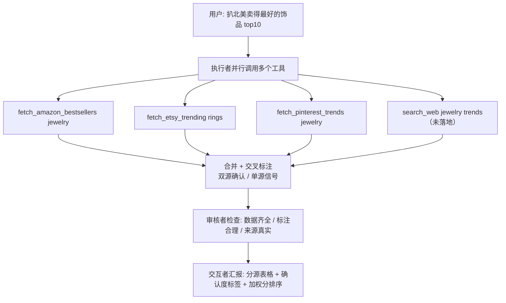

# 02_北美电商数据网站爬取详解

## 1. 目标

本文档是 `02_多Agents执行功能` 子项目群的第二份文档，承接 `01_多Agents执行功能项目初始计划详解.md` 中「执行者工具体系」的路线 A（预写工具）。目标是为执行者沉淀一套**北美电商选品数据源**的完整方案：

- 有哪些**免费且靠谱**的数据源可以扒取；
- 每个源能拿到什么、怎么接入（官方 API / 爬虫）、有什么坑；
- 如何用**多源交叉校验**消除单一网站不准的风险；
- 执行者输出的**返回数据契约**（品类 / 商品名 / 图片 / 链接 / 确认度标签）；
- 覆盖执行者「帮我扒一下北美卖得最好的饰品 top10」这类任务的标准工作流。

> 本文档聚焦「数据源与接入方案」，偏调研结论与约定；具体 function 的实现细节后续如有需要可在本子项目群内继续编号补充（如 `03_工具体系详解.md`）。

## 2. 核心认知纠偏

### 2.1 真实的「月销量」没有任何免费渠道

整个北美电商，**没有任何平台公开精确的月销量数字**：

- **Amazon** 只公开 **BSR（Best Sellers Rank，类目销售排名）**，不公开销量——第三方工具（Jungle Scout、Keepa、AMZScout 等）的"销量"都是拿 BSR 套公式**估算**出来的，全部收费。
- **Etsy / eBay / Shopify 独立站**根本不公开任何销量数据。
- 因此"哪个卖得最好 top10"只能靠**多个公开信号拼出来**，不存在一个网站直接给你现成排名。

### 2.2 交叉验证的前提：源之间必须互相独立

两个源如果底层是同一份原始数据加工出来的，互相印证就毫无意义（例如 Jungle Scout、AMZScout、RankBlaze 底层都是拿 Amazon BSR 反推的——看着是两个源，其实是一个源换衣服）。**真正的独立源是平台原生数据**，因为生成机制完全不同。

## 3. 数据源清单（免费且靠谱）

针对**饰品/首饰/戒指**品类的排序（综合免费程度、合规性、品类匹配度）：

| 数据源 | 免费？ | 能拿到什么 | 对饰品的价值 | 接入方式 |
|------|------|------|------|------|
| **Etsy 官方 Open API v3** | ✅ 免费（10000 请求/天） | 热门 listing、标题、价格、favorites、views、评论数 | **最高**（手作饰品最大平台） | 正式 API，注册拿 key |
| **Amazon Best Sellers 页面** | ✅ 公开可爬 | BSR 排名、价格、评分、评论数（每类目前 100） | 高（饰品是大类） | 爬 Amazon 搜索页（人气排序）为主，显式 `url` 传 BSR 类目页时走榜单页解析，需处理反爬。**2026-08-27 起**：搜索路径翻 5 页（约 100 候选）先排除后取足 top N |
| **Pinterest Trends** | ✅ 免费 | 按品类/地区/年龄的趋势 + saves/clicks | 中高（时尚/生活方式趋势提前 3~4 个月） | **已实现（2026-08-24）**：官方 API v5 `GET /v5/trends/keywords/{region}/top/{trend_type}`（免费，需注册 app 拿 Bearer token；trends.pinterest.com 匿名接口在数据中心 IP 不可用） |
| **eBay Terapeak** | ✅ 卖家内置 | 真实成交数据（sell-through rate、均价） | 中 | 需 eBay 卖家账号 |

### 3.1 Facebook / Instagram：不能当数据源

- 它们**不展示任何销量/月销/排名数据**，只有互动数、hashtag 热度。
- **反爬极严**，公共接口基本被锁，自己爬极易封号且违反 ToS。
- 顶多当**趋势信号**（看竞品在推什么），是弱信号，不是结构化数据源。

> 结论：**FB/IG 是营销阵地，不是数据源。数据源在电商平台自己那里。**

### 3.2 搜索类数据源（国产 AI 搜索 API）

执行者需要"实时联网查资料"时，用专门给 AI/Agent 用的搜索 API，而不是给人用的搜索网站：

| 服务 | 说明 | 免费额度 | 接入方式 |
|------|------|------|------|
| **博查 AI 搜索（Bocha）** | 国产、面向 AI 应用的搜索 API，被誉为"AI 应用的实时大脑"；DeepSeek/字节/腾讯等超 60% 国内 AI 应用在用；提供 Web Search / AI Search / Agent Search / Semantic Reranker 四类 API | 新用户免费领 **1000 次**资源包，超出按量计费 | REST API / Function Call（兼容 OpenAI）/ **MCP Server** |
| **秘塔搜索 API** | 国产，约 3 分钱/次，即测即用 | 通常有初始免费额度 | REST API，支持 MCP 协议 |

> 定位：博查/秘塔这类搜索 API 作为交叉校验里的"搜索意图/内容热度"信号源，可接入执行者的 Function Calling 或 MCP。

## 4. 多源交叉校验方法论

### 4.1 多源分工：各测一个独立维度

| 源 | 测的维度 | 在「饰品 top10」里的角色 |
|------|------|------|
| Amazon BSR | 大盘销量 | 主榜：正在大卖的款 |
| Etsy API | 垂直圈热度 | 副榜：手作饰品圈被收藏最多的款 |
| Pinterest Trends | 收藏种草 | 前瞻：未来 3~4 个月的趋势款 |
| 博查/秘塔搜索 API | 内容热度/新闻 | 补充：近期资讯中反复出现的品类 |

> **2026-08-16 勘误**：标题原为「五源」，但表格含 Pinterest 与搜索 API 共 6 个源——实际是**六源**，统一表述为六源分工。
> **2026-08-28 更新（当前实际可用三源）**：经 Google Trends / Movers 卸载、TikTok 归档后，当前**实际可用三源**——Amazon Best Sellers（主榜）/ Etsy（需 key）/ Pinterest（需 token）；搜索 API（博查/秘塔）未接入。六源仅指**曾规划**的维度集合，已收敛。
>
> **2026-08-28 卸载**：Google Trends（`fetch_google_trends`）与 Amazon Movers & Shakers（`fetch_amazon_movers`）经用户实测确认在当前网络环境下不可用（反爬/限流无解、无平替），已**彻底卸载删除**（工具文件/registry/executor 提示词/workflow 映射/前端设置页全清）。表格移除 Google Trends 行；Movers 本就不在分工表内（它是 Amazon 的 24h 涨幅维度）。**TikTok Creative Center 同步归档（2026-08-28 用户明确）**：从未实现、早已不用，用户确认当前仅 **Amazon Best Sellers（主榜）+ Etsy（需 key）+ Pinterest（需 token）** 三源可用，其余均不可用；TikTok 调研结论仅作历史归档。

> **2026-08-24 落地（历史记录）**：六源中 **Google Trends** 曾实现（零依赖 httpx 直连，返回热度时间序列 + 走势判定）；**Amazon Movers & Shakers** 曾实现（24h 涨幅榜，起量预警）；**Pinterest Trends** 已实现（官方 API v5，收藏种草/前瞻）；**TikTok Creative Center** 调研结论为「浏览器免登录可看但批量自动化不可行（签名+住宅代理）」，按用户决定**暂缓**，仅记结论不接实现；Amazon BSR / Etsy API 已实现；搜索 API 仍未接入。**2026-08-28 起，Google Trends 与 Movers 已卸载**，上文仅作历史归档。

### 4.2 交叉规则（写入执行者 prompt 的核心逻辑）

```
一个款出现在 ≥2 个独立源的高分区 → 标记「双源确认」，可信度高
一个款在 ≥3 个独立源都高分       → 标记「多源确认」，重点推荐
一个款只在单一源高分             → 标记「单源信号」，输出时提示用户「此款仅 X 源表现好，谨慎」
```

输出 top10 时每条都带一个**确认度标签**，用户一眼知道哪个稳、哪个是赌趋势。

> **2026-08-27 落地：默认仅 Amazon 主榜，Movers/Trends 改为可选（2026-08-28 已卸载）**。任何榜单/选品任务默认第一步**只调 `fetch_amazon_bestsellers`**（现状主榜，免 key）。Etsy/Pinterest 为可选叠加层（需配置 key/token，未配置时工具返回降级错误、直接跳过勿重试，主榜照常）。最终总结**只补实际调用且成功的源**：「Pinterest 种草：趋势词「XX」周环比增长 Y%」。**2026-08-28 起**：`fetch_google_trends`/`fetch_amazon_movers` 已彻底卸载（用户实测当前网络环境下不可用、无平替），执行者不再有「起量/热度趋势」维度可调。
>
> **2026-08-27 降级韧性（2026-08-28 更新）**：商品源（Amazon 榜 / Etsy 榜）失败最多重试 1 次——`amazon_bestsellers._get` 非 200 sleep 2s 重试 1 次、重试仍失败立即放弃该源、用已有数据交付；佐证源 `fetch_pinterest_trends` 失败静默不弹 ⚠️（workflow `_SILENT_DEGRADE_TOOLS`，未配置很常见）；执行者单轮模型超时（`timeout=300`）重试 1 次、重试仍失败保留已抓取 `tool_results` 返回，最终消息仍自动附加已抓到的榜单表格。**category 禁大类目词（2026-08-27 起，2026-08-28 工具级落地）**：`category` 只传具体品类词（如 ring/watch），禁止传 Jewelry/Accessories 等大类目词——大类目并入搜索词会放大混入耳环/玩具等无关商品，逼出第二次严格筛选。**2026-08-28 起工具端兜底**：`amazon_bestsellers` 组装搜索词时**整词命中 `_BROAD_CATEGORY_WORDS`（jewelry/accessories/apparel 等）的大类目词参数剔除**并记入 note（仅整词命中才剔，不拆散 jewelry box 等多词品类；只传大类目词时兜底保留一个避免报错）；**查询词去重移到翻译后按词精确去重**（此前翻译前 part 级子串去重判不出跨语言重复——keywords="diamond ring"+category="钻石戒指" 翻译后仍拼成 "diamond ring diamond ring"）。

> **能力边界如实告知（2026-08-27 起，2026-08-28 移除 Movers/Trends 后更新）**：可提供——现状销量榜（Amazon Best Sellers）、Etsy 榜（需 key）、Pinterest 趋势词（需 token）。**无公开数据源**：商品级「下降最快/跌幅最大」榜与「24h 起量/涨幅」榜（曾接入的 Movers/Trends 因反爬限流已卸载）、品类搜索热度走势（曾接入的 Google Trends 已卸载）、单品总销量/累计销量绝对值（各平台均不公开）、国内平台（小红书/抖音/淘宝/京东）数据。执行者遇到超纲请求须如实告知并给可替代方案，勿硬凑/勿伪造/勿用其它维度冒充。

### 4.3 矛盾处理：不做「平均值」，做「分源视图 + 加权分」

不同源排名不一致是常态，别强行求平均（信息会丢失）。两个做法：

1. **每条保留分源得分**，展示成表格，让用户自己看维度差异；
2. **可配置加权总分**：如 Amazon 0.5 + Etsy 0.3 + Pinterest 0.2，权重在设置里可调（主做饰品就把 Etsy 权重调高）。

## 5. 执行者标准工作流（多源校验）

多源校验**不是某个 function，而是执行者的一条固定工作流**：



执行者需要具备**并行调用多个工具**的能力（对应 `01` 总纲中「工具编排」的扩展），多源校验是它第一个落地的实战工作流。

## 6. 返回数据结构（数据契约）

### 6.1 需求拆解

执行者产出的 top10 不只是"名字 + 排名"，每条都要带**商品级详情**：

- **细分品类**（不是笼统的"饰品"，而是戒指/耳环/项链/手链…）
- **商品名称**
- **图片**（URL）
- **商品链接**（能点进那个商品页）
- 再加上多源校验的**确认度标签 + 分数**

### 6.2 各源能提供的字段

| 源 | 商品名 | 图片 | 商品链接 | 细分品类 |
|------|------|------|------|------|
| Etsy API | title | images[] | url | taxonomy（类目体系） |
| Amazon BSR | title | 图片 URL | `/dp/{ASIN}` | 类目路径 |
| 博查/秘塔搜索 API | 摘要 | 部分 | 网页链接 | 无 |

> 图片和商品链接只有电商平台源能给，搜索/趋势源给不了。返回结构里要区分「**可直接比价/点开的商品**」和「**仅作信号佐证的条目**」。

### 6.3 返回 JSON 契约

```json
{
  "task_id": "uuid",
  "query": "北美卖得最好的饰品 top10",
  "generated_at": "2026-08-16T00:59:00Z",
  "confidence_rule": "≥2源双源确认 / ≥3源多源确认 / 单源信号",
  "results": [
    {
      "rank": 1,
      "category": "戒指",                    // 细分品类（归一到统一词表）
      "product_name": "Titanium Ring with...",
      "brand": "XXX",
      "image_url": "https://...",            // 主图 URL
      "product_url": "https://.../dp/ASIN", // 可点击的商品链接
      "price": "$12.99",
      "source_primary": "amazon",            // 主来源平台
      "sources": ["amazon", "etsy"],         // 命中的独立源
      "confidence": "multi",                 // multi / dual / single
      "score": 87.5,                         // 加权总分
      "scores_by_source": {"amazon": 91, "etsy": 84, "pinterest": null},
      "metrics": {"bsr": 320, "reviews": 428, "favorites": 1200, "trend_7d": "+12%"}
    }
  ]
}
```

> **Phase 1 实际落地契约（2026-08-19，2026-08-24 补 markdown_table / Pinterest，2026-08-27 补多表展示，2026-08-28 移除 Movers/Trends）**：Amazon/Etsy 两个电商源工具各自返回扁平 `{ok, source, query, items[], note?}`；`items[]` 每项含 `rank/title/price/image_url/product_url/rating/reviews`（Amazon）与 `rank/title/price/image_url/product_url/num_favorers/views/taxonomy`（Etsy，过滤后 rank 统一重排 1..N）。**榜单表格由后端生成（2026-08-24 起）**：工具返回 `markdown_table` 字段（Amazon 严格 7 列、Etsy 严格 8 列，列对齐、链接列显示完整 https:// 网址、缺失填「-」），executor 的 `run()` 经 `tool_results` 收集、workflow 最终消息自动附加——不再由执行者在其最终回复手拼 Markdown 表格（LLM 少写 | 就整行右移、长 URL 被省略）。**多表展示（2026-08-27 起）**：`_format_ranking_table` 收集 `tool_results` 里**全部** ok 且带 markdown_table 的榜单结果（正序遍历、**同源保留最后一次**——执行者最后一次调用通常排除词更全、筛选更严，曾出现第一次宽松结果混入耳环/玩具与严格总结错位；2026-08-27 修复、按首次出现顺序输出、每张前加来源中文标签），最终消息不再只显示最后一张——多源对照直接可见。**Pinterest Trends（2026-08-24 落地）**：返回 `{ok, source:"pinterest", region, trend_type, items:[{rank, keyword, pct_growth_wow, pct_growth_mom, pct_growth_yoy}], summary}`，无商品榜/无 markdown_table（趋势词不是商品），仅作「收藏种草/前瞻」信号，官方 API 只返回当天 top 趋势词。**Google Trends / Movers（曾实现，2026-08-28 已卸载删除）**：不再有返回契约。

### 6.4 三个实现要点

1. **品类归一必须做**：每个源的品类体系不同（Etsy taxonomy / Amazon 类目路径），合并时归一到统一词表（戒指/耳环/项链/手链/胸针/吊坠…），否则 top10 里"戒指 / Wedding Bands / Rings"其实是同一种。做法：小映射表，或让执行者用模型归一（便宜、够用）。
2. **去重合并靠稳定标识**：同一源内的商品用稳定标识——Etsy 用 listing id、Amazon 用 ASIN。跨源合并（两个平台的"同一款"其实是不同 listing）按"归一后品类 + 名称相似"匹配，不硬去重；更合理的输出是**按源分榜 + 交叉标注**（见 §4.3 分源视图），别把两个平台强合成一个"全球 top10"。
3. **链接要干净**：Amazon 链接带 tracking 参数（`ref=...`），保存/分享前清洗；Etsy 链接直接可用。图片存主图即可（Amazon 有多个尺寸变体，取标准尺寸）。

### 6.5 前端展示方式

聊天页任务卡片里渲染**榜单表格**：

- 缩略图 + 商品名（可点，新标签打开商品页）
- 品类、价格
- 确认度徽标（多源确认=绿 / 双源=蓝 / 单源=灰）
- 每个源的小分

用户点"导出"可落成 Excel/PDF——复用 `01` 总纲的 `generate_excel` / `generate_pdf` 工具，形成闭环。

## 7. 分阶段落地建议

> **Phase 1 已落地（2026-08-19）**：`fetch_amazon_bestsellers` + `fetch_etsy_trending` 两个工具已实现并接入执行者，见 §7.1 标注。**Phase 2/3 仍为规划**。

**Phase 1（先跑通通道）**：第一个 function 从 **Etsy 官方 API** 写起——唯一免费 + 官方 + 不违反 ToS + 品类高度匹配。然后第二个写 **Amazon Best Sellers**（处理反爬）。（2026-08-24 曾接第三个 **Google Trends**，2026-08-28 因当前网络环境不可用已卸载删除。）

**Phase 2（扩大覆盖）**：接博查/秘塔搜索 API（MCP 或 Function Call）。TikTok Creative Center **已归档（2026-08-24 调研结论：浏览器免登录可看但批量自动化不可行——内部接口需签名+住宅代理；2026-08-28 用户确认不使用，勿再规划自动接入）**。

**Phase 3（体系成型）**：每加一个源 = 加一个 function + 在交叉规则里登记角色，成本很低。跑通 2~3 个独立源后，交叉校验框架即立住。

### 7.1 接入要点

- **Etsy**：Open API v3，注册开发者账号拿 key，10000 请求/天，100 listings/次批量调用。有开源项目 `etsy-oracle` 可参考其基于 favorites/views/评论增速的销量估算思路。
  - **已落地（2026-08-19）**：`backend/app/core/agent/tools/etsy_trending.py`。key 解析回退链：**设置页 per-user 数据库配置（`data_source_configs` 表，`GET/PUT /api/settings/datasources`）→ `.env` 的 `ETSY_API_KEY`**；两处均未配置返回结构化降级错误。按 `num_favorers`（收藏数）降序近似「最受欢迎」排序；批量取主图 `/listings/{id}/images`（并发 5、限频 0.2s）。**过滤（2026-08-23 起）**：`min_price/max_price`（Etsy `price.amount` 是「分」，按 `amount/100` 数值比较，不做汇率换算）与 `min_favorers`（最低收藏数）。Etsy 是全球平台**无地区概念**、官方 API **无评分字段**（只能按价格/收藏过滤，用户要评分时用 Amazon 源；颜色/材质并入 `keywords` 英文，2026-08-24 起）。**过滤后 rank 重排（2026-08-24 起）**：原 `enumerate(top)` 在 continue 过滤后 rank 跳号，改过滤完成统一重排 1..N；返回附 `markdown_table`（严格 8 列：排名/图片/商品名/链接/价格/评分「-」/收藏/来源）。**全量候选池（2026-08-28 起，见当天台账一）**：不再 `[:limit*2]` 截断（池子仅 40 条时严苛门槛一过滤就凑不齐 top N），按收藏排序后全量 100 条扫描过滤取前 limit 个幸存者，**过滤后才为保留条目批量拉主图**（避免为淘汰品白拉图）。
- **Amazon**：`httpx` 手写即可（后端请求统一用 httpx，不用 requests，见 §10），HTML 解析为自写解析器（`_SearchParser`），注意反爬（轮换 UA / 限速 / 必要时代理）；跑通了再考虑 Playwright。用官方 BSR 榜（Movers & Shakers 曾接入，2026-08-28 因反爬不可用已卸载）。
  - **已落地（2026-08-19）**：`backend/app/core/agent/tools/amazon_bestsellers.py`。主路径为**搜索页按人气排序**（`/s?k={关键词}&s=exact-aware-popularity-rank`，天然按销量热度排序），显式 `url` 传 BSR 类目页时走榜单页解析。**地区站点（2026-08-23 起）**：`site` 参数支持 us(默认)/uk/ca/au/de/fr/it/es（兼容 `amazon.co.uk`/`britain` 等别名归一），请求带对应站点货币 `i18n-prefs` + 语言 `lc-main` cookie 与 `Accept-Language`（服务器出口 IP 被判定为其它地区时默认返回本地货币，实测香港 IP 返回 HKD，cookie 后变 USD），商品链接清洗域名随站点（uk→www.amazon.co.uk 等）。**过滤参数（2026-08-23 起，2026-08-24 补区间/颜色/材质/排除词/过滤顺序）**：`min_price/max_price`（数值，单位随站点货币）、`min_rating`/`max_rating`（评分区间 0~5）、`min_reviews`/`max_reviews`（评论数区间，支持 1000 或 "1000"）、`color`/`material`（颜色/材质，中文/英文均可，并入搜索词缩小范围）、`exclude_keywords`（排除词，逗号/空格/顿号分隔，中英文均可，如 玩具/toy,派对,耳环，标题含任一排除词直接丢弃，**不并入搜索词**仅本地过滤，`_ZH_TO_EN` 含排除类词：玩具/派对/儿童/装扮/假发/礼品等兜底翻译），无法解析的字段不参与过滤避免误杀，过滤条件拼进返回 `note`。**过滤顺序（2026-08-24 起）**：**先排除词 → 再价格/评分/评论区间 → 最后才截断取 top N + rank 从 1 重排**——此前先 `[:limit]` 截断再过滤，top10 混入玩具/耳环一过滤就凑不齐 N 个；排除后池子不足 N 条时如实说明。**标题兜底（2026-08-24 起）**：`_SearchParser` 除 `h2` 内捕获标题外，`a` 标签命中 `/dp/` 且未在捕获状态时以链接文本为标题兜底、`h2` 的 `aria-label` 非空时直接取用——新版页面标题不在 `h2` 内不再导致商品名缺失。**中文品类词由执行者翻译成英文关键词**（任意品类全覆盖：玩具→toys、文具→stationery、银戒指→silver ring，见 03 文档 §5.6），工具层 `_ZH_TO_EN` 饰品/颜色/材质映射表（银戒指→silver ring、钛钢→titanium steel、玫瑰金→rose gold、白色→white 等，Amazon 只索引英文标题）保留作兜底。内置 `bm-verify`/Robot Check 反爬挑战检测，触发时返回中文提示而非空结果。**榜单表格由后端生成（2026-08-24 起）**：返回附 `markdown_table`（严格 7 列：排名/图片/商品名/链接/价格/评分/评论数，`_build_markdown_table` + `_cell` 清洗），由 workflow 自动附加到最终回复，执行者不再手拼表格。
- **Google Trends / Amazon Movers & Shakers（2026-08-24 曾实现，2026-08-28 已卸载删除）**：`google_trends.py`（零依赖 httpx 直连匿名内部接口，限流/拦截页处理）与 `amazon_movers.py`（`gp/movers-and-shakers` 24h 涨幅榜 + 类目 slug）经用户实测确认在当前网络环境下**不可用且无平替**（Google 内部接口数据中心 IP 必 429/拦截；Amazon `/gp/` 路径反爬比搜索页更严），已按「保持代码干净」原则**彻底删除**：工具文件、`registry.py` import/spec/handler、executor 提示词、`workflow.py` 的 `_TOOL_LABELS`/`_SILENT_DEGRADE_TOOLS`/`_RANKING_TOOLS`/`_tool_args_summary`、前端设置页条目全部清理。历史接入记录仅作归档，勿再恢复引用。
- **Pinterest Trends**：官方 API v5 `GET /v5/trends/keywords/{region}/top/{trend_type}`（免费，需注册 app + OAuth Bearer token，scope `user_accounts:read`，只返回当天 top 趋势词、无历史时序）。trends.pinterest.com 匿名接口在数据中心/云 IP 下返回空（pinterest-cli/trendgetter 第三方封装同受 IP 限制），**勿走匿名接口**。
  - **已落地（2026-08-24）**：`backend/app/core/agent/tools/pinterest_trends.py`。key 解析回退链（仿 etsy）：**设置页 per-user 数据库配置（`data_source_configs` 表 source="pinterest"，`GET/PUT /api/settings/datasources`）→ `.env` 的 `PINTEREST_API_TOKEN`**；两处未配置返回结构化降级错误（「可跳过 Pinterest 维度用 Amazon/Etsy 继续」）。**参数**：`keyword`（可选，作为 `include_keywords` 过滤 top 趋势词）、`region`（默认 US）、`trend_type`（默认 growing，支持 top/growing/monthly/yearly/seasonal）、`limit`（默认 20 ≤50）。**返回** `{ok, source:"pinterest", region, trend_type, items:[{rank, keyword, pct_growth_wow, pct_growth_mom, pct_growth_yoy}], summary}`，`_build_summary` 提炼「当前最热趋势词 + 周环比增长」；**无 markdown_table**（趋势词不是商品榜，不自动附加）。401/403 → 提示「token 无效或无权限，请在设置页重新配置」。
- **博查/秘塔**：注册领免费额度，兼容 OpenAI Function Call 或 MCP，执行者可按需联网搜索补充信号。**未落地**。

### 7.2 「月销量估算」怎么做（对 top10 够用）

真实销量拿不到，但可以用公开信号估一个**热度分**（透明、可解释）：

- Etsy：favorites 增速 + 评论增速 + views 加权；
- Amazon：BSR 排名（排名越靠前隐含销量越大）。

> 热度分不是真实销量，但对「选品 top10」完全够用。要在输出里明确标注"估算"，不误导用户。

## 8. 反爬与合规注意

1. **Etsy 优先用官方 API**，合规且免费，别爬它。
2. **Amazon 爬虫**要限速、轮换 UA；大规模抓取建议改用官方 SP-API（需卖家身份）或第三方（收费）。
3. **搜索 API（博查/秘塔）用官方接口**，不走网页抓取。
4. 本子项目群所有工具的落地都要遵守 `01` 总纲 §9 的安全边界（工具白名单、网络受控等）。

## 9. 与其他文档的关联

- 数据源作为执行者工具：`01_多Agents执行功能项目初始计划详解.md` §5 工具体系、§4 任务流转
- 审核者检查"来源真实"：`01_多Agents执行功能项目初始计划详解.md` §6 审核与回退
- 返回数据契约与前端任务卡片/导出：`01_多Agents执行功能项目初始计划详解.md` §7.2、§5.1 的 `generate_excel` / `generate_pdf`
- 产物（表格/榜单）生成与生命周期：`01_多Agents执行功能项目初始计划详解.md` §5.1、§10
- 账号配置与密钥管理：`01_单Agent聊天助手/` 设置页模型管理章节、`.env`（Etsy API key / 博查秘塔 key 等接入后需在 `.env.example` 补占位，如 `ETSY_API_KEY=`）
- 具体 function 实现若产生新结论，反哺本文档并在当天台账记录

## 10. 待定项与补充说明

- **Phase 1 已实现（2026-08-19）**：Amazon（搜索页人气排序 + 美元强制）与 Etsy（per-user key）两个数据源工具已落地，执行者系统提示含完整交叉验证工作流（按源分榜 + 确认度标签 + 共同趋势总结）。**2026-08-24 补 Pinterest Trends（官方 API，需 token）**；**Google Trends / Movers 曾于 2026-08-24 落地、2026-08-28 因当前网络环境不可用已卸载删除**；**TikTok Creative Center 调研结论仅归档、不使用（2026-08-28 用户确认三源即可）**。Phase 2/3（博查/秘塔）仍为规划，落地时需逐一验证接入方式；依赖（playwright 等）均为**待添加**，需按项目依赖例外流程确认后引入。
- 本文档为**规划 + Phase 1 落地记录**文档，除已标注「已落地」的章节外，其余「接入方式/免费额度」仍为调研结论。
- 依赖栈说明：后端请求统一用 `httpx`（现有项目依赖），已落地工具均复用 `httpx`；`requests` 仅为示意不再引入。
