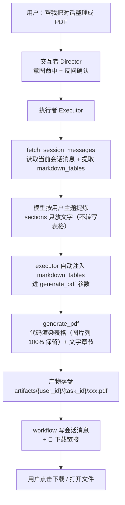

# 04_生成PDF文件详解

> 本详解承接 `01_多Agents执行功能项目初始计划详解.md`（总纲）与 `03_任务确认与执行详解.md`（确认/执行/留痕闭环），记录执行者「把聊天内容 / 采集数据整理成 PDF 文档」的完整方案。编号遵循 02 子项目群约定（04_xx）。对应工具有 `generate_pdf`，落盘到现有产物目录 `backend/artifacts/{user_id}/{task_id}/`（2026-08-24 起 backend 容器已 bind mount `../artifacts:/app/artifacts`，宿主机 `d:\XIAONA\artifacts/{user_id}/{task_id}/` 可直接找到产物）。

## 1. 目标与范围

### 1.1 实现目标

让执行者在用户要求「帮我把聊天整理成 PDF」「把这个 top10 整理成一份文档」时，能产出一份**格式美观、风格统一、链接可点**的 PDF 文档：

- **内容提炼由模型负责**：执行者读取会话消息 → 按用户指定主题提取相关部分 → 结构化为 `sections`；
- **排版渲染由后端负责**：固定模板渲染，保证每次输出风格统一、设计感稳定，不随模型心情变化；
- **链接完整可点可复制**：表格/段落里的商品链接必须是完整 `https://` URL，PDF 内可点击跳转、文本可选中复制；
- **图片可嵌入表格图片列**：用户要求「把 top10 的图片也整理进去」时，商品图填在表格「图片」列（``），生成时自动下载嵌入该列；下载失败自动降级为原文本不阻断。
- **markdown 表格由代码注入渲染（2026-08-24 起）**：会话里的榜单表格由 `fetch_session_messages` 提取为 `markdown_tables`，executor 在调用文档工具时**自动注入**，`generate_pdf` 解析原文直接渲染——图片列 100% 保留、列严格对齐，不依赖 LLM 转写（LLM 转写会丢图片列/列错位）。
- **文件名语义化（2026-08-24 起）**：`filename` 缺失或「文档_<时间戳>」占位名时自动用 `title` 提炼，如 `北美钻石戒指精选榜_20260824_180916.pdf`。

### 1.2 适用场景

| 场景 | 用户话术示例 | 执行者动作 |
|------|------|------|
| 聊天记录整理成 PDF | 帮我把咱们刚才的对话整理成 PDF | `fetch_session_messages` → 提炼 → `generate_pdf` |
| 按主题提取整理 | 帮我把聊过的戒指推荐整理成文档 | 先读会话 → **只提取相关部分** → `generate_pdf` |
| 榜单资料成稿 | 把 top10 整理成 PDF，带图片 | `fetch_amazon_bestsellers` + `generate_pdf`（表格「图片」列嵌图，不再用独立 images 参数） |
| 报告/总结 | 把这次分析生成一份报告 | 提炼结论 → `generate_pdf` |

## 2. 技术选型

| 候选 | 结论 | 理由 |
|------|------|------|
| **reportlab** | ✅ 选用 | 纯 Python、容器友好、模板控制力强（封面/表格/段落/页脚/链接注解都能做） |
| fpdf2 | ❌ | 更轻量但复杂排版能力弱，表格/页脚/链接注解支持差 |
| weasyprint | ❌ | HTML+CSS 渲染 PDF 设计感最强，但依赖系统级库（Cairo/Pango 等），Docker 构建成本高 |

**依赖**：新增 `reportlab` 到 `backend/requirements.txt`（2026-08-23 引入时本项目唯一新增依赖，按 AGENTS.md 依赖例外流程确认；其后 pypdf / python-docx / openpyxl 已更早引入，故仅是最早的文档生成依赖）。

## 3. 中文字体处理（关键坑）

**reportlab 默认字体（Helvetica 等）不含中文字形，不注册中文字体时中文输出为空白/方框**。必须：

```python
from reportlab.pdfbase import pdfmetrics
from reportlab.pdfbase.cidfonts import UnicodeCIDFont
pdfmetrics.registerFont(UnicodeCIDFont("STSong-Light"))  # Adobe 简体中文 CID 字体
```

- 注册后所有段落/表格字体统一用 `STSong-Light`（内嵌于 reportlab，无需外部字体文件）；
- 中文加粗用 `STSong-Light` 不支持粗体 → 标题用字号 + 颜色区分（见 §4），不依赖 bold；
- 不要尝试用系统字体文件（Docker 容器内无中文字体），CID 字体是唯一稳妥方案。

## 4. 模板结构

`generate_pdf` 渲染固定模板，保证「好看 + 统一」：

```
┌──────────────────────────────┐
│  封面页                       │
│  · 顶部小娜品牌条（indigo 色块）│
│  · 大标题（居中、大字）          │
│  · 副标题 / 来源说明            │
│  · 生成日期                     │
├──────────────────────────────┤
│  § 章节标题（色条 + 编号）       │
│  正文段落（两端对齐、行距舒适）    │
│  · 要点列表（• 圆点）            │
│  ┌──────────────────────────┐ │
│  │ 数据表格（表头深色、行斑马纹）│ │
│  └──────────────────────────┘ │
│  （可重复：章节 → 段落/列表/表格） │
├──────────────────────────────┤
│  页脚：页码 · 小娜出品          │
└──────────────────────────────┘
```

- **配色**：沿用项目主色 indigo→violet 系（表头/色条），白底、细线边框、柔和配色，与前端 UI 风格一致；
- **封面**：仅 `title` 非空时生成独立封面页，表格类数据（榜单）可跳过封面直接从章节开始，避免浪费页面；
- **页脚**：每页底部页码 + 来源标记。

## 5. 数据契约（`generate_pdf` 参数）

```json
{
  "filename": "北美戒指top10.pdf",
  "title": "北美银戒指销量 Top 10 分析",
  "subtitle": "数据来源：Amazon Best Sellers / Etsy API",
  "date": "2026-08-23",
  "content": "可选，markdown 原文（2026-09-01 起）：用户提供的大段粘贴文本直接传入，后端自动解析渲染（# 标题 / markdown 表格 / - 列表 / 段落），无需手工构造 sections",
  "sections": [
    {
      "heading": "榜单总览",
      "paragraphs": ["本次共整理 10 款商品，其中 925 银素圈款占主流。"],
      "bullets": ["双源确认 6 款", "单源信号 4 款"],
      "table": {
        "headers": ["排名", "商品名", "价格", "链接"],
        "rows": [
          ["1", "925 Sterling Silver Ring", "$12.99", "https://www.amazon.com/dp/B0XXXX"],
          ["2", "..." , "...", "https://..." ]
        ]
      }
    }
  ],
  "images": [
    {"url": "https://m.media-amazon.com/images/...", "caption": "第 1 名商品图"}
  ],
  "markdown_tables": [
    "| 排名 | 图片 | 商品名 | 链接 | 价格 | 评分 | 评论数 |\n|---|...|\n| 1 |  | ... |"
  ],
  "source": "Amazon/Etsy 交叉验证"
}
```

> `markdown_tables`（2026-08-24 起）：可选的 markdown 表格原文列表，由 `fetch_session_messages`
> 提取、executor 在调用文档工具时**自动注入**（LLM 无需感知）。`generate_pdf` 解析原文直接渲染，
> 图片列 100% 保留、列严格对齐。sections 里的 table 只在「会话无现成表格」时才由执行者构造。
>
> `content`（2026-09-01 起）：用户把大段粘贴文本（报价/方案/报告等，通常 >2000 字或含大量表格）
> 交给小娜整理成文档时，执行者把 `fetch_session_messages` 读到的用户消息原文按序拼接放进 `content`，
> 由后端 `_parse_markdown_blocks` 直接解析渲染——**不依赖 LLM 手工转 sections JSON**（输出 token
> 超限截断 JSON 会导致「sections 不能为空」反复失败）。`content` 非空时跳过 sections 空校验；
> 渲染顺序：封面 → content 原文 → sections（补充分析）→ markdown_tables → 独立 images。
>
> `title` 自动提取（2026-09-01 起）：`title` 为空且 `content` 非空时，取 content **首个非空行**
> （剥 `”`/`“` 引号与首尾空白，≤40 字）作 title——文件名不再回退「文档_时间戳」，
> 如 `RR斜坡维修请求智能处理系统·NAS本地化部署方案与报价_20260901_102530.pdf`。

### 5.1 表格与链接约定（用户重点要求）

- **URL 必须完整**：写入文档的 URL 一律是完整 `https://...` 绝对地址（执行者把工具返回的 `product_url` 原样传入，禁止截断/省略协议头）；
- **可点击**：reportlab 表格单元格/段落用 `<link href="...">` 包裹 URL（`Paragraph` + 链接注解），生成可点击区域，PDF 阅读器中可跳转；
- **可复制**：单元格内同时显示完整 URL 文本（不只是"点击这里"），鼠标可选中复制到浏览器；
- 拿不到完整 URL 时写「无链接」，不编造；
- **表格图片列（2026-08-24 起）**：表头含「图片」的列，单元格填 `` 即可嵌入商品图（`generate_pdf` 自动识别、下载后 `Image` 嵌入该列，宽不超列宽、高不超 `_IMG_MAX_H`、按宽高比缩放居中）；下载失败/嵌入异常降级为显示原文本，不阻塞生成。
- 独立 `images` 参数（2026-08-24 起）仅用于文档末尾的附图/封面图，**榜单类商品图一律走 `markdown_tables` 注入**（图片列保留），不要重复传 `images`（否则商品图会排到文档末尾、不在图片列里）。
- **markdown_tables 渲染（2026-08-24 起）**：每个 markdown 表格渲染为一个表格章节（无 heading），排在 sections 之后；单元格处理与 sections 表格一致（图片列嵌入 + URL 链接注解）。

### 5.2 sections / content 校验

- `sections` 为空 **且 `content` 为空** → 结构化错误（`{ok:false, error:"sections 不能为空"}`）；`content` 非空时跳过该校验（2026-09-01 起）；
- `table.headers` / `table.rows` 列数不一致 → 结构化错误；
- **sections 元素非 dict 时跳过不抛异常（2026-09-01 起）**：`for raw in sections: sec = raw if isinstance(raw, dict) else {}`——此前 LLM 输出截断产生字符串元素时 `(sec or {}).get("heading")` 对字符串调 `.get` 抛 `AttributeError: 'str' object has no attribute 'get'`，任务以「工具执行异常：AttributeError」收场；
- 所有文本字段做 `_safe_text`（清洗 PDF 特殊字符、控制字符），防止 reportlab 抛异常；
- `rows` 中 URL 字段显示完整 URL 文本（`<link href>` 包裹），不截断（2026-08-24 起对齐实际行为：此前文档声称「超长截断显示」但实现未截断）。

## 6. 工具实现要点（`backend/app/core/agent/tools/generate_pdf.py`）

- 与 `generate_excel` 同构：`async def generate_pdf(params, ctx)` → `{ok, path(相对), size, title, sections}`（无 `pages` 字段）；
- `ctx`：`{user_id, task_id, artifacts_dir, session_id}`（session_id 由 workflow 注入，`fetch_session_messages` 依赖，缺 ctx 时只校验数据不落盘）；
- **文件名语义化（2026-08-24 起）**：`filename` 缺失或「文档_<时间戳>」占位名时自动用 `title` 生成 `{safe_title}_{时间戳}.pdf`（`_safe_filename` 清洗 + 60 字符截断），title 也空才回退「文档_时间戳」；
- **markdown_tables 渲染（2026-08-24 起）**：`_parse_markdown_table` 解析 markdown 表格原文（跳过分隔行、按 `|` 切列），复用 `render_table` 渲染（图片列嵌入）；图片收集逻辑扫描独立 images + sections 表格 + markdown_tables（去重）；
- **content 原文渲染（2026-09-01 起）**：`_parse_markdown_blocks(content)` 把原文解析为块列表（`#` 标题 / 表格块 / `- ` 列表 / 段落），标题复用 heading/subheading 样式、表格复用 `render_table`、列表与段落复用 bullet/body 样式；渲染顺序：封面 → content → sections → markdown_tables → 独立 images；
- **文本表格 + 中文标题识别（2026-09-01 三轮修复 + 四轮对照表增强）**：`_parse_markdown_blocks` 在 markdown 块基础上增强纯文本结构识别——`一、`/`第X章`/`（一）` 开头行 → heading 1；`1.1` 短行（≤40 字且不以数字结尾）→ heading 2（防把 `1.1 基础环境搭建 … 7,000` 这类表格行误判）；**纯文本表格**（无 `|` 管道符）按 `_split_text_table` 探测：
  - **表头行**：可分列（Tab 分隔 → 全角空格 → 2+ 半角空格 → 单空格首切 2 列）且（含表格关键词 或 标准分隔列数≥3）且首/末列非数字——「列数≥3」**仅认标准分隔切出的列**（普通长句含 2 个空格经单空格切 3 列不算数，防正文段落误判表头）；**第一个可分列的行不是表头就立即放弃探测**（回落主循环按标题/段落渲染，防吞掉「2.1 总体结论」等标题行与正文）；
  - **数据行**：分列后**列数与表头一致（容差 ±1）即可**（不再强制首列序号/末列金额）——覆盖中文对照表（末列为中文说明，如「评估维度 分析结论」表下的「架构适配性 系统由 FastAPI…构成。」，单空格首切 2 列，首列 ≤15 字且无句号结尾）；**表头含金额类词（金额/HKD/价格/费用/小计/单价）时数据行末列须为数字**（防表格后总结句如「硬件按包干封顶价 HKD 13,000 结算：…」混入报价表）；标题行（`一、`/`（一）`/`1.1`）不吞进表格立即收尾；超过表头列数时前 ncols-1 列保留、多余列合并进最后一列（防丢内容）；数字末列对齐到表头末列（金额不错位到规格列）；数据行 ≥2 才判定为表格并渲染；不自信则回落段落（保守）；表头前的行（如「（一）硬件费用　包干封顶价 HKD 13,000」）不吞进表格、由标题规则渲染；
- **title 自动提取（2026-09-01 三轮修复）**：`title` 为空且 `content` 非空时取 content 首个非空行（剥引号，≤40 字）作 title——`_default_doc_name` 据此生成 `{safe_title}_{时间戳}.pdf`，不再回退「文档_时间戳」；
- **非 dict params 防御 + 图片收集 None 守卫（2026-09-01 二轮修复）**：入口 `params = params if isinstance(params, dict) else {}`（LLM 输出截断时 args 可能是 JSON 数组，`list.get` 崩溃）；图片收集循环对非 dict section / 无 `table` 键的纯文字 section 跳过（`if not table: continue`）——此前 `table.get("rows")` 对 None 调 `.get` 抛 `AttributeError: 'NoneType' object has no attribute 'get'`，LLM 传 content + 纯文字分析 sections 即触发（9-01 晚实测「粘贴 13000 字报价生成 Word」Word 连续 2 次 AttributeError 的根因，见当天台账二）；title 清洗字面 `\n` 换行为空格（LLM 传字面换行标题会崩封面排版）；
- **executor 会话原文 content 兜底 + 方案 C 直通（2026-09-01 二轮 + 五轮 + 方案 C 改造）**：`fetch_session_messages` 返回值新增 `assistant_tables`（仅助手消息提取的表格）；executor 收集会话 user 消息 >300 字正文拼接为 `session_user_content`。**方案 C 直通（六轮，默认）——正文永不经过 LLM**：`_markup_document(session_user_content, executor_cfg)` 先本地规则解析（`_smart_break_lines` 零换行语义分行 + `_parse_markdown_blocks` 结构化），仅当「表格候选行 ≥4 且规则识别表格覆盖不足 80%」时才调一次 LLM——LLM 只返回行级标记指令 `{line, anchor}`（`_ask_table_marks`，锚定 = 该行开头 6 字防行号漂移），程序 `_split_cols` 切列后在原行插入 `| c1 | c2 |` 表格标记、再重解析校验覆盖 ≥80% 才采用；LLM 失败/非法 JSON/候选行过多一律回落原文直注（宁可保真不保结构）。注入时同时 pop `sections`/`markdown_tables`/`title`/`subtitle`/`date`/`source`（LLM 编造的封面日期会污染文档，title 由工具从 content 首行自动提取）。**加工模式（总结/提炼/润色）才走 LLM 提炼**：`_markdownify_content`（六轮起并行分块：`asyncio.gather` + `Semaphore(4)` + 单块 `wait_for(180)`）分块交给 LLM 转 markdown——中文编号标题 `一、`/`（一）`→`#`、`1.1`→`##`、纯文本表格转 markdown 表格、删文末「生成 word」指令句，加工模式按需总结；**任一块失败整体回落原文直接注入**（不阻断任务）。加工失败时若 `args.content` 为空或明显短于原文（疑似截断）自动注入原文——不再依赖 LLM 把超长全文手工回传（输出 token 超限必截断 → args={} → 「sections 不能为空」）；content 已注入时只注入 `assistant_tables`（用户表格已在原文里，避免重复渲染），否则注入全部 `markdown_tables`（与旧行为一致）；
- 文件名白名单清洗（复用 `_safe_filename` 模式，强制 `.pdf` 后缀，防路径穿越）；
- 落盘 `artifacts/{user_id}/{task_id}/{filename}`，返回相对路径供下载接口使用；
- 图片下载用 httpx（超时 15s、UA 伪装），单个图片失败 `logger.warning` 后跳过；
- 生成全程 try/except，异常返回 `{ok:false, error:"PDF 生成失败：<异常类名>"}`，不抛给执行者。

## 7. 执行者工作流（`executor.py` 系统提示增补）

### 7.1 整体链路图



### 7.2 产出文档效果示意

```
┌─────────────────────────────────────────────┐
│  封面页（indigo 色块品牌条）                    │
│                                               │
│       北美银戒指销量 Top 10 分析               │
│       数据来源：Amazon Best Sellers / Etsy     │
│               2026-08-23                     │
├─────────────────────────────────────────────┤
│  §1 榜单总览                                  │
│  本次共整理 10 款商品，925 银素圈款占主流。        │
│  · 双源确认 6 款   · 单源信号 4 款             │
│                                               │
│  ┌──────┬──────────────┬──────────────────┬───────┬────────┐ │
│  │ 排名 │ 图片          │ 商品名            │ 价格  │ 链接    │ │
│  ├──────┼──────────────┼──────────────────┼───────┼────────┤ │
│  │ 1    │ [商品图嵌入]  │ 925 Silver Ring  │ $12.99│ https… │ │  ← 图片列嵌商品图（自动下载）
│  │ 2    │ [商品图嵌入]  │ …                │ …     │ https… │ │  ← 完整 URL，可点击跳转、可复制
│  └──────┴──────────────┴──────────────────┴───────┴────────┘ │
├─────────────────────────────────────────────┤
│  页脚：第 1 页 · 小娜出品                       │
└─────────────────────────────────────────────┘
```

- 用户要求整理聊天/生成 PDF 时：先 `fetch_session_messages` 读会话 → 按主题**只提取相关部分** → 用 `generate_pdf`；
- **数据源优先会话内容（2026-08-24 起）**：用户说「把上面的/刚才的/之前的对话/这个榜单/这个列表整理成文档」= 当前会话已有内容，执行者必须先用 `fetch_session_messages` 读会话作数据源，**禁止再调 `fetch_amazon_bestsellers`/`fetch_etsy_trending` 等数据源工具重新抓取**（director 提炼 params 会带 `内容来源: 会话已有内容`）；只有会话确认无相关内容才允许数据源补充；
- **方案 C 直通（2026-09-01 起，默认；六轮升级为「正文永不经过 LLM」）**：用户把整篇文章原样粘贴、只要求「变成 PDF/Word 文档」时，executor 的 `_want_passthrough(task)` 判定（task_type 为 generate 且描述/params 不含总结/提炼/精简/概括/改写/润色等加工词）为真，则调用文档工具时**无条件把会话原文注入 `args["content"]` 并移除 sections/markdown_tables/title/subtitle/date/source**——正文完全用会话原文渲染（`_smart_break_lines` 规则分行 + `_parse_markdown_blocks` 结构化，含纯文本表格/中文编号标题/零换行旧消息），LLM 只定格式（pdf/word）与 filename，**不再重写/总结正文**（根治「生成文档内容被 LLM 改写、20+ 表格只剩 1 个」）；模型未先调 `fetch_session_messages` 时 executor 主动拉取一次。规则吃不准的表格由 **LLM 只返回行级标记指令**（`_ask_table_marks`：行号 + 锚定文本，程序在原行插 `|` 表格标记，LLM 输出正文一律丢弃）兜底，失败回落原文直注；仅当用户明确要求「总结/提炼/精简」等加工词时走 LLM 提炼（此时 `_markdownify_content` 并行分块、按需总结，并保留二轮修复的 content 兜底注入 + 表格分源注入逻辑）；
- **表格由代码注入渲染（2026-08-24 起）**：会话里的榜单 markdown 表格由 `fetch_session_messages` 提取为 `markdown_tables`，executor 调用 `generate_pdf`/`generate_docx` 时**自动注入 `args["markdown_tables"]`**——图片列 100% 保留、列严格对齐，**执行者禁止手工把表格转写成 sections JSON**（LLM 转写会丢图片列/列错位），sections 只放文字部分；仅当会话无现成表格（如首次抓取直接整理）才自行构造 `sections[].table`（图片列填 ``）；直通模式下表格已含在原文里，由 `_split_text_table` 纯文本识别渲染；
- `filename` 用 6~12 字简洁语义名（如 `北美钻石戒指精选榜`，工具自动加时间戳与扩展名，2026-08-24 起**禁止「文档_时间戳」占位名**）；
- 最终回复附一句话总结「已生成 PDF：xxx.pdf」+ 产物下载链接（由 workflow 统一渲染）+ 落盘位置提示（`artifacts/{user_id}/{task_id}/`，2026-08-24 起）。

## 8. 与其他文档的关联

- 任务确认/执行/留痕闭环：`03_任务确认与执行详解.md` §3/§5/§6
- 产物目录与下载接口：`03_任务确认与执行详解.md` §7.2（`GET /api/agent/tasks/{id}/artifacts/{name}`）
- 产物 TTL 清理：本子项目群 `01_多Agents执行功能项目初始计划详解.md` §10 与 03 §11——**已实现**（`ARTIFACTS_TTL_DAYS=30` + `artifact_cleaner` 每日清理，2026-08-24，见当天台账）
- 榜单数据源字段：`02_北美电商数据网站爬取详解.md` §6.3/§7.1
- 依赖例外流程：`AGENTS.md`（reportlab 需经用户确认后加入 requirements）

## 9. 配置与依赖

| 项目 | 说明 |
|------|------|
| `requirements.txt` | 新增 `reportlab`（版本随 pip 最新） |
| `ARTIFACTS_DIR` | 复用现有产物目录，无需新配置 |

## 10. 验证结论（2026-08-24，实现后）

按本节实测通过（容器内执行，backend 镜像含 reportlab==4.2.2）：

| 验证项 | 结果 |
|--------|------|
| 中文渲染 | ✅ `generate_pdf` 生成中文标题 PDF（封面/章节/表格中文均正常，STSong-Light CID 字体） |
| 链接可点可复制 | ✅ 表格 URL 单元格用 `<link href>` 段落，PDF 内可点击跳转、文本可选中复制 |
| 表格跨页表头 | ✅ `Table(..., repeatRows=1)`，长表格分页后表头重复 |
| 表格列宽基准 | ✅ 列宽基准 515pt（A4 可用宽 595−40×2），5 列榜单表生成不报 LayoutError |
| 表格图片列 | ✅ 表头含「图片」的列单元格填 `` 即自动下载嵌入该列（`Image` 按宽高比缩放居中，宽限列宽、高限 `_IMG_MAX_H`）；下载/嵌入失败降级原文本不阻断（2026-08-24） |
| markdown 表格注入 | ✅ `fetch_session_messages` 提取 `markdown_tables`，executor 自动注入文档工具，`generate_pdf` 解析原文渲染，图片列 100% 保留、列严格对齐（2026-08-24） |
| 文件名语义化 | ✅ `filename` 缺失或「文档_时间戳」占位名时用 `title` 生成 `{safe_title}_{时间戳}.pdf`（60 字符截断）（2026-08-24） |
| 图片宽高比 | ✅ 只传 `width`，高度按原始宽高比自动计算，非方图不拉伸变形 |
| 图片嵌入降级 | ✅ httpx 下载（15s 超时、UA 伪装），单张失败 `logger.warning` 跳过不阻断 |
| 数据契约校验 | ✅ sections 为空 / 表格列数不一致返回结构化错误；`_safe_text` 清洗控制字符防 XML 解析异常 |
| 会话消息读取 | ✅ `fetch_session_messages` 取最近 N 条（desc+limit+reversed）、过滤任务进度消息、跨用户 session_id 返回错误 |
| 产物落盘 | ✅ 落盘 `artifacts/{user_id}/{task_id}/xxx.pdf`，返回相对路径；backend 容器已 bind mount `../artifacts:/app/artifacts`，宿主机 `d:\XIAONA\artifacts/{user_id}/{task_id}/` 可直接找到（2026-08-24） |
| 数据源优先会话 | ✅ 执行者系统提示强制「把上面的/刚才的/这个榜单整理成文档」用会话已有内容、禁止重新抓取（2026-08-24） |
| 前端下载 | ✅ `Markdown.jsx` 下载按钮 `fetch + Authorization` 取 Blob 触发浏览器保存（裸 `<a href>` 不带 JWT 会 401，2026-08-24 修） |
| 异常兜底 | ✅ 生成全程 try/except，异常返回 `{ok:false, error:"PDF 生成失败：<异常类名>"}` |
| TTL 清理 | ✅ `ARTIFACTS_TTL_DAYS=30` + `artifact_cleaner` 每日清理过期产物与空目录 |

实测产物：`{"ok": true, "path": "u1/t1/测试报告.pdf", "size": 5139, "title": "北美银戒指销量 Top 10 分析", "sections": 1}`。

## 11. 待定项

- 模板是否支持用户自定义配色/页眉 logo（当前固定小娜风格模板）；
- 封面图/品牌图形元素后续可加。
