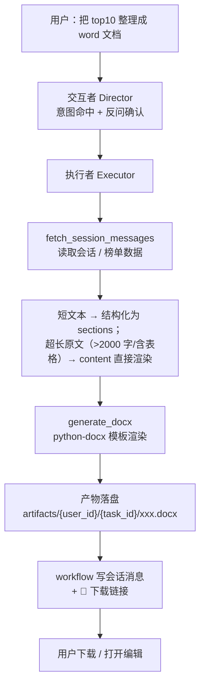

# 05_生成Word文档文件详解

> 本详解承接 `01_多Agents执行功能项目初始计划详解.md`（总纲）与 `03_任务确认与执行详解.md`（确认/执行/留痕闭环），记录执行者「把聊天内容 / 采集数据整理成 Word 文档」的完整方案。编号遵循 02 子项目群约定（05_xx）。对应工具有 `generate_docx`，落盘到现有产物目录 `backend/artifacts/{user_id}/{task_id}/`（2026-08-24 起 backend 容器已 bind mount `../artifacts:/app/artifacts`，宿主机 `d:\XIAONA\artifacts/{user_id}/{task_id}/` 可直接找到产物）。

## 1. 目标与范围

### 1.1 实现目标

让执行者在用户要求「帮我把这个 top10 整理成 word 文档」「把聊天记录导出成文档」时，产出一份**排版美观、风格统一、链接可点**的 Word 文档：

- **内容提炼由模型负责**：执行者读取会话消息 → 按用户指定主题提取相关部分 → 结构化为 `sections`；
- **排版渲染由后端负责**：固定模板渲染（标题/章节/表格/页脚），风格统一有设计感；
- **真实超链接**：表格/段落里的商品链接用 python-docx 真实超链接（Word 内 Ctrl+点击跳转），同时单元格显示完整 URL 文本可复制；
- **图片可嵌入**：支持把采集到的商品图嵌入文档，失败降级不阻断。

### 1.2 适用场景

| 场景 | 用户话术示例 | 执行者动作 |
|------|------|------|
| 榜单资料成 word | 把 top10 整理成一个 word 文档 | `fetch_amazon_bestsellers` + `generate_docx` |
| 聊天记录整理 | 把咱们聊的整理成 word | `fetch_session_messages` → 提炼 → `generate_docx` |
| 带图片成稿 | 把 top10 和图片整理进 word | `generate_docx`（商品图走 `markdown_tables` 图片列；`images=[{url, caption?}]` 仅用于文档末尾附图，见 §5） |

> Word 与 PDF 的差异：Word 可被用户二次编辑（改格式、加内容），更适合「资料底稿」；PDF 更像「成品交付」。执行者按用户说的格式选工具；用户没明确说格式但提到「文档/文件」时，默认 `generate_docx`。

## 2. 技术选型

| 候选 | 结论 | 理由 |
|------|------|------|
| **python-docx** | ✅ 选用 | 已在 requirements 中（多类型文件上传引入），**零新增依赖**，天然支持中文，能构造真实超链接 |

- 生成 `.docx` 为 Open XML 格式，python-docx 直接写 XML 结构，无需本地安装 Office；
- 中文天然支持（字体用「微软雅黑」等常用字体名写入 XML，用户打开 Word 自动渲染）。

## 3. 模板结构

`generate_docx` 渲染固定模板：

```
封面区（可选，title 非空时）
  · 顶部小娜品牌色块（indigo 主题）
  · 大标题（居中、加粗、大字号）
  · 副标题 / 来源
  · 生成日期

正文区
  § 章节标题（Heading，带色条/编号）
    正文段落（正文样式，首行缩进、行距舒适）
    · 要点列表（List Bullet）
    ┌──────────────────────────────┐
    │ 数据表格（表头深色底、白字、行斑马纹）│
    └──────────────────────────────┘
  （可重复：章节 → 段落/列表/表格）

页脚：页码 · 小娜出品
```

- **配色**：表头 indigo 深色底 + 白字，正文黑色，章节标题 indigo 色，与前端 UI 风格一致；
- **字体**：标题「微软雅黑」加粗，正文「微软雅黑」常规（中文跨平台通用）；
- **表格样式**：python-docx 内置 `Table Grid` 加自定义表头底色（shading），行斑马纹用浅灰。

## 4. 真实超链接实现（用户重点要求）

python-docx 不直接提供超链接 API，需用 oxml 构造关系：

```python
from docx.oxml.ns import qn
from docx.oxml import OxmlElement
from docx.opc.constants import RELATIONSHIP_TYPE as RT

def add_hyperlink(paragraph, url, text):
    part = paragraph.part
    r_id = part.relate_to(url, RT.HYPERLINK, is_external=True)
    hyperlink = OxmlElement("w:hyperlink")
    hyperlink.set(qn("r:id"), r_id)
    new_run = OxmlElement("w:r")
    rPr = OxmlElement("w:rPr")
    # 样式固定为 Word 标准超链接（蓝色 + 下划线），不加 color/underline 参数
    ...
    hyperlink.append(new_run)
    paragraph._p.append(hyperlink)
    return hyperlink
```

### 4.1 链接约定

- **URL 必须完整**：写入文档的 URL 一律是完整 `https://...` 绝对地址（执行者把 `product_url` 原样传入，禁止截断）；
- **可点击**：表格单元格内的链接用 `add_hyperlink` 构造真实超链接，Word 中 Ctrl+点击可跳转浏览器；
- **可复制**：单元格内同时显示**完整 URL 文本**，用户可直接选中复制；
- 拿不到完整 URL 时写「无链接」，不编造；
- 图片嵌入失败降级为 URL 文本。

## 5. 数据契约（`generate_docx` 参数）

与 `generate_pdf` 完全一致（content / sections / images / markdown_tables / source / date），执行者无需区分：

```json
{
  "filename": "北美钻石戒指精选榜",
  "title": "北美钻石戒指精选榜",
  "subtitle": "数据来源：Amazon Best Sellers / Etsy API",
  "date": "2026-08-23",
  "content": "可选，markdown 原文（2026-09-01 起）：用户提供的大段粘贴文本直接传入，后端自动解析渲染（# 标题 / markdown 表格 / - 列表 / 段落），无需手工构造 sections",
  "sections": [
    {
      "heading": "榜单总览",
      "paragraphs": ["本次共整理 10 款商品，其中 925 银素圈款占主流。"],
      "bullets": ["双源确认 6 款", "单源信号 4 款"]
    }
  ],
  "markdown_tables": [
    "| 排名 | 图片 | 商品名 | 链接 | 价格 | 评分 | 评论数 |\n|---|...|\n| 1 |  | ... |"
  ],
  "source": "Amazon/Etsy 交叉验证"
  // "images": [{"url": "https://...", "caption": "示意图"}]  // 可选、末尾附图（本示例省略）
}
```

> `markdown_tables`（2026-08-24 起）：可选的 markdown 表格原文列表，由 `fetch_session_messages`
> 提取、executor 调用 `generate_docx` 时**自动注入**。代码解析原文渲染，图片列 100% 保留、
> 列严格对齐；「图片」列单元格 `` 直接 `add_picture` 嵌入（宽 2.2cm）。
>
> `content`（2026-09-01 起）：用户把大段粘贴文本（报价/方案/报告等，通常 >2000 字或含大量表格）
> 交给小娜整理成文档时，执行者把 `fetch_session_messages` 读到的用户消息原文按序拼接放进 `content`，
> 由后端 `_parse_markdown_blocks` 直接解析渲染——**不依赖 LLM 手工转 sections JSON**（输出 token
> 超限截断 JSON 会导致「sections 不能为空」反复失败）。`content` 非空时跳过 sections 空校验；
> 渲染顺序：封面 → content 原文 → sections（补充分析）→ markdown_tables → 独立 images。
>
> `title` 自动提取（2026-09-01 起）：`title` 为空且 `content` 非空时，取 content **首个非空行**
> （剥 `”`/`“` 引号与首尾空白，≤40 字）作 title——文件名不再回退「文档_时间戳」，
> 如 `RR斜坡维修请求智能处理系统·NAS本地化部署方案与报价_20260901_102530.docx`。
>
> `images`（`[{url, caption?}]`，与 `generate_pdf` 一致）：可选，文档**末尾附图**（独立于表格）。
> **商品图不要走 `images`**——榜单商品图必须放在 `markdown_tables` 的「图片」列单元格里（图片随表格行排列，独立 `images` 会排到文档末尾、不在图片列）。单张图片下载失败降级为 URL 文本，不阻断生成。

### 5.1 sections / content 校验

- `sections` 为空 **且 `content` 为空** → 结构化错误；`content` 非空时跳过该校验（2026-09-01 起）；
- `table.headers` / `table.rows` 列数不一致 → 结构化错误；
- **sections 元素非 dict 时跳过不抛异常（2026-09-01 起）**：`for raw in sections: sec = raw if isinstance(raw, dict) else {}`——此前 LLM 输出截断产生字符串元素时 `(sec or {}).get("heading")` 对字符串调 `.get` 抛 `AttributeError`；
- 单元格值 `_cell` 归一化（None → 空串，dict/list → JSON 文本），防写入 TypeError；
- URL 单元格特殊处理：以 `http://`/`https://` 开头且长度合理 → 加超链接 + 显示全文；否则当普通文本。

## 6. 工具实现要点（`backend/app/core/agent/tools/generate_docx.py`）

- 与 `generate_excel` / `generate_pdf` 同构：`async def generate_docx(params, ctx)` → `{ok, path(相对), size, title, sections}`（无 `pages` 字段）；
- `ctx`：`{user_id, task_id, artifacts_dir, session_id}`（session_id 由 workflow 注入，`fetch_session_messages` 依赖，缺 ctx 时只校验数据不落盘）；
- **content 原文渲染（2026-09-01 起）**：`_parse_markdown_blocks(content)` 把原文解析为块列表（`#` 标题 / 表格块 / `- ` 列表 / 段落），标题用 `doc.add_heading`（1~3 级）、表格复用 `render_table`、列表用 `List Bullet`、段落普通样式；渲染顺序：封面 → content → sections → markdown_tables → 独立 images；
- **文本表格 + 中文标题识别（2026-09-01 三轮修复 + 四轮对照表增强）**：`_parse_markdown_blocks` 在 markdown 块基础上增强纯文本结构识别——`一、`/`第X章`/`（一）` 开头行 → heading 1；`1.1` 短行（≤40 字且不以数字结尾）→ heading 2（防把 `1.1 基础环境搭建 … 7,000` 这类表格行误判）；**纯文本表格**（无 `|` 管道符）按 `_split_text_table` 探测：
  - **表头行**：可分列（Tab 分隔 → 全角空格 → 2+ 半角空格 → 单空格首切 2 列）且（含表格关键词 或 标准分隔列数≥3）且首/末列非数字——「列数≥3」**仅认标准分隔切出的列**（普通长句含 2 个空格经单空格切 3 列不算数，防正文段落误判表头）；**第一个可分列的行不是表头就立即放弃探测**（回落主循环按标题/段落渲染，防吞掉「2.1 总体结论」等标题行与正文）；
  - **数据行**：分列后**列数与表头一致（容差 ±1）即可**（不再强制首列序号/末列金额）——覆盖中文对照表（末列为中文说明，如「评估维度 分析结论」表下的「架构适配性 系统由 FastAPI…构成。」，单空格首切 2 列，首列 ≤15 字且无句号结尾）；**表头含金额类词（金额/HKD/价格/费用/小计/单价）时数据行末列须为数字**（防表格后总结句如「硬件按包干封顶价 HKD 13,000 结算：…」混入报价表）；标题行（`一、`/`（一）`/`1.1`）不吞进表格立即收尾；超过表头列数时前 ncols-1 列保留、多余列合并进最后一列（防丢内容）；数字末列对齐到表头末列（金额不错位到规格列）；数据行 ≥2 才判定为表格并渲染；不自信则回落段落（保守）；表头前的行（如「（一）硬件费用　包干封顶价 HKD 13,000」）不吞进表格、由标题规则渲染；
- **title 自动提取（2026-09-01 三轮修复）**：`title` 为空且 `content` 非空时取 content 首个非空行（剥引号，≤40 字）作 title——`_default_doc_name` 据此生成 `{safe_title}_{时间戳}.docx`，不再回退「文档_时间戳」；
- **非 dict params 防御 + 图片收集 None 守卫（2026-09-01 二轮修复）**：入口 `params = params if isinstance(params, dict) else {}`（LLM 输出截断时 args 可能是 JSON 数组，`list.get` 崩溃）；图片收集循环对非 dict section / 无 `table` 键的纯文字 section 跳过（`if not table: continue`）——此前 `table.get("rows")` 对 None 调 `.get` 抛 `AttributeError`，LLM 传 content + 纯文字分析 sections 即触发（9-01 晚实测「粘贴 13000 字报价生成 Word」Word 连续 2 次 AttributeError 的根因，见当天台账二）；title 清洗字面 `\n` 换行为空格；
- **executor 会话原文 content 兜底 + 方案 C 直通（2026-09-01 二轮 + 五轮 + 方案 C 改造）**：`fetch_session_messages` 返回值新增 `assistant_tables`（仅助手消息提取的表格）；executor 收集会话 user 消息 >300 字正文拼接为 `session_user_content`。**方案 C 直通（六轮，默认）——正文永不经过 LLM**：`_markup_document(session_user_content, executor_cfg)` 先本地规则解析（`_smart_break_lines` 零换行语义分行 + `_parse_markdown_blocks` 结构化），仅当「表格候选行 ≥4 且规则识别表格覆盖不足 80%」时才调一次 LLM——LLM 只返回行级标记指令 `{line, anchor}`（`_ask_table_marks`，锚定 = 该行开头 6 字防行号漂移），程序 `_split_cols` 切列后在原行插入 `| c1 | c2 |` 表格标记、再重解析校验覆盖 ≥80% 才采用；LLM 失败/非法 JSON/候选行过多一律回落原文直注（宁可保真不保结构）。注入时同时 pop `sections`/`markdown_tables`/`title`/`subtitle`/`date`/`source`（LLM 编造的封面日期会污染文档，title 由工具从 content 首行自动提取）。**加工模式（总结/提炼/润色）才走 LLM 提炼**：`_markdownify_content`（六轮起并行分块：`asyncio.gather` + `Semaphore(4)` + 单块 `wait_for(180)`）分块交给 LLM 转 markdown——中文编号标题 `一、`/`（一）`→`#`、`1.1`→`##`、纯文本表格转 markdown 表格、删文末「生成 word」指令句，加工模式按需总结；**任一块失败整体回落原文直接注入**（不阻断任务）。加工失败时若 `args.content` 为空或明显短于原文（疑似截断）自动注入原文；content 已注入时只注入 `assistant_tables`，否则注入全部 `markdown_tables`；
- 文件名白名单清洗（强制 `.docx` 后缀，防路径穿越）；
- 落盘 `artifacts/{user_id}/{task_id}/{filename}`，返回相对路径；
- 图片下载用 httpx（超时 15s、UA 伪装），单张失败 `logger.warning` 后跳过；
- 生成全程 try/except，异常返回 `{ok:false, error:"Word 生成失败：<异常类名>"}`。

## 7. 执行者工作流（`executor.py` 系统提示增补）

### 7.1 整体链路图



### 7.2 产出文档效果示意

```
┌─────────────────────────────────────────────┐
│  封面区（indigo 色块品牌条）                   │
│                                               │
│       北美银戒指销量 Top 10 分析              │
│       数据来源：Amazon Best Sellers / Etsy     │
│               2026-08-23                     │
├─────────────────────────────────────────────┤
│  §1 榜单总览                                  │
│  本次共整理 10 款商品，925 银素圈款占主流。        │
│  · 双源确认 6 款   · 单源信号 4 款             │
│                                               │
│  ┌──────┬──────────────────┬───────┬────────┐ │
│  │ 排名 │ 商品名            │ 价格  │ 链接    │ │
│  ├──────┼──────────────────┼───────┼────────┤ │
│  │ 1    │ 925 Silver Ring  │ $12.99│ https… │ │  ← w:hyperlink 真实超链接，
│  │ 2    │ …                │ …     │ https… │ │      Ctrl+点击跳转 + 全文可复制
│  └──────┴──────────────────┴───────┴────────┘ │
│  [商品图嵌入，失败降级为 URL 文本]               │
├─────────────────────────────────────────────┤
│  页脚：第 1 页 · 小娜出品                       │
└─────────────────────────────────────────────┘
```

### 7.3 超链接的 OpenXML 结构

python-docx 没有现成超链接 API，通过 oxml 构造 `w:hyperlink`（含外部关系）实现：

```xml
<w:p>
  <w:hyperlink r:id="rId5">            <!-- relate_to(url, HYPERLINK) 建立外部关系 -->
    <w:r>
      <w:rPr>
        <w:color w:val="0563C1"/>       <!-- Word 标准超链接蓝色 -->
        <w:u w:val="single"/>
      </w:rPr>
      <w:t>https://www.amazon.com/dp/B0XXXX</w:t>  <!-- 完整 URL 文本，可复制 -->
    </w:r>
  </w:hyperlink>
</w:p>
```

- 用户要求整理成 word/文档时：先 `fetch_session_messages` 读会话 → 按主题**只提取相关部分** → 用 `generate_docx`；
- **数据源优先会话内容（2026-08-24 起）**：用户说「把上面的/刚才的/之前的对话/这个榜单/这个列表整理成文档」= 当前会话已有内容，执行者必须先用 `fetch_session_messages` 读会话作数据源，**禁止再调 `fetch_amazon_bestsellers`/`fetch_etsy_trending` 等数据源工具重新抓取**；只有会话确认无相关内容才允许数据源补充；
- **方案 C 直通（2026-09-01 起，默认；六轮升级为「正文永不经过 LLM」）**：用户把整篇文章原样粘贴、只要求「变成 PDF/Word 文档」时，executor 的 `_want_passthrough(task)` 判定（task_type 为 generate 且描述/params 不含总结/提炼/精简/概括/改写/润色等加工词）为真，则调用文档工具时**无条件把会话原文注入 `args["content"]` 并移除 sections/markdown_tables/title/subtitle/date/source**——正文完全用会话原文渲染（`_smart_break_lines` 规则分行 + `_parse_markdown_blocks` 结构化，含纯文本表格/中文编号标题/零换行旧消息），LLM 只定格式（pdf/word）与 filename，**不再重写/总结正文**；模型未先调 `fetch_session_messages` 时 executor 主动拉取一次。规则吃不准的表格由 **LLM 只返回行级标记指令**（`_ask_table_marks`：行号 + 锚定文本，程序在原行插 `|` 表格标记，LLM 输出正文一律丢弃）兜底，失败回落原文直注；仅当用户明确要求「总结/提炼/精简」等加工词时走 LLM 提炼（此时 `_markdownify_content` 并行分块、按需总结，并保留二轮修复的 content 兜底注入 + 表格分源注入逻辑）；
- **表格由代码注入渲染（2026-08-24 起）**：会话里的榜单 markdown 表格由 `fetch_session_messages` 提取为 `markdown_tables`，executor 调用文档工具时**自动注入**——图片列 100% 保留、列严格对齐，**执行者禁止手工把表格转写成 sections JSON**（LLM 转写会丢图片列/列错位），sections 只放文字部分；仅当会话无现成表格才自行构造 `sections[].table`；直通模式下表格已含在原文里，由 `_split_text_table` 纯文本识别渲染；
- 用户说「pdf」用 `generate_pdf`；说「word/文档/文件」用 `generate_docx`；只说「文档」且语境为可编辑底稿时默认 Word；
- `filename` 用 6~12 字简洁语义名（工具自动加时间戳与扩展名，2026-08-24 起**禁止「文档_时间戳」占位名**）；
- 最终回复附一句话总结「已生成 Word 文档：xxx.docx」+ 产物下载链接（由 workflow 统一渲染）+ 落盘位置提示（`artifacts/{user_id}/{task_id}/`，2026-08-24 起）。

## 8. 与其他文档的关联

- 任务确认/执行/留痕闭环：`03_任务确认与执行详解.md` §3/§5/§6
- 产物目录与下载接口：`03_任务确认与执行详解.md` §7.2
- PDF 生成方案（同款数据契约/模板风格）：`04_生成PDF文件详解.md`
- 榜单数据源字段：`02_北美电商数据网站爬取详解.md` §6.3/§7.1
- 产物 TTL 清理：`01_多Agents执行功能项目初始计划详解.md` §10 与 03 §11——**已实现**（`ARTIFACTS_TTL_DAYS=30` + `artifact_cleaner` 每日清理，2026-08-24）

## 9. 配置与依赖

| 项目 | 说明 |
|------|------|
| `requirements.txt` | **无需新增**（python-docx 已存在） |
| `ARTIFACTS_DIR` | 复用现有产物目录 |

## 10. 验证结论（2026-08-24，实现后）

按本节实测通过（容器内执行，python-docx 已随多类型文件上传引入，零新增依赖）：

| 验证项 | 结果 |
|--------|------|
| 中文渲染 | ✅ 标题/章节/表格中文正常（微软雅黑 + eastAsia 字体写入） |
| 真实超链接 | ✅ `_add_hyperlink` 构造 `w:hyperlink`（`relate_to(url, RT.HYPERLINK)` 外部关系），Word 内 Ctrl+点击跳转 |
| URL 可复制 | ✅ 单元格同时显示完整 URL 文本，可选中复制 |
| 封面/页脚 | ✅ title 非空生成封面区（indigo 色块品牌条 + 居中标题），页脚「小娜出品」 |
| 表格样式 | ✅ 表头 indigo 底白字 + 行斑马纹（`w:shd`），`Table Grid` 边框 |
| 图片嵌入降级 | ✅ 下载失败跳过不阻断，居中嵌入 + 图注 |
| markdown 表格注入 | ✅ `fetch_session_messages` 提取 `markdown_tables`，executor 自动注入文档工具，`generate_docx` 解析原文渲染，图片列 100% 保留（`add_picture` 嵌入单元格）、列严格对齐（2026-08-24） |
| 文件名语义化 | ✅ `filename` 缺失或「文档_时间戳」占位名时用 `title` 生成 `{safe_title}_{时间戳}.docx`（60 字符截断）（2026-08-24） |
| 数据契约校验 | ✅ sections 为空 / 表格列数不一致返回结构化错误 |
| 会话消息读取 | ✅ `fetch_session_messages` 取最近 N 条（desc+limit+reversed）、过滤任务进度消息、跨用户 session_id 返回错误 |
| 产物落盘 | ✅ 落盘 `artifacts/{user_id}/{task_id}/xxx.docx`，返回相对路径；backend 容器已 bind mount `../artifacts:/app/artifacts`，宿主机 `d:\XIAONA\artifacts/{user_id}/{task_id}/` 可直接找到（2026-08-24） |
| 数据源优先会话 | ✅ 执行者系统提示强制「把上面的/刚才的/这个榜单整理成文档」用会话已有内容、禁止重新抓取（2026-08-24） |
| 异常兜底 | ✅ 生成全程 try/except，异常返回 `{ok:false, error:"Word 生成失败：<异常类名>"}` |

实测产物：`{"ok": true, "path": "u1/t1/测试报告.docx", "size": 37930, "title": "北美银戒指销量 Top 10 分析", "sections": 1}`。

## 11. 待定项

- 表格分页后的表头重复（Word 表格跨页时重复标题行，python-docx 可设 `tblHeader`）；
- 封面页/页眉 logo 增强。
