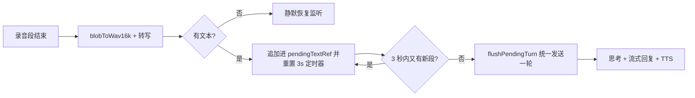

# 2026年8月16日 所遇问题及解决方案

> 本目录按日期归档 XIAONA 开发过程中遇到的问题与解决方案，作为项目问题台账。当日所有代码修改、排查结论均反哺至此，同时同步更新到对应的原计划文档。

## 一、深度思考非流式：思考过程一次性整段出现

### 问题现象

聊天页与桌面助手中，小娜的**最终回复**已经是逐字流式输出，但**深度思考过程不是流式**——思考内容一次性整段冒出来（或分段"跳"出来），用户希望"先流式输出深度思考，再流式输出最终回复"。

### 根因分析

后端思考链路完整支持流式，无需改动：

1. `llm_provider._stream_lines` 逐 chunk 产出 `(content_delta, thinking_delta)`（兼容 DeepSeek `reasoning_content` 与 Ollama `thinking`）；
2. `api/chat.py` 的 SSE 每帧都带 `{"delta": ..., "thinking": ...}`；
3. 前端 `streamChat`（`api/chat.js`）已解析 `parsed.thinking` 并回调 `onThinking`。

问题在前端渲染层（`Chat.jsx` 与 `DesktopAssistant.jsx` 均存在）：

- **最终回复**走打字机队列（`pendingRef` + 30ms 定时器逐字揭晓），`onDelta` 只入队不直接刷屏，所以是流式的；
- **思考**是 `onThinking` 里直接 `thinkingText += t; setState(...)` 刷屏。多个 SSE 帧在同一同步批次到达时被 React 18 自动批处理合并成一次渲染 → 思考"一次性整段出现"（DeepSeek/Ollama 的 `reasoning_content`/`thinking` 还常是大块增量，问题更明显）。

### 解决方案

把思考也接入打字机队列，且**优先揭晓思考、思考清空后再揭晓回复**（DeepSeek/Ollama 均先思考后回复），实现"先流式思考、再流式回复"。

1. **`frontend/src/pages/Chat.jsx`**：
   - 新增 `thinkingPendingRef`（思考待显示队列）；
   - `onThinking` 改为入队 + `startReveal()`，不再直接刷屏；
   - `startReveal` 定时器 tick 改为**优先揭晓 `thinkingPendingRef`**，思考队列清空后再揭晓 `pendingRef`（回复队列）；
   - `clearReveal` / `flushPending` 同时清 thinking 与 content 两个队列（流结束补全剩余思考与回复）。

```js
const thinkingPendingRef = useRef('');
const startReveal = () => {
  if (revealTimerRef.current) return;
  revealTimerRef.current = setInterval(() => {
    const tPending = thinkingPendingRef.current;
    if (tPending) {                       // 优先揭晓思考
      const chunk = tPending.slice(0, 3);
      thinkingPendingRef.current = tPending.slice(3);
      thinkingText += chunk;
      patchAssistant({ content: assistantText, thinking: thinkingText });
      return;
    }
    const pending = pendingRef.current;   // 思考清空后再揭晓回复
    if (!pending) { clearReveal(); return; }
    const chunk = pending.slice(0, 3);
    pendingRef.current = pending.slice(3);
    assistantText += chunk;
    patchAssistant({ content: assistantText, thinking: thinkingText });
  }, 30);
};
```

2. **`frontend/src/pages/DesktopAssistant.jsx`**：
   - 新增组件级 `thinkingPendingRef` + `thinkingTimerRef`；
   - `processVoice` 内新增 `startThinkingReveal`（思考打字机）与 `flushThinking`（补全剩余思考 + 清定时器）；
   - `onThinking` 改为入队 + `startThinkingReveal()`；
   - `finish()` 开头 `flushThinking()` 并 `patchTurn({ thinking, content })` 同步最终状态；
   - `interrupt()` 与 `stopListening()`（卸载）清 `thinkingTimerRef` 定时器与 `thinkingPendingRef` 队列——防打断/离开页面后定时器泄漏继续揭晓旧思考；
   - 回复（`onDelta`）保持直通（用户反馈桌面助手回复已是流式）。

### 改动文件清单

- `frontend/src/pages/Chat.jsx`
- `frontend/src/pages/DesktopAssistant.jsx`
- `AGENTS.md`
- `项目计划/01_单Agent聊天助手/05_前端详解.md`
- `项目计划/01_单Agent聊天助手/08_桌面助手详解.md`

### 验证

- `cd frontend && npm run build` 构建通过（773 modules）；
- `docker compose -f backend/docker-compose.yml up -d --build frontend` 重建前端容器为 Healthy；
- 待浏览器手工清单：聊天页用 DeepSeek（含 `reasoning_content`）对话——深度思考逐字浮现并自动滚动，思考结束后最终回复开始逐字浮现；桌面助手同一表现（麦克风下方转录面板思考逐字浮现）；普通对话模型（无思考通道）行为不变。

## 二、聊天页语音输入点发送要点两次：第一次只关麦第二次才发送

### 问题现象

聊天界面语音输入转文字过程中，点击「发送」按钮：第一次点击只关闭麦克风（不发送），第二次点击才真正发送。用户期望**第一次点击就既关闭麦克风又发送**。

### 根因分析

`VoiceRecorder` 录音中在 `document` 上注册 `pointerdown` 监听（点击麦克风按钮外任意处自动 `stop()`，含发送按钮）。但**文本最终确认是异步的**：

- Web Speech 主路径：`rec.stop()` 后要等 `onend` 事件回调才 `emitText()` 刷新最终文本；
- MediaRecorder 降级路径：`stop()` 当前段后要等 `onstop` → 后端 `/api/voice/transcribe` 完成才追加文本上屏。

而 `click` 的 `ChatInput.handleSend` 紧随 `pointerdown` 执行，此时 React 的 `text` 还是旧值（降级路径下甚至为空）→ `!text.trim()` 直接 return，第一次点击只触发了关麦；等文本异步刷新后，第二次点击才把内容发出去。

### 解决方案

**一次点击 = 关麦 + 发送**：让发送按钮在录音中先拿到"停止后确认的最终文本"再发送。

1. **`frontend/src/components/VoiceRecorder.jsx`**：
   - 组件改为 `forwardRef` + `useImperativeHandle`，暴露 `stopAndGetText(): Promise<string>`；
   - 新增 `stopInFlightRef`（停止流程进行中，第二次 stop 不重复收尾）、`stopPromiseRef`（幂等复用同一 Promise）、`pendingResolveRef`（外部 await 的 resolve）；
   - 新增 `flushTextAndResolve()`：清 `stopInFlightRef` + `emitText()` + resolve 外部等待者；接入 `stop()`（无进行中识别/录音时立即收尾）、`rec.onend`（Web Speech）、`recorder.onstop`（MediaRecorder 转写完成后）三处；
   - `stopAndGetText` 只在前一 `stop()` 未在途中时主动 `stop()`（`pointerdown` 已先行关麦时只注册等待者），8s 兜底超时防挂起发送。
2. **`frontend/src/components/ChatInput.jsx`**：
   - 新增 `voiceRecorderRef`，`<VoiceRecorder ref={voiceRecorderRef} ... />`；
   - `handleSend` 改为 async：`listening` 时先 `await voiceRecorderRef.current?.stopAndGetText()`，以 `voiceText.trim() || content` 为准再发送；
   - `canSend = listening || !!text.trim() || files.length > 0`（录音中即使文本暂空也允许点发送"停止并发送当前语音"；识别为空则不发送）；
   - Enter 发送复用同一 `handleSend`，天然受益。

### 改动文件清单

- `frontend/src/components/VoiceRecorder.jsx`
- `frontend/src/components/ChatInput.jsx`
- `AGENTS.md`
- `项目计划/01_单Agent聊天助手/04_语音输入与识别详解.md`

### 验证

- `cd frontend && npm run build` 构建通过（773 modules，产物 `index-Bu_QhNsC.js`）；
- `docker compose -f backend/docker-compose.yml up -d --build frontend` 重建前端容器为 Healthy；
- 待浏览器手工清单：语音输入转文字中点一次「发送」即关麦并发送（Web Speech 与 MediaRecorder 降级路径均一次生效）；未识别到文字时点发送只关麦、不发送空消息；输入框手动输入 + 点发送行为不变。

## 三、聊天页切到其他页面再返回时会话丢失

### 问题现象

聊天界面打开某个会话后，切到别的页面（如关系网），再点回聊天时界面空白——不是刚才聊的那个会话，需要再点一次侧边栏的历史会话才恢复。用户期望：**打开了哪个会话，切到任何界面再返回都还是那个会话**；只有**浏览器完全关闭重新打开**时才回到新会话界面。

### 根因分析

`Chat.jsx` 的 `sessionId` 初始值来自 URL query（`useSearchParams().get('session_id')`）。从聊天页（`/`）切到关系网（`/graph`）再点回聊天时，路由切换使 `Chat` 组件**卸载并重新挂载**，而新 URL `/` 上没有 `session_id` 参数 → `sessionId` 初始化为 `null` → 消息区空白，需手动点侧边栏会话恢复。

### 解决方案

把当前会话 id 持久化到 **`sessionStorage`**（按用户隔离），切页重挂载时自动恢复：

- `sessionStorage` 生命周期正匹配需求：同标签页内导航/刷新均保留，**关闭标签页/浏览器才清空**；
- 引入 `useAuth` 拿 `user.id`，存储 key=`chat_active_session_{user.id}`（多账号不串会话）；
- `sessionId` 初始化改为「URL 参数优先，其次 sessionStorage」；
- 新增 effect：`sessionId` 变化时同步写入 sessionStorage，置空时移除；
- URL 同步（`setSearchParams`）保留，刷新页面仍可恢复。

```js
// frontend/src/pages/Chat.jsx
const { user } = useAuth();
const activeSessionKey = user ? `chat_active_session_${user.id}` : null;
const [sessionId, setSessionId] = useState(
  () =>
    searchParams.get('session_id') ||
    (activeSessionKey ? sessionStorage.getItem(activeSessionKey) : null),
);

useEffect(() => {
  if (!activeSessionKey) return;
  if (sessionId) sessionStorage.setItem(activeSessionKey, sessionId);
  else sessionStorage.removeItem(activeSessionKey);
}, [sessionId, activeSessionKey]);
```

### 改动文件清单

- `frontend/src/pages/Chat.jsx`
- `AGENTS.md`
- `项目计划/01_单Agent聊天助手/07_会话历史记录详解.md`

### 验证

- `cd frontend && npm run build` 构建通过（773 modules，产物 `index-BhGXvlij.js`）；
- `docker compose -f backend/docker-compose.yml up -d --build frontend` 重建前端容器为 Healthy；
- 待浏览器手工清单：聊天页打开某会话 → 切关系网/桌面助手/设置 → 切回聊天，仍是刚才的会话与消息；刷新页面仍恢复；删除当前会话后切走切回为空；退出登录换账号不串会话；关闭浏览器重开后为全新会话。

## 四、设置页本地 Ollama 模型测试连不通：真实根因是「嵌入模型不支持对话」被笼统报成 HTTP 400

### 问题现象

设置页「添加模型」时，云端模型都能连通（绿勾），但**本地模型连不通**：有的提示「无法连接」，有的提示「模型服务返回错误（HTTP 400）」。用户坚持**不修改 `localhost` 地址**，并追问「将来云端部署后，用户本机 Ollama 填 localhost 怎么连」。

### 排查过程（现场诊断）

1. **宿主机探测**：`netstat -ano | findstr :11434` 显示 Ollama 监听在 `127.0.0.1:11434`（回环地址），`ollama list` 有 `qwen3:8b`、`bge-m3:latest` 两个模型，服务本身正常。
2. **容器内探测**：`host.docker.internal:11434/api/tags` 返回 **200**——容器 → 宿主机链路**畅通**（Windows Docker Desktop 下容器可经 host-gateway 访问宿主机，即使 Ollama 只监听回环也可达）。
3. **模拟 `test_connection` 完整路径**：
   - `http://localhost:11434` 与 `http://host.docker.internal:11434` 的 `qwen3:8b` → **均连接成功**（`localhost` 已被 `_resolve_host` 自动改写为 `host.docker.internal`）；
   - `bge-m3:latest` → **HTTP 400，响应体 `"bge-m3:latest" does not support chat`**；
   - 不存在的模型 `qwen3:999b` → HTTP 404。

**结论：本地 Ollama 链路实际是通的。** 用户遇到的「本地模型连不通」主要是对**嵌入/向量化模型（bge-m3）点「测试」**——该模型不支持 `/v1/chat/completions`，Ollama 返回 400，而旧 `test_connection` 一律笼统返回「模型服务返回错误（HTTP 400）」，用户误以为本地模型连不通。

### 解决方案

1. **`backend/app/core/llm_provider.py`**：
   - 新增模块级 `_ollama_model_names(base_url)`：探测 Ollama 原生 `/api/tags`，返回可用模型名列表（服务不可达返回 None，8s 短超时、失败静默）；
   - `test_connection` 对 `provider == ollama` 分支做精确诊断：
     - `ConnectError` 时二次探测 `/api/tags`：可达 → 「模型「{name}」不存在，可用模型：…」；不可达 → 「确认 Ollama 已启动且监听 11434、防火墙放行；若容器内仍连不上宿主机，可设 `OLLAMA_HOST=0.0.0.0:11434` 后重启」；
     - HTTP 400 且响应体含 `does not support chat` → 「模型「{name}」不支持对话（它可能是嵌入/向量化模型），请选择对话模型」；
     - HTTP 404 → 同样二次探测 `/api/tags` 列出可用模型；
     - 超时提示对 ollama 追加「首次调用需冷启动加载大模型（约 10~60 秒）」。
   - `localhost` 自动改写逻辑保持不变（用户不修改地址即可连通）。
2. **`frontend/src/components/ModelCard.jsx`**：测试结果从按钮行内 `<span>` 移到按钮下方独立 `<p>`，`items-start` + `break-words` 支持长提示完整换行展示。

> 关于「云端部署后用户本机 Ollama 填 localhost」：受网络拓扑限制，云端后端访问的 `localhost` 是**云端服务器自己**，无法直接到达用户本机 Ollama。该场景本次不实现（用户已确认暂缓）；若将来需要，唯一能保留「localhost 填法」的路线是浏览器中转（前端直连用户本机 Ollama 再交后端归档，需 Ollama 开跨域）。

### 改动文件清单

- `backend/app/core/llm_provider.py`
- `frontend/src/components/ModelCard.jsx`
- `AGENTS.md`
- `项目计划/01_单Agent聊天助手/05_前端详解.md`

### 验证

- `python -m compileall -q backend/app/core/llm_provider.py` 通过；
- `docker compose -f backend/docker-compose.yml up -d --build backend frontend` 重建两容器均 Healthy；
- 容器内实测 `test_connection` 各分支：
  - `localhost` / `host.docker.internal` + `qwen3:8b` → `ok=True 连接成功`；
  - `bge-m3:latest` → 「不支持对话（可能是嵌入/向量化模型）」；
  - `qwen3:999b` → 「模型不存在，可用模型：qwen3:8b、bge-m3:latest」；
  - 端口 19999（Ollama 未监听）→ 「确认 Ollama 已启动且监听 11434、防火墙放行…OLLAMA_HOST」；
  - 云端 DeepSeek（无效 key）→ 「鉴权失败，请检查 API Key」（云端分支不受影响）；
- 待浏览器手工清单：设置页对 `qwen3:8b` 本地模型点「测试」→ 绿勾连接成功；对 `bge-m3` 嵌入模型点「测试」→ 红叉但提示「不支持对话（可能是嵌入/向量化模型）」；不存在的模型 → 红叉提示「模型不存在」并列出可用模型。

## 五、添加模型被限制只能对话模型 + 功能分配无类型校验

### 问题现象

用户在设置页添加模型时，发现**添加什么模型都被当成「对话模型」**（`capabilities` 硬编码 `["chat"]`）。用户指出这是不对的：添加模型时**不需要管添加的是什么类型的模型**，嵌入模型、向量化模型都应当可以添加；类型审核应该放在「功能分配」处——聊天通路和记忆抽取通路只能放对话模型，向量化通路只能放向量化模型。

### 根因分析

1. **添加模型限制**：前端 `Settings.jsx` 的 `newModel.capabilities` 初始值/`emptyModel()` 都是 `['chat']`；后端 `ModelCreateRequest.capabilities` 默认值也是 `["chat"]`。两者叠加，无论用户添加什么模型都写死 `chat`。
2. **功能分配无校验**：`PUT /api/settings/function-models` 的 `assign_function_model` 只检查 `func` 合法性，不校验目标模型能力——把 bge-m3 嵌入模型分配给聊天通路也能成功（静默错误配置）。
3. **历史数据污染**：已存在的「嵌入模型」（bge-m3）记录 capabilities 也是 `chat`（旧逻辑默认值），是错误的。

### 解决方案

**添加模型不限类型 + 后端自动探测能力 + 功能分配严格校验**：

1. **`backend/app/core/llm_provider.py`**：
   - 新增 `_probe_embedding(cfg)`：POST `{base_url}/v1/embeddings`（body `{"model":..., "input":"ping"}`），200 视为支持向量化（8s 短超时，网络失败返回 False）；
   - 新增 `detect_capabilities(cfg)`：返回 `{"chat": bool, "embedding": bool, "reachable": bool}`——chat 用 `llm.test_connection` 探测，embedding 用 `_probe_embedding`；两路均网络级失败时 `reachable=False`（调用方不写回能力）。
2. **`backend/app/api/settings.py`**：
   - `ModelCreateRequest.capabilities` 默认改 `[]`（不再默认 `["chat"]`）；
   - `test_model`：调用 `detect_capabilities`，`reachable` 时写回 `model.capabilities`（如 `"embedding"`），返回 `{ok, detail, capabilities}`；detail 区分「连接成功，支持对话」/「连接成功，支持向量化（嵌入），不支持对话」/「模型服务可达，但未探测到对话/向量化能力」/「无法连接模型服务」；
   - `assign_function_model`（改 async）增加类型校验：目标模型必须存在（404）；能力为空时先自动 `detect_capabilities` 写回；`chat_model_id`/`extract_model_id` 必须含 `chat`，`embedding_model_id` 必须含 `embedding`，不匹配返回 400「该模型不支持对话/向量化，请选择…」；探测失败（服务不可达）不阻断分配。
3. **前端 `frontend/src/pages/Settings.jsx`**：
   - `newModel.capabilities` / `emptyModel()` 改 `[]`；`openEdit` 原样用 `model.capabilities`；
   - `saveModel` 保存成功后自动调 `testModel(saved.id)` 探测能力写回并刷新列表（探测失败不阻断保存）；
   - 功能分配三个下拉按能力过滤（新增 `filterByCapability` helper）：聊天/抽取只列含 `chat` 或能力未确认的模型，向量化只列含 `embedding` 或能力未确认的模型；当前已选值始终保留。
4. **`frontend/src/components/ModelCard.jsx`**：模型名旁显示能力标签（`对话`/`嵌入`/`对话 + 嵌入`/`未确认`），测试后同步能力。

### 改动文件清单

- `backend/app/core/llm_provider.py`
- `backend/app/api/settings.py`
- `frontend/src/pages/Settings.jsx`
- `frontend/src/components/ModelCard.jsx`
- `AGENTS.md`
- `项目计划/01_单Agent聊天助手/05_前端详解.md`

### 验证

- `python -m compileall -q backend/app` 通过；`cd frontend && npm run build` 通过（产物 `index-BaBPuUWt.js`）；
- `docker compose -f backend/docker-compose.yml up -d --build backend frontend` 重建两容器均 Healthy；
- 容器内实测 `detect_capabilities`：`qwen3:8b` → `{'chat': True, 'embedding': False}`；`bge-m3:latest` → `{'chat': False, 'embedding': True}`；
- 端到端（mock 登录 HHC）实测：
  - `test bge-m3` → 200，`capabilities=['embedding']` 写回（历史错误的 `chat` 已修复为 `embedding`）；
  - `assign bge-m3 → chat_model_id` → 400「该模型不支持对话，请选择对话模型」；
  - `assign qwen3:8b（他用户）→ embedding_model_id` → 404「模型不存在」（跨用户正确拒绝）；
  - `assign bge-m3 → embedding_model_id` → 200 成功（测试后已恢复原配置）；
- 待浏览器手工清单：设置页添加 bge-m3 嵌入模型不再被拒；模型卡片显示「嵌入」标签；向量化下拉可选 bge-m3、聊天下拉可选 qwen3:8b，且互不可选错；分配错误时弹「该模型不支持对话/向量化」提示。

## 六、功能模型分配提示行不即时显隐

### 问题现象

设置页「功能模型分配」模块里，每个下拉下方有一行提示（如「未配置对话模型：聊天、知识图谱、桌面助手将无法对话，请先配置」）。用户期望：**选择模型后提示行自动消失，取消选择（回到「请选择」）后提示行自动出现**，即时生效。

### 根因分析

`Settings.jsx` 的 `assignModel` 是**等后端 API 返回成功后才**更新 `configured` 标志、再控制提示显隐：

```js
const assignModel = async (func, modelId) => {
  await settingsApi.assignFunctionModel(func, modelId);   // 先等后端
  setFunctionModels(prev => ({ ...prev, [func]: modelId, [flag]: !!modelId }));
};
```

- **延迟**：后端 `assign_function_model` 在模型能力为空时会先自动探测能力（本地 Ollama 首次探测冷启动 10s+，对话探测 60s 超时）。选择模型后提示要等探测完、API 返回才消失，视觉上"没反应"。
- **失败无反馈**：后端校验拒绝（400）时 `await` 抛异常，前端无提示、下拉状态不更新，用户困惑。

### 解决方案

**乐观更新 + 失败回滚**：`setFunctionModels` 移到 `await` 之前，选择/取消立即更新提示行；后端拒绝时回滚旧值并弹后端中文提示。

```js
const assignModel = async (func, modelId) => {
  const prev = functionModels;                       // 记住旧值，失败回滚
  const flag = `${func.replace('_id', '')}_configured`;
  setFunctionModels(p => ({ ...p, [func]: modelId, [flag]: !!modelId }));   // 乐观更新：提示立即消失/出现
  try {
    await settingsApi.assignFunctionModel(func, modelId);
  } catch (e) {
    setFunctionModels(prev);                         // 后端拒绝（400 等）→ 回滚，提示恢复
    alert(e.response?.data?.detail || '分配失败，请重试');
  }
};
```

### 改动文件清单

- `frontend/src/pages/Settings.jsx`
- `项目计划/01_单Agent聊天助手/05_前端详解.md`

### 验证

- `cd frontend && npm run build` 通过（产物 `index-CPtqCNjS.js`）；
- `docker compose -f backend/docker-compose.yml up -d --build frontend` 重建前端容器为 Healthy；
- 待浏览器手工清单：功能分配下拉选一个对话模型 → 提示行立即消失（不等后端探测）；选回「请选择」→ 提示行立即出现；选一个能力不匹配的模型（后端 400）→ 下拉回滚、弹「该模型不支持对话/向量化」提示、提示行不变；下拉选项能力过滤逻辑不变。

## 七、聊天崩溃 "'list' object has no attribute 'get'"：Chroma query 嵌套结构被当扁平 list 解析

### 问题现象

上一轮「添加模型不限类型 + 能力自动探测」改动后，用户在聊天界面用 **DeepSeek 云端模型**对话，回复直接报错 `'list' object has no attribute 'get'`（前端显示错误串，聊天中断）。用户不解：用的不是本地模型，为何突然连云端对话也崩了。

### 根因分析

后端日志确认异常发生在 `memory_engine.py` 的 `retrieve_memory`（`hit.get("is_archived", False)`）：

```
File "/app/app/core/memory_engine.py", line 215, in retrieve_memory
  hit["is_archived"] = hit.get("is_archived", False)
AttributeError: 'list' object has no attribute 'get'
```

容器内实测 Chroma `query()` 的返回结构：

```
metadatas type: list
metadatas[0] type: list      # 嵌套！每个 query_text 对应一个内层 list
metadatas[0] len: 2
elem type: dict -> {'source': 'web', 'is_archived': False, ...}
```

**根因链条**：

1. Chroma `query(include=["documents","metadatas","distances"])` 返回**嵌套结构**——每个 query_text 对应一个内层 list（`query_texts=[query]` 时外层只有 1 个元素），即 `metadatas = [[{...}, {...}]]`；
2. `memory_engine.py` 的 `retrieve_memory` 把 `metadatas` 当**扁平 list** 遍历，`hit` 实际拿到内层 list，`hit.get(...)` 抛 `'list' object has no attribute 'get'`；
3. 异常向上抛 → `chat_stream` 中断 → `api/chat.py` 捕获后发 error 帧 → 前端显示错误串。

**为什么之前没暴露**：这是**预存在 bug**。此前用户从未真正配置向量化模型（`embedding_enabled` 恒为 False，Chroma 查询被跳过，只有 SQL 检索生效）。上一轮放开「添加模型不限类型」后，用户把 `bge-m3` 成功配置为向量化模型 → Chroma 语义检索真正执行 → bug 触发。与 DeepSeek 云端模型本身无关，是同一链路被激活。

### 解决方案

**展平 Chroma 嵌套结果**：新增模块级 `_flatten_chroma(raw)`（取内层 list、过滤 None），`retrieve_memory` 对 `documents`/`metadatas`/`distances` 三个键统一展平后再消费。

```python
def _flatten_chroma(raw) -> list:
    """把 Chroma query() 返回的嵌套结构展平为一层 list，并过滤 None。"""
    if not raw:
        return []
    first = raw[0] if isinstance(raw, list) else raw
    if not isinstance(first, list):
        first = [first]
    return [x for x in first if x is not None]

# retrieve_memory 内 Chroma 查询返回后立即展平
vector_results = {
    "documents": _flatten_chroma(vector_results.get("documents")),
    "metadatas": _flatten_chroma(vector_results.get("metadatas")),
    "distances": _flatten_chroma(vector_results.get("distances")),
}
for hit in vector_results["metadatas"]:
    hit["is_archived"] = hit.get("is_archived", False)
```

下游 `_build_messages`（`zip(documents, metadatas)`）与 `_mention_hits`（遍历 `metadatas`）消费展平后的 `semantic_hits`，逻辑自动恢复正确，无需改动。

### 改动文件清单

- `backend/app/core/memory_engine.py`
- `AGENTS.md`

### 验证

- `python -m compileall -q backend/app` 通过；
- `docker compose -f backend/docker-compose.yml up -d --build backend` 重建后端容器为 Healthy（backend 无 bind mount，代码 COPY 进镜像，必须 rebuild 才能加载新代码，`restart` 不生效）；
- 容器内实测（HHC 用户、真实 Chroma 数据）：
  - `retrieve_memory(query, embedding_enabled=True, extract_enabled=True)` 不再抛错，`semantic_hits.metadatas` 为扁平 dict list（len=2，`is_archived` 正常读取），documents 同步返回；
  - `chat_stream` 完整走通：DeepSeek 真实流式回复成功，`thinking` 流式正常（len≈275），无 error 帧；
  - KG 检索异常仍优雅降级（临时脚本未传 extract_cfg 时实体抽取走默认占位 key 报 401，被降级逻辑吞掉，不阻断聊天）——符合「Chroma/embedding/KG 任何异常降级，绝不阻断聊天主流程」约定；
- 待浏览器手工清单：DeepSeek 云端聊天恢复正常流式回复；向量化配置（bge-m3）不再影响对话；记忆检索在配置向量化模型后开始真正产生语义命中。

## 八、桌面助手识别不准 + 一点杂音就中断 + 一句话被切半句

### 问题现象

用户反馈桌面助手是「最难用的」：

1. **识别不准**：说「在吗，小娜」，被转写成「麦麦小妮」之类完全不同的词；
2. **一点杂音就中断**：思考/回复分析中，一点环境噪声（鼠标点击、键盘声）就打断当前处理；
3. **一句话没说完就中断**：有时正在说话，还没说完就被中断。

### 根因分析

**识别不准（ASR）**：

- `LocalWhisperASR` 用的是 **`base` 模型**（中文/专名能力弱）；
- `transcribe` 只传了 `language="zh"`，**未开** `vad_filter`（faster-whisper 内置 Silero VAD，可跳过静音/噪声段、只转写人声段）、**未传** `initial_prompt`（热词，专名「小娜」无法被引导进解码）、未设 `beam_size`。

**杂音打断 / 切半句（VAD 打断路径）**：

- `DesktopAssistant.jsx` 的 `checkVolume` 打断分支是**单帧判定**：`if (level > interruptThreshold) interrupt();`——鼠标点击/键盘声等瞬态噪声单帧 RMS 超阈值就立即打断；
- 思考时打断阈值 `Math.min(0.12, Math.max(0.02, noiseFloor*4))` 绝对下限 `0.02` 极低，一点环境噪声即可超过。

### 解决方案

**ASR 升级 small + 开启 VAD/热词（`backend/app/core/asr_provider.py`）**：

```python
class LocalWhisperASR(ASRProvider):
    def __init__(self, model_size: str = "small"):
        self.model = WhisperModel(model_size, device="cpu", compute_type="int8")

    async def transcribe(self, audio_path: str) -> str:
        segments, _ = await asyncio.to_thread(
            self.model.transcribe, audio_path,
            language="zh", beam_size=5,
            vad_filter=True, vad_parameters=dict(min_silence_duration_ms=500),
            initial_prompt="小娜，XIAONA，你好，请问。",
            condition_on_previous_text=False,
        )
        return "".join([s.text for s in segments])
```

`_build_asr()` 默认 `LocalWhisperASR("small")`；`backend/Dockerfile` 预下载模型改 `WhisperModel('small', ...)`。

**打断防抖 + 阈值提高（`frontend/src/pages/DesktopAssistant.jsx`）**：

- 新增 `INTERRUPT_CONFIRM_MS = 400`（打断确认窗口）；
- 打断分支改为音量须**持续超阈值 400ms** 才打断，掉回阈值下立即清零——瞬态噪声（鼠标/键盘）被过滤；
- 思考时打断阈值下限从 `0.02` 提到 `0.04`（`min(0.12, max(0.04, noiseFloor*5))`），更抗环境噪声；
- 开录路径、`SILENCE_MS=2500`、`MIN_VOICE_MS=500` 不变（"没说完就中断"主因是打断误触发，防抖后即可解决；噪声开录的短段由 MIN_VOICE_MS 丢弃、长噪声段由后端 vad_filter 转写为空静默恢复）。

### 改动文件清单

- `backend/app/core/asr_provider.py`
- `backend/Dockerfile`
- `frontend/src/pages/DesktopAssistant.jsx`
- `AGENTS.md`

### 验证

- `python -m compileall -q backend/app` 通过；`cd frontend && npm run build` 通过（产物 `index-eBzbmQOG.js`）；
- `docker compose -f backend/docker-compose.yml up -d --build backend frontend` 重建两容器均 Healthy；backend 构建日志确认 `WhisperModel('small', ...)` 预下载完成（约 138s）；
- 容器内实测：
  - `asr` 实例为 `LocalWhisperASR`，`transcribe` 源码确认含 `beam_size / vad_filter / initial_prompt / condition_on_previous_text`，默认 `model_size=small`；
  - 纯静音 wav → 转写为空字符串（`vad_filter` 生效，不会把静音/噪声误转写成乱码）；
  - 纯音调（正弦波，非人声）→ 同样转写为空（Silero VAD 只保留人声段）；
- 待浏览器手工清单：说「小娜在吗」识别正确（不再「麦麦小妮」）；思考/回复中点鼠标、键盘声不再打断；一句话说完停顿后正常提交、不切半句；正常说话打断仍生效。

## 九、桌面助手语音转写全线 500：ffmpeg 7.x 解析 Chrome MediaRecorder webm 报 AVERROR_EOF(187)

### 问题现象

用户反馈桌面助手"非常非常难用"：说着说着就报「网络异常」、无法打断、整体不可用。后端日志确认 `/api/voice/transcribe` **每次请求都 500**，根因全部是同一处：

```
subprocess.CalledProcessError: Command '['ffmpeg', '-y', '-i', '/tmp/tmpxxx.webm',
'-ar', '16000', '-ac', '1', '/tmp/tmpxxx.wav']' returned non-zero exit status 187.
```

### 根因分析

1. **187 = AVERROR_EOF = "File ended prematurely"**。ffmpeg 的 matroskadec 解析 WebM 时提前读到文件尾。这是 **Chrome MediaRecorder 产出 WebM 的已知特性**——非 seekable、Segment 长度未知（unknown-length）、无 Duration/Cues 元数据。
2. **回归窗口 = 后端镜像重建**：约 40 分钟前后端镜像重建，底层 Debian 从 bookworm（ffmpeg 5.x）升到 **trixie（ffmpeg 7.1.5）**。ffmpeg 7.x 的 matroska 解析对"流式"WebM 更严格：5.x 能容忍 Chrome 这种"读到 EOF 即结束"的结构，7.x 在头部/流信息解析阶段即抛 `AVERROR_EOF` 拒绝整个文件。
3. **`capture_output=True` 吞错**：`audio_utils.py` 的 `convert_to_wav` 用 `capture_output=True`，ffmpeg 真实报错被吞，只露出 exit 187，排查极难。
4. **前端误报「网络异常」**：`DesktopAssistant.jsx` 的 `processVoice` catch 统一 `setStatus(friendlyError('', 'network_error'))`——转写 500 被当成"网络异常"提示，用户看到的正是"说着说着网络异常"。
5. 容器内用 ffmpeg 自产各类 WebM（含 `-live 1` 未知长度段）均能正常转码，唯独浏览器实录文件失败——属于 ffmpeg 7.x 对 Chrome 特定结构的回归，无法用合成文件复现。

### 解决方案

**浏览器端解码为 16kHz 单声道 WAV 再上传**，彻底绕开服务端 ffmpeg 解析 Chrome WebM 的路径：

1. **新增 `frontend/src/utils/audio.js`** `blobToWav16k(blob)`：
   - `AudioContext.decodeAudioData` 解码（Chrome 能可靠解码自己产出的 opus webm）；
   - 多声道先混单声道，`OfflineAudioContext(1, frames, 16000)` 重采样到 16kHz；
   - 手写 44 字节头 16-bit PCM WAV 编码，返回 `Blob(..., {type:'audio/wav'})`；
   - `try/finally ctx.close()` 释放；空输入或解码失败返回 `null`（调用方静默跳过该段）。
2. **`frontend/src/pages/DesktopAssistant.jsx`**：`recorder.onstop` 里先 `blobToWav16k` 再 `processVoice(wav)`；`processVoice` catch 改为优先展示后端 `detail`（`err.response?.data?.detail`），仅网络错误才显示「网络异常」。
3. **`frontend/src/components/VoiceRecorder.jsx`**：`beginSegment` 的 `onstop` 同样先 `blobToWav16k` 再 `voiceApi.transcribe(wav)`。
4. **`frontend/src/api/voice.js`**：上传文件名改 `voice.wav`（后端据此建 `.wav` 临时文件，走 WAV 直通）。
5. **`backend/app/core/audio_utils.py`** `convert_to_wav`：
   - 新增 `_is_16k_mono_pcm_wav(path)`：解析 `RIFF`/`fmt ` chunk，判断是否 16kHz 单声道 16-bit PCM WAV；
   - 已是该格式 → **直接返回原路径，不调 ffmpeg**（浏览器路径完全脱离 ffmpeg）；
   - 其余格式输出到独立路径 `*_16k.wav`（修复输入已是 `.wav` 时 in==out 的 ffmpeg 同路径覆写冲突）；
   - 失败时 `logger.error` 记录 ffmpeg stderr，不再吞错。
6. **`backend/app/api/voice.py`** `transcribe`：`convert_to_wav`/`asr.transcribe` 包 try/except，失败返回 `JSONResponse({"detail": "音频转写失败，请重试或稍后再试"}, 422)`，不再裸 500；`finally` 对透传（`wav_path == tmp_path`）与新建 `*_16k.wav` 两种情况分别清理。

```python
# backend/app/core/audio_utils.py（关键改动）
def _is_16k_mono_pcm_wav(path: str) -> bool:
    with open(path, "rb") as f:
        if f.read(4) != b"RIFF":
            return False
        f.read(8)  # size + "WAVE"
        while True:
            header = f.read(8)
            if len(header) < 8:
                return False
            chunk_id, size = header[:4], struct.unpack("<I", header[4:8])[0]
            if chunk_id == b"fmt ":
                data = f.read(min(size, 16))
                if len(data) < 16:
                    return False
                fmt, channels, rate, _, _, bits = struct.unpack("<HHIIHH", data[:16])
                return fmt == 1 and channels == 1 and rate == 16000 and bits == 16
            if size % 2:
                size += 1
            f.seek(size, os.SEEK_CUR)
    return False

def convert_to_wav(src_path: str, dst_path: str | None = None) -> str:
    if _is_16k_mono_pcm_wav(src_path):
        return src_path
    dst_path = dst_path or os.path.splitext(src_path)[0] + "_16k.wav"
    result = subprocess.run(
        ["ffmpeg", "-y", "-i", src_path, "-ar", "16000", "-ac", "1", dst_path],
        capture_output=True,
    )
    if result.returncode != 0:
        logger.error("ffmpeg convert failed: %s", result.stderr.decode(errors="replace"))
        raise subprocess.CalledProcessError(result.returncode, result.args,
                                            output=result.stdout, stderr=result.stderr)
    return dst_path
```

> 备注：飞书语音消息仍走 ffmpeg 兜底（`.opus` 非 16k mono WAV，不命中直通），合成/旧格式不受影响。前端 Web Speech API 主路径（Chrome `webkitSpeechRecognition`）不经过该转写接口，不受影响。

### 改动文件清单

- `frontend/src/utils/audio.js`（新增）
- `frontend/src/pages/DesktopAssistant.jsx`
- `frontend/src/components/VoiceRecorder.jsx`
- `frontend/src/api/voice.js`
- `backend/app/core/audio_utils.py`
- `backend/app/api/voice.py`
- `AGENTS.md`
- `项目计划/01_单Agent聊天助手/04_语音输入与识别详解.md`
- `项目计划/01_单Agent聊天助手/08_桌面助手详解.md`

### 验证

- `python -m compileall -q backend/app` 通过；`cd frontend && npm run build` 通过（774 modules，产物 `index-B-UGtfNa.js`）；
- `docker compose -f backend/docker-compose.yml build backend frontend` + `up -d backend frontend` 重建两容器均 Healthy；后端日志无任何 `ffmpeg convert failed` / CalledProcessError；
- 容器内/宿主机实测（Python urllib 脚本，注册 mock 测试账号拿 token）：
  - **16kHz 单声道 WAV 上传** → `200 {"text":""}`（WAV 直通，不再 500；正弦波非人声被 Silero VAD 滤成空文本属预期）；
  - **webm（ffmpeg 自产）上传** → `200 {"text":""}`（ffmpeg 兜底路径仍正常）；
- 待浏览器手工清单：桌面助手说话 → 转录面板出文字 → 回复流式 + TTS 播放；聊天页 VoiceRecorder 降级路径同样验证；打断/误报「网络异常」随转写恢复后按既有逻辑实测。

## 十、桌面助手 VAD 体验重构：打断不了 / 听不完 / 一句话拆几句

### 问题现象

用户在第 9 节（转写 500）修复、后端不再报错后，又反馈桌面助手仍然「难用到像弱智」：

1. **打断不了**：小娜正在回复（TTS 播放）时说话，无法打断它；
2. **听不完**：用户一句话还没说完，就被中断；
3. **一句话被拆成好几句**：同一句话被分成多段分别转写；
4. 整体体验差，「一个东西就跟个弱智一样」。

### 根因分析（逐条对照上一版 VAD 实现）

1. **打断不了（TTS 播放中阈值过高）**：`suppressRef` 分支用 `Math.max(0.08, noiseFloor*6)` 固定下限 0.08。麦克风 RMS 能量标度下正常说话通常 0.03~0.10，回复声外放的"回声 + 用户声"混合能量很难稳定超过 0.08 → 用户喊得再大声也打不断；
2. **打断丢开头 / 一句话没说完就中断（确认窗口后才开录）**：上一版只在确认 `INTERRUPT_CONFIRM_MS`（400ms）后才 `recorder.start()`，用户开口的前 400ms 没录进去；反过来，确认前不录音，确认后若用户已停止说话，则录到的是尾巴 → 一句变半句；
3. **一句话被拆几句（noiseFloor 单调递减 + 无迟滞）**：
   - `noiseFloor = Math.min(noiseFloor, level)` 只在空闲采样且**单调递减**——环境噪声一过就永久锁死在峰值附近，开录阈值偏高，句中较轻的音节/停顿被判"静音"→ 提前切段；
   - 开录/停录共用单一 `threshold`，无迟滞（hysteresis），阈值附近抖动的帧导致 recorder 反复 start/stop，产生碎片段；
   - 噪声底在 busy/suppress 期间不校准，长时间思考后阈值失效。
4. **瞬态噪声误打断（残余）**：`INTERRUPT_CONFIRM_MS` 仅 400ms 且确认前不开录，确认窗口内鼠标点击等噪声若恰好维持 400ms 也可能打断。

### 解决方案（`frontend/src/pages/DesktopAssistant.jsx` + `VoiceRecorder.jsx` 同步）

1. **噪声底改 EMA + clamp**：只在非语音帧（`level < onTh` 或录音中 `level < offTh`）按 EMA 更新
   `noiseFloor = clamp(noiseFloor*0.95 + level*0.05)`（录音中更慢 0.97/0.03），clamp 上限 0.03、下限 0.005，
   初始 0.01——环境变化能跟上，不被一次性噪声/回声锁高；
2. **迟滞阈值 onTh/offTh**：开录 `onTh = min(0.06, max(0.02, noiseFloor*3))`，停录 `offTh = onTh*0.7`，
   中间区段保持录音状态，消除阈值附近抖动 → 修「一句话拆几句」；
3. **打断"确认即开录"**：检测到超阈值**第一帧**就 `recorder.start()`（用户开头不丢），
   持续 `INTERRUPT_CONFIRM_MS`（400→**300ms**）才真正 `interrupt()`；确认前掉回阈值下 →
   `dropNextRef` 标记该段丢弃（onstop 直接清 chunks 返回，不转写、不打扰 busy/suppress 状态）；
4. **TTS 播放中打断改"突发能量比"**：`baseAvg`（含回复回声的基础能量，慢 EMA 0.92/0.08，仅非语音帧更新）
   → `burstTh = max(0.03, baseAvg*2.2)`，用户说话相对回复声是突发能量才打断，
   替代固定 0.08 下限 → 修「打断不了」；
5. **思考中打断阈值下调**：`min(0.08, max(0.03, noiseFloor*4))`（原 `min(0.12, max(0.04, noiseFloor*5))`），
   思考时无 TTS 回声，阈值可更低更灵敏；
6. **MIN_VOICE_MS 500→300**：开录更及时后，短段（环境噪声）300ms 即丢，长句不会因开头没录到而不足 500ms 被误丢；
7. **VoiceRecorder.jsx 降级路径同步**：噪声校准 EMA + clamp、迟滞 onTh/offTh 同样落地（聊天页降级路径），
   参数与桌面助手一致（SILENCE_MS 保持 1200 不变）。

`interrupt()` 内新增：`armedRef.current = false; burstConfirmStartRef.current = 0;`（确认后段正常继续录，不丢弃）。

### 改动文件清单

- `frontend/src/pages/DesktopAssistant.jsx`
- `frontend/src/components/VoiceRecorder.jsx`
- `AGENTS.md`
- `项目计划/01_单Agent聊天助手/08_桌面助手详解.md`

### 验证

- `cd frontend && npm run build` 通过（774 modules，产物 `index-ClKWDAE0.js`）；无 lint 错误；
- `docker compose -f backend/docker-compose.yml build frontend` + `up -d frontend` 重建，`http://localhost:8080/` 返回 200；
- 待浏览器手工清单（四项体验）：
  1. 小娜回复（TTS 播放）时正常说话 → 立即打断，回复停止、新对话开始；
  2. 说一句完整长句（中间有换气停顿）→ 整句一次性转写，不切半句、不拆几句；
  3. 思考中点鼠标/键盘 → 不打断；正常说话 → 能打断；
  4. 一句话说一半被打断的场景消失（开头被完整录进去）。

## 十一、桌面助手打断仍然不生效 + 一句话被拆成多个回复

### 问题现象

第 10 节重构后用户实测仍有两个体验问题：

1. **打断不了**：小娜正在语音回复（TTS 播放）时，用户说话无法终止它的回复；
2. **一句话被拆成多个回复**：用户一句话里包含多个小句（如「你好小娜，我想聊一聊 TikTok 电商」分成几句说，每句之间停顿），小娜会对每个小句分别回复一次（「你好小娜」回一次、「我想聊TikTok」回一次、「电商」又回一次），本应合成一轮统一回复。

### 根因分析

**问题 1「打断不了」**：
- 上一版打断用「音量**连续**超阈值 `INTERRUPT_CONFIRM_MS=300ms`」判定（`burstConfirmStartRef` 低于阈值帧**立即清零**）。自然说话的字间隙（50~300ms）在阈值下时确认窗口被反复清零 → 用户说话永远攒不够连续 300ms → 永不触发 `interrupt()`；
- TTS 分支阈值 `burstTh = max(0.03, baseAvg*2.2)`：喇叭回声大时 `baseAvg` 抬高，用户声音叠在回声上虽然总能量高，但相对基线的倍数不够 → 阈值够不着；
- 无 TTS 预热：回复开头 `baseAvg≈0` 时回声会被当成"基础能量"快速污染，进一步抬高高阈值。

**问题 2「一句话拆多个回复」**：
- 每段录音（静音 `SILENCE_MS=2500` 切段）转写后**立即**走完整对话流程（`processVoice` 转写完直接 `streamChat`）——「你好小娜 / 停顿 2.5s / 我想聊TikTok / 停顿 / 电商」被 VAD 切成 3 段，每段各自触发一轮回复。
- 停顿 2.5s 在自然对话中很常见（边说边想），2.5s 的段间静音不足以当作"说完一轮"。

### 解决方案（`frontend/src/pages/DesktopAssistant.jsx`）

**问题 1：打断改"累积+衰减"判定 + TTS 增量突发阈值 + 预热期**

- 用 `interruptAccumRef` 替代连续窗口：超阈值帧 `+=16`（约一帧 rAF 时长）、低于阈值帧 `-=8`（**半速衰减，不立即清零**）→ 自然说话的字间隙只衰减不清零，说话声总量稳定超过 `INTERRUPT_CONFIRM_MS=200ms` 即打断；鼠标点击（短促尖峰）衰减后到不了阈值；
- TTS 阈值改**增量式突发**：`burstTh = baseAvg + max(0.02, baseAvg*0.5)`——用户声音叠在回复回声上，相对基线的**增量**超过该值即判定说话，不再要求绝对倍数；
- TTS 预热期：`finish()` 播放前记录 `suppressStartRef = performance.now()`，前 300ms 只校准 `baseAvg` 不判定打断（防回复开头回声被误判成用户语音自打断）；
- 瞬态段（鼠标点击）丢弃条件收紧：`belowSinceRef`（低于阈值持续起点）持续 >400ms **且** `interruptAccumRef===0` 才 stop+drop；
- `interrupt()`/`stopListening()` 清理 `interruptAccumRef / belowSinceRef / suppressStartRef`。

**问题 2：多句合并——段转写进缓冲，停顿 3 秒后统一发送**

- `SILENCE_MS` 2500→**1200**（段切得更早、转写更早，拆分由合并窗口愈合，不必再等 2.5s）；
- 新增 `MERGE_WINDOW_MS = 3000`、`MAX_PENDING_LEN = 500`、`pendingTextRef`（合并缓冲）、`finalizeTimerRef`（合并窗口定时器）；
- `processVoice` 重构为：转写 → **追加进 `pendingTextRef` → 重置 3s 合并窗口** → 不再直接发对话；状态栏显示 `已听到：…（停顿 3 秒后统一回复）`；
- 新增 `flushPendingTurn()`（合并窗口到期：取走累积文本、清缓冲、交给 `sendTurn`）与 `sendTurn(text)`（原 processVoice 中"停止旧音频 → 建 turn → busy → streamChat → finish/TTS"整段逻辑，作为统一发送入口）；
- `checkVolume` 正常监听分支检测到人声时 `clearTimeout(finalizeTimerRef)`（用户继续说则取消合并窗口）；缓冲 >500 字立即 flush 防无限累积；
- `interrupt()` 取消合并窗口（打断后进入新一轮）；`stopListening()` 取消定时器但**保留 pendingTextRef**，`startListening` 回来重新挂窗口（切页不丢已听内容）。



### 改动文件清单

- `frontend/src/pages/DesktopAssistant.jsx`
- `AGENTS.md`
- `项目计划/01_单Agent聊天助手/08_桌面助手详解.md`

### 验证

- `cd frontend && npm run build` 通过（774 modules，产物 `index-CqWiBXcH.js`）；无 lint 错误；
- `docker compose -f backend/docker-compose.yml build frontend` + `up -d frontend` 重建，`http://localhost:8080/` 返回 200；
- 待浏览器手工清单：
  1. TTS 播放中正常说话 → 立即打断；
  2. 说「你好小娜，我想聊 TikTok 电商」分几句（句间停顿 <3s）→ 只回复一次（合并为一轮）；
  3. 一句话说完整句（中间停顿）→ 不切半句；
  4. 思考中鼠标/键盘 → 不打断；正常说话 → 能打断。

## 十二、桌面助手响应提速 + 用户说话实时上屏 + 回复简洁

### 问题现象

第 11 节（合并一轮回复）落地后用户进一步反馈：

1. **回复速度慢**：合并窗口 3 秒偏长，用户希望停顿 2 秒左右就回复；
2. **用户说话不上屏**：说话时转录面板没有实时显示用户说的话，要等合并窗口结束（`sendTurn` 创建 user turn）才一次性出现；
3. **回复太啰嗦**：小娜回复冗长、语气词多，希望简洁精准——简单问题两三句话内说清，复杂问题适当展开但同样去冗余。

### 根因分析

1. `MERGE_WINDOW_MS = 3000` 固定 3 秒等待，响应偏慢；
2. `processVoice` 转写结果只追加进 `pendingTextRef`（合并缓冲）+ 状态栏提示，转录面板的 user turn 要到 `sendTurn` 才创建——用户说话期间面板一直是空的；
3. `backend/app/core/memory_engine.py` 的 system prompt（`_build_messages`）只写了「自然、亲切、与用户用中文交流」，没有任何简洁性约束。

### 解决方案

**响应提速（`frontend/src/pages/DesktopAssistant.jsx`）**：

- `MERGE_WINDOW_MS` 3000→**2000**（停顿 2 秒后统一回复）；
- 状态栏文案「停顿 N 秒后统一回复」改为 `${MERGE_WINDOW_MS / 1000}` 动态拼接，防数字漂移。

**用户说话实时上屏（`frontend/src/pages/DesktopAssistant.jsx`）**：

- 新增 `activeUserTurnIdRef`（当前正在累积的用户消息 turn id）；
- `processVoice` 转写成功分支：`activeUserTurnIdRef` 为空 → 创建 `{ id, role:'user', content }` 追加到 `turns`；非空 → `setTurns(prev => prev.map(...))` 把文本**追加**到该 user turn——段转写完成即实时上屏（边说边上屏）；
- `flushPendingTurn` 开头 `activeUserTurnIdRef.current = null` 封口该 user turn（停止追加）；
- `sendTurn` **删除**重复创建 user turn 的代码（原文行 465-467），只追加 assistant turn——user 消息已在 processVoice 阶段实时上屏；`patchTurn` 依赖「最后一条是 assistant」依然成立。

**回复简洁（`backend/app/core/memory_engine.py` `_build_messages`）**：

system prompt 在「自然、亲切、中文交流」后追加：

```
回复要简洁精准：简单问题两三句话内说清，不堆砌语气词、口头禅和表情符号；
复杂问题可适当展开，但同样去掉冗余修饰，直接给出关键信息。
```

（该 prompt 全局共用：聊天页/桌面助手/飞书，统一收窄回复风格。）

### 改动文件清单

- `frontend/src/pages/DesktopAssistant.jsx`
- `backend/app/core/memory_engine.py`
- `AGENTS.md`
- `项目计划/01_单Agent聊天助手/08_桌面助手详解.md`

### 验证

- `python -m compileall -q backend/app` 通过；`cd frontend && npm run build` 通过（774 modules，产物 `index-BjonAAW8.js`）；无 lint 错误；
- `docker compose -f backend/docker-compose.yml build backend frontend` + `up -d backend frontend` 重建两容器均 Healthy；`http://localhost:8080/` 200、`http://localhost:8000/api/health` `{"status":"ok"}`；
- 待浏览器手工清单：
  1. 说话时转录面板**实时**逐段出现用户文字（边说边上屏）；
  2. 停顿约 2 秒后小娜统一回复一轮；
  3. 回复简洁精准：简单问题两三句内说清，复杂问题适当展开但无冗余语气词/表情。

## 十三、桌面助手 VAD 静音定时器每帧堆叠 + 停录判定未用 offTh（说话中被切段）

### 问题现象

桌面助手"一句话被拆成几段"仍未根治：用户连续说一句话（中间换气/短暂停顿）时，录音被提前掐断、同一句被转写成多段；AGENTS.md 声称"开录/停录分离迟滞 onTh/offTh"已实现，但代码里**停录判定完全没用 offTh**。

### 根因分析（`frontend/src/pages/DesktopAssistant.jsx` `setupVAD`）

1. **定时器堆叠**：原逻辑 `else if (recording) { silenceTimerRef.current = setTimeout(...) }` 在每帧低于阈值时**都 new 一个 setTimeout 且不先 clearTimeout**——rAF 约 60fps，一次停顿会堆出几十个"幽灵定时器"；`level > onTh` 分支只 `clearTimeout` 最后一个引用，**早期堆叠的定时器在 1.2 秒后把正在说话的录音掐断**（AGENTS.md 声称已修复，但实现并没有真正做迟滞）；
2. **offTh 未参与停录**：原停录分支只看 `recording && level <= onTh`（等价于 `onTh` 单阈值），音量介于 offTh~onTh 的说话人也会被 1200ms 静音切断。

### 解决方案

```js
if (level > onTh) {
  ...
  if (silenceTimerRef.current) { clearTimeout(silenceTimerRef.current); silenceTimerRef.current = null; }
} else if (recording && level < offTh) {
  // 迟滞：offTh~onTh 中间区段保持录音；仅在无定时器时新建一个，回调内再校验仍处于录音态
  if (!silenceTimerRef.current) {
    silenceTimerRef.current = setTimeout(() => {
      silenceTimerRef.current = null;
      if (!recordingRef.current || state !== 'recording') return;   // 竞态防护
      ...stop() 切段（不足 MIN_VOICE_MS 则丢弃）...
    }, SILENCE_MS);
  }
}
```

- 设新定时器前先 clearTimeout + 置 null，杜绝堆叠；
- 定时器回调内校验 `recordingRef && state==='recording'`（onTh 帧已 clear 但旧回调已入队的竞态）；
- 停录条件改用 `level < offTh`（真正的 offTh 停录迟滞）。

### 改动文件清单

- `frontend/src/pages/DesktopAssistant.jsx`
- `AGENTS.md`
- `项目计划/01_单Agent聊天助手/08_桌面助手详解.md`

### 验证

- `cd frontend && npm run build` 通过（775 modules）；无 lint 错误；
- 待浏览器手工清单：连续说一句话（中间换气/停顿 <1.2s）不再被切段；停顿 >1.2s 才切一段。

## 十四、桌面助手 TTS 播放时助手自打断自己的回复（恶性循环）

### 问题现象

小娜每开始播回复约 0.3 秒就打断自己，随后回声段被当成"用户说话"录下来转写、再发一轮回复 → 无限循环/胡言乱语。代码注释写"预热期只校准 baseAvg 不判定打断"，但实现是**预热期不校准（baseAvg 不更新）还在累加**，与 AGENTS.md 意图完全不符。

### 根因分析（`frontend/src/pages/DesktopAssistant.jsx` `checkVolume` suppress 分支）

- TTS 起播瞬间麦克风会拾回大量开头回声（无 AEC）；
- 原代码超阈值帧**照常 `interruptAccumRef += 16`**，300ms 预热检查只在 `level >= burstTh` 分支末尾判断"预热结束才 interrupt()"——但累积量在预热期内早已加满 200，预热一结束立即触发 `interrupt()`；
- `baseAvg` 只在 `level < burstTh` 的帧更新（非语音帧），TTS 开头几乎每帧都 `>= burstTh`，所以 baseAvg 在预热期没有样本校准、锁不准基线。

### 解决方案

```js
const inWarmup = suppressStartRef.current && (performance.now() - suppressStartRef.current <= 300);
if (inWarmup) {
  baseAvg = baseAvg * 0.92 + level * 0.08;   // 预热期每帧都校准 baseAvg（回声正是要锁进基线的样本）
  return;                                      // 不累加、不开录、不判定打断
}
```

- 预热期提前短路：只做 baseAvg EMA，**不累加 interruptAccum、不开录、不判定打断**；
- 预热结束才进入增量突发判定，此时 baseAvg 已含回复回声基线，真实回声不再触发打断，用户声音叠加增量才打断。

### 改动文件清单

- `frontend/src/pages/DesktopAssistant.jsx`
- `AGENTS.md`
- `项目计划/01_单Agent聊天助手/08_桌面助手详解.md`

### 验证

- `cd frontend && npm run build` 通过；无 lint 错误；
- 待浏览器手工清单：小娜播完整条回复不被打断；播放中用户说话仍能立即打断。

## 十五、桌面助手时延优化与体验增强（2026-08-16 晚）

### 问题现象

1. 说完话到听见回复典型 7~12 秒（1.2s 静音 + 转写 1~3s + 固定 2s 合并窗口 + LLM 思考 + 整段 TTS）；
2. 无静音开关、无法重播被中断的回复、转录面板打开不加载历史、转写失败静默。

### 解决方案（`frontend/src/pages/DesktopAssistant.jsx` / `utils/audio.js`）

1. **单句立即 flush**：`processVoice` 转写返回后若 `!recordingRef.current`（无录音中的段）说明用户已静默 1.2s + 转写耗时（实际早已超过 2s 合并窗口），**立即 `flushPendingTurn()` 不再等满 2s**；若用户在转写期间已继续说（新段录音中）才挂合并窗口——多句合并不受影响；
2. **`getUserMedia` 开启 AEC**：`{ echoCancellation: true, noiseSuppression: true, autoGainControl: true }`，浏览器消除自己扬声器回声（部分设备不支持则降级重试），与第十、十一、十四节的打断修复形成双保险；
3. **`blobToWav16k` 复用 AudioContext 单例**：模块级 `getSharedCtx()` 懒建单例、不 close——每段录音新建 AudioContext 有初始化开销（几十~数百 ms），在转写链路上是纯延迟；解码不依赖主 ctx 状态（suspended 也能 decode），复用安全；
4. **体验**：
   - 静音开关按钮（🔊/🔇）：静音时 TTS 跳过合成播放，文字照常渲染/落库；
   - 重播上一条按钮：`lastReplyRef` + 抽取公共 `playReply(text, gen)`（finish 与重播共用），重播不落库；
   - 加载历史：初始化固定会话时 `sessionsApi.get` 拉最近 40 条映射为转录面板 turns（`hist_` 前缀 id，不与本地 turnSeq 冲突）；
   - 转写失败展示后端 detail（`err.response.data.detail`），仅真实网络错误才显示「网络异常」（与 AGENTS.md 约定一致）；
   - 切段状态从"思考中..."改为"识别中..."（转写阶段更准确），`你说：` 超过 50 字截断。

### 改动文件清单

- `frontend/src/pages/DesktopAssistant.jsx`
- `frontend/src/utils/audio.js`
- `AGENTS.md`
- `项目计划/01_单Agent聊天助手/08_桌面助手详解.md`

### 验证

- `cd frontend && npm run build` 通过（775 modules）；无 lint 错误；
- 待浏览器手工清单：说完一句话约 2~3s 内开始回复；开启静音后文字照常显示但不播音；重播按钮可重放上一条；刷新/重开桌面助手页面能看到历史对话。

## 十六、后端性能与安全（2026-08-16 晚）

### 问题一：Chroma embedding 同步阻塞事件循环

**现象**：`SentenceTransformer.encode`（CPU 密集，0.3~数秒/次，首次加载模型更久）在 async 路径上同步执行，每次对话全站卡顿。

**修复**（`backend/app/core/memory_engine.py` `_persist_user` / `_persist_reply` / `chat_media_reply`，`backend/app/api/feishu.py` `_record_media_meta`）：

全部 `sql.save_chat_message` 调用下沉为 `asyncio.to_thread(...)`（线程池执行 SQL + Chroma，事件循环不再阻塞）。feishu 的 `_record_media_meta` 由同步函数改 async 并在 webhook 中 `await`。

### 问题二：Cypher 关系类型/标签注入面

**现象**：`neo4j_client.link()` 把 LLM 抽取的 `pred` 用 f-string 拼进 Cypher 关系类型，`import_graph` 的 label 同理——存在注入面。

**修复**（`backend/app/db/neo4j_client.py`）：模块级白名单正则 `^[\u4e00-\u9fffA-Za-z0-9_]{1,32}$`（`_REL_TYPE_RE` / `_LABEL_RE`），`link()` 与 `import_graph` 开头校验，非法类型 `logger.warning` 后跳过。

### 问题三：上传/转写无大小限制

**现象**：`media_utils.MAX_FILE_SIZE` 从未使用，超大文件直接读进内存。

**修复**：
- `parse_upload` 开头 `len(data) > MAX_FILE_SIZE` → 返回 `{kind:"unsupported", reason:"too_large"}`（不读取内容）；
- `chat.py _collect_attachments` 用 `UploadFile.size` 预检（取不到则读后由 parse_upload 兜底）；
- `unsupported_reply` 加 `too_large` 参数，chat/feishu 在全部为超限文件时给出「超过 10MB 限制」文案；
- `voice.py /transcribe` 开头预检 `file.size > MAX_FILE_SIZE` 返回 422。

### 问题四：zip 炸弹 + 导入缺键裸 500 + ffmpeg 挂起

**修复**：
- `data.py` 新增 `_LimitedReader`（累计读取上限 `MAX_IMPORT_SIZE*5`），`json.load` 走限流读取；缺 `xiaona_export.json`（KeyError）/解析失败/非 dict 均返回 400 友好提示；
- `audio_utils.convert_to_wav` 的 `subprocess.run` 加 `timeout=60`，超时清理残留输出文件后抛错。

### 改动文件清单

- `backend/app/core/memory_engine.py`
- `backend/app/api/feishu.py`
- `backend/app/db/neo4j_client.py`
- `backend/app/core/media_utils.py`
- `backend/app/api/chat.py`
- `backend/app/api/voice.py`
- `backend/app/api/data.py`
- `backend/app/core/audio_utils.py`

### 验证

- `python -m compileall -q backend/app` 通过；无 lint 错误；
- 手工清单：上传 >10MB 文件得到「超过 10MB 限制」聊天式回复；导入损坏/缺键 zip 得到 400 中文提示；畸形音频转写不再永久挂起。

## 十七、后端会话一致性（2026-08-16 晚）

### 修复清单

| 问题 | 修复 |
|---|---|
| 会话 `updated_at` 不随新消息刷新，侧边栏"最近活跃"排序失真 | `save_message` 落库时对所在会话显式 `UPDATE updated_at`（onupdate 只在 UPDATE 该行时触发，须显式刷新） |
| 同一秒 user/assistant 消息可能乱序 | `sql_models.py` `Session.messages` relationship `order_by=["Message.created_at","Message.id"]`（`get_session`/导出同源受益） |
| `_maybe_auto_title` 第二个查询漏过滤 `is_deleted` | 补 `.filter_by(is_deleted=False)`，软删会话不被"复活"更新标题 |
| `chat_stream` finally 在 LLM 中途异常时落一条空 assistant 消息 | 空回复（`final_reply.strip()` 为空）不落库，与非流式 chat 行为一致 |
| 会话导出不含 thinking | markdown 导出 assistant 消息附 `> 深度思考：` 块；json 导出补 `thinking` 字段 |

### 改动文件清单

- `backend/app/core/memory_engine.py`
- `backend/app/db/sql_models.py`
- `backend/app/api/sessions.py`

### 验证

- `python -m compileall -q backend/app` 通过；无 lint 错误；
- 手工清单：发消息后侧边栏该会话排到最前；同一秒多条消息顺序稳定；导出 markdown/json 均含深度思考。

## 十八、前端健壮性（2026-08-16 晚）

### 修复清单

| 问题 | 修复 |
|---|---|
| 删除当前会话后 URL 残留旧 `session_id`（刷新后 404/消息发到已删会话） | `Chat.jsx` URL 同步 effect 增加 `!sessionId` 分支：删除当前会话时 `setSearchParams({}, {replace:true})` 清掉参数 |
| 未处理 `streamChat.onSession`（后端软删自愈后前端持旧 id） | `Chat.jsx` 新增 `sessionIdRef` + `onSession` 回调：只同步 ref/URL/sessionStorage，**不动 sessionId state**（否则触发 abort effect 中断在途流）；`sendMessage` 改用 `sessionIdRef.current` |
| `ChatInput` Enter 无 IME 组合态判断（中文选词误发送） | `onKeyDown` 加 `!e.nativeEvent.isComposing && e.keyCode !== 229` |
| `ChatInput` 双击发送重复提交 | `sendingRef` 发送锁：上一次发送完成前忽略重复触发 |
| `VoiceRecorder` 发送瞬间 Web Speech interim 末句丢失（resolve 的是 finalRef） | 新增 `lastInterimRef` 记录最近完整文本，`currentText()` = `finalRef || lastInterimRef`，`flushTextAndResolve`/`stopAndGetText` 兜底用它 |
| `AuthContext` 刷新时后端 5xx/断网强制登出 | `/me` 仅 401 清 token 登出；5xx/网络异常返回 `undefined` 不清 token、不覆盖登录态，下次刷新自动重试 |
| `api/chat.js` SSE error 帧后 reader 残留 | `onError` 前 `await reader.cancel()` 释放连接 |

### 改动文件清单

- `frontend/src/pages/Chat.jsx`
- `frontend/src/components/ChatInput.jsx`
- `frontend/src/components/VoiceRecorder.jsx`
- `frontend/src/contexts/AuthContext.jsx`
- `frontend/src/api/chat.js`

### 验证

- `cd frontend && npm run build` 通过（775 modules）；无 lint 错误；
- 手工清单：删除当前会话后 URL 无 `session_id`、刷新不报 404；中文输入法 Enter 不误发；快速连点发送只发一次；停后端后刷新页面不清登录态、后端恢复后自动恢复。

## 十九、死代码清理 + 定时器泄漏修复（2026-08-16 晚）

### 清理项

- `sessionsApi.search/export/rename`、`settingsApi.scanModels`、`chatApi.send`（均无调用方）删除；
- `Graph.jsx` 无效 `fgRef`（Graph3D 未 forwardRef）删除；
- 无引用组件 `PhoneInput.jsx` / `VerifyCodeInput.jsx` 删除；
- `useModelStatus` 保留原样（`loaded/refresh` 为 hook 内部状态与公开 API，暂保留）。

### 定时器泄漏修复

- `Login.jsx` / `Register.jsx` / `Settings.jsx` 验证码倒计时 `setInterval` 改为 `timerRef` 持有 + 组件卸载 `clearInterval`；`sendCode` 前 `clearInterval` 防连续点击叠加；`Register` 重复 `setCountdown(60)` 删除。

### 改动文件清单

- `frontend/src/api/sessions.js` / `settings.js` / `chat.js`
- `frontend/src/pages/Graph.jsx`
- `frontend/src/components/PhoneInput.jsx`（删除）/ `VerifyCodeInput.jsx`（删除）
- `frontend/src/pages/Login.jsx` / `Register.jsx` / `Settings.jsx`

### 验证

- `cd frontend && npm run build` 通过（775 modules）；无 lint 错误；登录/注册/设置页验证码倒计时卸载后无 setState 泄漏告警。

## 二十、飞书影子账号生命周期管理（2026-08-16）

### 问题现象

飞书用户首次使用会由 `get_or_create_user_by_feishu` 自动创建"影子账号"（`phone="feishu_{open_id}"`、`password_hash=""`），其三层记忆（SQL/Chroma/KG）与正式账号一样**永久保存**。长期不注册的用户持续占用 SQL/Chroma/KG 存储；用户也缺少"绑定正式账号永久保存记忆"的引导。

### 需求确认

用户明确：希望影子账号**限时保存记忆（30 天）**、超期未活跃自动清理；私聊时**限频提醒**（每 24h 一次）用户去设置页绑定手机号，正式账号记忆永久保存。

### 解决方案

1. **数据模型**：`User` 加两列——`last_active_at`（最近活跃，`get_or_create_feishu_session` 每次飞书消息进来刷新，含已有映射分支的 commit）、`last_reminded_at`（最近提醒时间，限频用）；`database._apply_light_migrations()` 补两段 `ALTER TABLE users ADD COLUMN`。
2. **配置**：`SHADOW_TTL_DAYS`（默认 30，记忆保留天数）、`SHADOW_REMIND_INTERVAL_HOURS`（默认 24，提醒限频）、`SHADOW_CLEANUP_INTERVAL_HOURS`（默认 24，清理任务间隔）。
3. **判定与提醒**（`feishu.py`）：`is_shadow_account(user)` = `phone.startswith("feishu_") and not password_hash`（绑定手机号后 phone 变真手机号、password_hash 非空，自然脱离影子状态）；`_shadow_reminder(user, channel_type)` 仅私聊 + 影子账号且距上次提醒 > 24h 时返回提醒文案并写 `last_reminded_at`，接入 text/audio/image/file 全部回复路径（reply 末尾追加），群聊不提醒、未 @ 不打扰。
4. **清理任务**（新增 `core/shadow_cleaner.py` + `main.py` 启动循环）：`cleanup_expired_shadow_accounts()` 查询 `phone like 'feishu_%'` + 无密码 + `last_active_at < now - SHADOW_TTL_DAYS` 的账号（`last_active_at` 为 NULL 的老账号**保守跳过**防误删）；每个账号先删 FeishuSessionMap/FeishuUserMap/FunctionAssignment/Model（经 FeishuUserMap 映射 feishu_user_id，PostgreSQL 外键先清映射），再 `sql.clear_messages_and_sessions` + `chroma.clear_collection` + `neo4j_client.clear_graph` 三层清理，最后删 User；Chroma/Neo4j 异常降级日志不阻断。定时循环与遗忘任务并列启动。

### 改动文件清单

- `backend/app/db/sql_models.py`（User 加两列）
- `backend/app/db/database.py`（迁移）
- `backend/app/config.py` / `.env.example`（三个配置项）
- `backend/app/api/feishu.py`（判定 + 限频提醒）
- `backend/app/db/feishu_session_map.py`（刷新 last_active_at）
- `backend/app/core/shadow_cleaner.py`（新增清理任务）
- `backend/app/main.py`（启动清理循环）
- `AGENTS.md` / `项目计划/01_单Agent聊天助手/10_飞书IM机器人接入详解.md`

### 验证

- `python -m compileall -q backend/app` 通过；无 lint 错误；`shadow_cleaner` 模块可导入。
- 待手工清单：未绑定飞书账号私聊机器人 → 回复末尾带绑定提醒且 `users.last_reminded_at` 写入；24h 内再聊不重复提醒；把影子账号 `last_active_at` 手工改为 31 天前 → 触发清理循环后该用户三层数据、映射、User 均删除。

## 二十一、全面审查 + 桌面助手难用根因修复（2026-08-16 晚）

用户要求全面审查所有代码与文档。审查发现 21 项问题（P0 桌面助手核心 6 项 / P1 健壮性 8 项 / P2 文档一致性 7 项），本次全部落地。其中对前文「待浏览器手工清单」的影响：**十三/十四/十五节的验证描述已随本次改动失效**，以其更新后的行为（见本节省略、AGENTS.md、08 详解）为准，最终浏览器实测统一见本节「验证」。

### P0 桌面助手核心体验

1. **一句话仍被拆成多轮回复**（`DesktopAssistant.jsx` `processVoice`）：
   - 根因：转写完成瞬间若未在录音即「单句立即 flush」，中文口语 >1.2s 的换气/想词停顿会把一句话拆成多轮；
   - 修复：`SILENCE_MS` 1200→**1600**（给换气/想词停顿留余量）；转写完成**一律挂合并窗口**，仅当「未在录音且距段结束 ≥ `CONFIRM_SILENCE_MS=800`」才立即 flush（此时实际停顿已接近 1.6s+转写耗时）；不足则挂满 `MERGE_WINDOW_MS` 等继续说。
2. **TTS 全量合成导致回复慢**：改为**句级流式 TTS**——`onDelta` 按句切分（`lastSentenceBoundary`）入 `speechQueueRef`，`kickSpeech(gen)` 串行逐句合成播放（首句就绪即出声），`finish()` 尾句入队后由播放链收尾（队列空+流结束→复位 busy/suppress）；后端保持整句合成（前端逐句请求已达成"边流式边播放"效果，避免改动 TTS 接口契约影响聊天页）。
3. **打断累积硬编码 16ms/帧**：高刷屏（120/144Hz）误打断；改为取 rAF 时间戳差值 `frameMs`，超阈值帧 `+=frameMs`、低于阈值帧 `-=frameMs/2`。
4. **打断后转录面板残留空白气泡**：`interrupt()` 里删除最后一个空的 assistant 占位 turn（abort 后 `finish` 不执行、content 恒空）。
5. **切页/失焦尾段录音触发对话并播 TTS**：新增 `pageFocusedRef`（blur/hidden→false、focus→true），`playReply`/`kickSpeech` 开头检查，未聚焦只落库渲染不播声音。
6. **纯语音无文字兜底**：转录面板下方加文字输入框，走同一 `sendTurn` 链路（`activeUserTurnIdRef` 为空时 sendTurn 内创建 user turn），VAD 与文字并行、均可打断回复。

### P1 健壮性与反馈

7. **低音量说话合并窗口不取消**：`checkVolume` 改「录音中或检测到声音（含 offTh~onTh 轻声区）一律 clear 合并窗口」；
8. **interrupt() 后 pendingText 永久滞留**：打断后若合并缓冲还有内容则重新挂窗口；
9. **状态栏文案误导**：「停顿 2 秒后统一回复」→「继续说会合并在同一轮回复」；
10. **无实时音量反馈**：VAD `level` 每 150ms 节流 `setVolume` 渲染麦克风下方音量条；
11. **TTS 失败静默**：`playReply` catch 与句级播放链末句失败均提示「语音合成失败，已显示文字回复」；
12. **VoiceRecorder 降级路径停录未用 offTh**：`vadLoop` 停录条件改 `recording && level < offTh`，与桌面助手一致；
13. **edge-tts 无超时 / TTS 接口无长度限制**：`synthesize` 加 `asyncio.wait_for` 30s；`/api/voice/tts` 清洗后 >5000 字符返回 422、合成失败返回 422 中文提示；
14. **`tts_provider = __import__(__name__)` hack**：移除，`voice.py` 直接 `from app.core.tts_provider import synthesize`。

### P2 文档一致性

15. `AGENTS.md` L24 乱码（`2026年8月15日18opppppp…`）修复为「如 `2026年8月16日所遇问题及解决方案.md`」；
16. `04_语音输入与识别详解.md` §6 旧代码摘录（被禁的 `getByteFrequencyData`+`VOICE_THRESHOLD`、不存在的 `SEGMENT_MS`/`startSegment`）更新为当前时间域 RMS + EMA 噪声底 + offTh 迟滞实现；
17. `04` 三处接口 `/api/chat` → `/api/chat/stream`（矩阵表两处 + §10 mermaid 两处）；
18. `04` §10「播放回复时暂停/屏蔽 VAD」矛盾 → 改写为「持续监听、TTS 突发能量判定可打断」；
19. `08_桌面助手详解.md` `processVoice` 过时描述（`onstop→processVoice→POST /api/chat→_persist`、`processVoice 每个 await 校验 gen`）更新为现职责划分：转写 `processVoice`、对话发送 `sendTurn`、句级 TTS `kickSpeech`/重播 `playReply`；
20. 台账十三/十四/十五「待浏览器手工验证」清单：因本次行为变更失效，闭合为「以本节省略的新行为为准，最终浏览器实测见本节验证」。

### 改动文件清单

- `frontend/src/pages/DesktopAssistant.jsx`（P0 全部 + 音量条/文字输入）
- `frontend/src/components/VoiceRecorder.jsx`（offTh 停录）
- `backend/app/core/tts_provider.py`（30s 超时、去 hack）
- `backend/app/api/voice.py`（TTS 限长 5000、失败 422、直接导入 synthesize）
- `AGENTS.md` / `项目计划/01_单Agent聊天助手/04_语音输入与识别详解.md` / `08_桌面助手详解.md` / 本台账

### 验证

- `cd frontend && npm run build` 通过（vite 9s，无 lint 错误）；
- `python -m compileall -q backend/app` 通过；
- 待浏览器实测清单：
  - 说「你好小娜，我想聊一下TikTok电商」中间自然换气停顿（<2.4s）→ 只收到一个回复、不拆句；
  - 单个短问句说完约 2~3s 内开始语音回复（首句就绪即出声，不再等整段流完）；
  - 播放回复中说话能立即打断；打断后转录面板无空白气泡；切到别的标签页后回复只落库不出声；
  - 麦克风图标下方音量条随说话起伏；静音/重播/文字输入均正常；
  - 聊天页 VoiceRecorder 降级路径轻声说话不再被切段。

## 二十二、部署上线时后端容器启动崩溃：迁移 SQL 用了 MySQL 的 DATETIME 类型（2026-08-16 深夜）

### 问题现象

`docker compose build backend frontend` 重建镜像成功后，`docker compose up -d backend frontend` 中 `xiaona_backend` 反复 `exited (3)`，`docker logs` 显示：

```
sqlalchemy.exc.ProgrammingError: (psycopg2.errors.UndefinedObject) type "datetime" does not exist
LINE 1: ALTER TABLE users ADD COLUMN last_active_at DATETIME
```

### 根因分析

`backend/app/db/database.py` `_apply_light_migrations()`（2026-08-16 飞书影子账号生命周期管理新增）用 `DATETIME` 补 `users.last_active_at` / `last_reminded_at` 两列：

```python
conn.execute(text("ALTER TABLE users ADD COLUMN last_active_at DATETIME"))
conn.execute(text("ALTER TABLE users ADD COLUMN last_reminded_at DATETIME"))
```

- `DATETIME` 是 **MySQL 方言**类型，PostgreSQL 不存在该类型 → 启动期 `init_db()` 直接抛 `ProgrammingError`；
- 此前本地/开发多以 SQLite 兜底（SQLite 类型宽松，`DATETIME` 也能建表），PostgreSQL 生产部署时才暴露；
- 模型定义本身没错（`sql_models.py` 用 SQLAlchemy `DateTime`，PG 下映射 `TIMESTAMP`），错的只有迁移 SQL 字面量。

### 解决方案

`database.py` 迁移 SQL 改为 **`TIMESTAMP`**（PostgreSQL 与 SQLite 均兼容；SQLite 对任何类型名都按 NUMERIC affinity 处理）：

```python
conn.execute(text("ALTER TABLE users ADD COLUMN last_active_at TIMESTAMP"))
conn.execute(text("ALTER TABLE users ADD COLUMN last_reminded_at TIMESTAMP"))
```

`init_db()` 重启后 `create_all` 先建表、`_apply_light_migrations` 探测到列已存在即跳过，幂等无需手清库。

### 改动文件清单

- `backend/app/db/database.py`（两处 `DATETIME` → `TIMESTAMP` + 注释说明）

### 验证

- `python -m compileall -q backend/app` 通过；
- `docker compose build backend` 通过 → `docker compose up -d backend frontend` 全部 Healthy；
- `docker exec xiaona_postgres psql -U xiaona -d xiaona -c "\d users"` 确认 `last_active_at` / `last_reminded_at` 均为 `timestamp without time zone`；
- `curl http://localhost:8000/api/health` = 200、`curl http://localhost:8080/` = 200。

## 二十三、桌面助手交互模型简化：打断保留内容 + 停顿 2.5s 自动发送 + ASR prompt 引导（2026-08-16 深夜）

### 问题现象

用户反馈桌面助手交互与期望心智不符，具体三处：

1. **打断后已生成内容消失**：思考/回复流式输出中用户补话打断，第一句回答"没思考完索性就不答了，就没了空了"——`interrupt()` 把未揭晓的思考 `thinkingPendingRef` 直接清空丢弃；若打断时思考揭晓太少 + content 为空，占位 turn 被整条删除，面板无任何痕迹；
2. **发送语义绕**：`SILENCE_MS(1600)` 切段 + `CONFIRM_SILENCE_MS(800)` 立即 flush + `MERGE_WINDOW_MS(2000)` 合并窗口三套并存，与用户"静默 2.5 秒自动发送"的期望不对齐；
3. **识别末尾字常错**：OpenAI whisper-1 云端转写只有 `language="zh"`，没有 prompt 引导口语/专名，短句末尾字容易识别错。

### 根因分析

- `DesktopAssistant.jsx` `interrupt()`（2026-08-16 晚版本）出于"防打断后旧思考继续揭晓"清空了 `thinkingPendingRef`，但没有保留已到达的思考/回复文本，也没有区分"完全空白占位"与"已有内容"两种情况，一律可能删除占位 turn；
- `processVoice` 的「未在录音且距段结束 ≥ 800ms 立即 flush」分支叠加 2s 合并窗口，用户感知的是"我还没说完它就不理我了/回得慢"；
- `OpenAIWhisperASR.transcribe` 未传 OpenAI 的 `prompt` 上下文参数（OpenAI API 支持，与本地 faster-whisper 的 `initial_prompt` 等效）。

### 解决方案（`frontend/src/pages/DesktopAssistant.jsx` + `components/ChatMessage.jsx` + `backend/app/core/asr_provider.py`）

1. **打断保留内容**：
   - 新增 `assistantTextRef`/`thinkingTextRef` 两个 ref，`onDelta`/思考打字机每 tick/`flushThinking` 同步写入（`sendTurn` 内局部变量与 ref 同步，`interrupt()` 才能读到）;
   - `interrupt()` 改为：把 `thinkingPendingRef` 剩余**并入** `thinkingTextRef`（不再清空）→ 清 `thinkingTimerRef`；`setTurns` 固定被中断一轮最终状态 `{ content: assistantTextRef.current, thinking: thinkingTextRef.current, interrupted: true }`；**仅当完全空白**（`!content && !thinking`）的占位 turn 才删除；
   - `ChatMessage.jsx` 加 `message.interrupted` 渲染「（已打断）」浅色小标记。
2. **停顿 2.5s 自动发送**：`MERGE_WINDOW_MS` 2000→**2500**；删除 `CONFIRM_SILENCE_MS` 常量、`lastSegmentEndRef` 及 processVoice 的「立即 flush」分支——转写完成**一律挂 2.5s 窗口**，`checkVolume` 在录音中/检测到声音时持续 clear 窗口，静默到点 `flushPendingTurn`；状态栏文案改「已听到：…（停顿 2.5 秒后自动发送）」。`SILENCE_MS=1600` 段切分保留（保证"流式输入一个一个句子"实时上屏节奏）。
3. **ASR prompt 引导**：`OpenAIWhisperASR.transcribe` 加 `prompt="小娜，XIAONA，你好，请问。这是一段中文口语对话。"`。

### 改动文件清单

- `frontend/src/pages/DesktopAssistant.jsx`（打断保留 + 2.5s 窗口 + 文案 + 删 CONFIRM_SILENCE_MS/lastSegmentEndRef）
- `frontend/src/components/ChatMessage.jsx`（「（已打断）」标记）
- `backend/app/core/asr_provider.py`（OpenAI 转写加 prompt）
- `AGENTS.md` / `08_桌面助手详解.md` / 本台账

### 验证

- `python -m compileall -q backend/app` 通过；
- 待浏览器实测清单：
  - 说「你好小娜，我想聊一下TikTok电商」中间自然换气停顿 → 逐句上屏、2.5s 后只收到一个回复；
  - 回复流式播放中说话 → 立即打断，面板保留已生成的思考+文字并标「（已打断）」，新语音 2.5s 后新回合；
  - 正常语速短问句末尾字不再丢失。

## 二十四、登录/注册全 500：relationship order_by 字符串列表在 SQLAlchemy 2.0 mapper 配置即崩（2026-08-16 深夜）

### 问题现象

「桌面助手交互模型简化」改动部署后，用户反馈**登录失败、注册失败**（前端一律"登录失败/注册失败"），后端日志显示 `POST /api/auth/login` 500，堆栈：

```
sqlalchemy.exc.InvalidRequestError: One or more mappers failed to initialize - can't proceed with
initialization of other mappers. Triggering mapper: 'Mapper[Session(sessions)]'.
Original exception was: Column expression expected for argument 'order_by'; got 'Message.created_at'.
  File "/app/app/api/auth.py", line 52, in login
    user = db.query(User).filter_by(phone=req.phone).first()
```

### 根因分析

`backend/app/db/sql_models.py` `Session.messages` relationship（2026-08-15 起的「消息排序带 id 次级键」改动）：

```python
order_by=["Message.created_at", "Message.id"],   # 问题行
```

- SQLAlchemy **2.0.x** 对 relationship `order_by` 的字符串列表走 `coercions.expect(ColumnArgumentRole)`，字符串 `"Message.created_at"` 被当作 SQL 字面量标签而非列 → 抛 `ArgumentError`；
- 该错误在**第一次任何 ORM 查询**时触发（SQLAlchemy 惰性 `configure_mappers()` 全局初始化）：`login`/`register` 里的 `db.query(User)` 是第一个真实查询 → 全 500；
- **此前未暴露的原因**：改动落地后只跑了 `compileall`（只查语法）与容器 healthcheck（`/api/health` 不触达 ORM），从未真实执行查询；用户浏览器第一次登录即触发。SQLAlchemy 1.x 接受字符串列表（2.0 移除），这是 2.0 的破坏性变更。

### 解决方案

`sql_models.py` 改为 **lambda 延迟求值返回列元组**（Message 定义在本文件靠后，lambda 避免 NameError；容器内已先验证该写法可 configure）：

```python
order_by=lambda: (Message.created_at, Message.id),
```

### 改动文件清单

- `backend/app/db/sql_models.py`（relationship order_by 字符串列表 → lambda 列元组）

### 验证

- 容器内 `python -c "from app.db.sql_models import Session; from sqlalchemy.orm import configure_mappers; configure_mappers()"` → `CONFIGURE_OK`（修复前抛 ArgumentError）；
- `docker compose build backend` → `docker compose up -d backend` 后：
  - `POST /api/auth/send_code` 200（mock 返回验证码）→ `POST /api/auth/login`（验证码）200 返回 token+user；
  - `GET /api/auth/me`（带 token）200；
  - 新手机号 `POST /api/auth/register` 200 返回 token+user；
  - 后端日志无 500、`/api/health` 200。

## 二十五、桌面助手双提速：DeepSeek 思考降 low + 语音 1.5 倍速（2026-08-16 深夜）

### 问题现象

桌面助手交互已稳定，用户提出两项提速诉求：

1. **思考等待时间长**：配置的对话模型是 `deepseek-v4-flash`（base_url `https://api.deepseek.com`）。DeepSeek V4 思考模式默认 `reasoning_effort=high`，思考 token 多、用户等首字时间长；
2. **语音语速慢**：TTS 回复用默认 `playbackRate=1`，希望提到 1.5 倍。

### 解决方案

1. **后端思考降 low**（`backend/app/core/llm_provider.py` `_complete`）：
   - 构造 body 后对 deepseek 注入 `reasoning_effort`：`if "deepseek.com" in (cfg.get("base_url") or ""): body["reasoning_effort"] = cfg.get("reasoning_effort", "low")`；
   - 依据：`memory_engine._model_configs` 返回的 cfg 无 `provider` 字段，但 `base_url` 已 `_ensure_v1` 规范化（`https://api.deepseek.com/v1` 含 `deepseek.com`）；Ollama/OpenAI 端点不识别 `reasoning_effort`，传了会 4xx，必须按 base_url 限定。官方文档 `deepseek-v4-flash` 对 `low` 有效映射（low/high/max）。
2. **语音 1.5 倍速**（`frontend/src/pages/DesktopAssistant.jsx`）：`playReply`（重播上一条）与 `kickSpeech`（句级流式 TTS）两处 `new Audio(audioUrl)` 后加 `audio.playbackRate = 1.5`。
3. **思考打字机提速**：桌面助手 `startThinkingReveal` 每 tick 揭晓 3→**6** 字符（30ms 不变），思考更快显示完、更快轮到回复；思考队列清空后再揭晓回复的顺序约定不变。

### 改动文件清单

- `backend/app/core/llm_provider.py`（deepseek 注入 reasoning_effort=low）
- `frontend/src/pages/DesktopAssistant.jsx`（两处 playbackRate=1.5 + 思考打字机 6 字符/tick）
- `AGENTS.md` / `08_桌面助手详解.md` / 本台账

### 验证

- `python -m compileall -q backend/app` 通过、`cd frontend && npm run build` 通过、无 lint 错误；
- 待浏览器实测：桌面助手提问后思考明显变短、首字更快；语音回复语速约为原来 1.5 倍；重播上一条同样 1.5 倍速。

## 二十六、思考深度按来源分流（web=high / desktop=low）+ 语速回调 1.25x（2026-08-16 深夜）

### 问题现象

二十五把桌面助手思考统一降到 low，聊天文字界面也跟着变浅了。用户确认使用场景不同：**聊天文字界面用户在「看」文字流式输出，可以等更久，深度思考（思路更广、准确性更高）更有价值；桌面助手语音用户无法久等，浅度思考 + 更快回话更能保持交互节奏**。另外语音 1.5 倍速实际听感太快，希望回调到 1.25x。

### 解决方案

1. **`llm_provider` 加 `thinking` 参数透传**（`backend/app/core/llm_provider.py`）：
   - `_complete(messages, cfg, stream=False, thinking="high")` / `chat(messages, model_config=None, thinking="high")` / `chat_stream(messages, model_config=None, thinking="high")` 三个方法签名加 `thinking` 参数；
   - 注入 `reasoning_effort` 的默认值改为随调用方传入：`if "deepseek.com" in (cfg.get("base_url") or ""): body["reasoning_effort"] = cfg.get("reasoning_effort", thinking or "high")`；
   - 仍仅按 `base_url` 限定 deepseek 才注入（Ollama/OpenAI 端点不识别该参数，传了 4xx）。
2. **`memory_engine` 按 source 分流**（`backend/app/core/memory_engine.py`）：`chat` 与 `chat_stream` 调 LLM 时统一传 `thinking="low" if source == "desktop" else "high"`——桌面助手语音（`desktop`）low 浅度思考快速回话；文字聊天/CLI/飞书（`web`/`cli`/`feishu`）high 深度思考。非流式 `chat()` 同步分流，两路径一致。
3. **Ollama 本次不做分流**：其 `think` 参数只有 true/false 开关，做不到 low/high 分级，用户已确认本次只做 DeepSeek。
4. **语速回调 1.25x**（`frontend/src/pages/DesktopAssistant.jsx`）：`playReply` 与 `kickSpeech` 两处 `audio.playbackRate = 1.5` → `1.25`（1.5x 太快，1.25x 既提速又听清）。

### 改动文件清单

- `backend/app/core/llm_provider.py`（三个方法签名加 thinking 参数，reasoning_effort 默认随调用方传入）
- `backend/app/core/memory_engine.py`（chat/chat_stream 按 source 传 thinking=low/high）
- `frontend/src/pages/DesktopAssistant.jsx`（两处 playbackRate 1.5→1.25）
- `AGENTS.md` / `08_桌面助手详解.md` / 本台账

### 验证

- `python -m compileall -q backend/app` 通过、`cd frontend && npm run build` 通过；
- 待浏览器实测：桌面助手语音提问思考明显短（low）、快速回话、语速 1.25x；聊天文字界面提问仍显示完整深度思考（high）；重播上一条语速 1.25x。

## 二十七、全面审查修复：P0/P1 代码 + 01/02 文档勘误（2026-08-16）

### 问题现象

对全项目（01 子项目群 12 份文档 + 02 子项目群 2 份文档 + backend/frontend 代码）做了完整审查，发现：① 1 个 P0 功能 bug（文件上传必 500）；② 14 个 P1 中等问题（代码与文档-代码不一致）；③ 文档自我描述大量落后于实现（Graph3D 旧视觉、打断阈值旧值、Chat.jsx 旧版、返回字段缺列、编号/引用错误等）。用户确认按「代码 8 项 + 01 文档 20+ 项 + 02 文档 15 项」清单全部执行。

### 解决方案（代码）

1. **P0：`chat.py` 引用未导入的 `MAX_FILE_SIZE`**（`backend/app/api/chat.py`）——`_collect_attachments` 用 `MAX_FILE_SIZE` 预检但 import 语句漏了，任何带文件上传（图片/PDF/Word/Excel）必 `NameError` 500。补 `from app.core.media_utils import MAX_FILE_SIZE, MAX_FILES, parse_upload, unsupported_reply`。
2. **P1-1：`streamChat` 硬编码 `source='web'`**（`frontend/src/api/chat.js`）——桌面助手永远走 web→high 深度思考，AGENTS.md 约定「desktop→low」分流失效。`streamChat` 加 `source='web'` 默认参数，`DesktopAssistant.jsx` 的 `sendTurn` 传 `source: 'desktop'`。
3. **P1-2：`_attachments_meta` 剥掉 `file_key/message_id`**（`memory_engine.py`）——飞书群聊 @ 处理过的媒体落库后 `_latest_media` 取不到 file_key，「再分析最近文件」按需拉取失效。`_attachments_meta` 透传 `file_key/message_id`；`_latest_media`（`feishu.py`）由「最近 1 条」改为「最近 10 条内第一个带 file_key 且非 video 的附件」（最新带附件消息可能恰好 file_key 为空，需继续往前扫）。
4. **P1-3：导出导入往返丢字段**（`memory_engine.py` 的 `import_session`）——只重建 role/content/source，丢了 `thinking`/`attachments`。补 `m.get("thinking","")`、`m.get("attachments","")`，source 回退会话级 `data.get("source","web")`。文档 07 导出 json 同步补 `attachments` 字段。
5. **P1-4：`Settings.jsx` 的 `sendBindCode` 丢弃 mock 验证码**——绑定手机号在 SMS_MOCK 模式下看不到验证码无法完成。`res.code` 自动填入绑定验证码框 + alert 提示（与 Login/Register 一致）。
6. **P1-5：`feishu.py` video 死分支**——webhook 已对 `msg_type=="media"` 单独分流 `_record_media_meta`，`_handle_media_message` 内的 `meta["kind"] in ("unsupported","video")` 判断里 video 不可达。移除 video（加注释说明）。
7. **P1-6：`parse_upload` 同步阻塞事件循环**（`chat.py` + `feishu.py`）——pypdf/python-docx/openpyxl 解析 CPU 密集，包 `asyncio.to_thread`。
8. **P1-7：`feishu_client.download_resource` 无大小上限**——下载后校验 `> MAX_FILE_SIZE(10MB)` 抛错（webhook catch 记录），防超大资源整包进内存。
9. **P1-8：删除 `kg_extractor.py` 死代码 + 联动清理**——全库零引用（文档 03 声称的「向量去重/事件蒸馏」实际不产生）。删文件 + `llm_provider.json_complete` + `neo4j_client.merge_trait/search_persons/create_person/add_alias` + `chroma_client.delete_session` 死方法。
10. **P1-9：认证限流**（`auth.py`）——`send_sms_code` 加 60s 发送冷却（同号防刷）、`verify_sms_code` 加 5 次失败作废验证码（防暴力穷举）。
11. **P1-10：`main.py` JWT_SECRET 默认值启动告警**——`lifespan` 里等于 `dev-secret-change-me` 时 `logger.warning`；docstring 同步改 APScheduler→asyncio 后台循环。
12. **P1-11：`database.py` 补 `models.capabilities` 迁移**——create_all 不给已有表补列，旧库缺列时 GET/PUT models 会 AttributeError 500。`_apply_light_migrations` 补 `ALTER TABLE models ADD COLUMN capabilities VARCHAR(128) DEFAULT 'chat'`。
13. **P1-12：`Settings.jsx` `assignModel` flag key 计算错误**——`func.replace('_id','')` 把 `chat_model_id` 错拼成 `chat_model_configured`（应为 `chat_configured`），乐观更新提示行永不刷新。改 `func.replace('_model_id','')`。
14. **P1-13：桌面助手双流并发 + 卸载不中断 SSE**（`DesktopAssistant.jsx`）——`sendTurn` 开头 `if (busyRef.current) interrupt()`（语音流在途又来文字输入先打断旧流）；卸载 cleanup 加 `abortRef.current?.abort()`（防 setState-on-unmounted）。
15. **P1-14：`Chat.jsx` 消息拉取竞态**——快速切会话时旧 `sessionsApi.get` 响应覆盖新消息。加 `loadSeqRef` 请求序号，过期响应丢弃 + `.catch` 记日志。
16. **P1-15：`forgetter.py` 同步查询/commit 阻塞事件循环**——全库遍历 + commit 下沉 `asyncio.to_thread`；且 `_scan_and_weight` 返回**纯 dict**（不跨线程访问 ORM 对象，commit 后属性过期会触发 reload 同步查询），归档标记改为批量 `id.in_()` update 再 to_thread commit。

### 解决方案（01 文档勘误 12 份）

- **01**：文件名/标题统一为「01_单Agent聊天助手项目初始计划详解」；导航「五大入口」→「四大入口」（历史会话并入侧边栏）；数据模型补 `last_active_at/last_reminded_at/is_deleted/thinking/attachments/Model/FunctionAssignment`；source 补 `desktop`；§5.2 桌面助手改走 stream；§5.3 `chat` 签名补 attachments/返回值；§5.5 SSE 契约补 `session_id` 首帧/`thinking`/`media_reply`/`error.code` + multipart；§8 目录树删 History.jsx、补 Markdown/ThinkingBlock/useModelStatus/utils/audio 等。
- **02**：数据模型对齐 01（补列）；`order_by` 改 lambda 元组 + SQLAlchemy 2.0 说明；importance 勘误为启发式；`merge_triple` → `merge_person/merge_thing + link`（KNOWS 时宾语也 Person）；时序图 Scheduler 改 asyncio 后台循环；技术栈删 APScheduler/Celery。
- **03**：关系类型表删 HAS_TRAIT/DISTILLED_FROM 并注明蒸馏未接入；§5/§6 标注 kg_extractor 已删（向量去重/事件蒸馏为历史方案勿照抄）；`type:"self"` → `is_self:true`；get_graph 补 `consolidate_bot_refs`；技术栈删 KùzuDB/embedding 描述。
- **04**：VAD 切段图补 1200ms 说明；关联文档文件名。
- **05**：Graph3D 代码块从旧视觉（nodeRelSize=3/箭头/粒子/曲率）更新为星空简洁风（1.6/1.5、无箭头粒子、2.4/1.7）；打断阈值更新（`min(0.08, max(0.03, noiseFloor×4))` + TTS 增量式突发 baseAvg 公式）；`chatApi.send` → `streamChat` 流式代码块 + 桌面助手非流式勘误；VAD 参数更新（noiseFloor EMA/clamp、SILENCE_MS=1600、MIN_VOICE_MS=300、MERGE_WINDOW_MS=2500）；§7 Chat.jsx 中间版代码块加「差异清单」勘误（URL 同步/sessionStorage/sessionIdRef/双打字机/自动滚动/loadSeqRef）。
- **06**：关联文档文件名。
- **07**：get_session/get_session_messages 返回字段补 `thinking/attachments`；`order_by` 改 lambda；导出 json 补 `attachments`；文件名引用。
- **08**：关联文档文件名。
- **09**：删除会话「需密码」→ 免密软删除勘误（设置页清空数据才需密码）；关联文档补 12。
- **10**：webhook 示例补媒体处理说明（image/file/media 按需监听）；`get_or_create_feishu_session` 补 `last_active_at` 活跃刷新 commit；文件名引用。
- **11**：CLI 返回补 `session_id`；文件名引用。
- **12**：`.doc` 识别但 python-docx 提取失败（旧二进制格式）勘误说明。

### 解决方案（02 文档勘误 2 份）

- **01（总纲）**：编号 `01~11` → `01~12`；§8.3 目录树与 §5.1 工具表矛盾加勘误说明（web_search/etsy/amazon_bsr/google_trends 属爬取子项目追加工具）；§11 依赖表标注「待添加」；关联文档文件名。
- **02（爬取）**：「五源」→「六源」（含 Pinterest + 搜索 API）；Google Trends「官方免费 API」→ 无正式开放 API（pytrends 非官方接口/alpha 邀请制）；§5 流程图补 Pinterest/搜索源；§7.1 接入要点同步；末尾补「待定项与补充说明」（纯规划无实现、依赖待添加、httpx 替代 requests 示意）。

### 改动文件清单

- 后端：`api/chat.py`、`api/feishu.py`、`api/voice.py`（未改）、`core/memory_engine.py`、`core/auth.py`、`core/forgetter.py`、`core/feishu_client.py`、`core/llm_provider.py`、`core/kg_extractor.py`（删除）、`db/neo4j_client.py`、`db/chroma_client.py`、`db/database.py`、`main.py`
- 前端：`api/chat.js`、`pages/DesktopAssistant.jsx`、`pages/Chat.jsx`、`pages/Settings.jsx`
- 文档：01 文件夹 12 份 + 02 文件夹 2 份 + `AGENTS.md` + 本台账

### 验证

- `python -m compileall -q backend/app` 通过、`cd frontend && npm run build` 通过、ReadLints 全部干净；
- 待浏览器实测：文件上传不再 500；桌面助手 source=desktop 思考更浅更快；飞书「再分析最近文件」可拉到 media 元数据；mock 模式绑定手机号能看到验证码；快速切会话不串消息；设置页分配模型提示行即时刷新。
